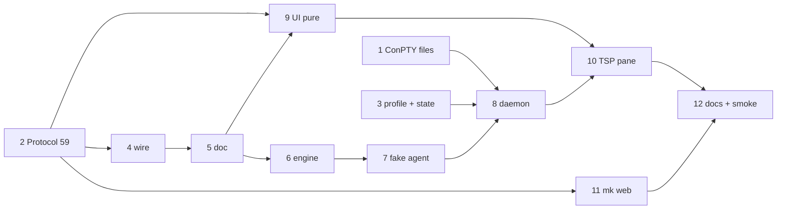

# omp native surface (TSP), part 1 - Implementation Plan

> **For agentic workers:** REQUIRED SUB-SKILL: Use superpowers:subagent-driven-development (recommended) or superpowers:executing-plans to implement this plan task-by-task. Steps use checkbox (`- [ ]`) syntax for tracking.

**Goal:** omp panes draw omp's own interface natively in Mkrew through the Tern Surface Protocol (TSP), like Tern does: omp's conversation and its dock (pills, meter, editor, model, effort, Send and Stop), with clicks sent back to omp.

**Architecture:** The daemon owns TSP for each omp session: a pure engine in `mkrew_core::tsp` splits TSP messages out of the PTY output, answers the hello before the DA1 reply, applies frames to a node document and acks them, and the daemon forwards snapshots and updates to clients over protocol 59.
The UI keeps a mirror of the document per session and draws it with Mkrew's theme in `shell/tsp_view.rs`; keys still go to the PTY through the pane's hidden terminal.
On Windows, Mkrew ships the newer `conpty.dll` and `OpenConsole.exe` (the same files Tern ships), which `portable-pty` sideloads; the system ConPTY drops TSP.

**Tech Stack:** Rust 2024 workspace; `portable-pty` 0.9; `alacritty_terminal` (vte) emulator in the daemon; tokio actor per session; GPUI for the UI; serde / serde_json; base64; Git Bash and PowerShell scripts; Inno Setup.

**Spec:** `docs/superpowers/specs/2026-11-23-omp-tsp-surface-design.md`.
Protocol reference: `docs/superpowers/specs/2026-11-23-omp-tsp/tsp-reference-omp-18.13.2.md`.
Test fixture (omp's own record of a real startup): `docs/superpowers/specs/2026-11-23-omp-tsp/omp-18.13.2-startup.tsp.jsonl`.

## Global Constraints

- Protocol version 59 (`PROTOCOL_VERSION`); `master` holds 58 and ADR 0106 (Tern layout, merged in 0a8d404), so this plan uses ADR 0107; no store migration.
- ConPTY package: NuGet `Microsoft.Windows.Console.ConPTY` 1.24.260710001, nupkg SHA-256 `175640566a3b59c4b132070ee96c2c77e5ab7edd2e92732a5eb3610bbf63d90e`.
- `runtimes/win-x64/native/conpty.dll` SHA-256 `39fba2713e2495117b1591ae8c32a3b904bea7aa66069cf7815e2844c76d75d8`; `build/native/runtimes/x64/OpenConsole.exe` SHA-256 `b7fd936c2668b87b9ecf7b3366dc6568afc1c6f981874cba3e955a1c35cf8160` (byte-identical to Tern's copies and to the spike's passing configuration).
- Profile key `tsp` (bool, optional): absent means on when `[usage] format = "omp_jsonl"`, off otherwise; every session gets `PI_TUI_NATIVE=1` when `tsp` is on, `PI_TUI_NATIVE=0` otherwise.
- Hello reply: `{"r":"hello","v":1,"term":"mkrew","kinds":<P1_KINDS>,"features":[],"apc":65536,"credits":2,"cols":<pty cols>,"dark":<bool>,"reduceMotion":false,"hour12":false}`.
- P1 kinds: `col row card section rule spacer overlay toast text md code ansi rows shimmer kv table list item tabs badge kbd icon status seg spinner elapsed progress rate meter effort editor input image checklist`; not advertised: `picker tree tool media prefs`.
- P1 events sent by the UI: `action toggle select activate focus theme`; by the daemon: `ack resize gone error`.
- Hello wait: 2 s from the session's first output, then `fallback`; document bounds 50,000 nodes and 6 MiB text (evicting the oldest `main` rows to 80%), images 4 MiB per session, so a `tsp.snapshot` fits the 16 MiB frame limit.
- UI: every color, spacing, radius and font size from `crates/mkrew-ui/src/theme.rs` (SPEC §14); dark and light; no looping animation (ADR 0086, the 500 ms status tick); omp's `t` palette is ignored.
- No `unwrap`/`expect` outside tests unless provably infallible (comment why); `thiserror` in libraries, `anyhow` in binaries, `tracing` for logs.
- No test runs a real agent or touches the network; on Windows the daemon e2e needs the Task 1 files in `target/debug`.
- Commits: Conventional Commits with `git -c user.email=tungnv975@gmail.com commit`; stage only the task's files (other agents edit this tree); never push; no em dash in any text.
- Per task: `cargo fmt --all`, `cargo clippy --workspace --all-targets -- -D warnings`, then the task's tests; after protocol or CLI changes run `cargo build -p mkrew-cli -p mkrew-fakeagent --bins -j 4` before `cargo test -p mkrew-daemon --test daemon -j 2`.
- Windows shell: Git Bash (`"C:/Program Files/Git/bin/bash.exe"`); plain `bash` in the omp shell is WSL.
- Branch: `feat/omp-tsp` from `master` 0a8d404 (after the Tern layout merge), worktree `.worktrees/omp-tsp`.

## Review Focus

1. A client attaches while omp streams: `tsp.update` frames arrive before the `tsp.snapshot` reply; the mirror must ignore updates whose `seq` is not newer than its surface and re-fetch only on a real gap (Task 9 mirror tests).
2. omp restarts in the same pane (daemon startup resume, `/resume`): it opens `s:1` again; the engine and the mirror must replace the document and reset `seq`, never merge old and new nodes (Task 6 and Task 9 tests).
3. The user clicks anywhere in a TSP pane and types: keys must reach omp through the pane's hidden terminal, including Vietnamese IME, paste and file drops (Task 10 manual check, Task 12 HUMAN_CHECKS).
4. A long answer streams as many `text append` ops per second: the UI must not re-parse unchanged Markdown nodes (cache keyed by node id, length and hash; Task 10) and must stay responsive (Task 12 smoke).
5. A dev checkout or install without the ConPTY files: the omp pane falls back to the terminal grid within 2 s with one toast, never blank, and the daemon log says which ConPTY it loaded (Task 1 log, Task 8 e2e fallback test, Task 10 toast).

## File Structure

| Path | Responsibility |
|---|---|
| `scripts/fetch-conpty.sh`, `scripts/fetch-conpty.ps1` | Download, check and place the pinned ConPTY files. |
| `scripts/verify.sh`, `scripts/verify.ps1`, `scripts/package-setup.ps1`, `packaging/mkrew.iss`, `.github/workflows/ci.yml` | Call the fetch, ship the files. |
| `crates/mkrew-daemon/src/conpty.rs` | Which ConPTY the daemon will load; one startup log line. |
| `crates/mkrew-protocol/src/message.rs` | Protocol 59: `TspState`, `TspNode`, `TspSurface`, `TspBlob`, `TspSnapshot(Params)`, `TspUpdate`, `TspChange`, `TspEventParams`, `Session.tsp`. |
| `crates/mkrew-core/src/profile.rs`, `agents/omp.toml` | Profile key `tsp`. |
| `crates/mkrew-core/src/state.rs` | `set_hook_only` for live surfaces. |
| `crates/mkrew-core/src/tsp.rs`, `tsp/wire.rs` | TSP framing: split, decode, encode. |
| `crates/mkrew-core/src/tsp/doc.rs` | Node document: ops, trees, eviction (shared by daemon and UI). |
| `crates/mkrew-core/src/tsp/engine.rs` | Per-session protocol engine: hello, acks, surfaces, timeout, events, snapshot. |
| `crates/mkrew-fakeagent/src/main.rs` | `--tsp` mode replaying the fixture for e2e tests. |
| `crates/mkrew-daemon/src/session.rs`, `src/server.rs`, `src/server/tsp.rs` | Engine in the session actor, requests `tsp.snapshot` / `tsp.event`, event `tsp.update`, `Session.tsp`. |
| `crates/mkrew-daemon/tests/daemon/tsp.rs` | End-to-end tests with the fake agent. |
| `crates/mkrew-ui/src/tsp.rs` | Pure UI model: style, tone and icon tables, ANSI runs, pane view, mirror. |
| `crates/mkrew-ui/src/shell/tsp_view.rs` | Drawing the surface, events, Shell integration. |
| `crates/mkrew-cli/web/*` | `mk web` notice for TSP panes. |
| `docs/decisions/0107-omp-native-surface.md`, `docs/SPEC.md`, `docs/HUMAN_CHECKS.md`, `docs/PROGRESS.md`, `docs/screenshots/` | Records and proof. |

## Cross-task decisions

These settle what the spec leaves open; every task follows them.

- The engine goes `Waiting -> Live` on the first `o` (a surface opened), not on the hello; the 2 s deadline stops once a supported hello was answered.
- A frame for a surface the engine does not know gets a `Warn` and is still acked (reference §3.4: omp stalls without acks and clamps spare ones).
- An `o` for a surface id that already exists replaces the document, resets `seq` to 0 and emits only `TspChange::Open`; clients replace, never merge.
- When the engine falls back inside a chunk, TSP messages still pending in that chunk are dropped and plain bytes go on; later chunks bypass the splitter.
- `Engine::event` validates and encodes only; the daemon writes the bytes to the PTY only while the engine is `Live`, so a program without TSP never receives `ESC _ tsp;e;`; a `theme` event always updates `dark` for the next hello.
- The engine keeps the fallback reason; `TspSnapshot.reason` carries it; on a `Live`/`Waiting` -> `Fallback` change the UI asks `tsp.snapshot` and toasts "omp is drawing as text: <reason>".
- An exited session has no actor: `tsp.snapshot` and `tsp.event` answer `invalid_state`; the UI keeps its own mirror and shows it read-only.
- `StateMachine::set_hook_only(true)` before any hook drops a screen guess (`working`, `idle`, `needs_input`) to `unknown`; the daemon applies that change with `StateSource::Daemon`.
- `Event::TspUpdate(Box<TspUpdate>)`; Task 2 adds its arms to the exhaustive matches in `crates/mkrew-ui/src/redraw.rs` and `crates/mkrew-ui/src/sidebar.rs`.
- `Session.tsp` is `#[serde(default)]` and always serialized, so every session JSON carries `"tsp"`.
- `tsp = true` on a shell profile is accepted; that session falls back 2 s after its first output.
- Wire: `Splitter::take_dropped()` counts dropped oversized messages (the engine warns); a chunked message keeps the params of its first chunk; `x` without `keep` reads as `keep: true`.
- Document: accepts all 43 omp kinds (not only the P1 list); `splice` offsets are UTF-16 code units; `set_limits` exists for tests; `evict` returns the `del` ops first, then the `add` of the trim row.
- `serde_json` has `preserve_order` in this workspace build, so no test compares the encoded bytes of an object with more than one key.
- Fake agent: `--tsp` replays the verbs `o t f x` of the fixture (`fixture_messages` returns `Result`); raw console input through `windows-sys` on Windows and `stty raw -echo` on Unix; it sends no DA1 query (ConPTY may answer DA1 itself), so the hello-before-DA1 order is proven by the engine tests.
- UI: `chat::available` gains a `tsp: TspState` parameter (Chat is unavailable unless `Off`); `render_tsp` takes the pane width and `sync_tsps` sizes the hidden terminal with `TerminalPane::fit_cols`; the `theme` event is sent from the status tick when the theme differs from the last one sent.
- UI selection: `md` and `code` nodes are selectable through `preview::message`; Ctrl+C copies and Esc clears only when a selection exists, otherwise both go to omp.
- `mk web`: the relay drops `tsp.update` events (the page never draws them).
- Daemon: `pub mod conpty;` (avoids `dead_code` on non-Windows clippy); the system ConPTY case logs at `info`.
- Spec 7.6 (omp `ask` card) and 7.7 (`checklist` todo) are in P1: no protocol change, `checklist` is in `P1_KINDS` and the hello (the ADR, SPEC and HUMAN_CHECKS move it from P2 to P1); the colors of the ask looks and the checklist marks are quoted from spec 7.6 and 7.7, and if Task 9 or 10 name a token differently the SPEC table follows the code.
- UI todo hud: `hud_line` returns `Option<HudLine>`; when no item is `active` or `pending` but one is `blocked`, the hud line shows the first blocked item (ring mark) instead of "All done", because "All done" next to an unfinished blocked item would be false.
- UI todo: a finished item is `done` or `dropped`; it counts in `done/total` and collapses its phase, which matches omp's `zw` predicate in `tools/todo.ts` (`completed || abandoned`).
- UI ask timeout: the `meter style=ring` draws a ring with the seconds label only; the arc for the remaining fraction is not drawn (gpui has no arc primitive used elsewhere in the crate).
- UI ask card: its fill is `theme.surface`, so the selected row (`surface_raised`) and the active tab (`card`) stay visible on it.
- UI todo popover: a `deferred(anchored())` panel above the hud chip, closed by `on_mouse_down_out` or Esc; its height is capped at 60% of the main list's height (`render_tsp` does not know the pane height), so at most 60% of the pane.

## Task order



Run the tasks in number order; each one leaves the workspace building and its tests green.

---

### Task 1: Ship the ConPTY sideload files

**Files:**
- Create: `scripts/fetch-conpty.sh`
- Create: `scripts/fetch-conpty.ps1`
- Create: `crates/mkrew-daemon/src/conpty.rs`
- Modify: `scripts/verify.sh:16-20` (between the clippy step and the test step)
- Modify: `scripts/verify.ps1:18-19` (between the clippy step and the test step)
- Modify: `scripts/package-setup.ps1:4-5` (header comment) and `:29-35` (fetch after the build, reshaped exists-check)
- Modify: `packaging/mkrew.iss:46-49` (`[Files]`)
- Modify: `.github/workflows/ci.yml:41-44` (cache step before `bash scripts/verify.sh`)
- Modify: `crates/mkrew-daemon/src/lib.rs:9-10` (module list) and `:64` (startup log)
- Test: `crates/mkrew-daemon/src/conpty.rs` (unit tests, `tempfile` is already a dev-dependency)

**Interfaces:**
- Consumes: nothing from other tasks.
- Produces:
  - `scripts/fetch-conpty.sh [--dest DIR]` and `scripts/fetch-conpty.ps1 [-Dest DIR]`: after a run, `conpty.dll` and `OpenConsole.exe` (pinned SHA-256) sit in `target/debug` and `target/release`, or only in DIR. Windows e2e tests of later tasks (fakeagent `--tsp`) rely on the files in `target/debug`.
  - `pub fn mkrew_daemon::conpty::sideloaded(exe_dir: &std::path::Path) -> bool`
  - `pub fn mkrew_daemon::conpty::log_once()`
  - Cache file shared by both scripts: `${LOCALAPPDATA:-$HOME/.cache}/mkrew/conpty/1.24.260710001.nupkg`.

Pinned values (the same in both scripts, copied from the shared contract):

| What | Value |
|---|---|
| Version | `1.24.260710001` |
| URL | `https://www.nuget.org/api/v2/package/Microsoft.Windows.Console.ConPTY/1.24.260710001` |
| nupkg SHA-256 | `175640566a3b59c4b132070ee96c2c77e5ab7edd2e92732a5eb3610bbf63d90e` |
| `runtimes/win-x64/native/conpty.dll` SHA-256 | `39fba2713e2495117b1591ae8c32a3b904bea7aa66069cf7815e2844c76d75d8` |
| `build/native/runtimes/x64/OpenConsole.exe` SHA-256 | `b7fd936c2668b87b9ecf7b3366dc6568afc1c6f981874cba3e955a1c35cf8160` |

Why this works (read before starting): `portable-pty` 0.9 tries `ConPtyFuncs::open("conpty.dll")` and falls back to `kernel32.dll` (`psuedocon.rs:55`).
Windows resolves a bare DLL name from the application directory first, so a `conpty.dll` next to `mkrew-daemon.exe` is used, and it starts `OpenConsole.exe` from its own directory.
The Rust PTY code does not change.

Windows shell note: run every command below in Git Bash (`"C:/Program Files/Git/bin/bash.exe"`); plain `bash` on this machine is WSL.
In omp's bash tool never run a program by a relative path: use `"$PWD/target/debug/mk.exe"`.

---

- [ ] **Step 1: Create `scripts/fetch-conpty.sh`**

Create the file with exactly this content (LF line endings):

```bash
#!/usr/bin/env bash
# Windows only: puts the pinned ConPTY pair (conpty.dll + OpenConsole.exe, from Microsoft's
# Microsoft.Windows.Console.ConPTY NuGet package, MIT) next to the Mkrew binaries. portable-pty
# loads a conpty.dll found next to the exe, and that newer ConPTY passes omp's TSP escape
# sequences through (ADR 0107).
# Usage: scripts/fetch-conpty.sh [--dest DIR]   (default: target/debug and target/release)
# The package is cached in ${LOCALAPPDATA:-$HOME/.cache}/mkrew/conpty; the package and both files
# are checked by SHA-256. Safe to run again. Does nothing off Windows.
set -euo pipefail

VERSION=1.24.260710001
URL="https://www.nuget.org/api/v2/package/Microsoft.Windows.Console.ConPTY/$VERSION"
NUPKG_SHA=175640566a3b59c4b132070ee96c2c77e5ab7edd2e92732a5eb3610bbf63d90e
# name|entry in the package|SHA-256 of the file
FILES=(
  "conpty.dll|runtimes/win-x64/native/conpty.dll|39fba2713e2495117b1591ae8c32a3b904bea7aa66069cf7815e2844c76d75d8"
  "OpenConsole.exe|build/native/runtimes/x64/OpenConsole.exe|b7fd936c2668b87b9ecf7b3366dc6568afc1c6f981874cba3e955a1c35cf8160"
)

case "$(uname -s)" in
  MINGW* | MSYS* | CYGWIN* | Windows_NT) ;;
  *)
    echo "fetch-conpty: not Windows, nothing to do"
    exit 0
    ;;
esac

root=$(cd "$(dirname "$0")/.." && pwd)
dests=("$root/target/debug" "$root/target/release")
case "${1:-}" in
  "") ;;
  --dest)
    [ $# -eq 2 ] || { echo "usage: fetch-conpty.sh [--dest DIR]" >&2; exit 2; }
    dests=("$2")
    ;;
  *)
    echo "usage: fetch-conpty.sh [--dest DIR]" >&2
    exit 2
    ;;
esac

sha() { sha256sum "$1" | cut -d' ' -f1; }

base=${LOCALAPPDATA:-$HOME/.cache}
if command -v cygpath >/dev/null; then base=$(cygpath -u "$base"); fi
cache="$base/mkrew/conpty"
nupkg="$cache/$VERSION.nupkg"

if [ -f "$nupkg" ] && [ "$(sha "$nupkg")" = "$NUPKG_SHA" ]; then
  echo "fetch-conpty: cache hit $nupkg"
else
  echo "fetch-conpty: downloading $URL"
  mkdir -p "$cache"
  curl -fsSL --retry 3 -o "$nupkg.part" "$URL"
  if [ "$(sha "$nupkg.part")" != "$NUPKG_SHA" ]; then
    rm -f "$nupkg.part"
    echo "fetch-conpty: the downloaded package does not match the pinned SHA-256" >&2
    exit 1
  fi
  mv -f "$nupkg.part" "$nupkg"
fi

tmp=$(mktemp -d)
trap 'rm -rf "$tmp"' EXIT
for f in "${FILES[@]}"; do
  IFS='|' read -r name entry want <<<"$f"
  unzip -p "$nupkg" "$entry" >"$tmp/$name"
  if [ "$(sha "$tmp/$name")" != "$want" ]; then
    echo "fetch-conpty: $entry in the package has an unexpected SHA-256" >&2
    exit 1
  fi
done

for d in "${dests[@]}"; do
  mkdir -p "$d"
  current=1
  for f in "${FILES[@]}"; do
    IFS='|' read -r name _ want <<<"$f"
    [ -f "$d/$name" ] && [ "$(sha "$d/$name")" = "$want" ] || current=0
  done
  if [ "$current" = 1 ]; then
    echo "fetch-conpty: $d up to date"
    continue
  fi
  for f in "${FILES[@]}"; do
    IFS='|' read -r name _ _ <<<"$f"
    cp "$tmp/$name" "$d/$name" || {
      echo "fetch-conpty: cannot write $d/$name (a daemon or session running from there keeps it open; try: mk daemon stop)" >&2
      exit 1
    }
  done
  echo "fetch-conpty: copied to $d"
done
```

- [ ] **Step 2: Create `scripts/fetch-conpty.ps1`**

Create the file with exactly this content (LF line endings, same style as `scripts/verify.ps1`):

```powershell
# Windows only: puts the pinned ConPTY pair (conpty.dll + OpenConsole.exe, from Microsoft's
# Microsoft.Windows.Console.ConPTY NuGet package, MIT) next to the Mkrew binaries. portable-pty
# loads a conpty.dll found next to the exe, and that newer ConPTY passes omp's TSP escape
# sequences through (ADR 0107).
# Usage: scripts/fetch-conpty.ps1 [-Dest DIR]   (default: target\debug and target\release)
# The package is cached in %LOCALAPPDATA%\mkrew\conpty (the same file scripts/fetch-conpty.sh
# uses); the package and both files are checked by SHA-256. Safe to run again. Does nothing off
# Windows.
param([string]$Dest)
$ErrorActionPreference = 'Stop'
$ProgressPreference = 'SilentlyContinue'
if ($env:OS -ne 'Windows_NT') { Write-Host 'fetch-conpty: not Windows, nothing to do'; exit 0 }

$version = '1.24.260710001'
$url = "https://www.nuget.org/api/v2/package/Microsoft.Windows.Console.ConPTY/$version"
$nupkgSha = '175640566a3b59c4b132070ee96c2c77e5ab7edd2e92732a5eb3610bbf63d90e'
$files = @(
  @{ Name = 'conpty.dll'; Entry = 'runtimes/win-x64/native/conpty.dll'; Sha = '39fba2713e2495117b1591ae8c32a3b904bea7aa66069cf7815e2844c76d75d8' },
  @{ Name = 'OpenConsole.exe'; Entry = 'build/native/runtimes/x64/OpenConsole.exe'; Sha = 'b7fd936c2668b87b9ecf7b3366dc6568afc1c6f981874cba3e955a1c35cf8160' }
)
function Sha($path) { (Get-FileHash -Algorithm SHA256 -LiteralPath $path).Hash.ToLower() }

$root = (Resolve-Path (Join-Path $PSScriptRoot '..')).Path
$dests = if ($Dest) { @($Dest) } else { @((Join-Path $root 'target\debug'), (Join-Path $root 'target\release')) }
$base = if ($env:LOCALAPPDATA) { $env:LOCALAPPDATA } else { Join-Path $HOME '.cache' }
$cache = Join-Path $base 'mkrew\conpty'
$nupkg = Join-Path $cache "$version.nupkg"

if ((Test-Path -LiteralPath $nupkg) -and (Sha $nupkg) -eq $nupkgSha) {
  Write-Host "fetch-conpty: cache hit $nupkg"
} else {
  Write-Host "fetch-conpty: downloading $url"
  New-Item -ItemType Directory -Force -Path $cache | Out-Null
  $part = "$nupkg.part"
  Invoke-WebRequest -Uri $url -OutFile $part -UseBasicParsing
  if ((Sha $part) -ne $nupkgSha) {
    Remove-Item -LiteralPath $part -Force
    throw 'fetch-conpty: the downloaded package does not match the pinned SHA-256'
  }
  Move-Item -LiteralPath $part -Destination $nupkg -Force
}

Add-Type -AssemblyName System.IO.Compression.FileSystem
$tmp = Join-Path ([IO.Path]::GetTempPath()) ('mkrew-conpty-' + [guid]::NewGuid())
New-Item -ItemType Directory -Path $tmp | Out-Null
try {
  $zip = [IO.Compression.ZipFile]::OpenRead($nupkg)
  try {
    foreach ($f in $files) {
      $entry = $zip.GetEntry($f.Entry)
      if (-not $entry) { throw "fetch-conpty: $($f.Entry) is not in the package" }
      $out = Join-Path $tmp $f.Name
      [IO.Compression.ZipFileExtensions]::ExtractToFile($entry, $out, $true)
      if ((Sha $out) -ne $f.Sha) { throw "fetch-conpty: $($f.Entry) in the package has an unexpected SHA-256" }
    }
  } finally { $zip.Dispose() }

  foreach ($d in $dests) {
    New-Item -ItemType Directory -Force -Path $d | Out-Null
    $d = (Resolve-Path -LiteralPath $d).Path
    $current = $true
    foreach ($f in $files) {
      $p = Join-Path $d $f.Name
      if (-not (Test-Path -LiteralPath $p) -or (Sha $p) -ne $f.Sha) { $current = $false }
    }
    if ($current) { Write-Host "fetch-conpty: $d up to date"; continue }
    foreach ($f in $files) {
      try {
        Copy-Item -LiteralPath (Join-Path $tmp $f.Name) -Destination (Join-Path $d $f.Name) -Force
      } catch {
        throw "fetch-conpty: cannot write $d\$($f.Name) (a daemon or session running from there keeps it open; try: mk daemon stop): $_"
      }
    }
    Write-Host "fetch-conpty: copied to $d"
  }
} finally {
  Remove-Item -LiteralPath $tmp -Recurse -Force -ErrorAction SilentlyContinue
}
```

- [ ] **Step 3: Hook `scripts/verify.sh` (Windows only, before cargo test)**

Current lines 16-20:

```bash
step "cargo clippy"
cargo clippy --workspace --all-targets -- -D warnings

step "cargo test"
INSTA_UPDATE=no cargo test --workspace
```

Insert the new block between line 17 and line 19, so the file reads:

```bash
step "cargo clippy"
cargo clippy --workspace --all-targets -- -D warnings

# The daemon e2e tests run on the sideloaded ConPTY (ADR 0107); the pinned download is cached.
case "$(uname -s)" in
  MINGW* | MSYS* | CYGWIN* | Windows_NT)
    step "fetch conpty"
    bash scripts/fetch-conpty.sh
    ;;
esac

step "cargo test"
INSTA_UPDATE=no cargo test --workspace
```

- [ ] **Step 4: Hook `scripts/verify.ps1`**

Current lines 17-19:

```powershell
Step 'cargo fmt --check' { cargo fmt --all -- --check }
Step 'cargo clippy'      { cargo clippy --workspace --all-targets -- -D warnings }
Step 'cargo test'        { cargo test --workspace }
```

Replace with (one line added; the script itself does nothing off Windows):

```powershell
Step 'cargo fmt --check' { cargo fmt --all -- --check }
Step 'cargo clippy'      { cargo clippy --workspace --all-targets -- -D warnings }
Step 'fetch conpty'      { & (Join-Path $PSScriptRoot 'fetch-conpty.ps1') }
Step 'cargo test'        { cargo test --workspace }
```

- [ ] **Step 5: Edit `scripts/package-setup.ps1`**

(a) Header: current lines 3-5:

```powershell
# Needs Inno Setup 6 (`winget install JRSoftware.InnoSetup --scope user`) and, for the release
# build, fxc.exe from the Windows SDK on PATH or in GPUI_FXC_PATH (gpui compiles its shaders).
# Usage: scripts/package-setup.ps1 [-NoBuild] [-BinDir DIR] [-Out DIR]
```

Insert one comment line after line 4 (so it sits before `# Usage:`):

```powershell
# conpty.dll and OpenConsole.exe (ADR 0107) are fetched from the pinned NuGet package into BinDir
# (scripts/fetch-conpty.ps1) and installed next to the daemon.
```

(b) Build and check: current lines 29-35:

```powershell
if (-not $NoBuild) {
  cargo build --release --locked -p mkrew-ui -p mkrew-cli -p mkrew-daemon
  if ($LASTEXITCODE -ne 0) { throw 'package-setup: cargo build failed' }
}
foreach ($bin in 'mkrew', 'mk', 'mkrew-daemon') {
  if (-not (Test-Path (Join-Path $BinDir "$bin.exe"))) { throw "package-setup: missing $bin.exe in $BinDir" }
}
```

Replace with (the loop now holds full file names, so the two DLL/EXE files are checked too):

```powershell
if (-not $NoBuild) {
  cargo build --release --locked -p mkrew-ui -p mkrew-cli -p mkrew-daemon
  if ($LASTEXITCODE -ne 0) { throw 'package-setup: cargo build failed' }
}
& (Join-Path $PSScriptRoot 'fetch-conpty.ps1') -Dest $BinDir
foreach ($file in 'mkrew.exe', 'mk.exe', 'mkrew-daemon.exe', 'conpty.dll', 'OpenConsole.exe') {
  if (-not (Test-Path (Join-Path $BinDir $file))) { throw "package-setup: missing $file in $BinDir" }
}
```

- [ ] **Step 6: Edit `packaging/mkrew.iss` `[Files]`**

Current lines 46-49:

```
[Files]
Source: "{#BinDir}\mkrew.exe"; DestDir: "{app}\bin"; Flags: ignoreversion
Source: "{#BinDir}\mk.exe"; DestDir: "{app}\bin"; Flags: ignoreversion
Source: "{#BinDir}\mkrew-daemon.exe"; DestDir: "{app}\bin"; Flags: ignoreversion
```

Insert after line 49 (before the `; Reference copies:` comment on line 50):

```
; Sideloaded ConPTY (ADR 0107): portable-pty loads conpty.dll from the daemon's folder, which
; starts OpenConsole.exe from its own. scripts/package-setup.ps1 fetches both into BinDir.
Source: "{#BinDir}\conpty.dll"; DestDir: "{app}\bin"; Flags: ignoreversion
Source: "{#BinDir}\OpenConsole.exe"; DestDir: "{app}\bin"; Flags: ignoreversion
```

- [ ] **Step 7: Add the nupkg cache to `.github/workflows/ci.yml`**

The `verify` job already has a Windows branch (matrix `windows-latest` and `ubuntu-latest`, `runner.os` conditions are used on line 40), so a conditional step fits.
Current lines 38-45:

```yaml
      - uses: Swatinem/rust-cache@v2
      # gpui's x11/wayland backends (mkrew-ui) link against these.
      - if: runner.os == 'Linux'
        run: sudo apt-get update && sudo apt-get install -y libxkbcommon-x11-dev libwayland-dev libx11-xcb-dev libfontconfig-dev libasound2-dev
      # Runs in Git Bash on Windows. Tests need the daemon + fakeagent bins, which
      # `cargo test --workspace` builds.
      - run: bash scripts/verify.sh
        shell: bash
```

Insert after line 41 (the `run: sudo apt-get ...` line), before the `# Runs in Git Bash` comment:

```yaml
      # verify.sh runs scripts/fetch-conpty.sh on Windows. Keep its download between runs; the
      # script checks SHA-256, so a stale cache is fetched again. Change the key with the pinned
      # version in the script.
      - if: runner.os == 'Windows'
        uses: actions/cache@v4
        with:
          path: ~/AppData/Local/mkrew/conpty
          key: conpty-1.24.260710001
```

The scripts cache into `%LOCALAPPDATA%\mkrew\conpty`, which on a runner is `C:\Users\runneradmin\AppData\Local\mkrew\conpty`, the same folder as `~/AppData/Local/mkrew/conpty`.
Do not change `.github/workflows/release.yml`: `package-setup.ps1` fetches inside the release job.

- [ ] **Step 8: Run `fetch-conpty.sh` twice and show the files in `target/debug`**

Run:

```bash
bash -n scripts/fetch-conpty.sh scripts/verify.sh
bash scripts/fetch-conpty.sh
bash scripts/fetch-conpty.sh
ls -l target/debug/conpty.dll target/debug/OpenConsole.exe target/release/conpty.dll target/release/OpenConsole.exe
sha256sum target/debug/conpty.dll target/debug/OpenConsole.exe
```

Expected:
- `bash -n` prints nothing.
- First run, cold cache: `fetch-conpty: downloading https://www.nuget.org/api/v2/package/Microsoft.Windows.Console.ConPTY/1.24.260710001`, then `fetch-conpty: copied to <repo>/target/debug` and `fetch-conpty: copied to <repo>/target/release`. If the cache already holds the package (a Tern or earlier run), the first line is `cache hit` instead; both are fine.
- Second run: `fetch-conpty: cache hit <...>/mkrew/conpty/1.24.260710001.nupkg`, then `fetch-conpty: <repo>/target/debug up to date` and `... target/release up to date`. No `downloading`, no `copied`.
- `ls` lists all four files, non-empty.
- `sha256sum` prints `39fba2713e2495117b1591ae8c32a3b904bea7aa66069cf7815e2844c76d75d8  target/debug/conpty.dll` and `b7fd936c2668b87b9ecf7b3366dc6568afc1c6f981874cba3e955a1c35cf8160  target/debug/OpenConsole.exe`.

If the second run prints `downloading` or `copied`, the idempotence check is wrong: fix the script before going on.

- [ ] **Step 9: Check the failure paths of the bash script with `--dest`**

Run (a temp dir replaces the two defaults, so `target/` is not touched):

```bash
tmp=$(mktemp -d)
bash scripts/fetch-conpty.sh --dest "$tmp"
nupkg="$(cygpath -u "${LOCALAPPDATA:-$HOME/.cache}")/mkrew/conpty/1.24.260710001.nupkg"
printf x >> "$nupkg"
bash scripts/fetch-conpty.sh --dest "$tmp"
printf x >> "$tmp/conpty.dll"
bash scripts/fetch-conpty.sh --dest "$tmp"
bash scripts/fetch-conpty.sh --bogus; echo "exit=$?"
rm -rf "$tmp"
```

Expected, in order:
1. `cache hit ...` then `copied to <tmp>`; both files exist in `<tmp>`.
2. After one extra byte is appended to the cached package: `fetch-conpty: downloading ...` (the damaged cache is not trusted, and the package is fetched again), then `<tmp> up to date`.
3. After one extra byte is appended to the copied `conpty.dll`: `cache hit ...` then `copied to <tmp>` (a changed file is replaced).
4. `usage: fetch-conpty.sh [--dest DIR]` on stderr and `exit=2`.

- [ ] **Step 10: Run the PowerShell script the same way**

Run in Git Bash (the destination is passed as a Windows path):

```bash
tmp=$(mktemp -d)
win=$(cygpath -w "$tmp")
powershell.exe -NoProfile -ExecutionPolicy Bypass -File scripts/fetch-conpty.ps1 -Dest "$win"
powershell.exe -NoProfile -ExecutionPolicy Bypass -File scripts/fetch-conpty.ps1 -Dest "$win"
powershell.exe -NoProfile -ExecutionPolicy Bypass -File scripts/fetch-conpty.ps1
sha256sum "$tmp/conpty.dll" "$tmp/OpenConsole.exe"
rm -rf "$tmp"
```

Expected:
- First run: `cache hit <...>\mkrew\conpty\1.24.260710001.nupkg` (the bash script filled the cache in Step 8) and `copied to <tmp>`.
- Second run: `cache hit ...` and `<tmp> up to date`.
- Third run (no `-Dest`): `cache hit ...`, then `<repo>\target\debug up to date` and `<repo>\target\release up to date`.
- `sha256sum` prints the same two pinned hashes as in Step 8.

- [ ] **Step 11: Commit the scripts, installer and CI change**

```bash
git add scripts/fetch-conpty.sh scripts/fetch-conpty.ps1 scripts/verify.sh scripts/verify.ps1 scripts/package-setup.ps1 packaging/mkrew.iss .github/workflows/ci.yml
git -c user.email=tungnv975@gmail.com commit -m "feat(packaging): ship the pinned ConPTY sideload files"
```

- [ ] **Step 12: Write the failing daemon test**

Create `crates/mkrew-daemon/src/conpty.rs` with the signature, a stub body, and the tests:

```rust
//! Which ConPTY the daemon's PTYs use (ADR 0107).
//!
//! `portable-pty` loads a `conpty.dll` found next to the executable and falls back to the
//! system one. omp's native surface (TSP) needs the sideloaded pair, which
//! `scripts/fetch-conpty.sh` puts next to the binaries.

use std::path::Path;

/// True when `conpty.dll` and `OpenConsole.exe` both sit in `exe_dir`.
pub fn sideloaded(_exe_dir: &Path) -> bool {
    false
}

#[cfg(test)]
mod tests {
    use super::*;
    use std::fs;

    const BOTH: [&str; 2] = ["conpty.dll", "OpenConsole.exe"];

    #[test]
    fn both_files_mean_sideloaded() {
        let dir = tempfile::tempdir().unwrap();
        for name in BOTH {
            fs::write(dir.path().join(name), b"x").unwrap();
        }
        assert!(sideloaded(dir.path()));
    }

    #[test]
    fn one_missing_file_means_system() {
        for missing in BOTH {
            let dir = tempfile::tempdir().unwrap();
            for name in BOTH.into_iter().filter(|name| *name != missing) {
                fs::write(dir.path().join(name), b"x").unwrap();
            }
            assert!(!sideloaded(dir.path()), "{missing} is missing");
        }
        let empty = tempfile::tempdir().unwrap();
        assert!(!sideloaded(empty.path()));
    }

    #[test]
    fn a_folder_with_a_file_name_does_not_count() {
        let dir = tempfile::tempdir().unwrap();
        fs::write(dir.path().join("OpenConsole.exe"), b"x").unwrap();
        fs::create_dir(dir.path().join("conpty.dll")).unwrap();
        assert!(!sideloaded(dir.path()));
    }
}
```

Register the module so the test compiles: in `crates/mkrew-daemon/src/lib.rs` the module list has (lines 8-10):

```rust
mod awake;
mod backup;
mod docs;
```

Insert one line after `mod backup;` (alphabetical order):

```rust
mod awake;
mod backup;
pub mod conpty;
mod docs;
```

- [ ] **Step 13: Run the test to verify it fails**

Run: `cargo test -p mkrew-daemon --lib conpty`
Expected: FAIL. `conpty::tests::both_files_mean_sideloaded` panics with `assertion failed: sideloaded(dir.path())`; the other two tests pass for now because the stub returns `false`.

- [ ] **Step 14: Write the implementation**

In `crates/mkrew-daemon/src/conpty.rs` replace the stub (the `sideloaded` function between `use std::path::Path;` and `#[cfg(test)]`) with:

```rust
/// The pair `portable-pty` needs next to the executable for a sideloaded ConPTY.
const FILES: [&str; 2] = ["conpty.dll", "OpenConsole.exe"];

/// True when `conpty.dll` and `OpenConsole.exe` both sit in `exe_dir`.
pub fn sideloaded(exe_dir: &Path) -> bool {
    FILES.iter().all(|name| exe_dir.join(name).is_file())
}

/// Logs once, at startup, which ConPTY the session PTYs will use. Nothing off Windows.
pub fn log_once() {
    #[cfg(windows)]
    {
        let found = std::env::current_exe()
            .ok()
            .and_then(|exe| exe.parent().map(sideloaded))
            .unwrap_or(false);
        if found {
            tracing::info!(conpty = "sideloaded", "conpty.dll and OpenConsole.exe found next to the daemon");
        } else {
            tracing::info!(
                conpty = "system",
                "conpty.dll and OpenConsole.exe are not both next to the daemon, so omp's native surface cannot start; run scripts/fetch-conpty.sh (scripts/fetch-conpty.ps1 on PowerShell)"
            );
        }
    }
}
```

- [ ] **Step 15: Run the test to verify it passes**

Run: `cargo test -p mkrew-daemon --lib conpty`
Expected: PASS, 3 tests (`both_files_mean_sideloaded`, `one_missing_file_means_system`, `a_folder_with_a_file_name_does_not_count`).

- [ ] **Step 16: Call `log_once` right after the `daemon starting` log**

`crates/mkrew-daemon/src/lib.rs` current lines 63-65:

```rust
    let _lock = InstanceLock::acquire(&paths.lock_file())?;
    tracing::info!(pid = std::process::id(), data_dir = %paths.data_dir.display(), "daemon starting");
    serve(paths).map_err(RunError::Other)
```

Replace with:

```rust
    let _lock = InstanceLock::acquire(&paths.lock_file())?;
    tracing::info!(pid = std::process::id(), data_dir = %paths.data_dir.display(), "daemon starting");
    conpty::log_once();
    serve(paths).map_err(RunError::Other)
```

Then run:

```bash
cargo fmt --all
cargo clippy -p mkrew-daemon --all-targets -- -D warnings
cargo test -p mkrew-daemon --lib conpty
```

Expected: fmt rewraps the long `tracing::info!` lines if needed (accept its output); clippy has no warnings; the 3 tests pass.

- [ ] **Step 17: Commit the daemon change**

```bash
git add crates/mkrew-daemon/src/conpty.rs crates/mkrew-daemon/src/lib.rs
git -c user.email=tungnv975@gmail.com commit -m "feat(daemon): log which ConPTY the session PTYs use"
```

- [ ] **Step 18: Run the existing daemon e2e suite on the new ConPTY**

Step 8 left the pair in `target/debug`, so the e2e daemon (`target/debug/mkrew-daemon.exe`) now loads the sideloaded ConPTY.
Run (order matters: the CLI and fake agent binaries first, `-j` keeps the C: disk and CPU calm):

```bash
cargo build -p mkrew-cli -p mkrew-fakeagent --bins -j 4
cargo test -p mkrew-daemon --test daemon -j 2
```

Expected: PASS for every existing test, same count as before this task.
If a test fails only with the files present, check it by moving the pair away (`mkdir -p target/off && mv target/debug/conpty.dll target/debug/OpenConsole.exe target/off/`), re-running that test, and restoring them (`mv target/off/* target/debug/`).
A test that passes without the pair and fails with it is a real regression of the newer OpenConsole: STOP, report the test name and its output to Main, and do not change the test.

- [ ] **Step 19: Manual regression on the new ConPTY (a person at the desktop)**

This step cannot be scripted.
The subagent runs 19.1 and 19.2 and hands the rest to anh with this list.
TSP is not on yet in this task (no `PI_TUI_NATIVE` change), so the only difference from before is the ConPTY pair.
For every check, an observed difference from the baseline is a finding.
Baseline = the same action with the system ConPTY: stop the daemon, move the pair out of `target/debug` (`mkdir -p target/off && mv target/debug/conpty.dll target/debug/OpenConsole.exe target/off/`), start the app, repeat the action, then move the pair back.

Do not edit `docs/HUMAN_CHECKS.md` here; list findings in the task report (the docs task owns that file).

**19.1 Build and start on the new ConPTY**

```bash
cargo build -p mkrew-ui -p mkrew-cli -p mkrew-daemon -j 4
bash scripts/fetch-conpty.sh
"$PWD/target/debug/mk.exe" daemon stop
"$PWD/target/debug/mkrew.exe" &
```

Observe: `fetch-conpty` prints `up to date` for both folders, the app opens and a shell pane draws its prompt within 2 s.

**19.2 The startup log names the ConPTY**

```bash
grep -h "conpty=" "$APPDATA"/mkrew/logs/daemon.*.log | tail -n 1
```

Observe: the last line contains `INFO` and `conpty="sideloaded"`.
Then stop the daemon, move the pair to `target/off` as in the baseline note, start the app, run the same `grep`: the last line contains `conpty="system"` and the text `run scripts/fetch-conpty.sh`.
Move the pair back and restart; the last line is `conpty="sideloaded"` again.
Each start writes exactly one such line (a restart adds one, nothing repeats while the daemon runs).

**19.3 Panes to cover:** a PowerShell shell pane, a Claude pane (`claude`) and a Codex pane (`codex`), each opened from the app (not from an outside terminal).
Run 19.4 to 19.9 in each of the three.

**19.4 Typing**
- Type `echo hello world`, Enter: the text appears as typed, with no lost or doubled letters, and the command output follows.
- Backspace removes one character; Left and Right move the cursor; Up recalls the previous line (shell) or the previous prompt (Claude, Codex).
- Ctrl+C: a running `Start-Sleep 30` stops in the shell; in Claude and Codex it cancels the current input or turn.
- Esc in Claude and Codex behaves as before (clears the input or interrupts).

**19.5 Resize**
- Drag the window edge narrower, then wider; then split the pane (Alt+Shift+=) and close the split.
- Observe: within about 1 s the content reflows to the new width, with no stale duplicated lines, no cursor left in the middle of the screen, and no blank pane.
- Shell only: run `[Console]::WindowWidth` before and after the resize; the number follows the pane width (it changes, and matches the new column count).
- Claude and Codex: their boxes and status lines redraw at the new width.

**19.6 Vietnamese IME**
- With Unikey (Telex) and then with Windows "Vietnamese Telex", type `Tieengs Vieetj cos daaus` in each pane's input.
- Observe: the line reads exactly `Tiếng Việt có dấu`, with no lost, doubled or leftover raw letters, and Enter submits the same text (shell: `echo Tiếng Việt có dấu` prints it back with all diacritics).

**19.7 Paste**
- Copy three lines of text (`one`, `two`, `three`), focus the pane, press Ctrl+Shift+V.
- Shell: the three lines arrive in the same form as in the baseline (PSReadLine shows them as a multi-line edit and does not run them early, or runs them one by one, but identical to the baseline).
- Claude and Codex: the text arrives as ONE message with its line breaks and is not submitted before you press Enter.
- Paste about 5 000 characters: it arrives complete (check the last words) and the pane stays responsive.
- Compare with the baseline; HUMAN_CHECKS T6.6 recorded that a ConPTY without mode 2004 glues the lines of a typed multi-line text, so note whether the newer OpenConsole changes that.

**19.8 Exit**
- Shell: `exit`. Claude: `/exit`. Codex: `/quit` (or Ctrl+C twice if it does not know it).
- Observe: the pane shows the exited state within 5 s (the daemon's kill grace), the final screen text stays visible, and the exit code shows as before.
- Run `tasklist /FI "IMAGENAME eq OpenConsole.exe"`: no `OpenConsole.exe` stays behind for a session that has exited; the count equals the number of live panes (the baseline starts `conhost.exe` instead).
- Close a running pane with Ctrl+Shift+Q: the same, and the child process is gone from `tasklist`.

**19.9 Startup resume**
- With a Claude pane and a Codex pane each holding a short conversation, run `"$PWD/target/debug/mk.exe" daemon stop`, then start `target/debug/mkrew.exe` again.
- Observe: the Claude and Codex panes resume as they did before this task (same session, earlier text available), each draws its screen within about 5 s, accepts typing, and the shell pane is as it was before this task.
- Run `grep -h -E " (WARN|ERROR) " "$APPDATA"/mkrew/logs/daemon.*.log | tail -n 5`: no new line about a PTY, ConPTY or spawn failure appears after the restart.
- No pane shows a blank screen or a process error such as `0xC0000142`.

Pass = every item behaves the same as the baseline.
If any item differs, report it to Main with the pane, the item, what was seen and what the baseline did, and do not remove the sideload files from the plan: Main decides.

### Task 2: Protocol 59 TSP types

**Files:**
- Modify: `crates/mkrew-protocol/src/message.rs:337` (new `Request` variants after `LimitsReport`), `:478` (new `Event` variant after `AgentLimits`), `:628` (`Session.tsp` after `plan_path`), `:1988` (new type block after `struct DocChangedEvent`, before `mod base64_bytes`)
- Modify: `crates/mkrew-protocol/src/lib.rs:16` (`PROTOCOL_VERSION`)
- Modify: `crates/mkrew-protocol/src/message/tests.rs:346` (request list), `:898-919` (Session literal), `:935` (session.updated assertions), `:1394-1397` (version test), end of file (new tests)
- Modify (add `tsp: mkrew_protocol::TspState::Off,` to every `Session { .. }` literal, current lines from `grep -rn "terminal_title: None," crates --include=*.rs`):
  - `crates/mkrew-core/src/run.rs:367`
  - `crates/mkrew-daemon/src/awake.rs:389`
  - `crates/mkrew-daemon/src/notify.rs:392`
  - `crates/mkrew-daemon/src/retention.rs:145`
  - `crates/mkrew-daemon/src/server/resume.rs:304`
  - `crates/mkrew-daemon/src/server.rs:905`
  - `crates/mkrew-daemon/src/turns.rs:300`
  - `crates/mkrew-daemon/tests/daemon/basics.rs:146`
  - `crates/mkrew-daemon/tests/daemon/turns.rs:158`
  - `crates/mkrew-store/src/lib.rs:1673`
  - `crates/mkrew-store/src/tests.rs:17`
  - `crates/mkrew-ui/src/attention.rs:229`
  - `crates/mkrew-ui/src/board/tests.rs:49`
  - `crates/mkrew-ui/src/broadcast.rs:265`
  - `crates/mkrew-ui/src/conflicts.rs:178`
  - `crates/mkrew-ui/src/doc_dialog.rs:332`
  - `crates/mkrew-ui/src/fanout.rs:408`
  - `crates/mkrew-ui/src/git_view/tests.rs:1403`
  - `crates/mkrew-ui/src/history.rs:198`
  - `crates/mkrew-ui/src/inbox.rs:351`
  - `crates/mkrew-ui/src/inspector.rs:245`
  - `crates/mkrew-ui/src/lifecycle.rs:253`
  - `crates/mkrew-ui/src/machine_notify.rs:133`
  - `crates/mkrew-ui/src/palette/tests.rs:192`
  - `crates/mkrew-ui/src/plan.rs:181`
  - `crates/mkrew-ui/src/redraw.rs:169`
  - `crates/mkrew-ui/src/run.rs:336`
  - `crates/mkrew-ui/src/sidebar/tests.rs:47`
  - `crates/mkrew-ui/src/status.rs:191`
  - `crates/mkrew-ui/src/tabs/tests.rs:639`
  - `crates/mkrew-ui/src/turns_dialog.rs:201`
  - `crates/mkrew-ui/src/undo_dialog.rs:334`
  - `crates/mkrew-ui/src/usage.rs:218`
  - `crates/mkrew-ui/src/worktree_dialog.rs:488`
- Modify: `crates/mkrew-ui/src/redraw.rs:72` (new event arm), `:546` (new test goes after the test ending there); `crates/mkrew-ui/src/sidebar.rs:671` (new event arm)
- Test: `crates/mkrew-protocol/src/message/tests.rs`, `crates/mkrew-ui/src/redraw.rs`

The list above is the output of the grep today.
The compiler is the authority: Step 5 tells the engineer to let `cargo check` name every literal and fix whatever it names, which also catches any literal added by another branch since.
Literals written with `..other` (for example `Session { kind: SessionKind::Shell, ..session(..) }` in `attention.rs`, `inbox.rs`, `palette/tests.rs`, `sidebar/tests.rs`, `run.rs`) need no change.

**Interfaces:**
- Consumes: the private `base64_bytes` module (`message.rs:1989`), `Ulid`, `serde_json`, all already imported in `message.rs`.
- Produces (exact, from the contract; all reachable as `mkrew_protocol::*` because `lib.rs:13` has `pub use message::*;`, so no re-export edit is needed): `TspState`, `TspNode`, `TspSurface`, `TspBlob`, `TspSnapshotParams`, `TspSnapshot`, `TspChange`, `TspUpdate`, `TspEventParams`, `Request::TspSnapshot`, `Request::TspEvent`, `Event::TspUpdate(Box<TspUpdate>)` (boxed: `TspChange::Open` holds a whole surface; daemon and UI construct `Event::TspUpdate(Box::new(TspUpdate { .. }))`), `Session.tsp: TspState`, `PROTOCOL_VERSION == 59`.
- `serde_json::Map<String, Value>` implements `PartialEq` (not `Eq`), so `TspNode`, `TspSurface`, `TspSnapshot`, `TspChange`, `TspUpdate` and `TspEventParams` derive `PartialEq` only; `Request` and `Event` already derive only `PartialEq` (`message.rs:45`, `:405`), so nothing else changes.
  `TspBlob`, `TspSnapshotParams` and `TspState` hold no JSON value and derive `Eq`.
  `Session` already derives only `PartialEq` (it has an `f64`).

- [ ] **Step 1: Write the failing tests (protocol crate)**

(a) In `crates/mkrew-protocol/src/message/tests.rs`, add two requests to the every-request list right after `Request::LimitsReport(limits()),` (line 346):
```rust
        Request::LimitsReport(limits()),
        Request::TspSnapshot(TspSnapshotParams { session_id: sid() }),
        Request::TspEvent(TspEventParams {
            session_id: sid(),
            surface: "s:1".into(),
            event: json!({"ev": "action", "sf": "s:1", "id": "dock.bar.stop", "act": "interrupt"}),
        }),
```

(b) In the `session.updated` test, the literal at lines 898-919 gets `tsp: TspState::Live,` after `plan_path: None,` (line 918):
```rust
        position: 2.5,
        plan_path: None,
        tsp: TspState::Live,
    }))));
```
Then add these assertions after `assert!(updated["data"].get("plan_path").is_none());` (line 935):
```rust
    assert!(updated["data"].get("plan_path").is_none());
    assert_eq!(updated["data"]["tsp"], "live");
    // Session JSON from before protocol 59 has no `tsp`: it reads as off.
    let mut older = updated["data"].clone();
    older.as_object_mut().unwrap().remove("tsp");
    assert_eq!(
        serde_json::from_value::<Session>(older).unwrap().tsp,
        TspState::Off
    );
```

(c) Rename and renumber the version test (lines 1394-1397; today `the_tern_layout_protocol_is_version_58` asserting 58):
```rust
#[test]
fn the_omp_surface_protocol_is_version_59() {
    assert_eq!(crate::PROTOCOL_VERSION, 59);
}
```

(d) Append at the end of the file (after the last test, `the_transcript_reply_carries_an_optional_recap`, line 1426):
```rust
fn tsp_surface(seq: u64) -> TspSurface {
    TspSurface {
        id: "s:1".into(),
        mode: "inline".into(),
        role: None,
        title: None,
        read_only: false,
        seq,
        root: TspNode {
            id: "s:1".into(),
            k: "col".into(),
            p: serde_json::Map::new(),
            c: vec![],
        },
    }
}

/// The JSON `data` of a `tsp.update` carrying `change`, after a round trip.
fn tsp_update_data(change: TspChange) -> serde_json::Value {
    let value = round_trip(&Message::Event(Event::TspUpdate(Box::new(TspUpdate {
        session_id: sid(),
        surface: "s:1".into(),
        change,
    }))));
    assert_eq!(value["type"], "event");
    assert_eq!(value["event"], "tsp.update");
    value["data"].clone()
}

#[test]
fn tsp_update_wire_shape_per_change_kind() {
    // frame: `blobs` is left out when empty, `ops` stay raw JSON arrays.
    assert_eq!(
        tsp_update_data(TspChange::Frame {
            seq: 4,
            ops: vec![json!(["text", "t1", "append", "hi"]), json!(["del", "t0"])],
            blobs: vec![],
        }),
        json!({
            "session_id": sid(),
            "surface": "s:1",
            "change": {
                "kind": "frame",
                "seq": 4,
                "ops": [["text", "t1", "append", "hi"], ["del", "t0"]]
            }
        })
    );
    // frame with an image the frame needs: bytes travel as base64.
    let with_blob = tsp_update_data(TspChange::Frame {
        seq: 5,
        ops: vec![],
        blobs: vec![TspBlob {
            id: "b1".into(),
            mime: "image/png".into(),
            data: vec![0x89, 0x50],
        }],
    });
    assert_eq!(
        with_blob["change"]["blobs"],
        json!([{"id": "b1", "mime": "image/png", "data": "iVA="}])
    );
    // open: absent role and title are left out, `read_only` is always there.
    assert_eq!(
        tsp_update_data(TspChange::Open {
            surface: tsp_surface(0)
        })["change"],
        json!({
            "kind": "open",
            "surface": {
                "id": "s:1", "mode": "inline", "read_only": false, "seq": 0,
                "root": {"id": "s:1", "k": "col"}
            }
        })
    );
    let titled = TspSurface {
        role: Some("agents".into()),
        title: Some("Agent Hub".into()),
        read_only: true,
        mode: "screen".into(),
        ..tsp_surface(3)
    };
    let open = tsp_update_data(TspChange::Open { surface: titled });
    assert_eq!(open["change"]["surface"]["role"], "agents");
    assert_eq!(open["change"]["surface"]["title"], "Agent Hub");
    assert_eq!(open["change"]["surface"]["read_only"], true);
    // closed.
    assert_eq!(
        tsp_update_data(TspChange::Closed { keep: true })["change"],
        json!({"kind": "closed", "keep": true})
    );
    assert_eq!(
        tsp_update_data(TspChange::Closed { keep: false })["change"],
        json!({"kind": "closed", "keep": false})
    );
}

#[test]
fn a_tsp_node_leaves_out_empty_props_and_children() {
    let mut props = serde_json::Map::new();
    props.insert("text".into(), json!("hi"));
    let tree = TspNode {
        id: "main".into(),
        k: "col".into(),
        p: serde_json::Map::new(),
        c: vec![TspNode {
            id: "t1".into(),
            k: "text".into(),
            p: props,
            c: vec![],
        }],
    };
    let value = serde_json::to_value(&tree).unwrap();
    assert_eq!(
        value,
        json!({"id": "main", "k": "col", "c": [{"id": "t1", "k": "text", "p": {"text": "hi"}}]})
    );
    assert_eq!(serde_json::from_value::<TspNode>(value).unwrap(), tree);
    // omp sends bare nodes too.
    let bare: TspNode = serde_json::from_value(json!({"id": "sp", "k": "spacer"})).unwrap();
    assert!(bare.p.is_empty() && bare.c.is_empty());
}

#[test]
fn tsp_requests_and_snapshot_reply_wire_shapes() {
    let snapshot = round_trip(&Message::Request {
        id: 1,
        request: Request::TspSnapshot(TspSnapshotParams { session_id: sid() }),
    });
    assert_eq!(snapshot["method"], "tsp.snapshot");
    assert_eq!(snapshot["params"], json!({"session_id": sid()}));
    let event = round_trip(&Message::Request {
        id: 2,
        request: Request::TspEvent(TspEventParams {
            session_id: sid(),
            surface: "s:1".into(),
            event: json!({"ev": "theme", "dark": false}),
        }),
    });
    assert_eq!(event["method"], "tsp.event");
    assert_eq!(event["params"]["surface"], "s:1");
    assert_eq!(event["params"]["event"], json!({"ev": "theme", "dark": false}));

    // A reply with no `blobs` key decodes (nothing inline to send).
    let none: TspSnapshot = serde_json::from_value(json!({"state": "waiting", "surfaces": []}))
        .unwrap();
    assert_eq!(
        none,
        TspSnapshot {
            state: TspState::Waiting,
            surfaces: vec![],
            blobs: vec![],
            reason: None,
        }
    );
    let full = TspSnapshot {
        state: TspState::Live,
        surfaces: vec![tsp_surface(9)],
        blobs: vec![TspBlob {
            id: "b1".into(),
            mime: "image/png".into(),
            data: vec![0x89, 0x50],
        }],
        reason: None,
    };
    let value = serde_json::to_value(&full).unwrap();
    assert_eq!(value["state"], "live");
    assert_eq!(value["surfaces"][0]["seq"], 9);
    assert_eq!(value["blobs"][0]["data"], "iVA=");
    assert_eq!(serde_json::from_value::<TspSnapshot>(value.clone()).unwrap(), full);
    assert!(value.get("reason").is_none(), "no reason key unless the session fell back");

    // A fallen-back session tells the UI why (spec 7.3 toast).
    let fell_back: TspSnapshot = serde_json::from_value(json!({
        "state": "fallback", "surfaces": [], "reason": "no TSP reply from the terminal layer"
    }))
    .unwrap();
    assert_eq!(fell_back.reason.as_deref(), Some("no TSP reply from the terminal layer"));
}

#[test]
fn tsp_state_names_are_snake_case_and_off_is_the_default() {
    for (state, name) in [
        (TspState::Off, "off"),
        (TspState::Waiting, "waiting"),
        (TspState::Live, "live"),
        (TspState::Fallback, "fallback"),
    ] {
        assert_eq!(serde_json::to_value(state).unwrap(), json!(name));
        assert_eq!(serde_json::from_value::<TspState>(json!(name)).unwrap(), state);
    }
    assert_eq!(TspState::default(), TspState::Off);
}
```

(e) In `crates/mkrew-ui/src/redraw.rs`, add this test before the closing `}` of `mod tests` (after `limits_always_redraw_the_main_window`, which ends at line 546):
```rust
    /// A surface change repaints only a pane that is on screen (spec 2026-11-23 section 6.4).
    #[test]
    fn tsp_updates_redraw_only_a_shown_pane() {
        let w = world();
        let s = terminals(&w);
        let update = |id| {
            Event::TspUpdate(Box::new(mkrew_protocol::TspUpdate {
                session_id: id,
                surface: "s:1".into(),
                change: mkrew_protocol::TspChange::Closed { keep: true },
            }))
        };
        assert!(redraws(&w, &s, &update(w.a())));
        assert!(!redraws(&w, &s, &update(w.b())), "hidden tab");
        assert!(!redraws(&w, &s, &update(w.c())), "other workspace");
    }
```

- [ ] **Step 2: Run the protocol tests to verify they fail**

Run: `cargo test -p mkrew-protocol`
Expected: FAIL to compile with "cannot find type `TspState` in this scope" (and the same for `TspSurface`, `TspNode`, `TspUpdate`, `Request::TspSnapshot`, `Event::TspUpdate`).

- [ ] **Step 3: Write the protocol implementation**

(a) `crates/mkrew-protocol/src/lib.rs:15-16`, replace
```rust
/// Bumped on any incompatible change; `hello` with another value gets `version_mismatch`.
pub const PROTOCOL_VERSION: u32 = 58;
```
with
```rust
/// Bumped on any incompatible change; `hello` with another value gets `version_mismatch`.
pub const PROTOCOL_VERSION: u32 = 59;
```

(b) `crates/mkrew-protocol/src/message.rs`, after `LimitsReport(AgentLimits),` (line 337) and before the closing `}` of `Request` (line 338):
```rust
    #[serde(rename = "limits.report")]
    LimitsReport(AgentLimits),
    /// Returns [`TspSnapshot`]: the native surfaces of an omp pane, each with the last frame
    /// `seq` the daemon applied, and the images they need (spec 2026-11-23 section 6.4).
    /// A session without TSP answers state `off` and no surfaces.
    #[serde(rename = "tsp.snapshot")]
    TspSnapshot(TspSnapshotParams),
    /// Returns nothing (`null`): one event from a UI to omp, written to the PTY input after
    /// the daemon checked its `ev` against the P1 list (spec 2026-11-23 sections 6.4 and 7.4).
    #[serde(rename = "tsp.event")]
    TspEvent(TspEventParams),
}
```

(c) After `AgentLimits(AgentLimits),` (line 478) and before the closing `}` of `Event` (line 479):
```rust
    #[serde(rename = "agent.limits")]
    AgentLimits(AgentLimits),
    /// The native surface of an omp pane changed (spec 2026-11-23 section 6.4): a client
    /// applies it in order and asks `tsp.snapshot` again when `seq` skips a number.
    #[serde(rename = "tsp.update")]
    TspUpdate(Box<TspUpdate>),
}
```

(d) `Session` (after `plan_path`, line 628):
```rust
    #[serde(default, skip_serializing_if = "Option::is_none")]
    pub plan_path: Option<String>,
    /// How the pane draws an omp session (spec 2026-11-23 section 6.4); daemon memory only,
    /// filled in `session.list` / `session.updated`, `off` for every other session and for
    /// JSON written before protocol 59.
    #[serde(default)]
    pub tsp: TspState,
}
```

(e) After `struct DocChangedEvent { .. }` (ends line 1987) and before `mod base64_bytes` (line 1989), insert this block (a blank line before and after; `MachineStats` no longer exists):
```rust
// ---- omp native surface, TSP (spec 2026-11-23 section 6.4) ----

/// Where an omp session stands with the Tern Surface Protocol (spec 2026-11-23 sections 5
/// and 7.3).
#[derive(Debug, Clone, Copy, Default, PartialEq, Eq, Serialize, Deserialize)]
#[serde(rename_all = "snake_case")]
pub enum TspState {
    /// TSP is not on for this session (profile key `tsp`, a shell, Claude Code): a terminal.
    #[default]
    Off,
    /// TSP is on, no surface yet: the agent has not said hello, or has not opened one.
    Waiting,
    /// A surface is open: the pane draws it instead of the terminal grid.
    Live,
    /// No hello within 2 s of the first output, or the agent went back to drawing rows.
    Fallback,
}

/// One node of a surface as omp sends it: `{id, k, p?, c?}` (reference section 3.1).
/// `p` holds the node's props, `c` its children in order; both are left out when empty.
#[derive(Debug, Clone, PartialEq, Serialize, Deserialize)]
pub struct TspNode {
    pub id: String,
    /// The node kind, for example `col`, `text`, `editor`.
    pub k: String,
    #[serde(default, skip_serializing_if = "serde_json::Map::is_empty")]
    pub p: serde_json::Map<String, serde_json::Value>,
    #[serde(default, skip_serializing_if = "Vec::is_empty")]
    pub c: Vec<TspNode>,
}

/// An open surface: its meta and the whole tree under `root`.
#[derive(Debug, Clone, PartialEq, Serialize, Deserialize)]
pub struct TspSurface {
    /// `s:1` for the inline surface.
    pub id: String,
    /// `inline` or `screen`.
    pub mode: String,
    #[serde(default, skip_serializing_if = "Option::is_none")]
    pub role: Option<String>,
    #[serde(default, skip_serializing_if = "Option::is_none")]
    pub title: Option<String>,
    /// Kept after omp closed it with `x {keep:true}`: drawn, not clickable.
    #[serde(default)]
    pub read_only: bool,
    /// The last frame `s` the daemon applied; 0 before any.
    pub seq: u64,
    /// The surface root `col`, with the children `main`, `dock` and `layer`.
    pub root: TspNode,
}

/// An inline image omp sent (`b` message), keyed by the id a node's props name.
#[derive(Debug, Clone, PartialEq, Eq, Serialize, Deserialize)]
pub struct TspBlob {
    pub id: String,
    pub mime: String,
    #[serde(with = "base64_bytes")]
    pub data: Vec<u8>,
}

/// `tsp.snapshot` request.
#[derive(Debug, Clone, PartialEq, Eq, Serialize, Deserialize)]
pub struct TspSnapshotParams {
    pub session_id: Ulid,
}

/// `tsp.snapshot` result.
#[derive(Debug, Clone, PartialEq, Serialize, Deserialize)]
pub struct TspSnapshot {
    pub state: TspState,
    /// Empty when no surface is open.
    pub surfaces: Vec<TspSurface>,
    #[serde(default)]
    pub blobs: Vec<TspBlob>,
    /// Why the session fell back to the terminal grid (spec 7.3 toast); `None` otherwise.
    #[serde(default, skip_serializing_if = "Option::is_none")]
    pub reason: Option<String>,
}

/// What changed on one surface (`tsp.update`).
#[derive(Debug, Clone, PartialEq, Serialize, Deserialize)]
#[serde(tag = "kind", rename_all = "snake_case")]
pub enum TspChange {
    /// A frame the daemon applied: `seq` is omp's frame `s`; `ops` are the frame's ops that
    /// applied plus the daemon's own eviction ops; `blobs` the images this frame needs.
    Frame {
        seq: u64,
        ops: Vec<serde_json::Value>,
        #[serde(default, skip_serializing_if = "Vec::is_empty")]
        blobs: Vec<TspBlob>,
    },
    /// omp opened a surface.
    Open { surface: TspSurface },
    /// omp closed the surface; `keep` leaves its last document, read-only.
    Closed { keep: bool },
}

/// `tsp.update` event data.
#[derive(Debug, Clone, PartialEq, Serialize, Deserialize)]
pub struct TspUpdate {
    pub session_id: Ulid,
    /// The surface id, `s:1` for the inline one.
    pub surface: String,
    pub change: TspChange,
}

/// `tsp.event` request: `event` is the JSON body without `sf` (the daemon adds the surface id),
/// for example `{"ev": "action", "id": "dock.bar.stop", "act": "interrupt"}`.
#[derive(Debug, Clone, PartialEq, Serialize, Deserialize)]
pub struct TspEventParams {
    pub session_id: Ulid,
    pub surface: String,
    pub event: serde_json::Value,
}
```

- [ ] **Step 4: Run the protocol tests to verify they pass**

Run: `cargo test -p mkrew-protocol`
Expected: PASS, including `tsp_update_wire_shape_per_change_kind`, `a_tsp_node_leaves_out_empty_props_and_children`, `tsp_requests_and_snapshot_reply_wire_shapes`, `tsp_state_names_are_snake_case_and_off_is_the_default`, `the_omp_surface_protocol_is_version_59`, the every-request round trip and the `session.updated` test.
(If the crate fails to build in tests only, check that the literal at `tests.rs:898` has `tsp: TspState::Live`.)

- [ ] **Step 5: Fix every `Session { .. }` literal and the two exhaustive `Event` matches**

Run: `cargo check --workspace --all-targets -j 4`
Expected: errors "missing field `tsp` in initializer of `Session`" and "non-exhaustive patterns: `&Event::TspUpdate(_)` not covered".
Let the compiler list every literal; add `tsp: mkrew_protocol::TspState::Off,` as the last field of each (the full path needs no new `use`).
The grep list in **Files** is what the compiler should name today; trust the compiler over the list.
Example, `crates/mkrew-ui/src/redraw.rs:181-183`:
```rust
            position: 0.0,
            plan_path: None,
            tsp: mkrew_protocol::TspState::Off,
        }
```
In `crates/mkrew-protocol/src/message/tests.rs` no other literal exists (the one at `:898` was done in Step 1).
In `crates/mkrew-daemon/src/server.rs:918` (the live session built in `start_session`) the line after `plan_path: start.plan_path,` also gets `tsp: mkrew_protocol::TspState::Off,`; the daemon task replaces it with the real value later.

Exhaustive matches.
`crates/mkrew-ui/src/redraw.rs`, after `Event::SessionQueue(e) => on_pane(e.session_id),` (line 72):
```rust
        Event::SessionQueue(e) => on_pane(e.session_id),
        // The native surface of an omp pane (spec 2026-11-23 section 6.4).
        Event::TspUpdate(e) => on_pane(e.session_id),
```
`crates/mkrew-ui/src/sidebar.rs`, in the `Change::None` arm (lines 671-672; `MachineStats` is gone, the arm now ends `| Event::AgentLimits(_) | Event::ProjectCloned(_) => Change::None`):
```rust
            | Event::AgentLimits(_)
            | Event::TspUpdate(_)
            | Event::ProjectCloned(_) => Change::None,
```
(The sidebar shows `Session.tsp` through `session.updated`, not through surface frames.)

- [ ] **Step 6: Run the workspace checks**

Run: `cargo fmt --all`
Run: `cargo clippy --workspace --all-targets -- -D warnings`
Expected: no warnings (`Event::TspUpdate` is boxed, so `large_enum_variant` does not fire).
Run: `cargo test -p mkrew-protocol`
Run: `cargo test -p mkrew-ui redraw`
Run: `cargo test -p mkrew-ui sidebar`
Run: `cargo test -p mkrew-store`
Expected: PASS (`tsp_updates_redraw_only_a_shown_pane` included).
Then build the binaries the daemon tests start, per the global rule, and run the existing daemon suite once to prove nothing else changed:
Run: `cargo build -p mkrew-cli -p mkrew-fakeagent --bins -j 4`
Run: `cargo test -p mkrew-daemon --test daemon -j 2`
Expected: PASS (`PROTOCOL_VERSION` is read by the tests from the constant, so the bump needs no edit there).

- [ ] **Step 7: Commit**
```bash
git add crates/mkrew-protocol crates/mkrew-core/src/run.rs \
  crates/mkrew-daemon/src/awake.rs crates/mkrew-daemon/src/notify.rs crates/mkrew-daemon/src/retention.rs \
  crates/mkrew-daemon/src/server/resume.rs crates/mkrew-daemon/src/server.rs crates/mkrew-daemon/src/turns.rs \
  crates/mkrew-daemon/tests/daemon/basics.rs crates/mkrew-daemon/tests/daemon/turns.rs \
  crates/mkrew-store/src/lib.rs crates/mkrew-store/src/tests.rs \
  crates/mkrew-ui/src/attention.rs crates/mkrew-ui/src/board/tests.rs crates/mkrew-ui/src/broadcast.rs \
  crates/mkrew-ui/src/conflicts.rs crates/mkrew-ui/src/doc_dialog.rs crates/mkrew-ui/src/fanout.rs \
  crates/mkrew-ui/src/git_view/tests.rs crates/mkrew-ui/src/history.rs crates/mkrew-ui/src/inbox.rs \
  crates/mkrew-ui/src/inspector.rs crates/mkrew-ui/src/lifecycle.rs crates/mkrew-ui/src/machine_notify.rs \
  crates/mkrew-ui/src/palette/tests.rs crates/mkrew-ui/src/plan.rs crates/mkrew-ui/src/redraw.rs \
  crates/mkrew-ui/src/run.rs crates/mkrew-ui/src/sidebar.rs crates/mkrew-ui/src/sidebar/tests.rs \
  crates/mkrew-ui/src/status.rs crates/mkrew-ui/src/tabs/tests.rs crates/mkrew-ui/src/turns_dialog.rs \
  crates/mkrew-ui/src/undo_dialog.rs crates/mkrew-ui/src/usage.rs crates/mkrew-ui/src/worktree_dialog.rs
git -c user.email=tungnv975@gmail.com commit -m "feat(protocol): protocol 59 TSP surface types and Session.tsp"
```
(If the compiler named a literal in a file not in this list, add it to `git add`; stage only files you changed.)

### Task 3: Profile key `tsp` and hook-only state

**Files:**
- Modify: `crates/mkrew-core/src/profile.rs:44` (`AgentProfile.tsp`), `:438` (compute the default before the literal), `:457-461` (literal), `:491` (`RawProfile.tsp`), tests in `mod tests` (after `usage_section_parses_known_and_unknown_formats`, ends line 640)
- Modify: `agents/omp.toml:9` (commented `# tsp = true`)
- Modify: `crates/mkrew-core/src/state.rs:33-40` (field), `:51-58` (constructor), `:130` (new method), `:132-134` (`uses_screen`)
- Test: `crates/mkrew-core/src/profile.rs` (`mod tests`), `crates/mkrew-core/src/state/tests.rs`

`AgentProfile` literals: `parse_profile` (`profile.rs:438`) is the only full literal in the workspace.
`running()` and `resumed()` (`profile.rs:187`, `:215`) and the test helpers in `crates/mkrew-daemon/src/launch.rs:197`, `:232`, `:237` and `profile.rs:713`, `:720` use `..self.clone()` or `..parsed`, so they need no edit.
The compiler confirms it in Step 3.

**Interfaces:**
- Consumes: `UsageFormat::parse` and `UsageFormat::OmpJsonl` (`profile.rs:98-113`), `StateMode` (`crate::profile`).
- Produces: `AgentProfile.tsp: bool` (default: on exactly when `[usage] format` is `omp_jsonl`; an explicit `tsp = true|false` wins), `StateMachine::set_hook_only(&mut self, on: bool) -> Option<SessionState>` (Some(`Unknown`) when it drops a screen guess).
  While hook-only is on, `uses_screen()` is `false`, so `screen_active` is `false`, `next_deadline` is `None`, and `on_output` leaves `starting` for `unknown` like a `hook` profile.
  Hooks (`on_hook`) work as before.

- [ ] **Step 1: Write the failing tests**

(a) `crates/mkrew-core/src/profile.rs`, in `mod tests` after `usage_section_parses_known_and_unknown_formats` (line 640):
```rust
    #[test]
    fn tsp_defaults_on_for_omp_jsonl_only() {
        let tsp = |src: &str| parse(src).unwrap().tsp;
        assert!(tsp("command = \"omp\"\n[usage]\nformat = \"omp_jsonl\""));
        assert!(!tsp("command = \"claude\"\n[usage]\nformat = \"claude_jsonl\""));
        assert!(!tsp("command = \"codex\"\n[usage]\nformat = \"codex_jsonl\""));
        assert!(!tsp("command = \"x\"\n[usage]\nformat = \"gemini\""));
        assert!(!tsp("command = \"x\""), "no usage: no TSP");
        assert!(!tsp("kind = \"shell\""));
    }

    #[test]
    fn the_tsp_key_wins_over_the_default() {
        let tsp = |src: &str| parse(src).unwrap().tsp;
        assert!(!tsp(
            "command = \"omp\"\ntsp = false\n[usage]\nformat = \"omp_jsonl\""
        ));
        assert!(tsp(
            "command = \"x\"\ntsp = true\n[usage]\nformat = \"claude_jsonl\""
        ));
        assert!(tsp("command = \"x\"\ntsp = true"));
        // Accepted on a shell too; the daemon then finds no hello and falls back (spec 5).
        assert!(tsp("kind = \"shell\"\ntsp = true"));
    }

    #[test]
    fn the_shipped_omp_profile_has_tsp_on_by_default() {
        let src = include_str!("../../../agents/omp.toml");
        let omp = parse_profile("omp", Path::new("omp.toml"), src).unwrap();
        assert!(omp.tsp);
    }
```

(b) `crates/mkrew-core/src/state/tests.rs`, insert after the test `the_screen_is_read_only_by_screen_modes_and_not_just_after_a_hook` (ends line 114):
```rust
#[test]
fn hook_only_ignores_the_screen_until_turned_off() {
    let c = clock();
    let mut m = machine(StateMode::HookScreen);
    assert_eq!(m.on_output(c.at(0), BUSY), Some(Working));
    assert_eq!(m.tick(c.at(3000), BUSY), Some(Idle));

    // No hook was ever seen: the screen's `idle` would stay forever, so it becomes `unknown`.
    assert_eq!(m.set_hook_only(true), Some(Unknown));
    assert!(!m.screen_active(c.at(4000)));
    // Output and a prompt on screen no longer move the state.
    assert_eq!(m.on_output(c.at(4000), BUSY), None);
    assert_eq!(m.on_output(c.at(4100), PROMPT), None);
    assert_eq!(m.tick(c.at(60_000), PROMPT), None);
    assert_eq!(m.state(), Unknown);

    // Off again: the profile's own mode reads the screen at once.
    assert_eq!(m.set_hook_only(false), None);
    assert!(m.screen_active(c.at(5000)));
    assert_eq!(m.on_output(c.at(5000), BUSY), Some(Working));
    assert_eq!(m.next_deadline(), Some(c.at(8000)));
    assert_eq!(m.tick(c.at(8000), BUSY), Some(Idle));
}

#[test]
fn hook_only_state_follows_hooks_and_schedules_no_screen_check() {
    let c = clock();
    let mut m = machine(StateMode::HookScreen);
    assert_eq!(m.set_hook_only(true), None, "`starting` is not a screen guess");
    // The first output leaves `starting` for `unknown`, as a `hook` profile does.
    assert_eq!(m.on_output(c.at(0), BUSY), Some(Unknown));
    assert_eq!(m.on_hook(c.at(100), HookEvent::Busy), Some(Working));
    assert_eq!(m.on_output(c.at(200), BUSY), None);
    assert_eq!(m.next_deadline(), None);
    // Long after the hook window and idle_after, a quiet screen does not end `working`.
    let late = c.at(100) + HOOK_PRIORITY + Duration::from_secs(60);
    assert_eq!(m.tick(late, BUSY), None);
    assert_eq!(m.state(), Working);
    assert_eq!(m.on_hook(late, HookEvent::Done), Some(Done));
}

#[test]
fn hook_only_keeps_a_state_a_hook_set() {
    let c = clock();
    let mut m = machine(StateMode::HookScreen);
    assert_eq!(m.on_hook(c.at(0), HookEvent::Busy), Some(Working));
    // A hook vouches for `working`: turning hook-only on keeps it.
    assert_eq!(m.set_hook_only(true), None);
    assert_eq!(m.state(), Working);
}
```

- [ ] **Step 2: Run the tests to verify they fail**

Run: `cargo test -p mkrew-core tsp`
Run: `cargo test -p mkrew-core hook_only`
Expected: FAIL to compile with "no field `tsp` on type `AgentProfile`" and "no method named `set_hook_only` found for struct `StateMachine`".

- [ ] **Step 3: Write the profile implementation**

`crates/mkrew-core/src/profile.rs`, `AgentProfile` (after `usage`, line 44, before the `[slash]` doc line 45):
```rust
    /// `[usage]` (SPEC §20E.3); `None` = no usage for this agent.
    pub usage: Option<UsageConfig>,
    /// `tsp` (spec 2026-11-23 section 5): the daemon speaks the Tern Surface Protocol with this
    /// agent and the pane draws its native surface. Absent in the file: on when
    /// `[usage] format` is `omp_jsonl`, off otherwise. Read when a session starts.
    pub tsp: bool,
    /// `[slash]`: fixes to the `/` command list.
    pub slash: SlashOverrides,
```

`RawProfile` (after `usage: Option<RawUsage>,`, line 491):
```rust
    usage: Option<RawUsage>,
    tsp: Option<bool>,
    #[serde(default)]
    slash: RawSlash,
```

`parse_profile`, insert before `Ok(AgentProfile {` (line 438, after the `needs_input_patterns` loop ending line 436):
```rust
    // Compute before `raw.usage` is consumed below.
    let tsp = raw.tsp.unwrap_or_else(|| {
        raw.usage
            .as_ref()
            .is_some_and(|u| matches!(UsageFormat::parse(&u.format), UsageFormat::OmpJsonl))
    });

    Ok(AgentProfile {
```
and in the literal, after the `usage:` field (lines 457-460) and before `slash,`:
```rust
        usage: raw.usage.map(|u| UsageConfig {
            format: UsageFormat::parse(&u.format),
            context_window: u.context_window,
        }),
        tsp,
        slash,
    })
```

`agents/omp.toml`, after line 9 (`oneshot = "omp -p --no-session"  # one-shot text; prompt on stdin`) and before the blank line and `[state]`:
```toml
oneshot = "omp -p --no-session"  # one-shot text; prompt on stdin
# omp draws its own native surface in Mkrew (the Tern Surface Protocol): cards, the dock with the
# model chip, Send and Stop. On by default because this profile has `[usage] format = "omp_jsonl"`.
# Uncomment and set `tsp = false` to draw omp as a plain terminal again. Read when a session starts.
# tsp = true
```
(The line stays a comment: the default is already on, and an explicit `true` would hide a later change of the default.)
Keep it above the first `[table]` header, where the other top-level keys are.

- [ ] **Step 4: Run the profile tests to verify they pass**

Run: `cargo test -p mkrew-core profile`
Expected: PASS, including `tsp_defaults_on_for_omp_jsonl_only`, `the_tsp_key_wins_over_the_default`, `the_shipped_omp_profile_has_tsp_on_by_default`.
Also run `cargo test -p mkrew-core omp_profile_spinner` (parses the shipped file; the new comment lines must not break it) and `cargo test -p mkrew-cli resume_hint_names_the_missing_line`.
Expected: PASS.

- [ ] **Step 5: Write the state implementation**

`crates/mkrew-core/src/state.rs`.
Struct (lines 33-40):
```rust
pub struct StateMachine {
    mode: StateMode,
    idle_after: Duration,
    patterns: Vec<Regex>,
    state: SessionState,
    last_output: Option<Instant>,
    last_hook: Option<Instant>,
    /// Set while an omp native surface is live: the screen text stays still then, so state
    /// comes from hooks only (spec 2026-11-23 section 6.5).
    hook_only: bool,
}
```
Constructor (lines 51-58):
```rust
        Ok(Self {
            mode: config.mode,
            idle_after: Duration::from_millis(config.idle_after_ms),
            patterns,
            state: SessionState::Starting,
            last_output: None,
            last_hook: None,
            hook_only: false,
        })
```
New method, after `on_exit` (line 130) and before `uses_screen`:
```rust
    /// The process exited. Terminal: every later event is ignored.
    pub fn on_exit(&mut self) -> Option<SessionState> {
        self.set(SessionState::Exited)
    }

    /// While `on`, the screen is never read, whatever the mode: state comes from hooks only,
    /// and [`next_deadline`](Self::next_deadline) is `None`. The daemon turns it on when an omp
    /// native surface goes live and off when it closes or falls back (spec 2026-11-23
    /// section 6.5). Turning it on before any hook arrived drops a state the screen guessed
    /// (`working`, `idle`, `needs_input`) to `unknown`, since no screen change will ever end it;
    /// returns that change for the daemon to apply.
    pub fn set_hook_only(&mut self, on: bool) -> Option<SessionState> {
        self.hook_only = on;
        let guessed = matches!(
            self.state,
            SessionState::Working | SessionState::Idle | SessionState::NeedsInput
        );
        if on && self.last_hook.is_none() && guessed {
            self.set(SessionState::Unknown)
        } else {
            None
        }
    }

    fn uses_screen(&self) -> bool {
        self.mode != StateMode::Hook && !self.hook_only
    }
```

- [ ] **Step 6: Run the tests to verify they pass**

Run: `cargo fmt --all`
Run: `cargo clippy --workspace --all-targets -- -D warnings`
Run: `cargo test -p mkrew-core`
Expected: PASS (`hook_only_ignores_the_screen_until_turned_off`, `hook_only_state_follows_hooks_and_schedules_no_screen_check`, and every existing state test unchanged).
Then, because `AgentProfile` gained a field, build the dependents once: `cargo check --workspace --all-targets -j 4`
Expected: no error "missing field `tsp`" (no other full literal exists).

- [ ] **Step 7: Commit**
```bash
git add crates/mkrew-core/src/profile.rs crates/mkrew-core/src/state.rs crates/mkrew-core/src/state/tests.rs agents/omp.toml
git -c user.email=tungnv975@gmail.com commit -m "feat(core): tsp profile key and hook-only state mode"
```

### Task 4: `mkrew_core::tsp::wire`

**Files:**
- Create: `crates/mkrew-core/src/tsp.rs`
- Create: `crates/mkrew-core/src/tsp/wire.rs`
- Modify: `crates/mkrew-core/Cargo.toml:11-14` (the `[dependencies]` block: add `base64`)
- Modify: `crates/mkrew-core/src/lib.rs:30-31` (`pub mod thread;` / `pub mod turn;`: add `pub mod tsp;` between them)
- Modify: `Cargo.lock` (cargo rewrites it)
- Test: `crates/mkrew-core/src/tsp/wire.rs` (`#[cfg(test)] mod tests`)

**Interfaces:**
- Consumes: `mkrew_protocol::{TspBlob, TspNode, TspSurface}` (protocol task; field shapes as in the contract), `base64 = "0.22"`, `serde`, `serde_json`, `thiserror` (already deps of `mkrew-core` except `base64`).
- Produces (exactly the contract names, plus `take_dropped`):
  - `pub const APC_PREFIX: &[u8]`, `OSC_PREFIX: &[u8]`, `MAX_MESSAGE: usize`
  - `pub struct Raw { pub verb: u8, pub params: Vec<(String, String)>, pub body: Vec<u8> }`
  - `pub enum Piece { Plain(Vec<u8>), Message(Raw) }`
  - `pub struct Splitter` with `new()`, `feed(&mut self, &[u8]) -> Vec<Piece>`, `take_dropped(&mut self) -> usize`
  - `pub enum Incoming { Hello { versions: Vec<u64>, features: Vec<String> }, BlobsQuery { ids: Vec<String> }, Open(TspSurface), Close { surface: String, keep: bool }, Theme, Frame { surface: String, seq: u64, ops: Vec<serde_json::Value> }, Blob(TspBlob), Unknown { verb: u8 } }`
  - `pub enum WireError { Body { verb: char, reason: String }, TooLarge { len: usize, limit: usize } }`
  - `pub fn decode(raw: &Raw) -> Result<Incoming, WireError>`
  - `pub fn encode(verb: u8, body: &serde_json::Value, limit: usize) -> Result<Vec<u8>, WireError>`
  - `#[cfg(test)] crate::tsp::fixture::out_lines() -> Vec<(u8, serde_json::Value)>`

Framing facts this task relies on (reference section 1, `encode.ts`):
- A message is `ESC _ t s p ; <verb> { ; <key>=<value> } ; <body> ESC \`; the OSC envelope is `ESC ] 8 7 7 ; t s p ;` followed by the same content, ended by `ESC \` or `BEL`.
- Param segment regex `^[A-Za-z0-9_-]+=[\x21-\x3a\x3c-\x7e]*$`; the first segment that does not match starts the body; a final segment with no `;` after it is always body.
- No `;` after the verb means verb only and an empty body.
- Chunks carry `c=<id>` and `m=1` (all but the last); a chunk id is reassembled in arrival order.
- Terminal to omp the verbs are `r` and `e`; JSON bodies are compact and never contain a raw ESC.

- [ ] **Step 1: Wire the module, add the dependency, add the fixture helper**

In `crates/mkrew-core/Cargo.toml`, the current block is:

```toml
[dependencies]
# Shares `SessionState` with the wire format (no tokio/GPUI/SQLite there either, SPEC §4).
mkrew-protocol = { version = "0.7.0", path = "../mkrew-protocol" }
directories = "6"
```

Insert `base64 = "0.22"` directly before `directories = "6"` (line 14):

```toml
mkrew-protocol = { version = "0.7.0", path = "../mkrew-protocol" }
base64 = "0.22"
directories = "6"
```

In `crates/mkrew-core/src/lib.rs`, the current lines are:

```rust
pub mod thread;
pub mod turn;
```

Insert between them:

```rust
pub mod thread;
pub mod tsp;
pub mod turn;
```

Create `crates/mkrew-core/src/tsp.rs`:

```rust
//! The Tern Surface Protocol (TSP) as omp speaks it (spec 2026-11-23-omp-tsp-surface-design).
//!
//! [`wire`] splits PTY output into plain bytes and TSP messages and encodes our replies,
//! [`doc`] holds the node tree the frames build. Both are pure: no I/O, no clock.

pub mod wire;

/// The committed omp 18.13.2 startup record, for tests of every layer.
#[cfg(test)]
pub(crate) mod fixture {
    use serde_json::Value;

    const STARTUP: &str = include_str!(concat!(
        env!("CARGO_MANIFEST_DIR"),
        "/../../docs/superpowers/specs/2026-11-23-omp-tsp/omp-18.13.2-startup.tsp.jsonl"
    ));

    /// Every `out` line (omp to terminal) as (verb byte, body as parsed JSON), in file order.
    pub(crate) fn out_lines() -> Vec<(u8, Value)> {
        STARTUP
            .lines()
            .map(|line| serde_json::from_str::<Value>(line).unwrap())
            .filter(|rec| rec["dir"] == "out")
            .map(|rec| (rec["verb"].as_str().unwrap().as_bytes()[0], rec["body"].clone()))
            .collect()
    }
}
```

- [ ] **Step 2: Write the failing splitter tests with a skeleton that compiles**

Create `crates/mkrew-core/src/tsp/wire.rs` with the skeleton (replaced in Step 4) and the tests:

```rust
//! TSP transport (spec 6.1): split PTY output into plain bytes and TSP messages.

pub const APC_PREFIX: &[u8] = b"\x1b_tsp;";
pub const OSC_PREFIX: &[u8] = b"\x1b]877;tsp;";
pub const MAX_MESSAGE: usize = 4 * 1024 * 1024;

/// One raw TSP message: `verb`, `k=v` params in order, body bytes (chunks already joined).
#[derive(Debug, Clone, PartialEq, Eq)]
pub struct Raw {
    pub verb: u8,
    pub params: Vec<(String, String)>,
    pub body: Vec<u8>,
}

#[derive(Debug, Clone, PartialEq, Eq)]
pub enum Piece {
    Plain(Vec<u8>),
    Message(Raw),
}

#[derive(Debug, Default)]
pub struct Splitter;

impl Splitter {
    pub fn new() -> Self {
        Self
    }

    pub fn feed(&mut self, _bytes: &[u8]) -> Vec<Piece> {
        Vec::new()
    }

    pub fn take_dropped(&mut self) -> usize {
        0
    }
}

#[cfg(test)]
mod tests {
    use super::*;

    fn raw(verb: u8, params: &[(&str, &str)], body: &str) -> Raw {
        Raw {
            verb,
            params: params
                .iter()
                .map(|(k, v)| (k.to_string(), v.to_string()))
                .collect(),
            body: body.as_bytes().to_vec(),
        }
    }

    /// Joins adjacent `Plain` pieces: where a stream was cut is not part of the result.
    fn merged(pieces: impl IntoIterator<Item = Piece>) -> Vec<Piece> {
        let mut out: Vec<Piece> = Vec::new();
        for piece in pieces {
            if let (Piece::Plain(add), Some(Piece::Plain(last))) = (&piece, out.last_mut()) {
                last.extend_from_slice(add);
                continue;
            }
            out.push(piece);
        }
        out
    }

    fn run(chunks: &[&[u8]]) -> Vec<Piece> {
        let mut splitter = Splitter::new();
        merged(chunks.iter().flat_map(|chunk| splitter.feed(chunk)))
    }

    const KITTY: &[u8] = b"\x1b_Gf=100,a=T;AAAA\x1b\\";

    /// ANSI, a kitty graphics APC, an OSC title, TSP in both envelopes (BEL and ST ended) and
    /// one body cut in two chunks with plain text between them, plus the pieces it must give.
    fn mixed() -> (Vec<u8>, Vec<Piece>) {
        let frame = r#"{"sf":"s:1","s":1,"ops":[["del","a"]]}"#;
        let long = r#"{"sf":"s:1","s":2,"ops":[["set","x",{"text":"héllo; world"}]]}"#;
        let (head, tail) = long.split_at(20);
        let hello = r#"{"q":"hello","v":[1],"app":"omp","features":[]}"#;
        let blobs = r#"{"q":"blobs","ids":["a"]}"#;
        let mut stream = Vec::new();
        stream.extend_from_slice(b"hi \x1b[31mred\x1b[0m ");
        stream.extend_from_slice(KITTY);
        stream.extend_from_slice(format!("\x1b_tsp;f;{frame}\x1b\\").as_bytes());
        stream.extend_from_slice(b"mid\x1b]0;title\x07");
        stream.extend_from_slice(format!("\x1b]877;tsp;q;{hello}\x07").as_bytes());
        stream.extend_from_slice(format!("\x1b]877;tsp;q;{blobs}\x1b\\").as_bytes());
        stream.extend_from_slice(format!("\x1b_tsp;f;c=7;m=1;{head}\x1b\\").as_bytes());
        stream.extend_from_slice(b"xx");
        stream.extend_from_slice(format!("\x1b_tsp;f;c=7;{tail}\x1b\\").as_bytes());
        stream.extend_from_slice(b"tail");
        let want = vec![
            Piece::Plain([b"hi \x1b[31mred\x1b[0m ".as_slice(), KITTY].concat()),
            Piece::Message(raw(b'f', &[], frame)),
            Piece::Plain(b"mid\x1b]0;title\x07".to_vec()),
            Piece::Message(raw(b'q', &[], hello)),
            Piece::Message(raw(b'q', &[], blobs)),
            Piece::Plain(b"xx".to_vec()),
            Piece::Message(raw(b'f', &[], long)),
            Piece::Plain(b"tail".to_vec()),
        ];
        (stream, want)
    }

    #[test]
    fn a_mixed_stream_splits_into_plain_bytes_and_messages() {
        let (stream, want) = mixed();
        assert_eq!(run(&[&stream]), want);
    }

    #[test]
    fn every_split_position_gives_the_same_pieces() {
        let (stream, want) = mixed();
        for at in 0..=stream.len() {
            assert_eq!(run(&[&stream[..at], &stream[at..]]), want, "split at {at}");
        }
    }

    #[test]
    fn a_stream_fed_byte_by_byte_gives_the_same_pieces() {
        let (stream, want) = mixed();
        let chunks: Vec<&[u8]> = stream.chunks(1).collect();
        assert_eq!(run(&chunks), want);
    }

    #[test]
    fn a_partial_prefix_is_held_until_it_resolves() {
        let mut s = Splitter::new();
        assert_eq!(s.feed(b"abc\x1b_t"), vec![Piece::Plain(b"abc".to_vec())]);
        assert_eq!(
            s.feed(b"sp;f;{}\x1b\\"),
            vec![Piece::Message(raw(b'f', &[], "{}"))]
        );
        // The held bytes turn out not to be TSP: they come back as plain bytes.
        assert!(s.feed(b"\x1b_t").is_empty());
        assert_eq!(s.feed(b"xyz"), vec![Piece::Plain(b"\x1b_txyz".to_vec())]);
        // A lone ESC at the end of a chunk is held too, and released with the next byte.
        assert_eq!(s.feed(b"a\x1b"), vec![Piece::Plain(b"a".to_vec())]);
        assert_eq!(s.feed(b"[0m"), vec![Piece::Plain(b"\x1b[0m".to_vec())]);
    }

    #[test]
    fn another_apc_passes_through_as_plain_bytes() {
        let bytes = [KITTY, b"ok"].concat();
        assert_eq!(run(&[&bytes]), vec![Piece::Plain(bytes.clone())]);
    }

    #[test]
    fn params_stop_at_the_first_segment_that_is_not_key_value() {
        let got = run(&[
            b"\x1b_tsp;b;id=ab;mime=image/png;QUJD==\x1b\\",
            b"\x1b_tsp;f;{\"a\":\"x=1;y\"}\x1b\\",
            b"\x1b_tsp;e\x1b\\",
        ]);
        assert_eq!(
            got,
            vec![
                Piece::Message(raw(b'b', &[("id", "ab"), ("mime", "image/png")], "QUJD==")),
                Piece::Message(raw(b'f', &[], r#"{"a":"x=1;y"}"#)),
                Piece::Message(raw(b'e', &[], "")),
            ]
        );
    }

    #[test]
    fn chunks_join_in_order_and_keep_the_first_chunks_params() {
        let got = run(&[
            b"\x1b_tsp;b;id=ab;mime=image/png;c=1;m=1;QUJD\x1b\\",
            b"\x1b_tsp;b;c=1;REVG\x1b\\",
        ]);
        assert_eq!(
            got,
            vec![Piece::Message(raw(
                b'b',
                &[("id", "ab"), ("mime", "image/png")],
                "QUJDREVG"
            ))]
        );
    }

    #[test]
    fn interleaved_chunk_ids_are_joined_separately() {
        let got = run(&[
            b"\x1b_tsp;f;c=1;m=1;{\"a\":\x1b\\",
            b"\x1b_tsp;f;c=2;m=1;{\"b\":\x1b\\",
            b"\x1b_tsp;f;c=2;2}\x1b\\",
            b"\x1b_tsp;f;c=1;1}\x1b\\",
        ]);
        assert_eq!(
            got,
            vec![
                Piece::Message(raw(b'f', &[], r#"{"b":2}"#)),
                Piece::Message(raw(b'f', &[], r#"{"a":1}"#)),
            ]
        );
    }

    #[test]
    fn a_message_with_a_bad_verb_is_dropped_not_leaked_as_plain() {
        let mut s = Splitter::new();
        assert_eq!(
            s.feed(b"\x1b_tsp;zz;{}\x1b\\ok"),
            vec![Piece::Plain(b"ok".to_vec())]
        );
        assert_eq!(s.take_dropped(), 1);
    }

    #[test]
    fn an_unterminated_message_over_4_mib_is_dropped_and_the_splitter_resets() {
        let mut s = Splitter::new();
        assert!(s.feed(APC_PREFIX).is_empty());
        let mib = vec![b'a'; 1024 * 1024];
        for _ in 0..4 {
            assert!(s.feed(&mib).is_empty());
        }
        // Exactly 4 MiB of body is still held.
        assert_eq!(s.take_dropped(), 0);
        // One more byte: dropped, nothing leaks out as plain bytes.
        assert!(s.feed(b"a").is_empty());
        assert_eq!(s.take_dropped(), 1);
        assert_eq!(s.take_dropped(), 0);
        // The splitter is usable again.
        assert_eq!(
            s.feed(b"\x1b_tsp;f;{}\x1b\\"),
            vec![Piece::Message(raw(b'f', &[], "{}"))]
        );
    }

    #[test]
    fn a_terminated_message_is_bounded_by_the_same_limit() {
        let wire = |payload: &[u8]| [APC_PREFIX, payload, b"\x1b\\".as_slice()].concat();
        let mut payload = b"f;".to_vec();
        payload.extend(vec![b'a'; MAX_MESSAGE - 2]);
        let mut s = Splitter::new();
        let got = s.feed(&wire(&payload));
        assert!(matches!(&got[..], [Piece::Message(m)] if m.body.len() == MAX_MESSAGE - 2));
        payload.push(b'a');
        assert!(s.feed(&wire(&payload)).is_empty());
        assert_eq!(s.take_dropped(), 1);
    }
}
```

- [ ] **Step 3: Run the tests to verify they fail**

Run: `cargo test -p mkrew-core tsp::wire`
Expected: compiles, then FAIL: `a_mixed_stream_splits_into_plain_bytes_and_messages`, `every_split_position_gives_the_same_pieces` and the others assert `left == right` with `left: []` (the skeleton `feed` returns no pieces). `an_unterminated_message_over_4_mib_is_dropped_and_the_splitter_resets` fails on `take_dropped` returning 0 where 1 is expected.

- [ ] **Step 4: Implement the splitter**

Replace everything above `#[cfg(test)]` in `crates/mkrew-core/src/tsp/wire.rs` (the whole skeleton) with:

```rust
//! TSP transport (spec 6.1): split PTY output into plain bytes and TSP messages, decode the
//! messages omp sends and encode the replies we write back.
//!
//! Framing is `ESC _ tsp ; <verb> { ; <key>=<value> } ; <body> ESC \` (reference section 1),
//! or the same after `ESC ] 877 ; tsp ;` ended by `ESC \` or `BEL`.

use std::collections::HashMap;

pub const APC_PREFIX: &[u8] = b"\x1b_tsp;";
pub const OSC_PREFIX: &[u8] = b"\x1b]877;tsp;";
/// Longest message body (the bytes between the prefix and the terminator) we keep.
pub const MAX_MESSAGE: usize = 4 * 1024 * 1024;

const ESC: u8 = 0x1b;
const BEL: u8 = 0x07;
/// Chunked messages open at once; a stream that opens more is garbage.
const MAX_OPEN_CHUNKS: usize = 16;

/// One raw TSP message: `verb`, `k=v` params in order, body bytes (chunks already joined).
#[derive(Debug, Clone, PartialEq, Eq)]
pub struct Raw {
    pub verb: u8,
    pub params: Vec<(String, String)>,
    pub body: Vec<u8>,
}

#[derive(Debug, Clone, PartialEq, Eq)]
pub enum Piece {
    Plain(Vec<u8>),
    Message(Raw),
}

/// A chunked message so far: the first chunk's params and the joined body.
#[derive(Debug)]
struct Chunked {
    params: Vec<(String, String)>,
    body: Vec<u8>,
}

#[derive(Debug, Default)]
pub struct Splitter {
    /// An unfinished message, or a tail that may become the start of one. Starts with ESC.
    buf: Vec<u8>,
    /// Bytes of `buf` already searched for a terminator.
    scanned: usize,
    chunks: HashMap<String, Chunked>,
    dropped: usize,
}

impl Splitter {
    pub fn new() -> Self {
        Self::default()
    }

    /// How many messages were dropped (over 4 MiB or malformed) since the last call.
    pub fn take_dropped(&mut self) -> usize {
        std::mem::take(&mut self.dropped)
    }

    /// Splits one output chunk; keeps an unfinished message (or a prefix that may start one) for the next call.
    pub fn feed(&mut self, bytes: &[u8]) -> Vec<Piece> {
        if self.buf.is_empty() && !bytes.contains(&ESC) {
            return if bytes.is_empty() {
                Vec::new()
            } else {
                vec![Piece::Plain(bytes.to_vec())]
            };
        }
        self.buf.extend_from_slice(bytes);
        let mut data = std::mem::take(&mut self.buf);
        let mut pieces = Vec::new();
        let mut plain = Vec::new();
        let mut at = 0;
        let mut hold = false;
        while at < data.len() {
            let Some(off) = data[at..].iter().position(|&b| b == ESC) else {
                plain.extend_from_slice(&data[at..]);
                at = data.len();
                break;
            };
            plain.extend_from_slice(&data[at..at + off]);
            at += off;
            let rest = &data[at..];
            let (prefix, osc) = if rest.starts_with(APC_PREFIX) {
                (APC_PREFIX.len(), false)
            } else if rest.starts_with(OSC_PREFIX) {
                (OSC_PREFIX.len(), true)
            } else if APC_PREFIX.starts_with(rest) || OSC_PREFIX.starts_with(rest) {
                // ponytail: a lone ESC at the end of a chunk waits for the next chunk, so an ESC
                // key echo is released with the next output; add a timer if that is ever visible.
                hold = true;
                break;
            } else {
                plain.push(ESC);
                at += 1;
                continue;
            };
            // Resume the terminator search where the last call stopped (one byte back for `ESC \`).
            let from = if at == 0 {
                prefix.max(self.scanned.saturating_sub(1))
            } else {
                prefix
            };
            let Some((end, term)) = find_end(rest, from, osc) else {
                if rest.len() - prefix > MAX_MESSAGE {
                    // ponytail: the rest of the oversized message leaks out as plain bytes once it
                    // arrives; add skip-until-terminator state if a real agent ever does this.
                    self.dropped += 1;
                    at = data.len();
                } else {
                    hold = true;
                }
                break;
            };
            let body = &rest[prefix..end];
            at += end + term;
            if body.len() > MAX_MESSAGE {
                self.dropped += 1;
            } else if let Some(message) = self.message(body) {
                if !plain.is_empty() {
                    pieces.push(Piece::Plain(std::mem::take(&mut plain)));
                }
                pieces.push(Piece::Message(message));
            }
        }
        if !plain.is_empty() {
            pieces.push(Piece::Plain(plain));
        }
        if hold {
            data.drain(..at);
            self.scanned = data.len();
            self.buf = data;
        } else {
            self.scanned = 0;
        }
        pieces
    }

    /// Parses one message body and joins chunks: `None` while a chunked message is incomplete or when malformed.
    fn message(&mut self, body: &[u8]) -> Option<Raw> {
        let Some(mut message) = parse(body) else {
            self.dropped += 1;
            return None;
        };
        let Some(pos) = message.params.iter().position(|(k, _)| k == "c") else {
            return Some(message);
        };
        let id = message.params.remove(pos).1;
        let more = match message.params.iter().position(|(k, _)| k == "m") {
            Some(pos) => message.params.remove(pos).1 == "1",
            None => false,
        };
        if self.chunks.len() >= MAX_OPEN_CHUNKS && !self.chunks.contains_key(&id) {
            self.chunks.clear();
            self.dropped += 1;
        }
        let held = self.chunks.entry(id.clone()).or_insert_with(|| Chunked {
            params: std::mem::take(&mut message.params),
            body: Vec::new(),
        });
        held.body.extend_from_slice(&message.body);
        if held.body.len() > MAX_MESSAGE {
            self.chunks.remove(&id);
            self.dropped += 1;
            return None;
        }
        if more {
            return None;
        }
        let done = self.chunks.remove(&id)?;
        Some(Raw {
            verb: message.verb,
            params: done.params,
            body: done.body,
        })
    }
}

/// Position and length of the terminator (`ESC \`, or `BEL` for the OSC envelope) at or after `from`.
fn find_end(hay: &[u8], from: usize, osc: bool) -> Option<(usize, usize)> {
    let mut at = from;
    while at < hay.len() {
        match hay[at] {
            ESC if hay.get(at + 1) == Some(&b'\\') => return Some((at, 2)),
            BEL if osc => return Some((at, 1)),
            _ => at += 1,
        }
    }
    None
}

/// `<verb>[;k=v]*;<body>` as omp's `Pye` reads it; `None` unless the verb is one byte.
fn parse(body: &[u8]) -> Option<Raw> {
    let semi = body.iter().position(|&b| b == b';');
    if semi.unwrap_or(body.len()) != 1 {
        return None;
    }
    let verb = body[0];
    let mut params = Vec::new();
    if semi.is_none() {
        return Some(Raw {
            verb,
            params,
            body: Vec::new(),
        });
    }
    let mut at = 2;
    while let Some(off) = body[at..].iter().position(|&b| b == b';') {
        let Some(param) = split_param(&body[at..at + off]) else {
            break;
        };
        params.push(param);
        at += off + 1;
    }
    Some(Raw {
        verb,
        params,
        body: body[at..].to_vec(),
    })
}

/// One `key=value` segment: key `[A-Za-z0-9_-]+`, value printable ASCII without `;`.
fn split_param(segment: &[u8]) -> Option<(String, String)> {
    let eq = segment.iter().position(|&b| b == b'=')?;
    let (key, value) = (&segment[..eq], &segment[eq + 1..]);
    let key_ok = !key.is_empty()
        && key
            .iter()
            .all(|b| b.is_ascii_alphanumeric() || matches!(b, b'_' | b'-'));
    let value_ok = value
        .iter()
        .all(|&b| (0x21..=0x7e).contains(&b) && b != b';');
    (key_ok && value_ok).then(|| {
        (
            String::from_utf8_lossy(key).into_owned(),
            String::from_utf8_lossy(value).into_owned(),
        )
    })
}
```

- [ ] **Step 5: Run the tests to verify they pass**

Run: `cargo test -p mkrew-core tsp::wire`
Expected: PASS, 11 tests (the 4 MiB tests allocate a few MiB each and finish in well under a second).

- [ ] **Step 6: Write the failing decode tests**

In `crates/mkrew-core/src/tsp/wire.rs`, extend the imports of the `tests` module. The current first lines are:

```rust
mod tests {
    use super::*;
```

Replace with:

```rust
mod tests {
    use super::*;
    use serde_json::json;
```

Append these tests at the end of the `tests` module (before its closing `}`):

```rust
    fn decoded(verb: u8, params: &[(&str, &str)], body: &str) -> Result<Incoming, WireError> {
        decode(&raw(verb, params, body))
    }

    #[test]
    fn decode_reads_the_hello_and_the_blobs_query() {
        let hello = r#"{"q":"hello","v":[1,2],"app":"omp","features":["edit","undo","send"]}"#;
        assert_eq!(
            decoded(b'q', &[], hello),
            Ok(Incoming::Hello {
                versions: vec![1, 2],
                features: vec!["edit".into(), "undo".into(), "send".into()],
            })
        );
        assert_eq!(
            decoded(b'q', &[], r#"{"q":"blobs","ids":["a","b"]}"#),
            Ok(Incoming::BlobsQuery {
                ids: vec!["a".into(), "b".into()]
            })
        );
        // A query kind we do not know is ignored, not an error.
        assert_eq!(
            decoded(b'q', &[], r#"{"q":"later"}"#),
            Ok(Incoming::Unknown { verb: b'q' })
        );
    }

    #[test]
    fn decode_open_builds_an_empty_surface_with_its_own_id_as_root() {
        let body = r#"{"id":"s:2","mode":"screen","title":"Agents","role":"omp.hub","adopt":true}"#;
        assert_eq!(
            decoded(b'o', &[], body),
            Ok(Incoming::Open(TspSurface {
                id: "s:2".into(),
                mode: "screen".into(),
                role: Some("omp.hub".into()),
                title: Some("Agents".into()),
                read_only: false,
                seq: 0,
                root: TspNode {
                    id: "s:2".into(),
                    k: "col".into(),
                    p: Default::default(),
                    c: Vec::new(),
                },
            }))
        );
        let Ok(Incoming::Open(bare)) = decoded(b'o', &[], r#"{"id":"s:1","mode":"inline"}"#)
        else {
            panic!("open without title and role must decode");
        };
        assert_eq!((bare.role, bare.title), (None, None));
    }

    #[test]
    fn decode_close_reads_keep_and_defaults_to_keeping() {
        let close = |body| decoded(b'x', &[], body);
        assert_eq!(
            close(r#"{"id":"s:1","keep":false}"#),
            Ok(Incoming::Close {
                surface: "s:1".into(),
                keep: false
            })
        );
        assert_eq!(
            close(r#"{"id":"s:1","keep":true}"#),
            Ok(Incoming::Close {
                surface: "s:1".into(),
                keep: true
            })
        );
        assert_eq!(
            close(r#"{"id":"s:3"}"#),
            Ok(Incoming::Close {
                surface: "s:3".into(),
                keep: true
            })
        );
    }

    #[test]
    fn decode_frame_keeps_the_ops_verbatim_and_rejects_a_bad_body() {
        let body = r#"{"sf":"s:1","s":3,"ops":[["settle","a"],["suspend"]]}"#;
        assert_eq!(
            decoded(b'f', &[], body),
            Ok(Incoming::Frame {
                surface: "s:1".into(),
                seq: 3,
                ops: vec![json!(["settle", "a"]), json!(["suspend"])],
            })
        );
        for broken in [
            r#"{"sf":"s:1","s":3,"ops":"x"}"#,
            r#"{"sf":"s:1","ops":[]}"#,
            "not json",
        ] {
            assert!(
                matches!(
                    decoded(b'f', &[], broken),
                    Err(WireError::Body { verb: 'f', .. })
                ),
                "{broken}"
            );
        }
    }

    #[test]
    fn decode_blob_reads_id_and_mime_from_params_and_base64_from_the_body() {
        let params = [("id", "ab12"), ("mime", "image/png")];
        assert_eq!(
            decoded(b'b', &params, "QUJD"),
            Ok(Incoming::Blob(TspBlob {
                id: "ab12".into(),
                mime: "image/png".into(),
                data: b"ABC".to_vec(),
            }))
        );
        assert!(matches!(
            decoded(b'b', &[("id", "ab12")], "QUJD"),
            Err(WireError::Body { verb: 'b', .. })
        ));
        assert!(matches!(
            decoded(b'b', &params, "not base64!"),
            Err(WireError::Body { verb: 'b', .. })
        ));
    }

    #[test]
    fn decode_ignores_the_palette_and_unknown_verbs() {
        assert_eq!(decoded(b't', &[], "{}"), Ok(Incoming::Theme));
        assert_eq!(decoded(b'z', &[], "{}"), Ok(Incoming::Unknown { verb: b'z' }));
    }
```

- [ ] **Step 7: Run the tests to verify they fail**

Run: `cargo test -p mkrew-core tsp::wire`
Expected: FAIL to compile: `cannot find function decode in this scope`, `cannot find type Incoming in this scope`, `cannot find type WireError in this scope`, `cannot find type TspSurface in this scope`.

- [ ] **Step 8: Implement decode**

In `crates/mkrew-core/src/tsp/wire.rs`, replace the import block at the top. The current block is:

```rust
use std::collections::HashMap;

pub const APC_PREFIX: &[u8] = b"\x1b_tsp;";
```

Replace with:

```rust
use std::collections::HashMap;

use base64::Engine as _;
use base64::engine::general_purpose::STANDARD;
use mkrew_protocol::{TspBlob, TspNode, TspSurface};
use serde::Deserialize;
use serde_json::Value;

pub const APC_PREFIX: &[u8] = b"\x1b_tsp;";
```

Insert this block directly above `/// Position and length of the terminator` (after the `impl Splitter` block):

```rust
/// Typed message omp to terminal.
#[derive(Debug, Clone, PartialEq)]
pub enum Incoming {
    Hello {
        versions: Vec<u64>,
        features: Vec<String>,
    },
    BlobsQuery {
        ids: Vec<String>,
    },
    /// The new surface with an empty `col` root named like the surface and `seq` 0.
    Open(TspSurface),
    Close {
        surface: String,
        keep: bool,
    },
    /// The palette is read by nobody (spec 7.2); the message is only recognized.
    Theme,
    Frame {
        surface: String,
        seq: u64,
        ops: Vec<Value>,
    },
    Blob(TspBlob),
    Unknown {
        verb: u8,
    },
}

#[derive(Debug, Clone, PartialEq, Eq, thiserror::Error)]
pub enum WireError {
    #[error("tsp `{verb}` message: {reason}")]
    Body { verb: char, reason: String },
    #[error("tsp message body of {len} bytes is over the limit of {limit}")]
    TooLarge { len: usize, limit: usize },
}

#[derive(Deserialize)]
struct Query {
    q: String,
    #[serde(default)]
    v: Vec<u64>,
    #[serde(default)]
    features: Vec<String>,
    #[serde(default)]
    ids: Vec<String>,
}

#[derive(Deserialize)]
struct Open {
    id: String,
    mode: String,
    #[serde(default)]
    role: Option<String>,
    #[serde(default)]
    title: Option<String>,
}

#[derive(Deserialize)]
struct Close {
    id: String,
    #[serde(default = "keep_by_default")]
    keep: bool,
}

fn keep_by_default() -> bool {
    true
}

#[derive(Deserialize)]
struct Frame {
    sf: String,
    s: u64,
    ops: Vec<Value>,
}

fn bad(raw: &Raw, reason: impl ToString) -> WireError {
    WireError::Body {
        verb: raw.verb as char,
        reason: reason.to_string(),
    }
}

fn parse_body<T: serde::de::DeserializeOwned>(raw: &Raw) -> Result<T, WireError> {
    serde_json::from_slice(&raw.body).map_err(|e| bad(raw, e))
}

pub fn decode(raw: &Raw) -> Result<Incoming, WireError> {
    match raw.verb {
        b'q' => {
            let query: Query = parse_body(raw)?;
            Ok(match query.q.as_str() {
                "hello" => Incoming::Hello {
                    versions: query.v,
                    features: query.features,
                },
                "blobs" => Incoming::BlobsQuery { ids: query.ids },
                _ => Incoming::Unknown { verb: raw.verb },
            })
        }
        b'o' => {
            let open: Open = parse_body(raw)?;
            Ok(Incoming::Open(TspSurface {
                root: TspNode {
                    id: open.id.clone(),
                    k: "col".to_owned(),
                    p: serde_json::Map::new(),
                    c: Vec::new(),
                },
                id: open.id,
                mode: open.mode,
                role: open.role,
                title: open.title,
                read_only: false,
                seq: 0,
            }))
        }
        b'x' => {
            let close: Close = parse_body(raw)?;
            Ok(Incoming::Close {
                surface: close.id,
                keep: close.keep,
            })
        }
        b't' => Ok(Incoming::Theme),
        b'f' => {
            let frame: Frame = parse_body(raw)?;
            Ok(Incoming::Frame {
                surface: frame.sf,
                seq: frame.s,
                ops: frame.ops,
            })
        }
        b'b' => {
            let param = |key: &str| {
                raw.params
                    .iter()
                    .find(|(k, _)| k == key)
                    .map(|(_, v)| v.clone())
                    .ok_or_else(|| bad(raw, format!("missing `{key}` param")))
            };
            Ok(Incoming::Blob(TspBlob {
                id: param("id")?,
                mime: param("mime")?,
                data: STANDARD.decode(&raw.body).map_err(|e| bad(raw, e))?,
            }))
        }
        verb => Ok(Incoming::Unknown { verb }),
    }
}
```

- [ ] **Step 9: Run the tests to verify they pass**

Run: `cargo test -p mkrew-core tsp::wire`
Expected: PASS, 17 tests.

- [ ] **Step 10: Write the failing encode tests**

Append to the `tests` module of `crates/mkrew-core/src/tsp/wire.rs`:

```rust
    #[test]
    fn encode_frames_one_message() {
        assert_eq!(
            encode(b'e', &json!({"ev": "x"}), 64).unwrap(),
            b"\x1b_tsp;e;{\"ev\":\"x\"}\x1b\\".to_vec()
        );
    }

    #[test]
    fn encode_refuses_a_body_over_the_limit_and_accepts_one_at_the_limit() {
        let body = json!({"ev": "x"}); // 10 bytes of JSON
        assert_eq!(
            encode(b'e', &body, 9),
            Err(WireError::TooLarge { len: 10, limit: 9 })
        );
        assert!(encode(b'e', &body, 10).is_ok());
    }

    #[test]
    fn an_encoded_body_never_contains_a_raw_escape_and_splits_back_to_the_same_json() {
        let body = json!({"ev": "error", "msg": "bad \u{1b}\\ and \u{7} bytes; a=b"});
        let wire = encode(b'e', &body, MAX_MESSAGE).unwrap();
        let inner = &wire[APC_PREFIX.len() + 2..wire.len() - 2];
        assert!(!inner.contains(&ESC) && !inner.contains(&BEL));
        let mut s = Splitter::new();
        let mut pieces = s.feed(&wire);
        let Some(Piece::Message(message)) = pieces.pop() else {
            panic!("expected one message");
        };
        assert!(pieces.is_empty());
        assert_eq!(message.verb, b'e');
        assert_eq!(serde_json::from_slice::<Value>(&message.body).unwrap(), body);
    }
```

- [ ] **Step 11: Run the tests to verify they fail**

Run: `cargo test -p mkrew-core tsp::wire`
Expected: FAIL to compile: `cannot find function encode in this scope`.

- [ ] **Step 12: Implement encode**

Insert in `crates/mkrew-core/src/tsp/wire.rs` directly above `/// Position and length of the terminator`:

```rust
/// `ESC _ tsp ; <verb> ; <json> ESC \`; the JSON must be at most `limit` bytes (the hello's `apc`).
/// One message always: a reply is never chunked (omp cannot read a chunked hello reply).
pub fn encode(verb: u8, body: &Value, limit: usize) -> Result<Vec<u8>, WireError> {
    let json = serde_json::to_vec(body).map_err(|e| WireError::Body {
        verb: verb as char,
        reason: e.to_string(),
    })?;
    if json.len() > limit {
        return Err(WireError::TooLarge {
            len: json.len(),
            limit,
        });
    }
    let mut out = Vec::with_capacity(APC_PREFIX.len() + json.len() + 4);
    out.extend_from_slice(APC_PREFIX);
    out.push(verb);
    out.push(b';');
    out.extend_from_slice(&json);
    out.extend_from_slice(b"\x1b\\");
    Ok(out)
}
```

- [ ] **Step 13: Run the tests to verify they pass**

Run: `cargo test -p mkrew-core tsp::wire`
Expected: PASS, 20 tests.

- [ ] **Step 14: Add the fixture round-trip test (regression on real omp bytes; passes at once)**

Append to the `tests` module of `crates/mkrew-core/src/tsp/wire.rs`, and add `use crate::tsp::fixture;` under `use serde_json::json;` at the top of the module:

```rust
    #[test]
    fn the_startup_fixture_round_trips_through_encode_split_and_decode() {
        let mut s = Splitter::new();
        let mut seqs = Vec::new();
        let mut opened = None;
        for (i, (verb, body)) in fixture::out_lines().into_iter().enumerate() {
            let wire = encode(verb, &body, MAX_MESSAGE).unwrap();
            let mut pieces = s.feed(&wire);
            assert_eq!(pieces.len(), 1, "line {i}");
            let Some(Piece::Message(message)) = pieces.pop() else {
                panic!("line {i} did not come back as a message");
            };
            match decode(&message).unwrap() {
                Incoming::Open(surface) => {
                    assert_eq!(i, 0);
                    opened = Some(surface);
                }
                Incoming::Theme => assert_eq!(i, 1),
                Incoming::Frame { surface, seq, ops } => {
                    assert_eq!(surface, "s:1");
                    assert!(!ops.is_empty());
                    if seq == 1 {
                        assert_eq!(
                            ops[0],
                            json!(["add", "main", "s:1", null, {"id": "main", "k": "col"}])
                        );
                    }
                    seqs.push(seq);
                }
                other => panic!("line {i}: unexpected {other:?}"),
            }
        }
        assert_eq!(seqs, (1..=10).collect::<Vec<u64>>());
        let surface = opened.unwrap();
        assert_eq!(
            (
                surface.id.as_str(),
                surface.mode.as_str(),
                surface.role.as_deref(),
                surface.title.as_deref()
            ),
            ("s:1", "inline", Some("omp.session"), Some("omp"))
        );
    }
```

- [ ] **Step 15: Run the tests to verify they pass**

Run: `cargo test -p mkrew-core tsp::wire`
Expected: PASS, 21 tests.

- [ ] **Step 16: Format, lint, commit**

Run: `cargo fmt --all && cargo clippy -p mkrew-core --all-targets -- -D warnings`
Expected: no diagnostics. (`pub(crate) mod fixture` is used by the wire test; Task 5 reuses it.)

```bash
git add Cargo.lock crates/mkrew-core/Cargo.toml crates/mkrew-core/src/lib.rs crates/mkrew-core/src/tsp.rs crates/mkrew-core/src/tsp/wire.rs
git -c user.email=tungnv975@gmail.com commit -m "feat(core): TSP wire splitter, decoder and encoder"
```

### Task 5: `mkrew_core::tsp::doc`

**Files:**
- Create: `crates/mkrew-core/src/tsp/doc.rs`
- Modify: `crates/mkrew-core/src/tsp.rs` (the line `pub mod wire;` from Task 4: add `pub mod doc;` before it)
- Test: `crates/mkrew-core/src/tsp/doc.rs` (`#[cfg(test)] mod tests`)

**Interfaces:**
- Consumes: `mkrew_protocol::TspNode` (contract), `crate::tsp::fixture::out_lines()` (Task 4), `serde`, `serde_json`.
- Produces (contract names, plus `set_limits`):
  - `pub const MAX_NODES: usize = 50_000`, `MAX_TEXT: usize = 6 * 1024 * 1024`, `TRIM_ID: &str = "mkrew.trimmed"`, `TEXT_KINDS: &[&str]`
  - `pub struct Node { pub id: String, pub kind: String, pub props: serde_json::Map<String, serde_json::Value>, pub children: Vec<String>, pub parent: Option<String>, pub settled: bool }`
  - `pub struct Document` (derives `Debug, Clone, PartialEq`) and `#[derive(Debug, Default, Clone, PartialEq)] pub struct Applied { pub ops: Vec<Value>, pub errors: Vec<String> }`
  - `Document::{new, from_tree, to_tree, root, get, children, text, focus, len, text_bytes, apply, evict, set_limits}`

Op semantics come from omp's own reference document (`apply.ts`, `Glt.#m`), reproduced here:
- `add` is atomic: the id must equal the node id, the parent must exist, `before` must be a child of the parent, every node of the subtree needs a known kind and a new id.
- Every change clears the `settled` flag of the changed node and of all its ancestors.
- `del` removes the subtree and clears `focus` when it was inside; `move` computes the new index after removing the node from its old place.
- `reveal` and `scroll` only check the id; `suspend` and `resume` are accepted and change nothing.

- [ ] **Step 1: Write the failing tests for add, set, text, splice and partial failure, with a skeleton that compiles**

In `crates/mkrew-core/src/tsp.rs`, the current line is:

```rust
pub mod wire;
```

Replace with:

```rust
pub mod doc;
pub mod wire;
```

Create `crates/mkrew-core/src/tsp/doc.rs` (the skeleton above `#[cfg(test)]` is replaced in Step 3, the tests stay):

```rust
//! The TSP document (spec 6.3).

use serde_json::{Map, Value};

pub const MAX_NODES: usize = 50_000;
pub const MAX_TEXT: usize = 6 * 1024 * 1024;
pub const TRIM_ID: &str = "mkrew.trimmed";
pub const TEXT_KINDS: &[&str] = &[
    "text", "md", "code", "ansi", "math", "editor", "input", "shimmer",
];

#[derive(Debug, Clone, PartialEq)]
pub struct Node {
    pub id: String,
    pub kind: String,
    pub props: Map<String, Value>,
    pub children: Vec<String>,
    pub parent: Option<String>,
    pub settled: bool,
}

#[derive(Debug, Clone, PartialEq)]
pub struct Document {
    root: String,
}

#[derive(Debug, Default, Clone, PartialEq)]
pub struct Applied {
    pub ops: Vec<Value>,
    pub errors: Vec<String>,
}

impl Document {
    pub fn new(surface: &str) -> Self {
        Self {
            root: surface.to_owned(),
        }
    }

    pub fn get(&self, _id: &str) -> Option<&Node> {
        None
    }

    pub fn children<'a>(&'a self, _id: &str) -> impl Iterator<Item = &'a Node> + use<'a> {
        std::iter::empty()
    }

    pub fn text(&self, _id: &str) -> Option<&str> {
        None
    }

    pub fn len(&self) -> usize {
        0
    }

    pub fn text_bytes(&self) -> usize {
        0
    }

    pub fn apply(&mut self, _ops: &[Value]) -> Applied {
        Applied::default()
    }
}

#[cfg(test)]
mod tests {
    use super::*;
    use serde_json::json;

    fn roots() -> Vec<Value> {
        ["main", "dock", "layer"]
            .map(|id| json!(["add", id, "s:1", null, {"id": id, "k": "col"}]))
            .to_vec()
    }

    /// A surface `s:1` with the three roots omp's first frame adds.
    fn seeded() -> Document {
        let mut doc = Document::new("s:1");
        let applied = doc.apply(&roots());
        assert!(applied.errors.is_empty(), "{:?}", applied.errors);
        doc
    }

    fn leaf(id: &str, parent: &str, kind: &str) -> Value {
        json!(["add", id, parent, null, {"id": id, "k": kind}])
    }

    fn ids(doc: &Document, parent: &str) -> Vec<String> {
        doc.children(parent).map(|n| n.id.clone()).collect()
    }

    /// Applies one op that must fail and returns its error; the document must not change size.
    fn fails(doc: &mut Document, op: Value) -> String {
        let (len, bytes) = (doc.len(), doc.text_bytes());
        let applied = doc.apply(std::slice::from_ref(&op));
        assert!(applied.ops.is_empty(), "{op} applied");
        assert_eq!(applied.errors.len(), 1, "{op}");
        assert_eq!((doc.len(), doc.text_bytes()), (len, bytes), "{op} changed the doc");
        applied.errors.into_iter().next().unwrap_or_default()
    }

    #[test]
    fn add_places_nodes_by_before_and_drops_null_props() {
        let mut doc = seeded();
        let applied = doc.apply(&[
            json!(["add", "a", "main", null, {"id": "a", "k": "col",
                "p": {"gap": "sm", "title": null},
                "c": [{"id": "a.t", "k": "text", "p": {"text": "hi"}}]}]),
            leaf("b", "main", "spacer"),
            json!(["add", "c", "main", "b", {"id": "c", "k": "spacer"}]),
        ]);
        assert!(applied.errors.is_empty(), "{:?}", applied.errors);
        assert_eq!(applied.ops.len(), 3);
        assert_eq!(ids(&doc, "main"), ["a", "c", "b"]);
        assert_eq!(ids(&doc, "a"), ["a.t"]);
        assert_eq!(doc.get("a.t").unwrap().parent.as_deref(), Some("a"));
        assert_eq!(doc.get("a").unwrap().props["gap"], "sm");
        assert!(!doc.get("a").unwrap().props.contains_key("title"));
        assert_eq!(doc.text("a.t"), Some("hi"));
        // root, main, dock, layer, a, a.t, b, c
        assert_eq!(doc.len(), 8);
    }

    #[test]
    fn a_failed_add_changes_nothing() {
        let mut doc = seeded();
        doc.apply(&[leaf("a", "main", "col")]);
        let cases = [
            (leaf("x", "nope", "col"), "unknown id nope"),
            (leaf("a", "main", "col"), "duplicate id a"),
            (
                json!(["add", "x", "main", null, {"id": "x", "k": "col",
                    "c": [{"id": "y", "k": "col"}, {"id": "y", "k": "col"}]}]),
                "duplicate id y",
            ),
            (
                json!(["add", "x", "main", "dock", {"id": "x", "k": "col"}]),
                "dock is not a child of main",
            ),
            (
                json!(["add", "x", "main", null, {"id": "z", "k": "col"}]),
                "does not match",
            ),
            (leaf("x", "main", "blink"), "unknown kind blink"),
        ];
        for (op, needle) in cases {
            let error = fails(&mut doc, op);
            assert!(error.contains(needle), "{error} should contain {needle}");
        }
        assert!(doc.get("x").is_none() && doc.get("y").is_none());
    }

    #[test]
    fn set_merges_props_and_null_deletes_one() {
        let mut doc = seeded();
        doc.apply(&[json!(["add", "a", "main", null,
            {"id": "a", "k": "col", "p": {"gap": "sm", "role": "r"}}])]);
        let applied = doc.apply(&[json!(["set", "a", {"gap": "lg", "role": null, "tone": "info"}])]);
        assert!(applied.errors.is_empty());
        let props = &doc.get("a").unwrap().props;
        assert_eq!(props["gap"], "lg");
        assert_eq!(props["tone"], "info");
        assert!(!props.contains_key("role"));
        assert!(fails(&mut doc, json!(["set", "nope", {}])).contains("unknown id nope"));
        assert!(fails(&mut doc, json!(["set", "a", [1]])).contains("must be an object"));
    }

    #[test]
    fn text_appends_replaces_and_only_works_on_text_kinds() {
        let mut doc = seeded();
        doc.apply(&[
            json!(["add", "t", "main", null, {"id": "t", "k": "md", "p": {"text": "ab"}}]),
            leaf("bare", "main", "text"),
            leaf("c", "main", "col"),
        ]);
        doc.apply(&[json!(["text", "t", "append", "cd"])]);
        assert_eq!(doc.text("t"), Some("abcd"));
        doc.apply(&[json!(["text", "t", "replace", "x"])]);
        assert_eq!(doc.text("t"), Some("x"));
        doc.apply(&[json!(["text", "bare", "append", "q"])]);
        assert_eq!(doc.text("bare"), Some("q"));
        assert!(fails(&mut doc, json!(["text", "c", "append", "q"])).contains("c (col) has no primary text"));
        assert!(fails(&mut doc, json!(["text", "t", "prepend", "q"])).contains("unknown text mode prepend"));
        assert!(fails(&mut doc, json!(["text", "t", "append", 5])).contains("must be a string"));
        // `text()` reads the primary text of text kinds only.
        doc.apply(&[json!(["add", "n", "main", null, {"id": "n", "k": "toast", "p": {"text": "hi"}}])]);
        assert_eq!(doc.text("n"), None);
    }

    #[test]
    fn splice_counts_utf16_units_like_javascript() {
        let mut doc = seeded();
        // "a😀b": a = 1 unit, the emoji = 2 units, b = 1 unit.
        doc.apply(&[json!(["add", "e", "dock", null, {"id": "e", "k": "editor", "p": {"text": "a😀b"}}])]);
        doc.apply(&[json!(["splice", "e", 1, 2, "X"])]);
        assert_eq!(doc.text("e"), Some("aXb"));
        doc.apply(&[json!(["splice", "e", 1, 0, "é😀"])]);
        assert_eq!(doc.text("e"), Some("aé😀Xb"));
        // Units now: a0 é1 😀2-3 X4 b5, length 6.
        assert!(fails(&mut doc, json!(["splice", "e", 3, 0, "?"])).contains("surrogate pair"));
        assert!(fails(&mut doc, json!(["splice", "e", 5, 2, ""])).contains("outside text of length 6"));
        assert!(fails(&mut doc, json!(["splice", "e", -1, 0, ""])).contains("splice needs"));
        doc.apply(&[json!(["splice", "e", 6, 0, "!"])]);
        assert_eq!(doc.text("e"), Some("aé😀Xb!"));
        doc.apply(&[leaf("n", "main", "toast")]);
        assert!(fails(&mut doc, json!(["splice", "n", 0, 0, "x"])).contains("has no primary text"));
    }

    #[test]
    fn a_failing_op_is_skipped_and_the_rest_of_the_frame_still_runs() {
        let mut doc = seeded();
        let ok1 = leaf("a", "main", "col");
        let ok2 = leaf("b", "main", "col");
        let applied = doc.apply(&[ok1.clone(), json!(["set", "nope", {}]), ok2.clone()]);
        assert_eq!(applied.ops, vec![ok1, ok2]);
        assert_eq!(applied.errors, vec!["op 1: unknown id nope".to_owned()]);
        assert_eq!(ids(&doc, "main"), ["a", "b"]);
    }

    #[test]
    fn malformed_ops_are_errors_not_panics() {
        let mut doc = seeded();
        assert!(fails(&mut doc, json!(["frobnicate", "a"])).contains("op 0: unknown op frobnicate"));
        assert!(fails(&mut doc, json!("add")).contains("op is not an array"));
        assert!(fails(&mut doc, json!([])).contains("op has no verb"));
        assert!(fails(&mut doc, json!(["add", "x"])).contains("argument"));
    }

    #[test]
    fn text_bytes_follows_text_and_span_text_through_every_op() {
        let mut doc = seeded();
        doc.apply(&[json!(["add", "t", "main", null, {"id": "t", "k": "text", "p": {"text": "hello"}}])]);
        assert_eq!(doc.text_bytes(), 5);
        doc.apply(&[json!(["text", "t", "append", " w"])]);
        assert_eq!(doc.text_bytes(), 7);
        doc.apply(&[json!(["splice", "t", 0, 1, "J"])]);
        assert_eq!(doc.text_bytes(), 7);
        doc.apply(&[json!(["add", "s", "main", null,
            {"id": "s", "k": "text", "p": {"spans": [{"t": "ab"}, {"t": "c", "s": "muted"}]}}])]);
        assert_eq!(doc.text_bytes(), 10);
        doc.apply(&[json!(["set", "t", {"text": null}])]);
        assert_eq!(doc.text_bytes(), 3);
        // Both the spans (3) and the new text (2) are stored on `s`, so both count.
        doc.apply(&[json!(["text", "s", "replace", "xy"])]);
        assert_eq!(doc.text_bytes(), 5);
    }
}
```

- [ ] **Step 2: Run the tests to verify they fail**

Run: `cargo test -p mkrew-core tsp::doc`
Expected: compiles, then FAIL: every test panics, for example `left: 0, right: 8` in `add_places_nodes_by_before_and_drops_null_props` (the skeleton `apply` does nothing).

- [ ] **Step 3: Implement the document core (new, add, set, text, splice, apply)**

Replace everything above `#[cfg(test)]` in `crates/mkrew-core/src/tsp/doc.rs` with:

```rust
//! The TSP document (spec 6.3): the node tree frames of ops build, applied the way omp's own
//! reference document does (`packages/tui/src/native/apply.ts`, reference section 3.2).
//!
//! A failing op is skipped and reported; the rest of its frame still runs.

use std::collections::{HashMap, HashSet};

use mkrew_protocol::TspNode;
use serde::Deserialize;
use serde_json::{Map, Value};

pub const MAX_NODES: usize = 50_000;
/// Bytes of text per document; a `tsp.snapshot` reply must fit the 16 MiB protocol frame.
pub const MAX_TEXT: usize = 6 * 1024 * 1024;
/// Id of the synthetic first row of `main` once old rows were evicted.
pub const TRIM_ID: &str = "mkrew.trimmed";
pub const TEXT_KINDS: &[&str] = &[
    "text", "md", "code", "ansi", "math", "editor", "input", "shimmer",
];
/// The 43 kinds omp 18.13.2 can send (reference section 4); `add` of any other kind fails.
const KINDS: &[&str] = &[
    "col", "row", "card", "section", "rule", "spacer", "text", "md", "code", "diff", "ansi",
    "math", "image", "media", "kv", "table", "tree", "badge", "kbd", "icon", "spinner", "shimmer",
    "elapsed", "progress", "rate", "list", "item", "tabs", "editor", "input", "status", "seg",
    "overlay", "toast", "rows", "picker", "prefs", "tool", "checklist", "agent", "chart", "meter",
    "effort",
];
/// Stands in for a missing op argument.
static NULL: Value = Value::Null;

#[derive(Debug, Clone, PartialEq)]
pub struct Node {
    pub id: String,
    pub kind: String,
    pub props: Map<String, Value>,
    pub children: Vec<String>,
    pub parent: Option<String>,
    pub settled: bool,
}

#[derive(Debug, Clone, PartialEq)]
pub struct Document {
    nodes: HashMap<String, Node>,
    /// The surface id; the root node is a `col` with this id.
    root: String,
    focus: Option<String>,
    text_bytes: usize,
    max_nodes: usize,
    max_text: usize,
}

#[derive(Debug, Default, Clone, PartialEq)]
pub struct Applied {
    /// The ops that applied, in order (what clients must replay).
    pub ops: Vec<Value>,
    /// One `op <index>: <message>` per op that failed.
    pub errors: Vec<String>,
}

impl Document {
    pub fn new(surface: &str) -> Self {
        let mut doc = Self::bare(surface);
        doc.insert(
            TspNode {
                id: surface.to_owned(),
                k: "col".to_owned(),
                p: Map::new(),
                c: Vec::new(),
            },
            None,
        );
        doc
    }

    fn bare(surface: &str) -> Self {
        Self {
            nodes: HashMap::new(),
            root: surface.to_owned(),
            focus: None,
            text_bytes: 0,
            max_nodes: MAX_NODES,
            max_text: MAX_TEXT,
        }
    }

    /// Overrides the eviction bounds (tests of the engine use small ones).
    pub fn set_limits(&mut self, max_nodes: usize, max_text: usize) {
        self.max_nodes = max_nodes;
        self.max_text = max_text;
    }

    pub fn root(&self) -> &str {
        &self.root
    }

    pub fn get(&self, id: &str) -> Option<&Node> {
        self.nodes.get(id)
    }

    pub fn children<'a>(&'a self, id: &str) -> impl Iterator<Item = &'a Node> + use<'a> {
        self.nodes
            .get(id)
            .into_iter()
            .flat_map(|node| node.children.iter())
            .filter_map(|child| self.nodes.get(child))
    }

    /// The `text` prop of a text-bearing node.
    pub fn text(&self, id: &str) -> Option<&str> {
        self.nodes
            .get(id)
            .filter(|node| TEXT_KINDS.contains(&node.kind.as_str()))
            .and_then(|node| node.props.get("text"))
            .and_then(Value::as_str)
    }

    pub fn focus(&self) -> Option<&str> {
        self.focus.as_deref()
    }

    /// Node count; never zero, the root always exists.
    #[allow(clippy::len_without_is_empty)]
    pub fn len(&self) -> usize {
        self.nodes.len()
    }

    pub fn text_bytes(&self) -> usize {
        self.text_bytes
    }

    /// Runs every op; a failing op is skipped, the rest still run.
    pub fn apply(&mut self, ops: &[Value]) -> Applied {
        let mut applied = Applied::default();
        for (index, op) in ops.iter().enumerate() {
            match self.run(op) {
                Ok(()) => applied.ops.push(op.clone()),
                Err(message) => applied.errors.push(format!("op {index}: {message}")),
            }
        }
        applied
    }

    fn run(&mut self, op: &Value) -> Result<(), String> {
        let args = op.as_array().ok_or("op is not an array")?;
        let verb = args
            .first()
            .and_then(Value::as_str)
            .ok_or("op has no verb")?;
        match verb {
            "add" => {
                let node = args.get(4).ok_or("argument 4 must be a node")?;
                self.add(str_at(args, 1)?, str_at(args, 2)?, opt_at(args, 3)?, node)
            }
            "set" => self.set(str_at(args, 1)?, args.get(2).unwrap_or(&NULL)),
            "text" => self.text_op(str_at(args, 1)?, str_at(args, 2)?, str_at(args, 3)?),
            "splice" => self.splice(
                str_at(args, 1)?,
                args.get(2).unwrap_or(&NULL),
                args.get(3).unwrap_or(&NULL),
                args.get(4).unwrap_or(&NULL),
            ),
            other => Err(format!("unknown op {other}")),
        }
    }

    fn node(&self, id: &str) -> Result<&Node, String> {
        self.nodes
            .get(id)
            .ok_or_else(|| format!("unknown id {id}"))
    }

    /// Index in `parent`'s children where a node placed `before` another (or last) goes.
    fn index(&self, parent: &str, before: Option<&str>) -> Result<usize, String> {
        let kids = &self.node(parent)?.children;
        match before {
            None => Ok(kids.len()),
            Some(b) => kids
                .iter()
                .position(|c| c == b)
                .ok_or_else(|| format!("{b} is not a child of {parent}")),
        }
    }

    fn add(
        &mut self,
        id: &str,
        parent: &str,
        before: Option<&str>,
        node: &Value,
    ) -> Result<(), String> {
        let node = TspNode::deserialize(node).map_err(|e| format!("bad node: {e}"))?;
        if node.id != id {
            return Err(format!("add id {id} does not match node id {}", node.id));
        }
        self.node(parent)?;
        let at = self.index(parent, before)?;
        self.check(&node, &mut HashSet::new())?;
        self.insert(node, Some(parent));
        if let Some(parent_node) = self.nodes.get_mut(parent) {
            parent_node.children.insert(at, id.to_owned());
        }
        self.unsettle(parent);
        Ok(())
    }

    /// Validates a whole subtree before anything is inserted, so a failed `add` changes nothing.
    fn check(&self, node: &TspNode, seen: &mut HashSet<String>) -> Result<(), String> {
        if node.id.is_empty() {
            return Err("node without id".to_owned());
        }
        if !KINDS.contains(&node.k.as_str()) {
            return Err(format!("unknown kind {}", node.k));
        }
        if self.nodes.contains_key(&node.id) || !seen.insert(node.id.clone()) {
            return Err(format!("duplicate id {}", node.id));
        }
        node.c.iter().try_for_each(|child| self.check(child, seen))
    }

    /// Inserts a checked subtree into the arena (not into the parent's child list).
    fn insert(&mut self, node: TspNode, parent: Option<&str>) {
        let TspNode { id, k, mut p, c } = node;
        p.retain(|_, v| !v.is_null());
        self.text_bytes += weight(&p);
        let children = c.iter().map(|child| child.id.clone()).collect();
        self.nodes.insert(
            id.clone(),
            Node {
                id: id.clone(),
                kind: k,
                props: p,
                children,
                parent: parent.map(str::to_owned),
                settled: false,
            },
        );
        for child in c {
            self.insert(child, Some(&id));
        }
    }

    /// Runs `change` on a node, keeps `text_bytes` in step and clears the settled flags up the tree.
    fn edit(
        &mut self,
        id: &str,
        change: impl FnOnce(&mut Node) -> Result<(), String>,
    ) -> Result<(), String> {
        let node = self
            .nodes
            .get_mut(id)
            .ok_or_else(|| format!("unknown id {id}"))?;
        let before = weight(&node.props);
        let result = change(&mut *node);
        let after = weight(&node.props);
        self.text_bytes = (self.text_bytes + after).saturating_sub(before);
        result?;
        self.unsettle(id);
        Ok(())
    }

    /// omp clears `settled` on the changed node and all its ancestors.
    fn unsettle(&mut self, id: &str) {
        let mut at = Some(id.to_owned());
        while let Some(current) = at {
            let Some(node) = self.nodes.get_mut(&current) else {
                break;
            };
            node.settled = false;
            at = node.parent.clone();
        }
    }

    fn set(&mut self, id: &str, props: &Value) -> Result<(), String> {
        let Value::Object(props) = props else {
            return Err("set props must be an object".to_owned());
        };
        self.edit(id, |node| {
            for (key, value) in props {
                if value.is_null() {
                    node.props.remove(key);
                } else {
                    node.props.insert(key.clone(), value.clone());
                }
            }
            Ok(())
        })
    }

    fn text_op(&mut self, id: &str, mode: &str, text: &str) -> Result<(), String> {
        self.edit(id, |node| {
            text_kind(node)?;
            let append = match mode {
                "append" => true,
                "replace" => false,
                other => return Err(format!("unknown text mode {other}")),
            };
            if append && let Some(Value::String(current)) = node.props.get_mut("text") {
                current.push_str(text);
            } else {
                node.props
                    .insert("text".to_owned(), Value::String(text.to_owned()));
            }
            Ok(())
        })
    }

    fn splice(&mut self, id: &str, from: &Value, del: &Value, insert: &Value) -> Result<(), String> {
        let (Some(from), Some(del), Some(insert)) = (from.as_u64(), del.as_u64(), insert.as_str())
        else {
            return Err("splice needs integer from and delCount and a string".to_owned());
        };
        self.edit(id, |node| {
            text_kind(node)?;
            let current = node.props.get("text").and_then(Value::as_str).unwrap_or("");
            let len = current.encode_utf16().count();
            let to = from
                .checked_add(del)
                .filter(|&to| to <= len as u64)
                .ok_or_else(|| format!("splice range {from}+{del} outside text of length {len}"))?;
            let (Some(start), Some(end)) = (
                byte_at(current, from as usize),
                byte_at(current, to as usize),
            ) else {
                // ponytail: JS can cut a surrogate pair in half, a Rust String cannot; the op is
                // skipped (and reported) until omp is seen to send such a splice.
                return Err("splice range splits a surrogate pair".to_owned());
            };
            if let Some(Value::String(text)) = node.props.get_mut("text") {
                text.replace_range(start..end, insert);
            } else {
                // No text yet: the range is 0..0 and the insert becomes the text.
                node.props
                    .insert("text".to_owned(), Value::String(insert.to_owned()));
            }
            Ok(())
        })
    }
}

/// Bytes the document counts for a node: its `text` plus the `t` of every span.
fn weight(props: &Map<String, Value>) -> usize {
    let text = props
        .get("text")
        .and_then(Value::as_str)
        .map_or(0, str::len);
    let spans = props
        .get("spans")
        .and_then(Value::as_array)
        .map_or(0, |spans| {
            spans
                .iter()
                .filter_map(|span| span.get("t")?.as_str())
                .map(str::len)
                .sum()
        });
    text + spans
}

fn text_kind(node: &Node) -> Result<(), String> {
    if TEXT_KINDS.contains(&node.kind.as_str()) {
        Ok(())
    } else {
        Err(format!("{} ({}) has no primary text", node.id, node.kind))
    }
}

/// Byte offset of UTF-16 index `at` in `s`; `None` past the end or inside a surrogate pair.
fn byte_at(s: &str, at: usize) -> Option<usize> {
    let mut units = 0;
    for (byte, ch) in s.char_indices() {
        if units == at {
            return Some(byte);
        }
        if units > at {
            return None;
        }
        units += ch.len_utf16();
    }
    (units == at).then_some(s.len())
}

fn str_at(args: &[Value], i: usize) -> Result<&str, String> {
    args.get(i)
        .and_then(Value::as_str)
        .ok_or_else(|| format!("argument {i} must be a string"))
}

fn opt_at(args: &[Value], i: usize) -> Result<Option<&str>, String> {
    match args.get(i) {
        None | Some(Value::Null) => Ok(None),
        Some(Value::String(s)) => Ok(Some(s)),
        Some(_) => Err(format!("argument {i} must be a string or null")),
    }
}
```

`max_nodes` and `max_text` are only written until Step 15, so rustc warns `fields never read` until then; that is expected.

- [ ] **Step 4: Run the tests to verify they pass**

Run: `cargo test -p mkrew-core tsp::doc`
Expected: PASS, 8 tests.

- [ ] **Step 5: Write the failing tests for move, del, settle, focus and the forwarded ops**

Append to the `tests` module of `crates/mkrew-core/src/tsp/doc.rs`:

```rust
    #[test]
    fn move_reorders_and_reparents_computing_the_index_after_removal() {
        let mut doc = seeded();
        doc.apply(&[
            leaf("a", "main", "spacer"),
            leaf("b", "main", "spacer"),
            leaf("c", "main", "spacer"),
            leaf("k", "dock", "col"),
        ]);
        doc.apply(&[json!(["move", "c", "main", "a"])]);
        assert_eq!(ids(&doc, "main"), ["c", "a", "b"]);
        doc.apply(&[json!(["move", "c", "main", null])]);
        assert_eq!(ids(&doc, "main"), ["a", "b", "c"]);
        // Same parent, before a later sibling: the slot is counted without the moved node.
        doc.apply(&[json!(["move", "a", "main", "c"])]);
        assert_eq!(ids(&doc, "main"), ["b", "a", "c"]);
        doc.apply(&[json!(["move", "b", "k", null])]);
        assert_eq!(ids(&doc, "main"), ["a", "c"]);
        assert_eq!(ids(&doc, "k"), ["b"]);
        assert_eq!(doc.get("b").unwrap().parent.as_deref(), Some("k"));
        let cases = [
            (json!(["move", "s:1", "main", null]), "cannot move the root"),
            (
                json!(["move", "dock", "k", null]),
                "cannot move dock into its own subtree",
            ),
            (json!(["move", "a", "main", "a"]), "move before itself"),
            (
                json!(["move", "a", "main", "dock"]),
                "dock is not a child of main",
            ),
            (json!(["move", "nope", "main", null]), "unknown id nope"),
            (json!(["move", "a", "nope", null]), "unknown id nope"),
        ];
        for (op, needle) in cases {
            let error = fails(&mut doc, op);
            assert!(error.contains(needle), "{error} should contain {needle}");
        }
        assert_eq!(ids(&doc, "main"), ["a", "c"]);
        assert_eq!(ids(&doc, "k"), ["b"]);
    }

    #[test]
    fn del_removes_the_subtree_and_clears_focus_inside_it() {
        let mut doc = seeded();
        doc.apply(&[json!(["add", "p", "main", null, {"id": "p", "k": "col",
            "c": [{"id": "q", "k": "editor", "p": {"text": "abc"}}, {"id": "r", "k": "col"}]}])]);
        doc.apply(&[json!(["focus", "q"])]);
        assert_eq!(doc.focus(), Some("q"));
        assert_eq!((doc.len(), doc.text_bytes()), (7, 3));
        doc.apply(&[json!(["del", "p"])]);
        assert_eq!((doc.len(), doc.text_bytes()), (4, 0));
        assert!(doc.get("q").is_none() && doc.get("r").is_none());
        assert!(ids(&doc, "main").is_empty());
        assert_eq!(doc.focus(), None);
        assert!(fails(&mut doc, json!(["del", "s:1"])).contains("cannot delete the root"));
        assert!(fails(&mut doc, json!(["del", "p"])).contains("unknown id p"));
    }

    #[test]
    fn focus_sets_clears_and_rejects_unknown_ids() {
        let mut doc = seeded();
        doc.apply(&[leaf("e", "dock", "editor"), json!(["focus", "e"])]);
        assert_eq!(doc.focus(), Some("e"));
        assert!(fails(&mut doc, json!(["focus", "nope"])).contains("unknown id nope"));
        assert_eq!(doc.focus(), Some("e"));
        doc.apply(&[json!(["focus", null])]);
        assert_eq!(doc.focus(), None);
    }

    #[test]
    fn settle_marks_a_node_and_any_change_unsettles_it_and_its_ancestors() {
        let mut doc = seeded();
        doc.apply(&[
            leaf("p", "main", "col"),
            leaf("q", "p", "text"),
            leaf("s", "p", "text"),
            json!(["settle", "q"]),
            json!(["settle", "s"]),
            json!(["settle", "p"]),
        ]);
        let settled = |doc: &Document, id: &str| doc.get(id).unwrap().settled;
        assert!(settled(&doc, "q") && settled(&doc, "s") && settled(&doc, "p"));
        doc.apply(&[json!(["set", "q", {"tone": "info"}])]);
        assert!(!settled(&doc, "q") && !settled(&doc, "p"));
        assert!(settled(&doc, "s"), "a sibling stays settled");
        doc.apply(&[json!(["settle", "p"]), leaf("t", "p", "text")]);
        assert!(!settled(&doc, "p"), "an add under a settled node unsettles it");
        assert!(fails(&mut doc, json!(["settle", "nope"])).contains("unknown id nope"));
    }

    #[test]
    fn reveal_scroll_suspend_and_resume_apply_without_changing_the_document() {
        let mut doc = seeded();
        doc.apply(&[leaf("a", "main", "col")]);
        let before = doc.clone();
        let ops = [
            json!(["reveal", "a", "end"]),
            json!(["scroll", "a", "start"]),
            json!(["suspend"]),
            json!(["resume"]),
        ];
        let applied = doc.apply(&ops);
        assert!(applied.errors.is_empty(), "{:?}", applied.errors);
        assert_eq!(applied.ops, ops);
        assert_eq!(doc, before);
        assert!(fails(&mut doc, json!(["reveal", "nope", "end"])).contains("unknown id nope"));
    }
```

- [ ] **Step 6: Run the tests to verify they fail**

Run: `cargo test -p mkrew-core tsp::doc`
Expected: FAIL: the five new tests report `unknown op move`, `unknown op del`, `unknown op settle`, `unknown op focus`, `unknown op reveal` (as `assertion left == right failed` on `ids(&doc, "main")`, and as `assertion failed: applied.ops.is_empty()`-style failures inside `fails`).

- [ ] **Step 7: Implement move, del, settle, focus, reveal, scroll, suspend, resume**

In `crates/mkrew-core/src/tsp/doc.rs`, extend `run`. The current tail of `run` is:

```rust
            "splice" => self.splice(
                str_at(args, 1)?,
                args.get(2).unwrap_or(&NULL),
                args.get(3).unwrap_or(&NULL),
                args.get(4).unwrap_or(&NULL),
            ),
            other => Err(format!("unknown op {other}")),
        }
    }
```

Replace with:

```rust
            "splice" => self.splice(
                str_at(args, 1)?,
                args.get(2).unwrap_or(&NULL),
                args.get(3).unwrap_or(&NULL),
                args.get(4).unwrap_or(&NULL),
            ),
            "move" => self.mv(str_at(args, 1)?, str_at(args, 2)?, opt_at(args, 3)?),
            "del" => self.del(str_at(args, 1)?),
            "settle" => {
                let id = str_at(args, 1)?;
                self.nodes
                    .get_mut(id)
                    .ok_or_else(|| format!("unknown id {id}"))?
                    .settled = true;
                Ok(())
            }
            "focus" => match opt_at(args, 1)? {
                None => {
                    self.focus = None;
                    Ok(())
                }
                Some(id) => {
                    self.node(id)?;
                    self.focus = Some(id.to_owned());
                    Ok(())
                }
            },
            // Accepted and forwarded; the document does not change (the UI scrolls).
            "reveal" | "scroll" => self.node(str_at(args, 1)?).map(|_| ()),
            "suspend" | "resume" => Ok(()),
            other => Err(format!("unknown op {other}")),
        }
    }
```

Then insert these methods inside `impl Document`, directly after the `splice` method (before the closing `}` of the impl, i.e. above the free function `weight`):

```rust
    fn mv(&mut self, id: &str, parent: &str, before: Option<&str>) -> Result<(), String> {
        if id == self.root {
            return Err("cannot move the root".to_owned());
        }
        let Some(old_parent) = self.node(id)?.parent.clone() else {
            return Err("cannot move the root".to_owned());
        };
        self.node(parent)?;
        let mut up = Some(parent);
        while let Some(ancestor) = up {
            if ancestor == id {
                return Err(format!("cannot move {id} into its own subtree"));
            }
            up = self.nodes.get(ancestor).and_then(|n| n.parent.as_deref());
        }
        if before == Some(id) {
            return Err("move before itself".to_owned());
        }
        // Validates `before` while the tree is still untouched.
        self.index(parent, before)?;
        if let Some(old) = self.nodes.get_mut(&old_parent) {
            old.children.retain(|c| c != id);
        }
        let at = self.index(parent, before)?;
        if let Some(new) = self.nodes.get_mut(parent) {
            new.children.insert(at, id.to_owned());
        }
        if let Some(node) = self.nodes.get_mut(id) {
            node.parent = Some(parent.to_owned());
        }
        self.unsettle(&old_parent);
        self.unsettle(id);
        Ok(())
    }

    fn del(&mut self, id: &str) -> Result<(), String> {
        if id == self.root {
            return Err("cannot delete the root".to_owned());
        }
        let Some(parent) = self.node(id)?.parent.clone() else {
            return Err("cannot delete the root".to_owned());
        };
        if let Some(parent_node) = self.nodes.get_mut(&parent) {
            parent_node.children.retain(|c| c != id);
        }
        self.drop_subtree(id);
        self.unsettle(&parent);
        Ok(())
    }

    /// Removes a node and everything below it from the arena (not from the parent's child list).
    fn drop_subtree(&mut self, id: &str) {
        let mut stack = vec![id.to_owned()];
        while let Some(current) = stack.pop() {
            let Some(node) = self.nodes.remove(&current) else {
                continue;
            };
            self.text_bytes = self.text_bytes.saturating_sub(weight(&node.props));
            if self.focus.as_deref() == Some(current.as_str()) {
                self.focus = None;
            }
            stack.extend(node.children);
        }
    }
```

- [ ] **Step 8: Run the tests to verify they pass**

Run: `cargo test -p mkrew-core tsp::doc`
Expected: PASS, 13 tests.

- [ ] **Step 9: Write the failing round-trip test (`from_tree` / `to_tree`)**

Append to the `tests` module, and add `use mkrew_protocol::TspNode;` under `use serde_json::json;`:

```rust
    #[test]
    fn to_tree_and_from_tree_round_trip_through_json_like_a_snapshot() {
        let mut doc = seeded();
        doc.apply(&[
            json!(["add", "a", "main", null, {"id": "a", "k": "col", "p": {"gap": "sm"},
                "c": [{"id": "a.t", "k": "text", "p": {"text": "héllo"}}, {"id": "a.u", "k": "spacer"}]}]),
            json!(["add", "e", "dock", null, {"id": "e", "k": "editor", "p": {"text": "x", "cursor": 1}}]),
            leaf("b", "main", "col"),
            json!(["move", "b", "main", "a"]),
        ]);
        let tree = doc.to_tree();
        assert_eq!(tree.id, "s:1");
        let top: Vec<&str> = tree.c.iter().map(|n| n.id.as_str()).collect();
        assert_eq!(top, ["main", "dock", "layer"]);
        let main: Vec<&str> = tree.c[0].c.iter().map(|n| n.id.as_str()).collect();
        assert_eq!(main, ["b", "a"], "child order survives");
        let back: TspNode = serde_json::from_value(serde_json::to_value(&tree).unwrap()).unwrap();
        let mut mirror = Document::from_tree(&back);
        assert_eq!(mirror, doc);
        assert_eq!(mirror.text_bytes(), doc.text_bytes());
        // The mirror keeps following frames.
        let applied = mirror.apply(&[json!(["text", "a.t", "append", "!"]), leaf("c", "layer", "col")]);
        assert!(applied.errors.is_empty(), "{:?}", applied.errors);
        assert_eq!(mirror.text("a.t"), Some("héllo!"));
        assert_eq!(mirror.get("c").unwrap().parent.as_deref(), Some("layer"));
    }
```

- [ ] **Step 10: Run the tests to verify they fail**

Run: `cargo test -p mkrew-core tsp::doc`
Expected: FAIL to compile: `no method named to_tree found for struct Document`, `no function or associated item named from_tree found for struct Document`.

- [ ] **Step 11: Implement `to_tree` and `from_tree`**

Insert inside `impl Document` directly after the `new` method (before `fn bare`):

```rust
    /// A mirror built from a snapshot tree. Focus and settled flags are not part of the tree,
    /// so the mirror starts without them.
    pub fn from_tree(root: &TspNode) -> Self {
        let mut doc = Self::bare(&root.id);
        doc.insert(root.clone(), None);
        doc
    }

    pub fn to_tree(&self) -> TspNode {
        // The root is inserted by every constructor and `del`/`move` refuse to touch it.
        self.tree(&self.nodes[&self.root])
    }

    fn tree(&self, node: &Node) -> TspNode {
        TspNode {
            id: node.id.clone(),
            k: node.kind.clone(),
            p: node.props.clone(),
            c: self.children(&node.id).map(|c| self.tree(c)).collect(),
        }
    }
```

- [ ] **Step 12: Run the tests to verify they pass**

Run: `cargo test -p mkrew-core tsp::doc`
Expected: PASS, 14 tests.

- [ ] **Step 13: Write the failing eviction tests**

Append to the `tests` module:

```rust
    /// `n` rows `<prefix>0..` under `main`, each a `col` with one text child (2 nodes per row).
    fn rows(prefix: &str, n: usize, text: &str) -> Vec<Value> {
        (0..n)
            .map(|i| {
                let id = format!("{prefix}{i}");
                json!(["add", id, "main", null, {"id": id, "k": "col",
                    "c": [{"id": format!("{id}.t"), "k": "text", "p": {"text": text}}]}])
            })
            .collect()
    }

    /// 10 rows plus one editor in `dock` and one node in `layer`: 26 nodes with the roots.
    fn with_rows(text: &str) -> Document {
        let mut doc = seeded();
        let mut ops = rows("r", 10, text);
        ops.push(json!(["add", "d1", "dock", null, {"id": "d1", "k": "editor", "p": {"text": "draft"}}]));
        ops.push(leaf("l1", "layer", "col"));
        let applied = doc.apply(&ops);
        assert!(applied.errors.is_empty(), "{:?}", applied.errors);
        doc
    }

    fn trim_row() -> Value {
        json!({"id": "mkrew.trimmed", "k": "text", "p": {"text": "Earlier messages were trimmed"}})
    }

    #[test]
    fn eviction_removes_the_oldest_rows_and_keeps_dock_layer_and_the_newest() {
        let mut doc = with_rows("");
        assert_eq!(doc.len(), 26);
        let mut mirror = doc.clone();
        let (removed, ops) = doc.evict_with(25, usize::MAX);
        // 80% of 25 is 20 and the trim row will take one: down to 18 nodes, so 4 rows go.
        assert_eq!(removed, ["r0", "r1", "r2", "r3"]);
        assert_eq!(
            ops,
            vec![
                json!(["del", "r0"]),
                json!(["del", "r1"]),
                json!(["del", "r2"]),
                json!(["del", "r3"]),
                json!(["add", "mkrew.trimmed", "main", "r4", trim_row()]),
            ]
        );
        assert_eq!(
            ids(&doc, "main"),
            ["mkrew.trimmed", "r4", "r5", "r6", "r7", "r8", "r9"]
        );
        assert_eq!(doc.len(), 19);
        assert!(doc.get("r0.t").is_none(), "the subtree of an evicted row is gone");
        assert!(doc.get("d1").is_some() && doc.get("l1").is_some());
        assert_eq!(doc.text("mkrew.trimmed"), Some("Earlier messages were trimmed"));
        // What clients are told to do gives them the same document.
        let applied = mirror.apply(&ops);
        assert!(applied.errors.is_empty(), "{:?}", applied.errors);
        assert_eq!(mirror, doc);
    }

    #[test]
    fn a_second_eviction_never_removes_or_re_adds_the_trim_row() {
        let mut doc = with_rows("");
        doc.evict_with(25, usize::MAX);
        let applied = doc.apply(&rows("x", 8, ""));
        assert!(applied.errors.is_empty());
        assert_eq!(doc.len(), 35);
        let (removed, ops) = doc.evict_with(25, usize::MAX);
        // 35 nodes down to 20 (no trim row to add): r4..r9 and x0, x1 go.
        assert_eq!(removed, ["r4", "r5", "r6", "r7", "r8", "r9", "x0", "x1"]);
        assert!(ops.iter().all(|op| op[0] == "del"), "{ops:?}");
        assert_eq!(ids(&doc, "main")[0], TRIM_ID);
        assert_eq!(doc.len(), 19);
    }

    #[test]
    fn eviction_by_text_counts_the_trim_row_and_keeps_the_accounting_exact() {
        let mut doc = with_rows(&"x".repeat(30));
        assert_eq!(doc.text_bytes(), 305); // 10 * 30 + "draft"
        let (removed, _) = doc.evict_with(usize::MAX, 100);
        // Goal 80 bytes; the trim row is 29: rows go until the rest is at most 51, so r9 stays.
        assert_eq!(removed.len(), 9);
        assert_eq!(ids(&doc, "main"), ["mkrew.trimmed", "r9"]);
        assert_eq!(doc.text_bytes(), 64); // 30 + "draft" + 29
    }

    #[test]
    fn eviction_does_nothing_at_the_limit_or_when_main_has_nothing_to_give() {
        let mut doc = with_rows("");
        assert_eq!(doc.evict_with(doc.len(), usize::MAX), (Vec::new(), Vec::new()));
        let mut dock_only = seeded();
        dock_only.apply(&[json!(["add", "big", "dock", null,
            {"id": "big", "k": "editor", "p": {"text": "x".repeat(200)}}])]);
        assert_eq!(dock_only.evict_with(usize::MAX, 100), (Vec::new(), Vec::new()));
        assert!(dock_only.get(TRIM_ID).is_none());
        assert!(dock_only.get("big").is_some());
    }

    #[test]
    fn evict_uses_the_limits_set_on_the_document() {
        let mut doc = with_rows("");
        assert_eq!(doc.evict(), (Vec::new(), Vec::new()));
        doc.set_limits(25, usize::MAX);
        let (removed, _) = doc.evict();
        assert_eq!(removed, ["r0", "r1", "r2", "r3"]);
    }
```

- [ ] **Step 14: Run the tests to verify they fail**

Run: `cargo test -p mkrew-core tsp::doc`
Expected: FAIL to compile: `no method named evict_with found for struct Document`, `no method named evict found for struct Document`.

- [ ] **Step 15: Implement eviction**

In `crates/mkrew-core/src/tsp/doc.rs`, change the `serde_json` import. The current line is:

```rust
use serde_json::{Map, Value};
```

Replace with:

```rust
use serde_json::{Map, Value, json};
```

Add the trim text constant directly below `pub const TRIM_ID`. The current lines are:

```rust
pub const TRIM_ID: &str = "mkrew.trimmed";
pub const TEXT_KINDS: &[&str] = &[
```

Replace with:

```rust
pub const TRIM_ID: &str = "mkrew.trimmed";
const TRIM_TEXT: &str = "Earlier messages were trimmed";
pub const TEXT_KINDS: &[&str] = &[
```

Insert inside `impl Document` after `drop_subtree` (above the free function `weight`):

```rust
    /// Over the node or text bound: removes the oldest top-level children of `main` (never
    /// `dock`, `layer`, or the trim row) until the document is under 80% of both bounds, with room
    /// for the trim row. Returns the removed ids and the ops to forward to clients: one `del`
    /// per removed id, then the `add` of the trim row at the top of `main` when it was absent.
    pub fn evict(&mut self) -> (Vec<String>, Vec<Value>) {
        self.evict_with(self.max_nodes, self.max_text)
    }

    fn evict_with(&mut self, max_nodes: usize, max_text: usize) -> (Vec<String>, Vec<Value>) {
        if self.nodes.len() <= max_nodes && self.text_bytes <= max_text {
            return (Vec::new(), Vec::new());
        }
        let (goal_nodes, goal_text) = (max_nodes / 5 * 4, max_text / 5 * 4);
        let (extra_nodes, extra_text) = if self.nodes.contains_key(TRIM_ID) {
            (0, 0)
        } else {
            (1, TRIM_TEXT.len())
        };
        let Some(main) = self.nodes.get("main") else {
            return (Vec::new(), Vec::new());
        };
        let oldest: Vec<String> = main
            .children
            .iter()
            .filter(|c| c.as_str() != TRIM_ID)
            .cloned()
            .collect();
        let mut removed = Vec::new();
        for id in oldest {
            if self.nodes.len() + extra_nodes <= goal_nodes
                && self.text_bytes + extra_text <= goal_text
            {
                break;
            }
            if self.del(&id).is_ok() {
                removed.push(id);
            }
        }
        let mut ops: Vec<Value> = removed.iter().map(|id| json!(["del", id])).collect();
        if !removed.is_empty() && extra_nodes == 1 {
            let first = self
                .nodes
                .get("main")
                .and_then(|main| main.children.first())
                .cloned();
            let trim = json!(["add", TRIM_ID, "main", first,
                {"id": TRIM_ID, "k": "text", "p": {"text": TRIM_TEXT}}]);
            if self.run(&trim).is_ok() {
                ops.push(trim);
            }
        }
        (removed, ops)
    }
```

- [ ] **Step 16: Run the tests to verify they pass**

Run: `cargo test -p mkrew-core tsp::doc`
Expected: PASS, 19 tests, no warnings.

- [ ] **Step 17: Add the fixture test (regression on the real omp startup frames; passes at once)**

Append to the `tests` module, and add `use crate::tsp::fixture;` under the other `use` lines of the module:

```rust
    #[test]
    fn the_startup_fixture_applies_without_errors() {
        let mut doc = Document::new("s:1");
        for (verb, body) in fixture::out_lines() {
            if verb != b'f' {
                continue;
            }
            let ops = body["ops"].as_array().unwrap();
            let applied = doc.apply(ops);
            assert!(
                applied.errors.is_empty(),
                "frame {}: {:?}",
                body["s"],
                applied.errors
            );
            assert_eq!(applied.ops.len(), ops.len());
        }
        for id in ["main", "dock", "layer"] {
            let node = doc.get(id).unwrap_or_else(|| panic!("{id} is missing"));
            assert_eq!(node.parent.as_deref(), Some("s:1"), "{id}");
        }
        let editor = doc.get("3.line/input").unwrap();
        assert_eq!(editor.kind, "editor");
        assert_eq!(editor.props["placeholder"], "What are we cooking?");
        assert_eq!(doc.focus(), Some("3.line/input"));
        // Set ops merged over the add: the context meter ends with the last frame's props.
        let meter = doc.get("3.context").unwrap();
        assert_eq!(meter.kind, "meter");
        assert_eq!(meter.props["label"], "2%");
        assert_eq!(meter.props["value"], 0.015528);
        // `u` was added, deleted and re-added as a hidden col (frame 9).
        let toast = doc.get("u").unwrap();
        assert_eq!(toast.kind, "col");
        assert_eq!(toast.props["hidden"], true);
        // One `move` in the startup frames: node 3 now lives under `h`.
        assert_eq!(doc.get("3").unwrap().parent.as_deref(), Some("h"));
        assert_eq!(doc.len(), 55);
        // And the same tree comes back through a snapshot mirror.
        assert_eq!(Document::from_tree(&doc.to_tree()).len(), 55);
    }
```

The figures in this test (55 nodes, ids `3.line/input`, `3.context`, `u`, `3`, `h`) come from a replay of the committed fixture with the semantics of reference section 3.2: zero op errors, 31 `add`, 10 `set`, 7 `settle`, 6 `del`, 1 `focus` (`3.line/input`), 1 `move` (`["move","3","h",null]`).

- [ ] **Step 18: Run the tests to verify they pass**

Run: `cargo test -p mkrew-core tsp`
Expected: PASS: 20 tests in `tsp::doc` and 21 in `tsp::wire`.

- [ ] **Step 19: Format, lint, commit**

Run: `cargo fmt --all && cargo clippy -p mkrew-core --all-targets -- -D warnings`
Expected: no diagnostics.

```bash
git add crates/mkrew-core/src/tsp.rs crates/mkrew-core/src/tsp/doc.rs
git -c user.email=tungnv975@gmail.com commit -m "feat(core): TSP document with ops, tree round trip and eviction"
```

### Task 6: `mkrew_core::tsp::engine`

**Files:**
- Create: `crates/mkrew-core/src/tsp/engine.rs`
- Create: `crates/mkrew-core/src/tsp/engine/tests.rs`
- Modify: `crates/mkrew-core/src/tsp.rs` (add `pub mod engine;` right after the `pub mod doc;` line Task 5 added, so the order is `doc`, `engine`, `wire`)
- Test: `crates/mkrew-core/src/tsp/engine/tests.rs`

**Interfaces:**
- Consumes (Task 4, `crate::tsp::wire`):
  `Splitter::new()`, `Splitter::feed(&mut self, &[u8]) -> Vec<Piece>`, `Piece::{Plain(Vec<u8>), Message(Raw)}`,
  `Raw { verb: u8, params: Vec<(String, String)>, body: Vec<u8> }`,
  `Incoming::{Hello { versions: Vec<u64>, features: Vec<String> }, BlobsQuery { ids: Vec<String> }, Open(TspSurface), Close { surface: String, keep: bool }, Theme, Frame { surface: String, seq: u64, ops: Vec<Value> }, Blob(TspBlob), Unknown { verb: u8 }}`,
  `decode(&Raw) -> Result<Incoming, WireError>`, `encode(verb: u8, body: &Value, limit: usize) -> Result<Vec<u8>, WireError>`, `MAX_MESSAGE`, `WireError` (`thiserror`, implements `Display`).
  Test helper `crate::tsp::fixture::out_lines()`.
- Consumes (Task 5, `crate::tsp::doc`):
  `Document::new(&str)`, `Document::to_tree(&self) -> TspNode`, `Document::apply(&mut self, &[Value]) -> Applied`, `Document::evict(&mut self) -> (Vec<String>, Vec<Value>)`, `Document::set_limits(&mut self, usize, usize)`,
  `Applied { ops: Vec<Value>, errors: Vec<String> }`, `MAX_NODES`, `MAX_TEXT`, `TRIM_ID`.
- Consumes (Task 2, `mkrew_protocol`): `TspState`, `TspNode`, `TspSurface`, `TspBlob`, `TspSnapshot`, `TspChange`.
- Produces (exactly the contract):
  `pub const HELLO_WAIT`, `pub const P1_KINDS`, `pub const P1_EVENTS`,
  `pub enum Step { Plain(Vec<u8>), Reply(Vec<u8>), Update(TspChangeFor), State(TspState), Warn(String) }`,
  `pub struct TspChangeFor { pub surface: String, pub change: TspChange }`,
  `pub struct Engine` with `new`, `state`, `on_output`, `deadline`, `on_deadline`, `resize`, `event`, `snapshot`,
  `pub enum EngineError` (see CONTRACT NOTES 8), and `#[cfg(test)] pub(crate) fn Engine::with_limits(cols: u16, dark: bool, max_nodes: usize, max_text: usize) -> Engine`.

- [ ] **Step 1: Write the failing tests**

First register the module.
In `crates/mkrew-core/src/tsp.rs`, insert after the line `pub mod doc;`:

```rust
pub mod engine;
```

Create `crates/mkrew-core/src/tsp/engine.rs` with only the test hook (the implementation comes in Step 3):

```rust
#[cfg(test)]
mod tests;
```

Create `crates/mkrew-core/src/tsp/engine/tests.rs`:

```rust
use base64::Engine as _;

use super::*;
use crate::tsp::fixture;

const SF: &str = "s:1";

fn apc(verb: u8, body: Value) -> Vec<u8> {
    wire::encode(verb, &body, wire::MAX_MESSAGE).unwrap()
}

fn hello_query(versions: Value) -> Vec<u8> {
    apc(
        b'q',
        json!({"q": "hello", "v": versions, "app": "omp", "features": ["edit", "undo", "send"]}),
    )
}

fn open_bytes() -> Vec<u8> {
    apc(b'o', json!({"id": SF, "mode": "inline", "title": "omp", "role": "omp.session"}))
}

fn frame_bytes(sf: &str, s: u64, ops: Value) -> Vec<u8> {
    apc(b'f', json!({"sf": sf, "s": s, "ops": ops}))
}

fn main_op() -> Value {
    json!(["add", "main", SF, null, {"id": "main", "k": "col"}])
}

/// Verb and JSON body of one encoded message.
fn parse(bytes: &[u8]) -> (u8, Value) {
    let mut pieces = Splitter::new().feed(bytes);
    assert_eq!(pieces.len(), 1, "{bytes:?}");
    let Piece::Message(raw) = pieces.remove(0) else { panic!("not a message: {bytes:?}") };
    (raw.verb, serde_json::from_slice(&raw.body).unwrap())
}

fn reply_bodies(steps: &[Step]) -> Vec<Value> {
    steps
        .iter()
        .filter_map(|s| match s {
            Step::Reply(b) => Some(parse(b).1),
            _ => None,
        })
        .collect()
}

/// Joins neighbouring `Plain` steps (a splitter may cut plain bytes at a chunk edge).
fn merged(steps: Vec<Step>) -> Vec<Step> {
    let mut out: Vec<Step> = Vec::new();
    for step in steps {
        if let (Step::Plain(add), Some(Step::Plain(last))) = (&step, out.last_mut()) {
            last.extend_from_slice(add);
            continue;
        }
        out.push(step);
    }
    out
}

fn ack(sf: &str, s: u64) -> Value {
    json!({"ev": "ack", "sf": sf, "s": s})
}

/// An engine that answered the hello and opened `s:1`.
fn live() -> (Engine, Instant) {
    let t = Instant::now();
    let mut e = Engine::new(120, true);
    e.on_output(t, &hello_query(json!([1])));
    e.on_output(t, &open_bytes());
    (e, t)
}

fn child_ids(node: &TspNode) -> Vec<&str> {
    node.c.iter().map(|n| n.id.as_str()).collect()
}

#[test]
fn the_hello_reply_has_exactly_the_contract_fields() {
    let mut e = Engine::new(120, false);
    let steps = e.on_output(Instant::now(), &hello_query(json!([1])));
    let [Step::Reply(bytes)] = steps.as_slice() else { panic!("{steps:?}") };
    let (verb, body) = parse(bytes);
    assert_eq!(verb, b'r');
    assert_eq!(
        body,
        json!({
            "r": "hello", "v": 1, "term": "mkrew", "kinds": P1_KINDS, "features": [],
            "apc": 65536, "credits": 2, "cols": 120, "dark": false,
            "reduceMotion": false, "hour12": false
        })
    );
    assert_eq!(e.state(), TspState::Waiting);
}

#[test]
fn the_hello_reply_comes_before_the_da1_bytes_at_every_chunk_split() {
    let mut stream = hello_query(json!([1]));
    stream.extend_from_slice(b"\x1b[c");
    for cut in 0..=stream.len() {
        let t = Instant::now();
        let mut e = Engine::new(120, true);
        let mut steps = e.on_output(t, &stream[..cut]);
        steps.extend(e.on_output(t, &stream[cut..]));
        let steps = merged(steps);
        assert!(
            matches!(steps.as_slice(), [Step::Reply(r), Step::Plain(p)]
                if parse(r).1["r"] == "hello" && p[..] == b"\x1b[c"[..]),
            "cut {cut}: {steps:?}"
        );
    }
}

#[test]
fn an_unsupported_hello_version_falls_back_without_a_reply() {
    let mut e = Engine::new(120, true);
    let steps = e.on_output(Instant::now(), &hello_query(json!([2, 3])));
    assert!(
        matches!(steps.as_slice(), [Step::State(TspState::Fallback), Step::Warn(_)]),
        "{steps:?}"
    );
    assert_eq!(e.state(), TspState::Fallback);
    assert_eq!(e.deadline(), None);

    // omp may offer several versions; `1` among them is enough.
    let mut e = Engine::new(120, true);
    let steps = e.on_output(Instant::now(), &hello_query(json!([2, 1])));
    assert_eq!(reply_bodies(&steps).len(), 1);
}

#[test]
fn the_deadline_runs_from_the_first_output_until_a_hello_is_answered() {
    let t = Instant::now();
    let mut e = Engine::new(120, true);
    assert_eq!(e.deadline(), None, "nothing was output yet");

    e.on_output(t, b"plain text");
    assert_eq!(e.deadline(), Some(t + HELLO_WAIT));
    e.on_output(t + Duration::from_secs(1), b"more text");
    assert_eq!(e.deadline(), Some(t + HELLO_WAIT), "later output does not move it");

    assert!(e.on_deadline(t + HELLO_WAIT - Duration::from_millis(1)).is_empty());
    assert_eq!(e.state(), TspState::Waiting);
    let steps = e.on_deadline(t + HELLO_WAIT);
    assert!(
        matches!(steps.as_slice(), [Step::State(TspState::Fallback), Step::Warn(_)]),
        "{steps:?}"
    );
    assert_eq!(e.state(), TspState::Fallback);
    assert_eq!(e.deadline(), None);
    assert_eq!(
        e.snapshot().reason.as_deref(),
        Some("no TSP reply from the terminal layer"),
        "the UI toasts this reason"
    );

    let mut answered = Engine::new(120, true);
    answered.on_output(t, &hello_query(json!([1])));
    assert_eq!(answered.deadline(), None);
    assert!(answered.on_deadline(t + Duration::from_secs(60)).is_empty());
    assert_eq!(answered.state(), TspState::Waiting);
}

#[test]
fn a_hello_after_the_fall_back_passes_through_unanswered() {
    let t = Instant::now();
    let mut e = Engine::new(120, true);
    e.on_output(t, b"rows");
    e.on_deadline(t + HELLO_WAIT);
    let hello = hello_query(json!([1]));
    assert_eq!(e.on_output(t + HELLO_WAIT, &hello), vec![Step::Plain(hello)]);
}

#[test]
fn open_then_frame_updates_clients_and_acks_with_the_frame_seq() {
    let t = Instant::now();
    let mut e = Engine::new(120, true);
    e.on_output(t, &hello_query(json!([1])));

    let steps = e.on_output(t, &open_bytes());
    assert_eq!(steps.len(), 2, "{steps:?}");
    let Step::Update(TspChangeFor { surface, change: TspChange::Open { surface: s } }) = &steps[0]
    else {
        panic!("{steps:?}")
    };
    assert_eq!(surface, SF);
    assert_eq!(
        (s.id.as_str(), s.mode.as_str(), s.role.as_deref(), s.title.as_deref(), s.seq, s.read_only),
        (SF, "inline", Some("omp.session"), Some("omp"), 0, false)
    );
    assert_eq!(s.root.id, SF);
    assert_eq!(steps[1], Step::State(TspState::Live));
    assert_eq!(e.state(), TspState::Live);

    let steps = e.on_output(t, &frame_bytes(SF, 1, json!([main_op()])));
    assert_eq!(steps.len(), 2, "{steps:?}");
    assert_eq!(
        steps[0],
        Step::Update(TspChangeFor {
            surface: SF.into(),
            change: TspChange::Frame { seq: 1, ops: vec![main_op()], blobs: vec![] },
        })
    );
    let Step::Reply(bytes) = &steps[1] else { panic!("{steps:?}") };
    assert_eq!(parse(bytes), (b'e', ack(SF, 1)));
}

#[test]
fn a_frame_with_a_bad_op_forwards_the_good_ops_then_reports_and_acks() {
    let (mut e, t) = live();
    let good_add = json!(["add", "t1", "main", null, {"id": "t1", "k": "text", "p": {"text": "hi"}}]);
    let ops = json!([main_op(), ["del", "nope"], good_add]);
    let steps = e.on_output(t, &frame_bytes(SF, 1, ops));
    assert_eq!(steps.len(), 4, "{steps:?}");
    assert_eq!(
        steps[0],
        Step::Update(TspChangeFor {
            surface: SF.into(),
            change: TspChange::Frame { seq: 1, ops: vec![main_op(), good_add], blobs: vec![] },
        })
    );
    let Step::Reply(err) = &steps[1] else { panic!("{steps:?}") };
    let (verb, body) = parse(err);
    assert_eq!((verb, &body["ev"]), (b'e', &json!("error")));
    assert!(body["msg"].as_str().unwrap().starts_with("frame 1: "), "{body}");
    assert!(matches!(&steps[2], Step::Warn(_)), "{steps:?}");
    let Step::Reply(a) = &steps[3] else { panic!("{steps:?}") };
    assert_eq!(parse(a).1, ack(SF, 1));
}

#[test]
fn a_frame_for_an_unknown_surface_is_skipped_with_a_warning_but_acked() {
    let (mut e, t) = live();
    let steps = e.on_output(t, &frame_bytes("s:9", 3, json!([main_op()])));
    assert_eq!(steps.len(), 2, "{steps:?}");
    assert!(matches!(&steps[0], Step::Warn(_)), "{steps:?}");
    let Step::Reply(a) = &steps[1] else { panic!("{steps:?}") };
    assert_eq!(parse(a).1, ack("s:9", 3));
    assert_eq!(e.snapshot().surfaces[0].seq, 0, "s:1 is untouched");
}

#[test]
fn reopening_a_surface_replaces_its_document_and_restarts_seq() {
    let (mut e, t) = live();
    let text = json!(["add", "t1", "main", null, {"id": "t1", "k": "text", "p": {"text": "old"}}]);
    e.on_output(t, &frame_bytes(SF, 1, json!([main_op(), text])));
    e.on_output(t, &frame_bytes(SF, 2, json!([["set", "t1", {"tone": "accent"}]])));
    assert_eq!(e.snapshot().surfaces[0].seq, 2);

    let again = apc(b'o', json!({"id": SF, "mode": "inline", "title": "again", "role": "omp.session"}));
    let steps = e.on_output(t, &again);
    assert_eq!(steps.len(), 1, "no State step: already live: {steps:?}");
    let Step::Update(TspChangeFor { change: TspChange::Open { surface }, .. }) = &steps[0] else {
        panic!("{steps:?}")
    };
    assert_eq!((surface.seq, surface.title.as_deref()), (0, Some("again")));
    assert!(surface.root.c.is_empty(), "clients replace, not merge");
    let snap = e.snapshot();
    assert_eq!(snap.surfaces.len(), 1);
    assert!(snap.surfaces[0].root.c.is_empty());

    // A merged document would reject this `main` as a duplicate id.
    let steps = e.on_output(t, &frame_bytes(SF, 1, json!([main_op()])));
    assert_eq!(reply_bodies(&steps), vec![ack(SF, 1)], "{steps:?}");
}

#[test]
fn closing_the_inline_surface_without_keep_falls_back() {
    let (mut e, t) = live();
    e.on_output(t, &frame_bytes(SF, 1, json!([main_op()])));
    let steps = e.on_output(t, &apc(b'x', json!({"id": SF, "keep": false})));
    assert!(
        matches!(
            steps.as_slice(),
            [
                Step::Update(TspChangeFor { change: TspChange::Closed { keep: false }, .. }),
                Step::State(TspState::Fallback),
                Step::Warn(_)
            ]
        ),
        "{steps:?}"
    );
    assert_eq!(e.state(), TspState::Fallback);
    assert!(e.snapshot().surfaces.is_empty());
}

#[test]
fn closing_with_keep_leaves_a_read_only_surface_in_the_snapshot() {
    let (mut e, t) = live();
    e.on_output(t, &frame_bytes(SF, 1, json!([main_op()])));
    let steps = e.on_output(t, &apc(b'x', json!({"id": SF, "keep": true})));
    assert_eq!(
        steps,
        vec![Step::Update(TspChangeFor {
            surface: SF.into(),
            change: TspChange::Closed { keep: true }
        })]
    );
    assert_eq!(e.state(), TspState::Live);
    let snap = e.snapshot();
    let s = &snap.surfaces[0];
    assert!(s.read_only);
    assert_eq!(s.seq, 1);
    assert_eq!(child_ids(&s.root), ["main"]);
}

#[test]
fn resize_is_sent_only_while_live_and_the_hello_uses_the_latest_cols() {
    let t = Instant::now();
    let mut e = Engine::new(120, true);
    assert_eq!(e.resize(90), None, "not live yet");
    let steps = e.on_output(t, &hello_query(json!([1])));
    assert_eq!(reply_bodies(&steps)[0]["cols"], json!(90));

    e.on_output(t, &open_bytes());
    let bytes = e.resize(100).expect("live");
    assert_eq!(parse(&bytes), (b'e', json!({"ev": "resize", "cols": 100})));

    e.on_output(t, &apc(b'x', json!({"id": SF, "keep": false})));
    assert_eq!(e.resize(80), None, "fallen back");
}

#[test]
fn events_outside_the_p1_list_are_rejected_and_sf_is_always_the_callers() {
    let (mut e, _) = live();
    let bytes = e.event(SF, json!({"ev": "action", "id": "dock.x", "act": "stop", "sf": "s:9"})).unwrap();
    assert_eq!(
        parse(&bytes),
        (b'e', json!({"ev": "action", "id": "dock.x", "act": "stop", "sf": SF}))
    );
    for bad in [
        json!({"ev": "edit", "id": "x"}),
        json!({"ev": "bogus"}),
        json!({"id": "x"}),
        json!("action"),
        json!({"ev": "theme", "dark": "yes"}),
    ] {
        assert!(e.event(SF, bad.clone()).is_err(), "{bad}");
    }
}

#[test]
fn a_theme_event_sets_dark_for_the_next_hello() {
    let mut e = Engine::new(80, true);
    let bytes = e.event(SF, json!({"ev": "theme", "dark": false})).unwrap();
    assert_eq!(parse(&bytes).1, json!({"ev": "theme", "dark": false, "sf": SF}));
    let steps = e.on_output(Instant::now(), &hello_query(json!([1])));
    assert_eq!(reply_bodies(&steps)[0]["dark"], json!(false));
}

#[test]
fn blobs_are_stored_and_attached_to_the_frames_that_name_them() {
    let (mut e, t) = live();
    e.on_output(t, &frame_bytes(SF, 1, json!([main_op()])));
    let png = b"PNGDATA";
    let blob = format!(
        "\x1b_tsp;b;id=abc;mime=image/png;{}\x1b\\",
        base64::engine::general_purpose::STANDARD.encode(png)
    );
    assert!(e.on_output(t, blob.as_bytes()).is_empty());
    let want = vec![TspBlob { id: "abc".into(), mime: "image/png".into(), data: png.to_vec() }];

    let frame_blobs = |e: &mut Engine, seq: u64, ops: Value| -> Vec<TspBlob> {
        let steps = e.on_output(t, &frame_bytes(SF, seq, ops));
        let Step::Update(TspChangeFor { change: TspChange::Frame { blobs, .. }, .. }) = &steps[0] else {
            panic!("{steps:?}")
        };
        blobs.clone()
    };

    let add = json!(["add", "img", "main", null, {"id": "img", "k": "image", "p": {"blob": "abc", "alt": "x"}}]);
    assert_eq!(frame_blobs(&mut e, 2, json!([add])), want, "add of an image node");
    assert!(frame_blobs(&mut e, 3, json!([["set", "img", {"alt": "y"}]])).is_empty());
    assert_eq!(
        frame_blobs(&mut e, 4, json!([["set", "img", {"blob": "abc"}]])),
        want,
        "set of the blob prop"
    );
    let unknown = json!(["add", "img2", "main", null, {"id": "img2", "k": "image", "p": {"blob": "nope"}}]);
    assert!(frame_blobs(&mut e, 5, json!([unknown])).is_empty(), "unknown blob id");
    assert_eq!(e.snapshot().blobs, want);
}

#[test]
fn the_oldest_blobs_are_dropped_past_the_byte_cap_and_the_snapshot_keeps_only_used_ones() {
    let (mut e, t) = live();
    e.max_blob_bytes = 10;
    let blob = |id: &str, n: usize| {
        let body = base64::engine::general_purpose::STANDARD.encode(vec![7u8; n]);
        format!("\x1b_tsp;b;id={id};mime=image/png;{body}\x1b\\")
    };
    let image = |id: &str| json!(["add", id, "main", null, {"id": id, "k": "image", "p": {"blob": id}}]);
    e.on_output(t, &frame_bytes(SF, 1, json!([main_op()])));
    for (id, n) in [("a", 4), ("b", 4), ("c", 4)] {
        e.on_output(t, blob(id, n).as_bytes());
    }
    // 12 bytes > 10: "a" was dropped, "b" and "c" remain.
    e.on_output(t, &frame_bytes(SF, 2, json!([image("a"), image("b")])));
    let ids = |e: &Engine| e.snapshot().blobs.into_iter().map(|b| b.id).collect::<Vec<_>>();
    assert_eq!(ids(&e), ["b"], "a is gone; c is stored but no image names it");
    e.on_output(t, &frame_bytes(SF, 3, json!([image("c")])));
    assert_eq!(ids(&e), ["b", "c"]);
}

#[test]
fn the_startup_fixture_replays_to_one_live_surface_with_every_frame_acked() {
    let t = Instant::now();
    let mut e = Engine::new(120, true);
    e.on_output(t, &hello_query(json!([1])));
    let lines = fixture::out_lines();
    let frames = lines.iter().filter(|(verb, _)| *verb == b'f').count() as u64;
    let mut acks = Vec::new();
    for (verb, body) in &lines {
        for step in e.on_output(t, &apc(*verb, body.clone())) {
            match step {
                Step::Warn(w) => panic!("the fixture must apply cleanly: {w}"),
                Step::Reply(bytes) => acks.push(parse(&bytes).1),
                _ => {}
            }
        }
    }
    assert!(frames > 0);
    assert_eq!(acks, (1..=frames).map(|s| ack(SF, s)).collect::<Vec<_>>());

    let snap = e.snapshot();
    assert_eq!(snap.state, TspState::Live);
    assert_eq!(snap.surfaces.len(), 1);
    let s = &snap.surfaces[0];
    assert_eq!((s.id.as_str(), s.seq), (SF, frames));
    assert_eq!(s.root.id, SF);
    assert_eq!(child_ids(&s.root), ["main", "dock", "layer"]);
}

#[test]
fn eviction_reports_gone_and_forwards_the_dels_and_the_trim_row() {
    let t = Instant::now();
    let mut e = Engine::with_limits(80, true, 12, MAX_TEXT);
    e.on_output(t, &hello_query(json!([1])));
    e.on_output(t, &open_bytes());
    let setup = json!([
        main_op(),
        ["add", "dock", SF, null, {"id": "dock", "k": "col"}],
        ["add", "layer", SF, null, {"id": "layer", "k": "col"}],
        ["add", "d1", "dock", null, {"id": "d1", "k": "text", "p": {"text": "composer"}}]
    ]);
    e.on_output(t, &frame_bytes(SF, 1, setup));

    let rows: Vec<Value> = (1..=10)
        .map(|i| json!(["add", format!("r{i}"), "main", null, {"id": format!("r{i}"), "k": "text", "p": {"text": "row"}}]))
        .collect();
    let steps = e.on_output(t, &frame_bytes(SF, 2, json!(rows)));
    assert_eq!(steps.len(), 3, "update, gone, ack: {steps:?}");

    let Step::Reply(g) = &steps[1] else { panic!("{steps:?}") };
    let gone = parse(g).1;
    assert_eq!((&gone["ev"], &gone["sf"]), (&json!("gone"), &json!(SF)));
    let ids: Vec<String> =
        gone["ids"].as_array().unwrap().iter().map(|v| v.as_str().unwrap().to_owned()).collect();
    assert!(!ids.is_empty());
    let oldest_first: Vec<String> = (1..=ids.len()).map(|i| format!("r{i}")).collect();
    assert_eq!(ids, oldest_first, "the oldest rows go, newest and dock stay");
    let Step::Reply(a) = &steps[2] else { panic!("{steps:?}") };
    assert_eq!(parse(a).1, ack(SF, 2));

    let Step::Update(TspChangeFor { change: TspChange::Frame { seq, ops, .. }, .. }) = &steps[0] else {
        panic!("{steps:?}")
    };
    assert_eq!(*seq, 2);
    assert_eq!(ops[..10], rows[..], "the frame's own ops come first");
    let extra = &ops[10..];
    assert_eq!(extra.len(), ids.len() + 1, "one del per removed id plus the trim row: {extra:?}");
    let mut dels: Vec<String> = extra
        .iter()
        .filter(|op| op[0] == "del")
        .map(|op| op[1].as_str().unwrap().to_owned())
        .collect();
    dels.sort();
    let mut sorted_ids = ids.clone();
    sorted_ids.sort();
    assert_eq!(dels, sorted_ids);
    let adds: Vec<&Value> = extra.iter().filter(|op| op[0] == "add").collect();
    assert_eq!(adds.len(), 1);
    assert_eq!((adds[0][1].as_str(), adds[0][2].as_str()), (Some(TRIM_ID), Some("main")));

    let snap = e.snapshot();
    let root = &snap.surfaces[0].root;
    let main = root.c.iter().find(|n| n.id == "main").unwrap();
    let main_ids = child_ids(main);
    assert_eq!(main_ids.first(), Some(&TRIM_ID));
    assert_eq!(main_ids.last(), Some(&"r10"));
    assert!(!main_ids.contains(&"r1"));
    let dock = root.c.iter().find(|n| n.id == "dock").unwrap();
    assert_eq!(child_ids(dock), ["d1"]);
}
```

- [ ] **Step 2: Run test to verify it fails**

Run: `cargo test -p mkrew-core tsp::engine`
Expected: FAIL to compile, with "cannot find type `Engine` in this scope" (and `Step`, `P1_KINDS`, `TspChangeFor`, `HELLO_WAIT`) from `engine/tests.rs`.

- [ ] **Step 3: Write the implementation**

Replace the whole of `crates/mkrew-core/src/tsp/engine.rs` with:

```rust
//! The per-session TSP engine the daemon owns (spec 2026-11-23 sections 6.2 to 6.4).
//!
//! Pure: PTY output goes in with a timestamp, a list of [`Step`]s comes out, in the order the daemon must carry them out.
//! The engine owns the splitter, one [`Document`] per open surface and the inline blobs.

use std::collections::{BTreeMap, BTreeSet, VecDeque};
use std::time::{Duration, Instant};

use mkrew_protocol::{TspBlob, TspChange, TspNode, TspSnapshot, TspState, TspSurface};
use serde_json::{Value, json};

use super::doc::{Applied, Document, MAX_NODES, MAX_TEXT};
use super::wire::{self, Incoming, Piece, Splitter};

/// How long after the first output a hello may take before the pane falls back to the terminal grid.
pub const HELLO_WAIT: Duration = Duration::from_secs(2);

/// The kinds advertised in the hello (spec 7.1).
pub const P1_KINDS: &[&str] = &[
    "col", "row", "card", "section", "rule", "spacer", "overlay", "toast", "text", "md", "code", "ansi", "rows",
    "shimmer", "kv", "table", "list", "item", "tabs", "badge", "kbd", "icon", "status", "seg", "spinner", "elapsed",
    "progress", "rate", "meter", "effort", "editor", "input", "image", "checklist",
];

/// The events a client may send in P1 (spec 7.4).
pub const P1_EVENTS: &[&str] = &["action", "toggle", "select", "activate", "focus", "theme"];

/// Largest body the engine writes; the hello's `apc` field tells omp the same number.
const APC_LIMIT: usize = 65_536;

/// Inline blob bytes the engine keeps (the oldest are dropped past it).
pub const MAX_BLOB_BYTES: usize = 4 * 1024 * 1024;

/// What the daemon must do, in this order.
#[derive(Debug, Clone, PartialEq)]
pub enum Step {
    /// Bytes for the emulator, the session log and the clients, as today.
    Plain(Vec<u8>),
    /// Bytes for the PTY input (an encoded `r` or `e` message).
    Reply(Vec<u8>),
    /// A `tsp.update` event to broadcast.
    Update(TspChangeFor),
    /// The session's TSP state changed.
    State(TspState),
    /// A `warn` log line; after a fall back it is also the reason shown to the user.
    Warn(String),
}

#[derive(Debug, Clone, PartialEq)]
pub struct TspChangeFor {
    pub surface: String,
    pub change: TspChange,
}

#[derive(Debug, thiserror::Error)]
pub enum EngineError {
    #[error("the event is not a JSON object with a string `ev`")]
    Malformed,
    #[error("the event `{0}` is not sent in P1")]
    Unsupported(String),
    #[error("a theme event needs a boolean `dark`")]
    BadTheme,
    #[error(transparent)]
    Wire(#[from] wire::WireError),
}

struct Surface {
    /// `root` is stale here; [`Engine::snapshot`] and the `open` update fill it from the document.
    meta: TspSurface,
    doc: Document,
}

pub struct Engine {
    splitter: Splitter,
    surfaces: BTreeMap<String, Surface>,
    blobs: BTreeMap<String, TspBlob>,
    /// Blob ids, oldest first, and their total size.
    blob_order: VecDeque<String>,
    blob_bytes: usize,
    state: TspState,
    /// A supported hello was answered.
    hello_ok: bool,
    cols: u16,
    dark: bool,
    first_output: Option<Instant>,
    /// `(max_nodes, max_text)` handed to every new document.
    limits: (usize, usize),
    /// Inline blobs kept in memory; the oldest are dropped past this many bytes.
    max_blob_bytes: usize,
    /// Why the engine fell back, for the UI's toast (`TspSnapshot.reason`).
    fallback_reason: Option<String>,
}

impl Engine {
    pub fn new(cols: u16, dark: bool) -> Self {
        Self {
            splitter: Splitter::new(),
            surfaces: BTreeMap::new(),
            blobs: BTreeMap::new(),
            blob_order: VecDeque::new(),
            blob_bytes: 0,
            state: TspState::Waiting,
            hello_ok: false,
            cols,
            dark,
            first_output: None,
            limits: (MAX_NODES, MAX_TEXT),
            max_blob_bytes: MAX_BLOB_BYTES,
            fallback_reason: None,
        }
    }

    /// Tests force eviction with a tiny limit.
    #[cfg(test)]
    pub(crate) fn with_limits(cols: u16, dark: bool, max_nodes: usize, max_text: usize) -> Self {
        Self { limits: (max_nodes, max_text), ..Self::new(cols, dark) }
    }

    pub fn state(&self) -> TspState {
        self.state
    }

    /// Splits output; answers hello (Reply before any later Plain), applies frames (Update then ack Reply), opens and closes surfaces, evicts.
    /// In Fallback everything passes as Plain (no replies).
    pub fn on_output(&mut self, now: Instant, bytes: &[u8]) -> Vec<Step> {
        if bytes.is_empty() {
            return Vec::new();
        }
        if self.state == TspState::Fallback {
            return vec![Step::Plain(bytes.to_vec())];
        }
        self.first_output.get_or_insert(now);
        let mut steps = Vec::new();
        for piece in self.splitter.feed(bytes) {
            if self.state == TspState::Fallback {
                // The engine fell back inside this chunk: TSP messages still queued are dropped, plain bytes go on.
                if let Piece::Plain(b) = piece {
                    steps.push(Step::Plain(b));
                }
                continue;
            }
            match piece {
                Piece::Plain(b) => steps.push(Step::Plain(b)),
                Piece::Message(raw) => match wire::decode(&raw) {
                    Ok(msg) => self.handle(msg, &mut steps),
                    Err(e) => steps.push(Step::Warn(format!("tsp: message dropped: {e}"))),
                },
            }
        }
        let dropped = self.splitter.take_dropped();
        if dropped > 0 {
            steps.push(Step::Warn(format!("tsp: {dropped} oversized message(s) dropped")));
        }
        steps
    }

    /// When to call [`Engine::on_deadline`]: only while no hello was answered, counted from the first output.
    pub fn deadline(&self) -> Option<Instant> {
        if self.state == TspState::Waiting && !self.hello_ok {
            self.first_output.map(|t| t + HELLO_WAIT)
        } else {
            None
        }
    }

    /// Waiting -> Fallback once the deadline passed.
    pub fn on_deadline(&mut self, now: Instant) -> Vec<Step> {
        let mut steps = Vec::new();
        if self.deadline().is_some_and(|d| now >= d) {
            self.fall_back("no TSP reply from the terminal layer".into(), &mut steps);
        }
        steps
    }

    /// The `e resize` bytes while a surface is live; the new width is kept for the next hello either way.
    pub fn resize(&mut self, cols: u16) -> Option<Vec<u8>> {
        self.cols = cols;
        if self.state != TspState::Live {
            return None;
        }
        wire::encode(b'e', &json!({"ev": "resize", "cols": cols}), APC_LIMIT).ok()
    }

    /// Validates `ev` against [`P1_EVENTS`], sets `sf`, encodes; `theme` also updates `dark`.
    /// The caller forwards the bytes only while the session is live.
    pub fn event(&mut self, surface: &str, mut event: Value) -> Result<Vec<u8>, EngineError> {
        let ev = event.get("ev").and_then(Value::as_str).ok_or(EngineError::Malformed)?.to_owned();
        if !P1_EVENTS.contains(&ev.as_str()) {
            return Err(EngineError::Unsupported(ev));
        }
        if ev == "theme" {
            self.dark = event.get("dark").and_then(Value::as_bool).ok_or(EngineError::BadTheme)?;
        }
        event["sf"] = json!(surface);
        Ok(wire::encode(b'e', &event, APC_LIMIT)?)
    }

    /// Surfaces plus the blobs some `image` node still names.
    pub fn snapshot(&self) -> TspSnapshot {
        let surfaces: Vec<TspSurface> = self
            .surfaces
            .values()
            .map(|s| TspSurface { root: s.doc.to_tree(), ..s.meta.clone() })
            .collect();
        let mut used = BTreeSet::new();
        for s in &surfaces {
            referenced(&s.root, &mut used);
        }
        let blobs = self.blobs.values().filter(|b| used.contains(b.id.as_str())).cloned().collect();
        TspSnapshot { state: self.state, surfaces, blobs, reason: self.fallback_reason.clone() }
    }

    /// Keeps the newest blobs: past `max_blob_bytes` the oldest go first.
    fn store_blob(&mut self, blob: TspBlob) {
        self.blob_bytes += blob.data.len();
        if let Some(old) = self.blobs.insert(blob.id.clone(), blob.clone()) {
            self.blob_bytes -= old.data.len();
            self.blob_order.retain(|id| *id != old.id);
        }
        self.blob_order.push_back(blob.id);
        while self.blob_bytes > self.max_blob_bytes {
            let Some(oldest) = self.blob_order.pop_front() else { break };
            if let Some(gone) = self.blobs.remove(&oldest) {
                self.blob_bytes -= gone.data.len();
            }
        }
    }

    fn handle(&mut self, msg: Incoming, steps: &mut Vec<Step>) {
        if !self.hello_ok && !matches!(msg, Incoming::Hello { .. }) {
            return; // omp does not send anything else before the reply; ignore stray messages
        }
        match msg {
            Incoming::Hello { versions, .. } => self.hello(&versions, steps),
            Incoming::BlobsQuery { ids } => {
                let have: Vec<&String> = ids.iter().filter(|id| self.blobs.contains_key(*id)).collect();
                push_reply(steps, b'r', &json!({"r": "blobs", "have": have}));
            }
            Incoming::Open(meta) => self.open(meta, steps),
            Incoming::Close { surface, keep } => self.close(&surface, keep, steps),
            Incoming::Frame { surface, seq, ops } => self.frame(&surface, seq, &ops, steps),
            Incoming::Blob(blob) => self.store_blob(blob),
            // The palette is ignored (spec 7.2); unknown verbs are ignored (spec 6.1).
            Incoming::Theme | Incoming::Unknown { .. } => {}
        }
    }

    fn hello(&mut self, versions: &[u64], steps: &mut Vec<Step>) {
        if !versions.contains(&1) {
            self.fall_back(format!("omp offered TSP versions {versions:?}, Mkrew speaks 1"), steps);
            return;
        }
        self.hello_ok = true;
        let reply = json!({
            "r": "hello", "v": 1, "term": "mkrew", "kinds": P1_KINDS, "features": [],
            "apc": APC_LIMIT, "credits": 2, "cols": self.cols, "dark": self.dark,
            "reduceMotion": false, "hour12": false
        });
        push_reply(steps, b'r', &reply);
    }

    fn open(&mut self, meta: TspSurface, steps: &mut Vec<Step>) {
        let mut doc = Document::new(&meta.id);
        doc.set_limits(self.limits.0, self.limits.1);
        let meta = TspSurface { seq: 0, read_only: false, ..meta };
        let shown = TspSurface { root: doc.to_tree(), ..meta.clone() };
        steps.push(Step::Update(TspChangeFor {
            surface: meta.id.clone(),
            change: TspChange::Open { surface: shown },
        }));
        // An existing id is replaced: omp re-opens `s:1` after an adopt, and clients replace too.
        self.surfaces.insert(meta.id.clone(), Surface { meta, doc });
        if self.state == TspState::Waiting {
            self.state = TspState::Live;
            steps.push(Step::State(TspState::Live));
        }
    }

    fn close(&mut self, id: &str, keep: bool, steps: &mut Vec<Step>) {
        let Some(surface) = self.surfaces.get_mut(id) else {
            steps.push(Step::Warn(format!("tsp: close of unknown surface {id}")));
            return;
        };
        steps.push(Step::Update(TspChangeFor {
            surface: id.to_owned(),
            change: TspChange::Closed { keep },
        }));
        if keep {
            surface.meta.read_only = true;
            return;
        }
        let inline = surface.meta.mode == "inline";
        self.surfaces.remove(id);
        if inline {
            self.fall_back("omp closed its surface and draws rows again".into(), steps);
        }
    }

    fn frame(&mut self, id: &str, seq: u64, ops: &[Value], steps: &mut Vec<Step>) {
        let Some(surface) = self.surfaces.get_mut(id) else {
            // Acked anyway: omp holds one list of unacked frames and stalls without the ack (reference 3.4).
            steps.push(Step::Warn(format!("tsp: frame {seq} for unknown surface {id}")));
            push_reply(steps, b'e', &ack(id, seq));
            return;
        };
        let Applied { ops: mut applied, errors } = surface.doc.apply(ops);
        let (gone, evicted) = surface.doc.evict();
        applied.extend(evicted);
        surface.meta.seq = seq;

        let blobs: Vec<TspBlob> =
            blob_ids(&applied).into_iter().filter_map(|b| self.blobs.get(b).cloned()).collect();
        steps.push(Step::Update(TspChangeFor {
            surface: id.to_owned(),
            change: TspChange::Frame { seq, ops: applied, blobs },
        }));
        if !errors.is_empty() {
            let msg = format!("frame {seq}: {}", errors.join("; "));
            push_reply(steps, b'e', &json!({"ev": "error", "msg": msg}));
            steps.push(Step::Warn(format!("tsp {id}: {msg}")));
        }
        if !gone.is_empty() {
            push_reply(steps, b'e', &json!({"ev": "gone", "sf": id, "ids": gone}));
        }
        push_reply(steps, b'e', &ack(id, seq));
    }

    fn fall_back(&mut self, reason: String, steps: &mut Vec<Step>) {
        self.state = TspState::Fallback;
        self.surfaces.clear();
        self.fallback_reason = Some(reason.clone());
        steps.push(Step::State(TspState::Fallback));
        steps.push(Step::Warn(reason));
    }
}

fn ack(surface: &str, seq: u64) -> Value {
    json!({"ev": "ack", "sf": surface, "s": seq})
}

/// Ids of the blobs named by `image` nodes in a tree.
fn referenced<'a>(node: &'a TspNode, ids: &mut BTreeSet<&'a str>) {
    if node.k == "image"
        && let Some(id) = node.p.get("blob").and_then(Value::as_str)
    {
        ids.insert(id);
    }
    for child in &node.c {
        referenced(child, ids);
    }
}

fn push_reply(steps: &mut Vec<Step>, verb: u8, body: &Value) {
    match wire::encode(verb, body, APC_LIMIT) {
        Ok(bytes) => steps.push(Step::Reply(bytes)),
        Err(e) => steps.push(Step::Warn(format!("tsp: reply not sent: {e}"))),
    }
}

/// Blob ids named by `image` nodes in `add` ops and by `blob` props in `set` ops, first use first.
fn blob_ids(ops: &[Value]) -> Vec<&str> {
    fn walk<'a>(node: &'a Value, ids: &mut Vec<&'a str>) {
        if node["k"] == "image"
            && let Some(id) = node["p"]["blob"].as_str()
            && !ids.contains(&id)
        {
            ids.push(id);
        }
        for child in node["c"].as_array().into_iter().flatten() {
            walk(child, ids);
        }
    }
    let mut ids = Vec::new();
    for op in ops {
        match op[0].as_str() {
            Some("add") => walk(&op[4], &mut ids),
            Some("set") => {
                if let Some(id) = op[2]["blob"].as_str()
                    && !ids.contains(&id)
                {
                    ids.push(id);
                }
            }
            _ => {}
        }
    }
    ids
}

#[cfg(test)]
mod tests;
```

- [ ] **Step 4: Run test to verify it passes**

Run: `cargo test -p mkrew-core tsp::engine`
Expected: PASS, 16 tests (`the_hello_reply_has_exactly_the_contract_fields` through `eviction_reports_gone_and_forwards_the_dels_and_the_trim_row`).
If `eviction_reports_gone_...` fails on `r10` or `r1`, the cause is in Task 5's `evict` (oldest first, stop under 80%), not in the engine.
If the fixture test fails with a warning, the cause is a Task 5 op rule rejecting a fixture op.

- [ ] **Step 5: Format and lint**

Run: `cargo fmt --all && cargo clippy -p mkrew-core --all-targets -- -D warnings`
Expected: no diff left to commit besides this task's files, no warnings.

- [ ] **Step 6: Commit**

```bash
git add crates/mkrew-core/src/tsp.rs crates/mkrew-core/src/tsp/engine.rs crates/mkrew-core/src/tsp/engine/tests.rs
git -c user.email=tungnv975@gmail.com commit -m "feat(core): TSP session engine (hello, surfaces, acks, eviction, blobs)"
```

### Task 7: Fake agent `--tsp` mode

**Files:**
- Modify: `crates/mkrew-fakeagent/Cargo.toml:11-23` (`mkrew-core` becomes a normal dependency, `windows-sys` for Windows)
- Modify: `crates/mkrew-fakeagent/src/main.rs:1-16` (doc header, imports, `USAGE`)
- Modify: `crates/mkrew-fakeagent/src/main.rs:30-34` (`real_main` dispatches `--tsp`)
- Modify: `crates/mkrew-fakeagent/src/main.rs:50-98` (new `tsp`, `fixture_messages`, `raw_console`, `Args`, `parse_args`)
- Modify: `crates/mkrew-fakeagent/src/main.rs:100-151` (tests)
- Modify: `Cargo.lock` (edges only, no new package)
- Test: `crates/mkrew-fakeagent/src/main.rs` (`mod tests`)

**Interfaces:**
- Consumes: `mkrew_core::tsp::wire::{encode, MAX_MESSAGE}` with `encode(verb: u8, body: &serde_json::Value, limit: usize) -> Result<Vec<u8>, WireError>` (Task 4, `WireError: std::error::Error + Send + Sync + 'static`).
- Produces: CLI `mkrew-fakeagent --tsp <fixture.jsonl> [--record <file>]`, used by Task 8's e2e.
  Behavior: raw console input, prints `ESC _ tsp;q;{"q":"hello","v":[1],"app":"fake","features":[]} ESC \`, records every stdin byte to `--record` from a reader thread, waits up to 10 s for `ESC _ tsp;r;` in what it read, then writes every `out` line of the fixture as an APC message, prints `fake tsp done\r\n` and sleeps until killed.
  No reply within 10 s: prints `fake tsp: no reply\r\n` and keeps running.
  Internal: `fn fixture_messages(text: &str) -> anyhow::Result<Vec<Vec<u8>>>`, `Args.tsp: Option<String>`, `Args.record: Option<String>`.

- [ ] **Step 1: Write the failing tests**

In `crates/mkrew-fakeagent/src/main.rs`, replace the whole `#[cfg(test)] mod tests { ... }` (lines 100-151) with the block below.
The first four tests and the helpers are the existing ones, unchanged; the new tests start at `tsp_takes_a_fixture_and_a_record_file`.

```rust
#[cfg(test)]
mod tests {
    use super::*;
    use serde_json::json;

    /// The startup record of a real omp 18.13.2 (spec 2026-11-23-omp-tsp): 12 `out` and 10 `in` lines.
    const FIXTURE: &str = include_str!(
        "../../../docs/superpowers/specs/2026-11-23-omp-tsp/omp-18.13.2-startup.tsp.jsonl"
    );

    fn args(list: &[&str]) -> impl Iterator<Item = String> {
        list.iter()
            .map(|s| s.to_string())
            .collect::<Vec<_>>()
            .into_iter()
    }

    fn scenario_arg(list: &[&str]) -> Option<String> {
        parse_args(args(list)).unwrap().scenario
    }

    #[test]
    fn scenario_arg_forms() {
        assert_eq!(scenario_arg(&[]), None);
        assert_eq!(
            scenario_arg(&["--scenario", "flood"]).as_deref(),
            Some("flood")
        );
        assert_eq!(
            scenario_arg(&["--scenario=a.toml"]).as_deref(),
            Some("a.toml")
        );
        assert!(parse_args(args(&["--scenario"])).is_err());
        assert!(parse_args(args(&["--bogus"])).is_err());
    }

    #[test]
    fn one_positional_arg_is_the_prompt() {
        let parsed = parse_args(args(&["--scenario", "ask", "fix the bug & ship"])).unwrap();
        assert_eq!(parsed.prompt.as_deref(), Some("fix the bug & ship"));
        assert_eq!(parsed.scenario.as_deref(), Some("ask"));
        assert!(parse_args(args(&["one", "two"])).is_err());
    }

    #[test]
    fn resume_takes_the_native_id() {
        let parsed = parse_args(args(&["--resume", "native-1", "go"])).unwrap();
        assert_eq!(parsed.resume.as_deref(), Some("native-1"));
        assert_eq!(parsed.prompt.as_deref(), Some("go"));
        assert!(parse_args(args(&["--resume"])).is_err());
    }

    #[test]
    fn listen_is_a_flag() {
        assert!(parse_args(args(&["--listen"])).unwrap().listen);
        assert!(!parse_args(args(&[])).unwrap().listen);
    }

    #[test]
    fn tsp_takes_a_fixture_and_a_record_file() {
        let parsed = parse_args(args(&["--tsp", "f.jsonl", "--record", "r.bin"])).unwrap();
        assert_eq!(parsed.tsp.as_deref(), Some("f.jsonl"));
        assert_eq!(parsed.record.as_deref(), Some("r.bin"));
        // The record file is optional, the fixture is not.
        let bare = parse_args(args(&["--tsp", "f.jsonl"])).unwrap();
        assert_eq!(bare.record, None);
        assert!(parse_args(args(&["--tsp"])).is_err());
        assert!(parse_args(args(&["--tsp", "f.jsonl", "--record"])).is_err());
        assert!(parse_args(args(&["--record", "r.bin"])).is_err());
        assert_eq!(parse_args(args(&[])).unwrap().tsp, None);
    }

    #[test]
    fn only_out_lines_are_replayed_in_order_with_their_verbs() {
        let text = [
            r#"{"t":1,"dir":"out","verb":"o","body":{"id":"s:1","mode":"inline"}}"#,
            r#"{"t":2,"dir":"in","verb":"e","params":{},"body":{"ev":"ack","sf":"s:1","s":1}}"#,
            "",
            r#"{"t":3,"dir":"out","verb":"f","body":{"sf":"s:1","s":1,"ops":[]}}"#,
            r#"{"t":4,"dir":"out","verb":"x","body":{"sf":"s:1","keep":false}}"#,
        ]
        .join("\n");
        let messages = fixture_messages(&text).unwrap();
        assert_eq!(messages.len(), 3, "the in line and the blank line are skipped");
        for (message, verb) in messages.iter().zip(["o", "f", "x"]) {
            let head = format!("\x1b_tsp;{verb};");
            assert!(message.starts_with(head.as_bytes()), "{message:?}");
            assert!(message.ends_with(b"\x1b\\"), "{message:?}");
        }
        let head = b"\x1b_tsp;x;".len();
        let body = &messages[2][head..messages[2].len() - 2];
        assert_eq!(
            serde_json::from_slice::<serde_json::Value>(body).unwrap(),
            json!({"sf": "s:1", "keep": false})
        );
    }

    #[test]
    fn the_committed_fixture_replays_its_twelve_out_messages() {
        let messages = fixture_messages(FIXTURE).unwrap();
        // `ESC _ t s p ;` is 6 bytes, so byte 6 is the verb.
        let verbs: String = messages.iter().map(|m| char::from(m[6])).collect();
        assert_eq!(verbs, format!("ot{}", "f".repeat(10)));
    }

    #[test]
    fn a_bad_fixture_line_names_its_line_number() {
        let text = "{\"dir\":\"out\",\"verb\":\"o\",\"body\":{}}\nnot json";
        let err = fixture_messages(text).unwrap_err();
        assert!(err.to_string().contains("line 2"), "{err:#}");
        // `b` carries base64, which `wire::encode` cannot write.
        let blob = r#"{"dir":"out","verb":"b","body":{}}"#;
        assert!(fixture_messages(blob).is_err());
        let long = r#"{"dir":"out","verb":"ff","body":{}}"#;
        assert!(fixture_messages(long).is_err());
    }
}
```

- [ ] **Step 2: Run the tests to verify they fail**

Run: `cargo test -p mkrew-fakeagent --bin mkrew-fakeagent`
Expected: FAIL to compile with `error[E0425]: cannot find function \`fixture_messages\`` and `error[E0609]: no field \`tsp\` on type \`Args\``.

- [ ] **Step 3: Make `mkrew-core` a normal dependency and add `windows-sys`**

In `crates/mkrew-fakeagent/Cargo.toml`, replace lines 11-23 (the `[dependencies]` and `[dev-dependencies]` tables):

```toml
[dependencies]
# `enable_ansi_colors()`: turns on VT processing on Windows consoles without our own unsafe code;
# 1.x is already in the tree via clap.
anstyle-query = "1"
anyhow = "1.0"
serde = { version = "1.0", features = ["derive"] }
serde_json = "1"
thiserror = "2"
toml = "1.1"

[dev-dependencies]
mkrew-core = { version = "0.7.0", path = "../mkrew-core" }
tempfile = "3"
```

with:

```toml
[dependencies]
# `enable_ansi_colors()`: turns on VT processing on Windows consoles without our own unsafe code;
# 1.x is already in the tree via clap.
anstyle-query = "1"
anyhow = "1.0"
# `--tsp` encodes the fixture's messages with the daemon's own `tsp::wire::encode`.
mkrew-core = { version = "0.7.0", path = "../mkrew-core" }
serde = { version = "1.0", features = ["derive"] }
serde_json = "1"
thiserror = "2"
toml = "1.1"

[target.'cfg(windows)'.dependencies]
# `--tsp` needs raw VT console input (`Get/SetConsoleMode`, as `mk attach` does); already in
# the tree through mkrew-cli and mkrew-daemon, so no package is added.
windows-sys = { version = "0.61", features = ["Win32_Foundation", "Win32_System_Console"] }

[dev-dependencies]
tempfile = "3"
```

- [ ] **Step 4: Write the implementation**

In `crates/mkrew-fakeagent/src/main.rs`:

(a) Replace the header and imports, lines 1-16:

```rust
//! `mkrew-fakeagent [--scenario <file|name>] [--resume <id>] [--listen] [<prompt>]`: runs a
//! scenario (SPEC §16).
//!
//! The scenario comes from `--scenario`, else `MKREW_FAKE_SCENARIO`, else the built-in `ask`.
//! `--resume <id>` (a profile's `resume` command) is printed first as `Resumed: <id>`, then a
//! `<prompt>` (a task prompt passed with `prompt_mode = "arg"`) as `Task: <prompt>`.
//! `--listen` binds `127.0.0.1:0`, prints `Listening on http://127.0.0.1:<port>/` and waits until killed (a dev server for the port tests).

use std::io::{self, BufWriter, Write};
use std::process;

use anyhow::{Result, bail};
use mkrew_fakeagent::{DEFAULT_SCENARIO, SCENARIO_ENV, load, run};

const USAGE: &str =
    "usage: mkrew-fakeagent [--scenario <file|name>] [--resume <id>] [--listen] [<prompt>]";
```

with:

```rust
//! `mkrew-fakeagent [--scenario <file|name>] [--resume <id>] [--listen] [--tsp <fixture.jsonl> [--record <file>]] [<prompt>]`: runs a
//! scenario (SPEC §16).
//!
//! The scenario comes from `--scenario`, else `MKREW_FAKE_SCENARIO`, else the built-in `ask`.
//! `--resume <id>` (a profile's `resume` command) is printed first as `Resumed: <id>`, then a
//! `<prompt>` (a task prompt passed with `prompt_mode = "arg"`) as `Task: <prompt>`.
//! `--listen` binds `127.0.0.1:0`, prints `Listening on http://127.0.0.1:<port>/` and waits until killed (a dev server for the port tests).
//! `--tsp <fixture.jsonl>` plays omp's native-surface protocol (TSP, spec 2026-11-23-omp-tsp):
//! raw console input, a hello query, a wait of up to 10 s for the terminal's hello reply, then
//! every `out` line of the fixture as an APC message. `--record <file>` receives every byte read
//! from stdin (the terminal's reply, acks and events).

use std::fs::File;
use std::io::{self, BufWriter, Read, Write};
use std::path::Path;
use std::process;
use std::sync::{Arc, Mutex, PoisonError};
use std::thread;
use std::time::{Duration, Instant};

use anyhow::{Context, Result, bail};
use mkrew_core::tsp::wire;
use mkrew_fakeagent::{DEFAULT_SCENARIO, SCENARIO_ENV, load, run};

const USAGE: &str = "usage: mkrew-fakeagent [--scenario <file|name>] [--resume <id>] [--listen] [--tsp <fixture.jsonl> [--record <file>]] [<prompt>]";

/// What `--tsp` sends first; omp sends this (then a DA1 query) when it starts.
const TSP_HELLO: &[u8] =
    b"\x1b_tsp;q;{\"q\":\"hello\",\"v\":[1],\"app\":\"fake\",\"features\":[]}\x1b\\";
/// The start of the terminal's hello reply (`ESC _ tsp ; r ;`).
const TSP_REPLY: &[u8] = b"\x1b_tsp;r;";
/// How long `--tsp` waits for the hello reply before it stays a plain program.
const TSP_REPLY_WAIT: Duration = Duration::from_secs(10);
```

(b) In `real_main`, replace lines 30-34:

```rust
fn real_main() -> Result<i32> {
    let args = parse_args(std::env::args().skip(1))?;
    if args.listen {
        return listen();
    }
```

with:

```rust
fn real_main() -> Result<i32> {
    let args = parse_args(std::env::args().skip(1))?;
    if args.listen {
        return listen();
    }
    if let Some(fixture) = &args.tsp {
        return tsp(Path::new(fixture), args.record.as_deref().map(Path::new));
    }
```

(c) Insert after `listen()` (after line 64, before `#[derive(Debug, Default, PartialEq)] struct Args`):

```rust
/// `--tsp`: prints the hello query, records what the terminal writes back, and once the
/// hello reply is in, replays the fixture's `out` messages; never returns.
fn tsp(fixture: &Path, record: Option<&Path>) -> Result<i32> {
    let text = std::fs::read_to_string(fixture)
        .with_context(|| format!("read fixture {}", fixture.display()))?;
    let messages = fixture_messages(&text)?;
    let mut record = record
        .map(|path| File::create(path).with_context(|| format!("create {}", path.display())))
        .transpose()?;
    raw_console::enable();

    // Every stdin byte, for the reply check here and (through `record`) for the test.
    let seen = Arc::new(Mutex::new(Vec::<u8>::new()));
    let reader_seen = Arc::clone(&seen);
    thread::spawn(move || {
        let mut stdin = io::stdin().lock();
        let mut buf = [0u8; 4096];
        while let Ok(n) = stdin.read(&mut buf) {
            if n == 0 {
                break;
            }
            if let Some(file) = &mut record {
                let _ = file.write_all(&buf[..n]).and_then(|()| file.flush());
            }
            reader_seen
                .lock()
                .unwrap_or_else(PoisonError::into_inner)
                .extend_from_slice(&buf[..n]);
        }
    });

    let mut out = io::stdout().lock();
    out.write_all(TSP_HELLO)?;
    out.flush()?;
    let deadline = Instant::now() + TSP_REPLY_WAIT;
    let replied = loop {
        let got = seen.lock().unwrap_or_else(PoisonError::into_inner);
        if got.windows(TSP_REPLY.len()).any(|w| w == TSP_REPLY) {
            break true;
        }
        drop(got);
        if Instant::now() >= deadline {
            break false;
        }
        thread::sleep(Duration::from_millis(20));
    };
    if replied {
        for message in &messages {
            out.write_all(message)?;
            out.flush()?;
        }
        out.write_all(b"fake tsp done\r\n")?;
    } else {
        out.write_all(b"fake tsp: no reply\r\n")?;
    }
    out.flush()?;
    drop(out);
    loop {
        thread::park();
    }
}

/// The messages omp sent to the terminal in a TSP record (JSONL of `{t, dir, verb, params,
/// body}`): the `out` lines, in order, as `ESC _ tsp ; <verb> ; <json> ESC \`. `in` lines (the
/// terminal's own acks) and blank lines are skipped.
// ponytail: verbs o t f x only; a `b` message is base64, not JSON, and the fixture has none.
fn fixture_messages(text: &str) -> Result<Vec<Vec<u8>>> {
    let mut messages = Vec::new();
    for (index, line) in text.lines().enumerate() {
        if line.trim().is_empty() {
            continue;
        }
        let at = index + 1;
        let record: serde_json::Value =
            serde_json::from_str(line).with_context(|| format!("fixture line {at}"))?;
        if record["dir"] != "out" {
            continue;
        }
        let verb = match record["verb"].as_str().map(str::as_bytes) {
            Some([verb @ (b'o' | b't' | b'f' | b'x')]) => *verb,
            other => bail!("fixture line {at}: verb {other:?} is not one of o t f x"),
        };
        let message = wire::encode(verb, &record["body"], wire::MAX_MESSAGE)
            .with_context(|| format!("fixture line {at}"))?;
        messages.push(message);
    }
    Ok(messages)
}

/// Raw console input, so the terminal's APC replies arrive byte for byte and unechoed.
#[cfg(windows)]
#[allow(unsafe_code)]
mod raw_console {
    use std::os::windows::io::AsRawHandle;

    use windows_sys::Win32::System::Console::{
        CONSOLE_MODE, ENABLE_ECHO_INPUT, ENABLE_LINE_INPUT, ENABLE_PROCESSED_INPUT,
        ENABLE_VIRTUAL_TERMINAL_INPUT, GetConsoleMode, SetConsoleMode,
    };

    /// No line editing, no echo, VT input; a no-op when stdin is not a console.
    pub fn enable() {
        let stdin = std::io::stdin().as_raw_handle();
        let mut mode: CONSOLE_MODE = 0;
        // SAFETY: `stdin` is this process's live std handle and `mode` a valid out pointer.
        if unsafe { GetConsoleMode(stdin, &mut mode) } == 0 {
            return;
        }
        let raw = (mode & !(ENABLE_LINE_INPUT | ENABLE_ECHO_INPUT | ENABLE_PROCESSED_INPUT))
            | ENABLE_VIRTUAL_TERMINAL_INPUT;
        // SAFETY: same handle; a failure keeps the old mode.
        unsafe { SetConsoleMode(stdin, raw) };
    }
}

/// The PTY's line discipline would hold input back until a newline: `stty` switches it off
/// (stdin is the PTY slave, inherited).
#[cfg(not(windows))]
mod raw_console {
    pub fn enable() {
        let _ = std::process::Command::new("stty")
            .args(["raw", "-echo"])
            .status();
    }
}
```

(d) Replace the `Args` struct and `parse_args` (lines 66-98) with:

```rust
#[derive(Debug, Default, PartialEq)]
struct Args {
    scenario: Option<String>,
    resume: Option<String>,
    prompt: Option<String>,
    listen: bool,
    /// `--tsp <fixture.jsonl>`.
    tsp: Option<String>,
    /// `--record <file>` (with `--tsp`): everything read from stdin.
    record: Option<String>,
}

fn parse_args(mut args: impl Iterator<Item = String>) -> Result<Args> {
    let mut parsed = Args::default();
    while let Some(arg) = args.next() {
        if let Some(value) = arg.strip_prefix("--scenario=") {
            parsed.scenario = Some(value.to_owned());
        } else if arg == "--scenario" {
            match args.next() {
                Some(value) => parsed.scenario = Some(value),
                None => bail!("--scenario needs a value\n{USAGE}"),
            }
        } else if arg == "--resume" {
            match args.next() {
                Some(value) => parsed.resume = Some(value),
                None => bail!("--resume needs a value\n{USAGE}"),
            }
        } else if arg == "--listen" {
            parsed.listen = true;
        } else if arg == "--tsp" {
            match args.next() {
                Some(value) => parsed.tsp = Some(value),
                None => bail!("--tsp needs a value\n{USAGE}"),
            }
        } else if arg == "--record" {
            match args.next() {
                Some(value) => parsed.record = Some(value),
                None => bail!("--record needs a value\n{USAGE}"),
            }
        } else if arg.starts_with("--") || parsed.prompt.is_some() {
            bail!("unexpected argument `{arg}`\n{USAGE}");
        } else {
            parsed.prompt = Some(arg);
        }
    }
    if parsed.record.is_some() && parsed.tsp.is_none() {
        bail!("--record needs --tsp\n{USAGE}");
    }
    Ok(parsed)
}
```

- [ ] **Step 5: Run the tests to verify they pass**

Run: `cargo test -p mkrew-fakeagent`
Expected: PASS (the new tests plus the existing lib tests; `Cargo.lock` gains the `mkrew-core` and `windows-sys` edges of `mkrew-fakeagent` only).

- [ ] **Step 6: Lint**

Run: `cargo fmt --all && cargo clippy -p mkrew-fakeagent --all-targets -- -D warnings`
Expected: no warnings.

- [ ] **Step 7: Commit**

```bash
git add crates/mkrew-fakeagent/Cargo.toml crates/mkrew-fakeagent/src/main.rs Cargo.lock
git -c user.email=tungnv975@gmail.com commit -m "test(fakeagent): --tsp mode that replays a TSP fixture and records stdin"
```

---

### Task 8: Daemon TSP integration

Prerequisites, all from earlier tasks: the protocol types and `Request::TspSnapshot` / `Request::TspEvent` / `Event::TspUpdate(Box<TspUpdate>)` / `Session.tsp` (Task 2), `mkrew_core::tsp::engine::{Engine, Step}` (Task 6), `AgentProfile.tsp` and `StateMachine::set_hook_only` (Task 3), `--tsp` in the fake agent (Task 7).
**Windows prerequisite for the e2e in this task:** the Task 1 script must have copied `conpty.dll` and `OpenConsole.exe` next to `mkrew-daemon.exe` in `target/debug`.
Run it once before Step 10: `"C:/Program Files/Git/bin/bash.exe" scripts/fetch-conpty.sh`.
On the system ConPTY the APC hello never reaches the daemon, and the live-path tests fail with the hint printed by `wait_tsp`.

**Files:**
- Create: `crates/mkrew-daemon/src/server/tsp.rs`
- Create: `crates/mkrew-daemon/tests/daemon/tsp.rs`
- Modify: `crates/mkrew-daemon/tests/daemon/main.rs:60-61` (`mod tsp;`)
- Modify: `crates/mkrew-daemon/src/session.rs:14-22` (imports)
- Modify: `crates/mkrew-daemon/src/session.rs:108` (`Hub.tsp_states`)
- Modify: `crates/mkrew-daemon/src/session.rs:287-288` (`Command::TspSnapshot`, `Command::TspEvent`)
- Modify: `crates/mkrew-daemon/src/session.rs:315` (`SpawnSpec.dark`)
- Modify: `crates/mkrew-daemon/src/session.rs:346,362-365` (`Hub::new`, `Hub::tsp_state`)
- Modify: `crates/mkrew-daemon/src/session.rs:417-440` (`spawn_watched`: destructure, env, engine)
- Modify: `crates/mkrew-daemon/src/session.rs:592-613` (`Actor` literal)
- Modify: `crates/mkrew-daemon/src/session.rs:1119` (`Actor.tsp`)
- Modify: `crates/mkrew-daemon/src/session.rs:1139,1270,1293` (`run`: deadline branch, command arms)
- Modify: `crates/mkrew-daemon/src/session.rs:1313-1346` (`on_output` split into `on_output`, `apply_steps`, `on_plain`)
- Modify: `crates/mkrew-daemon/src/session.rs:1452-1454` (`resize`)
- Modify: `crates/mkrew-daemon/src/server.rs:52-54,370-372,510-511,933,1406` (`mod tsp;`, list fill, dispatch arms, `dark`, `edit_session` fill)
- Test: `crates/mkrew-daemon/tests/daemon/tsp.rs`

**Interfaces:**
- Consumes:
  - `mkrew_core::tsp::engine::{Engine, Step, TspChangeFor}`: `Engine::new(cols: u16, dark: bool)`, `on_output(&mut self, now: Instant, bytes: &[u8]) -> Vec<Step>`, `deadline(&self) -> Option<Instant>`, `on_deadline(&mut self, now: Instant) -> Vec<Step>`, `resize(&mut self, cols: u16) -> Option<Vec<u8>>`, `event(&mut self, surface: &str, event: serde_json::Value) -> Result<Vec<u8>, EngineError>`, `snapshot(&self) -> TspSnapshot`, `state(&self) -> TspState`; `Step::{Plain(Vec<u8>), Reply(Vec<u8>), Update(TspChangeFor), State(TspState), Warn(String)}`; `TspChangeFor { surface: String, change: TspChange }`.
  - `mkrew_protocol::{TspState, TspSnapshot, TspUpdate, TspSnapshotParams, TspEventParams, TspChange, TspNode}`, `Event::TspUpdate(Box<TspUpdate>)`, `Session.tsp`.
  - `AgentProfile.tsp: bool`; `StateMachine::set_hook_only(&mut self, on: bool) -> Option<SessionState>` (apply a returned state with `StateSource::Daemon`).
- Produces:
  - `SpawnSpec.dark: bool`; `Hub.tsp_states: Mutex<HashMap<Ulid, TspState>>`; `Hub::tsp_state(&self, id: Ulid) -> TspState`.
  - `Command::TspSnapshot { reply: oneshot::Sender<TspSnapshot> }`, `Command::TspEvent { surface: String, event: serde_json::Value, reply: oneshot::Sender<Result<(), String>> }`.
  - Requests `tsp.snapshot` (returns `TspSnapshot`) and `tsp.event` (returns `()`).
    Errors: session not live gives `invalid_state` (exited) or `not_found` (unknown); `tsp.event` on a session without TSP, or with an `ev` outside the P1 list, gives `invalid_request`.
  - Events `session.updated` with `tsp` going `waiting` to `live` or `fallback`, and `tsp.update` per applied frame, surface open and surface close.

- [ ] **Step 1: Write the failing e2e tests**

Add `mod tsp;` to `crates/mkrew-daemon/tests/daemon/main.rs` in the module list, between `task_runs` and `turns` (lines 60-61; `limits` replaced `widgets` earlier in the same list):

```rust
mod task_runs;
mod tsp;
mod turns;
```

Create `crates/mkrew-daemon/tests/daemon/tsp.rs`:

```rust
//! The omp native surface (TSP) end to end (spec 2026-11-23-omp-tsp-surface-design §9): the
//! fake agent in `--tsp` mode replays the committed startup record of a real omp, the daemon
//! answers its hello, acks its frames, serves `tsp.snapshot` and `tsp.update`, and writes
//! `tsp.event` back to the agent's stdin (which the fake agent records to a file).
//!
//! Windows prerequisite: `conpty.dll` and `OpenConsole.exe` (Task 1, `scripts/fetch-conpty.sh`)
//! must sit next to `mkrew-daemon.exe` in `target/debug`. The system ConPTY drops the APC
//! query, so the hello never arrives and the live-path tests below fall back instead.
//! Build the fake agent first: `cargo build -p mkrew-cli -p mkrew-fakeagent --bins`.

use mkrew_protocol::{
    TspChange, TspEventParams, TspNode, TspSnapshot, TspSnapshotParams, TspState,
};

use super::*;

/// omp 18.13.2's own record of its startup: `o`, `t`, ten frames and their acks.
const FIXTURE: &str = concat!(
    env!("CARGO_MANIFEST_DIR"),
    "/../../docs/superpowers/specs/2026-11-23-omp-tsp/omp-18.13.2-startup.tsp.jsonl"
);
/// Frames in [`FIXTURE`] (`s` 1 to 10).
const FIXTURE_FRAMES: u64 = 10;
const NO_HELLO_HINT: &str = "the session fell back to the terminal: on Windows put conpty.dll \
and OpenConsole.exe next to mkrew-daemon.exe (scripts/fetch-conpty.sh)";

/// The fake profile `id` with `tsp = true` and the fake agent's `args` (a TOML array).
fn write_tsp_profile(env: &Env, id: &str, args: &str) {
    env.write_fake_profile_as(id, args);
    let path = env
        .dir
        .path()
        .join("config")
        .join("agents")
        .join(format!("{id}.toml"));
    let text = std::fs::read_to_string(&path).unwrap();
    let tsp = text.replace("prompt_mode = \"none\"", "prompt_mode = \"none\"\ntsp = true");
    assert_ne!(tsp, text);
    env.write_profile(id, &tsp);
}

/// A `--tsp` profile; returns the file the fake agent records its stdin to.
fn write_replaying_profile(env: &Env, id: &str) -> PathBuf {
    let record = env.dir.path().join(format!("{id}-record.bin"));
    let args = format!("['--tsp', '{FIXTURE}', '--record', '{}']", record.display());
    write_tsp_profile(env, id, &args);
    record
}

fn tsp_snapshot(client: &mut Client, id: Ulid) -> TspSnapshot {
    client
        .call(Request::TspSnapshot(TspSnapshotParams { session_id: id }))
        .into_result()
        .unwrap()
}

fn tsp_event(client: &mut Client, id: Ulid, event: Value) -> Outcome {
    client.call(Request::TspEvent(TspEventParams {
        session_id: id,
        surface: "s:1".into(),
        event,
    }))
}

/// Waits for the `session.updated` that reports `want` (or `fallback`, which ends the wait).
fn wait_tsp(client: &mut Client, id: Ulid, want: TspState) {
    let event = client.wait_event_where(|e| {
        matches!(e, Event::SessionUpdated(s)
            if s.id == id && (s.tsp == want || s.tsp == TspState::Fallback))
    });
    let Event::SessionUpdated(session) = event else {
        unreachable!()
    };
    assert_eq!(session.tsp, want, "{NO_HELLO_HINT}");
}

/// Polls `tsp.snapshot` until the first surface has applied frame `seq`.
fn wait_frames(client: &mut Client, id: Ulid, seq: u64) -> TspSnapshot {
    let deadline = Instant::now() + TIMEOUT;
    loop {
        let snapshot = tsp_snapshot(client, id);
        if snapshot.surfaces.first().is_some_and(|s| s.seq >= seq) {
            return snapshot;
        }
        assert!(
            Instant::now() < deadline,
            "surfaces stuck at {:?}, wanted seq {seq}",
            snapshot.surfaces.iter().map(|s| s.seq).collect::<Vec<_>>()
        );
        std::thread::sleep(Duration::from_millis(50));
    }
}

/// Waits until what the fake agent recorded satisfies `ready`; returns it.
fn wait_record(path: &Path, ready: impl Fn(&str) -> bool) -> String {
    let deadline = Instant::now() + TIMEOUT;
    loop {
        let text = std::fs::read(path)
            .map(|bytes| String::from_utf8_lossy(&bytes).into_owned())
            .unwrap_or_default();
        if ready(&text) {
            return text;
        }
        assert!(Instant::now() < deadline, "the agent recorded {text:?}");
        std::thread::sleep(Duration::from_millis(50));
    }
}

fn find<'a>(node: &'a TspNode, wanted: &impl Fn(&TspNode) -> bool) -> Option<&'a TspNode> {
    if wanted(node) {
        return Some(node);
    }
    node.c.iter().find_map(|child| find(child, wanted))
}

fn kill(client: &mut Client, id: Ulid) {
    let request = Request::SessionKill(SessionKillParams {
        session_id: id,
        force: true,
    });
    client.call(request).into_result::<()>().unwrap();
    client.wait_state(id, SessionState::Exited);
}

#[test]
fn a_tsp_session_goes_live_and_trades_acks_and_events_with_the_agent() {
    let env = Env::new();
    let record = write_replaying_profile(&env, "tsp");
    let (_daemon, mut client) = env.start();
    let project = client.add_project(&env.repo());
    let spawned: SessionSpawnResult = client.spawn(&project, "tsp").into_result().unwrap();
    let id = spawned.session_id;

    // waiting -> live, announced and listed.
    wait_tsp(&mut client, id, TspState::Live);
    assert_eq!(client.session(id).tsp, TspState::Live);

    // Every frame reaches clients once, in order, after the surface opened.
    let last = FIXTURE_FRAMES;
    client.wait_event_where(|e| {
        matches!(e, Event::TspUpdate(u) if u.session_id == id
            && matches!(u.change, TspChange::Frame { seq, .. } if seq == last))
    });
    let changes: Vec<&TspChange> = client
        .events
        .iter()
        .filter_map(|e| match e {
            Event::TspUpdate(u) if u.session_id == id => {
                assert_eq!(u.surface, "s:1");
                Some(&u.change)
            }
            _ => None,
        })
        .collect();
    assert!(matches!(changes.first(), Some(TspChange::Open { .. })), "{changes:?}");
    let seqs: Vec<u64> = changes
        .iter()
        .filter_map(|c| match c {
            TspChange::Frame { seq, .. } => Some(*seq),
            _ => None,
        })
        .collect();
    assert_eq!(seqs, (1..=FIXTURE_FRAMES).collect::<Vec<_>>());

    // The snapshot is what a late client starts from.
    let snapshot = wait_frames(&mut client, id, FIXTURE_FRAMES);
    assert_eq!(snapshot.state, TspState::Live);
    assert_eq!(snapshot.surfaces.len(), 1);
    let surface = &snapshot.surfaces[0];
    assert_eq!((surface.id.as_str(), surface.seq), ("s:1", FIXTURE_FRAMES));
    assert!(find(&surface.root, &|n| n.k == "editor").is_some(), "{:?}", surface.root);

    // A click on a node with `actions.click` reaches the agent's stdin as `e action`.
    let clickable = find(&surface.root, &|n| {
        n.p.get("actions")
            .and_then(|a| a.get("click"))
            .is_some_and(Value::is_string)
    })
    .expect("the fixture has clickable nodes");
    let act = clickable.p["actions"]["click"].as_str().unwrap().to_owned();
    let event = json!({"ev": "action", "id": clickable.id, "act": act});
    tsp_event(&mut client, id, event).into_result::<()>().unwrap();

    let acks = |text: &str| text.matches("\"ev\":\"ack\"").count();
    let recorded = wait_record(&record, |text| {
        text.contains("\"ev\":\"action\"") && acks(text) >= FIXTURE_FRAMES as usize
    });
    assert!(recorded.contains("\x1b_tsp;e;"), "{recorded:?}");
    assert!(recorded.contains(&format!("\"act\":\"{act}\"")), "{recorded:?}");
    assert!(recorded.contains("\"sf\":\"s:1\""), "{recorded:?}");
    // The hello reply came first (omp waits for it), and each frame was acked exactly once.
    assert!(recorded.starts_with("\x1b_tsp;r;"), "{recorded:?}");
    assert!(recorded.contains("\"r\":\"hello\""), "{recorded:?}");
    assert_eq!(acks(&recorded), FIXTURE_FRAMES as usize, "{recorded:?}");

    // TSP bytes never reach the log or the screen; the plain text after them does.
    kill(&mut client, id);
    let log = session_log(&env, id);
    assert!(log.contains("fake tsp done"), "{log}");
    assert!(!log.contains("_tsp;"), "{log:?}");

    // Once the session is gone the requests say so.
    let snapshot = Request::TspSnapshot(TspSnapshotParams { session_id: id });
    assert_eq!(error_code(client.call(snapshot)), ErrorCode::InvalidState);
    let unknown = Request::TspSnapshot(TspSnapshotParams {
        session_id: Ulid::new(),
    });
    assert_eq!(error_code(client.call(unknown)), ErrorCode::NotFound);
    client.stop();
}

#[test]
fn a_tsp_profile_whose_agent_says_no_hello_falls_back_to_the_terminal() {
    let env = Env::new();
    // The default `ask` scenario prints text and asks for confirmation; it never says hello.
    write_tsp_profile(&env, "tsp", "[]");
    let (_daemon, mut client) = env.start();
    let project = client.add_project(&env.repo());
    let spawned: SessionSpawnResult = client.spawn(&project, "tsp").into_result().unwrap();
    let id = spawned.session_id;

    // Within the 2 s hello wait after the first output (TIMEOUT only bounds the test).
    wait_tsp(&mut client, id, TspState::Fallback);
    // The pane is today's terminal: the screen still drives the state, the text is logged.
    client.wait_state(id, SessionState::NeedsInput);
    let snapshot = tsp_snapshot(&mut client, id);
    assert_eq!(snapshot.state, TspState::Fallback);
    assert!(snapshot.surfaces.is_empty(), "{snapshot:?}");
    assert_eq!(client.session(id).tsp, TspState::Fallback);
    kill(&mut client, id);
    let log = session_log(&env, id);
    assert!(log.contains("Fake agent ready."), "{log}");
    client.stop();
}

#[test]
fn tsp_event_rejects_events_the_p1_list_does_not_have_and_never_writes_them() {
    let env = Env::new();
    let record = write_replaying_profile(&env, "tsp");
    let (_daemon, mut client) = env.start();
    let project = client.add_project(&env.repo());
    let spawned: SessionSpawnResult = client.spawn(&project, "tsp").into_result().unwrap();
    let id = spawned.session_id;
    wait_tsp(&mut client, id, TspState::Live);
    let snapshot = wait_frames(&mut client, id, FIXTURE_FRAMES);
    let editor = find(&snapshot.surfaces[0].root, &|n| n.k == "editor").unwrap();

    // Local text editing is P3: `edit` is refused, with a reason, before anything is written.
    let edit = json!({"ev": "edit", "id": editor.id, "from": 0, "to": 0, "cursor": 1, "len": 0, "text": "a"});
    assert_eq!(
        error_code(tsp_event(&mut client, id, edit)),
        ErrorCode::InvalidRequest
    );
    let no_ev = json!({"id": editor.id});
    assert_eq!(
        error_code(tsp_event(&mut client, id, no_ev)),
        ErrorCode::InvalidRequest
    );
    // A valid event after it proves the order on the wire: `focus` arrives, `edit` never did.
    let focus = json!({"ev": "focus", "id": editor.id});
    tsp_event(&mut client, id, focus).into_result::<()>().unwrap();
    let recorded = wait_record(&record, |text| text.contains("\"ev\":\"focus\""));
    assert!(!recorded.contains("\"ev\":\"edit\""), "{recorded:?}");
    kill(&mut client, id);
    client.stop();
}

#[test]
fn a_session_without_tsp_answers_off_and_takes_no_events() {
    let env = Env::new();
    env.write_fake_profile();
    let (_daemon, mut client) = env.start();
    let project = client.add_project(&env.repo());
    let spawned: SessionSpawnResult = client.spawn(&project, "fake").into_result().unwrap();
    let id = spawned.session_id;

    let snapshot = tsp_snapshot(&mut client, id);
    assert_eq!(
        snapshot,
        TspSnapshot {
            state: TspState::Off,
            surfaces: Vec::new(),
            blobs: Vec::new(),
            reason: None,
        }
    );
    assert_eq!(client.session(id).tsp, TspState::Off);
    let theme = json!({"ev": "theme", "dark": true});
    assert_eq!(
        error_code(tsp_event(&mut client, id, theme)),
        ErrorCode::InvalidRequest
    );
    kill(&mut client, id);
    client.stop();
}

#[test]
fn the_agent_is_started_with_pi_tui_native_matching_its_tsp_setting() {
    let env = Env::new();
    let script = if cfg!(windows) {
        "command = 'cmd.exe'\nargs = ['/c', 'echo', 'native=%PI_TUI_NATIVE%']"
    } else {
        "command = 'sh'\nargs = ['-c', 'echo native=$PI_TUI_NATIVE']"
    };
    env.write_profile("on", &format!("name = \"On\"\n{script}\ntsp = true\n"));
    env.write_profile("off", &format!("name = \"Off\"\n{script}\ntsp = false\n"));
    let (_daemon, mut client) = env.start();
    let project = client.add_project(&env.repo());
    for (profile, expected) in [("on", "native=1"), ("off", "native=0")] {
        let spawned: SessionSpawnResult = client.spawn(&project, profile).into_result().unwrap();
        client.wait_state(spawned.session_id, SessionState::Exited);
        let log = session_log(&env, spawned.session_id);
        assert!(log.contains(expected), "{profile}: {log}");
    }
    client.stop();
}
```

`Client::response` needs no change: TSP adds events (`Event::TspUpdate`), not new frame kinds.

- [ ] **Step 2: Run the tests to verify they fail**

Run: `cargo build -p mkrew-cli -p mkrew-fakeagent --bins -j 4`
Then: `cargo test -p mkrew-daemon --test daemon tsp -j 2`
Expected: the tests compile and FAIL.
The two live-path tests and the fallback test time out after 30 s each (`no matching event in [...]`, because `session.tsp` stays `off`); `a_session_without_tsp_...` fails at `tsp.snapshot` with `tsp.snapshot is not implemented yet`; the env test fails with `native=` missing from the log.

- [ ] **Step 3: Hub state, `SpawnSpec.dark`, `Command` variants (`session.rs`)**

(a) Imports. In `crates/mkrew-daemon/src/session.rs` lines 14-16, after `use mkrew_core::state::PATTERN_TAIL_LINES;` insert:

```rust
use mkrew_core::tsp::engine::{Engine, Step as TspStep};
```

and in the `mkrew_protocol::{ ... }` import (lines 17-22) change the last line

```rust
    SessionState, SessionStateEvent, SessionTerminalTitleEvent, StateSource,
};
```

to

```rust
    SessionState, SessionStateEvent, SessionTerminalTitleEvent, StateSource, TspSnapshot,
    TspState, TspUpdate,
};
```

(b) `Hub` field, after `terminal_titles` (line 108):

```rust
    pub terminal_titles: Mutex<HashMap<Ulid, String>>,
    /// The TSP state of every TSP session (`waiting`, `live`, `fallback`); memory only, kept
    /// until the daemon stops so exited sessions list their last state.
    // ponytail: one enum per TSP session; prune on exit if it grows.
    pub tsp_states: Mutex<HashMap<Ulid, TspState>>,
```

(c) `Hub::new`, after `terminal_titles: Mutex::default(),` (line 346):

```rust
            terminal_titles: Mutex::default(),
            tsp_states: Mutex::default(),
```

(d) Accessor, after `terminal_title` (lines 362-365):

```rust
    /// The TSP state of session `id`; `off` for a session without TSP.
    pub fn tsp_state(&self, id: Ulid) -> TspState {
        lock(&self.tsp_states).get(&id).copied().unwrap_or_default()
    }
```

(e) `SpawnSpec`, after `turn_snapshots` (line 315):

```rust
    pub turn_snapshots: bool,
    /// The UI theme the TSP hello reports (`[ui] theme`; System counts as dark, spec 6.2).
    pub dark: bool,
}
```

(f) `Command`, after the `LinkPlan` variant (lines 280-287, before the closing `}` at 288):

```rust
    /// `tsp.snapshot`: the engine's surfaces; `off` and empty when the session has no TSP.
    TspSnapshot {
        reply: oneshot::Sender<TspSnapshot>,
    },
    /// `tsp.event`: checked by the engine and written to the PTY input while the surface is
    /// live. `reply` gets why an event was refused.
    TspEvent {
        surface: String,
        event: serde_json::Value,
        reply: oneshot::Sender<Result<(), String>>,
    },
```

- [ ] **Step 4: Start the agent with `PI_TUI_NATIVE`, build the engine (`spawn_watched`)**

(a) Destructure, lines 417-428: change `session,` to `mut session,` and add `dark,` last:

```rust
        let SpawnSpec {
            mut session,
            profile,
            cwd,
            project_dir,
            socket,
            log_file,
            typed,
            banner,
            env,
            turn_snapshots,
            dark,
        } = spec;
```

(b) Env, after the `for (key, value) in &env { cmd.env(key, value); }` loop (line 433), before `cmd.env("MKREW_SESSION_ID", ...)`:

```rust
        // omp draws through TSP only when told to; `0` also keeps it from probing the
        // terminal (a 300 ms first-paint wait) in any shell-started omp (spec 5).
        cmd.env("PI_TUI_NATIVE", if profile.tsp { "1" } else { "0" });
```

(c) Engine and initial state, right after `let machine = StateMachine::new(&profile.state).context("compile state patterns")?;` (line 440):

```rust
        let tsp = profile.tsp.then(|| Engine::new(session.cols, dark));
        if tsp.is_some() {
            session.tsp = TspState::Waiting;
            lock(&self.tsp_states).insert(session.id, TspState::Waiting);
        }
```

(d) `Actor` literal (lines 592-613): add `tsp,` after `ports: run_ports,`:

```rust
            usage,
            ports: run_ports,
            tsp,
        };
```

(e) `Actor` struct, after the `ports` field (line 1119):

```rust
    /// `Some(..)` for a session whose profile has `tsp`: splits the output into plain bytes and
    /// TSP messages, answers the hello and keeps the surfaces (spec 6).
    tsp: Option<Engine>,
}
```

- [ ] **Step 5: Split `on_output` (`session.rs:1313-1346`)**

Replace the whole `fn on_output` (lines 1313-1346) with these six methods.
The body of `on_plain` is the old `on_output` body unchanged.

```rust
    fn on_output(&mut self, bytes: &[u8]) {
        let Some(engine) = self.tsp.as_mut() else {
            self.on_plain(bytes);
            return;
        };
        let steps = engine.on_output(Instant::now(), bytes);
        self.apply_steps(steps);
    }

    /// Carries out what the TSP engine decided, strictly in its order: the hello reply is
    /// written before the emulator answers whatever plain bytes follow it (omp waits behind a
    /// DA1 query for the hello reply, reference 2.3).
    fn apply_steps(&mut self, steps: Vec<TspStep>) {
        for step in steps {
            match step {
                TspStep::Plain(bytes) => self.on_plain(&bytes),
                TspStep::Reply(bytes) => self.send_tsp(bytes),
                TspStep::Update(update) => {
                    let _ = self.hub.events.send(Event::TspUpdate(Box::new(TspUpdate {
                        session_id: self.session.id,
                        surface: update.surface,
                        change: update.change,
                    })));
                }
                TspStep::State(state) => self.set_tsp_state(state),
                TspStep::Warn(message) => {
                    tracing::warn!(id = %self.session.id, "tsp: {message}");
                }
            }
        }
    }

    /// Writes a TSP message to the PTY input without waiting, like a DSR reply: a full queue
    /// means the child is not reading, and omp resumes after its own 5 s ack stall.
    fn send_tsp(&self, bytes: Vec<u8>) {
        if self.input.try_send(bytes).is_err() {
            tracing::warn!(id = %self.session.id, "input queue full or closed; TSP message dropped");
        }
    }

    /// Output that is not TSP (all of it for a session without TSP): the log, the emulator,
    /// attached clients and the state scan, exactly as before TSP existed.
    fn on_plain(&mut self, bytes: &[u8]) {
        if let Err(e) = self.log.write(bytes) {
            tracing::warn!(id = %self.session.id, "session log write failed: {e}");
        }
        let reply = self.emulator().advance(bytes);
        // Never wait for the writer here: a full input queue means the child is not reading
        // its input anyway, so dropping this answer is the lesser evil. (It can land between
        // two chunks of a paste; DSR during a paste is rare enough to accept that.)
        if !reply.is_empty() && self.input.try_send(reply).is_err() {
            tracing::debug!(id = %self.session.id, "input queue full or closed; DSR reply dropped");
        }
        let title = self.emulator().take_title();
        if let Some(title) = title {
            self.on_terminal_title(title.as_deref());
        }
        self.attachments.retain(|a| !a.is_closed());
        for attachment in &self.attachments {
            attachment.push(bytes);
        }
        // The screen work runs at most every `SCAN_GAP` (ADR 0088). A waiting `session.send`
        // needs the current state when `deliver()` runs below, so it scans every batch.
        let now = Instant::now();
        // A run session scans every batch: its port line may scroll off within one gap.
        if self
            .scan
            .on_output(now, !self.queue.is_empty() || self.ports.is_some())
        {
            self.scan_screen(now);
        }
        if !self.send_writing {
            self.queue.on_output();
        }
        self.deliver();
    }

    /// Records, announces and applies a new TSP state: while the surface is live the screen
    /// text stands still, so only hooks may drive the session state (spec 6.5). The scan
    /// already resets its fingerprint while the machine ignores the screen.
    fn set_tsp_state(&mut self, state: TspState) {
        if self.session.tsp == state {
            return;
        }
        tracing::info!(id = %self.session.id, ?state, "tsp state");
        self.session.tsp = state;
        lock(&self.hub.tsp_states).insert(self.session.id, state);
        let guess_dropped = self.machine.set_hook_only(state == TspState::Live);
        let _ = self
            .hub
            .events
            .send(Event::SessionUpdated(Box::new(self.session.clone())));
        // A screen guess (`working`) made before the surface opened would never end now.
        if let Some(next) = guess_dropped {
            self.set_state(next, StateSource::Daemon);
        }
    }

    /// `tsp.event`: the engine validates and encodes it (and keeps a `theme` for the next
    /// hello); the bytes go to the agent only while its surface is live, never to a program
    /// that does not speak TSP.
    fn tsp_event(&mut self, surface: &str, event: serde_json::Value) -> Result<(), String> {
        let Some(engine) = self.tsp.as_mut() else {
            return Err("this session does not use TSP".into());
        };
        let live = engine.state() == TspState::Live;
        let bytes = engine.event(surface, event).map_err(|e| e.to_string())?;
        if !live {
            return Ok(());
        }
        self.input
            .try_send(bytes)
            .map_err(|_| "the agent is not reading its input".to_owned())
    }
```

- [ ] **Step 6: The deadline branch and the command arms (`Actor::run`)**

(a) Next to `scan_at` (line 1139):

```rust
            let scan_at = self.scan.deadline().map(tokio::time::Instant::from_std);
            let tsp_at = self
                .tsp
                .as_ref()
                .and_then(Engine::deadline)
                .map(tokio::time::Instant::from_std);
```

(b) Command arms, after the `Command::LinkPlan { .. }` arm and before `None => commands_open = false,` (line 1270):

```rust
                    Some(Command::TspSnapshot { reply }) => {
                        let snapshot = match &self.tsp {
                            Some(engine) => engine.snapshot(),
                            None => TspSnapshot {
                                state: TspState::Off,
                                surfaces: Vec::new(),
                                blobs: Vec::new(),
                                reason: None,
                            },
                        };
                        // The caller may have gone away; nothing to do then.
                        let _ = reply.send(snapshot);
                    }
                    Some(Command::TspEvent { surface, event, reply }) => {
                        let _ = reply.send(self.tsp_event(&surface, event));
                    }
```

(c) The select branch, before the `kill_at` branch (line 1293):

```rust
                () = sleep_until(tsp_at), if tsp_at.is_some() => {
                    // No hello within the engine's wait after the first output: it falls back.
                    let steps = self
                        .tsp
                        .as_mut()
                        .map(|engine| engine.on_deadline(Instant::now()))
                        .unwrap_or_default();
                    self.apply_steps(steps);
                }
                () = sleep_until(kill_at), if kill_at.is_some() => {
```

(only the first line of the `kill_at` branch is shown as the anchor and stays as it is.)

- [ ] **Step 7: Tell a live surface about resizes (`Actor::resize`)**

In `Actor::resize` replace (lines 1452-1454):

```rust
        self.session.cols = cols;
        self.session.rows = rows;
        self.save();
```

with:

```rust
        self.session.cols = cols;
        self.session.rows = rows;
        // `e resize` only while a surface is live (the engine answers `None` otherwise).
        if let Some(bytes) = self.tsp.as_mut().and_then(|engine| engine.resize(cols)) {
            self.send_tsp(bytes);
        }
        self.save();
```

- [ ] **Step 8: Server side: `dark`, list fills, handlers, dispatch**

(a) `crates/mkrew-daemon/src/server.rs`, module list (lines 52-54): insert `mod tsp;` between `task_worktree` and `turn`:

```rust
mod task_worktree;
mod tsp;
mod turn;
```

(b) `start_session`, in the `SpawnSpec` literal (line 933):

```rust
            turn_snapshots: self.settings.current().features.turns,
            // System counts as dark until a UI reports its theme (`tsp.event` theme).
            dark: !matches!(
                self.settings.current().ui.theme,
                mkrew_core::settings::ThemeMode::Light
            ),
        };
```

(c) `session.list` (lines 370-372):

```rust
                    for session in &mut sessions {
                        session.terminal_title = self.hub.terminal_title(session.id);
                        session.tsp = self.hub.tsp_state(session.id);
                    }
```

(d) `edit_session`, after line 1406:

```rust
        session.terminal_title = self.hub.terminal_title(session.id);
        session.tsp = self.hub.tsp_state(session.id);
```

(e) Dispatch arms in `Daemon::handle`, after the `Request::LimitsReport(params) => match ... { ... },` arm (ends line 510) and before `other => {` (line 511):

```rust
            Request::TspSnapshot(params) => (self.tsp_snapshot(params).await, After::Continue),
            Request::TspEvent(params) => (self.tsp_event(params).await, After::Continue),
```

(f) Create `crates/mkrew-daemon/src/server/tsp.rs`:

```rust
//! `tsp.snapshot` and `tsp.event` (spec 2026-11-23-omp-tsp-surface-design 6.4): both go to the
//! session task, which owns the TSP engine.

use mkrew_protocol::{ErrorCode, Outcome, TspEventParams, TspSnapshotParams};
use tokio::sync::oneshot;

use super::{Daemon, ok};
use crate::session::Command;

impl Daemon {
    /// The surfaces of a live session; a session without TSP answers `off` and no surfaces.
    pub(super) async fn tsp_snapshot(&self, params: TspSnapshotParams) -> Outcome {
        let id = params.session_id;
        let Some(session) = self.hub.sender(id) else {
            return self.not_live(id);
        };
        let (reply, snapshot) = oneshot::channel();
        if session.send(Command::TspSnapshot { reply }).await.is_err() {
            return self.not_live(id);
        }
        match snapshot.await {
            Ok(snapshot) => ok(&snapshot),
            // The session ended while the request was on its way.
            Err(_) => self.not_live(id),
        }
    }

    /// Writes a client's event to the agent. A refused event (not in the P1 list, no TSP in
    /// this session) is an `invalid_request` with the reason.
    pub(super) async fn tsp_event(&self, params: TspEventParams) -> Outcome {
        let id = params.session_id;
        let Some(session) = self.hub.sender(id) else {
            return self.not_live(id);
        };
        let (reply, done) = oneshot::channel();
        let command = Command::TspEvent {
            surface: params.surface,
            event: params.event,
            reply,
        };
        if session.send(command).await.is_err() {
            return self.not_live(id);
        }
        match done.await {
            Ok(Ok(())) => ok(&()),
            Ok(Err(message)) => Outcome::error(ErrorCode::InvalidRequest, message),
            Err(_) => self.not_live(id),
        }
    }
}
```

- [ ] **Step 9: Compile**

Run: `cargo check -p mkrew-daemon --all-targets`
Expected: PASS (no errors).
If it lists a missing `tsp` field in a `Session { .. }` literal inside the daemon (`awake.rs`, `notify.rs`, `retention.rs`, `turns.rs`, `server/resume.rs` tests), Task 2 missed it: add `tsp: mkrew_protocol::TspState::Off,` after `terminal_title: None,` there.

- [ ] **Step 10: Run the e2e tests to verify they pass**

Windows only, once: `"C:/Program Files/Git/bin/bash.exe" scripts/fetch-conpty.sh` (Task 1; puts `conpty.dll` and `OpenConsole.exe` in `target/debug`).
Run: `cargo build -p mkrew-cli -p mkrew-fakeagent --bins -j 4`
Then: `cargo test -p mkrew-daemon --test daemon tsp -j 2`
Expected: PASS, all five `tsp::` tests.
If the first and third tests fail in `wait_tsp` with the hint about `conpty.dll`, the ConPTY files are not next to the daemon; that is the environment, not the code.
Then the regression runs for the output path and for the state test that now sees a Waiting then Fallback omp-profile session: `cargo test -p mkrew-daemon --test daemon states -j 2`, then `cargo test -p mkrew-daemon --test daemon -j 2` (every other test uses sessions without TSP and must still pass).

- [ ] **Step 11: Lint and commit**

Run: `cargo fmt --all && cargo clippy --workspace --all-targets -- -D warnings`
Expected: no warnings.

```bash
git add crates/mkrew-daemon/src/session.rs crates/mkrew-daemon/src/server.rs crates/mkrew-daemon/src/server/tsp.rs crates/mkrew-daemon/tests/daemon/tsp.rs crates/mkrew-daemon/tests/daemon/main.rs
git -c user.email=tungnv975@gmail.com commit -m "feat(daemon): TSP output path, hello and acks, tsp.snapshot and tsp.event"
```

### Task 9: `mkrew_ui::tsp` (pure)

**Files:**
- Create: `crates/mkrew-ui/src/tsp.rs`
- Modify: `crates/mkrew-ui/src/lib.rs:105` (add `pub mod tsp;` after `pub mod toast;`, before `pub mod turn;`)
- Test: `crates/mkrew-ui/src/tsp.rs` (inline `#[cfg(test)] mod tests`)

**Interfaces:**
- Consumes: `mkrew_core::tsp::doc::{Document, Node}` (Task 5: `Document::new`, `from_tree`, `to_tree`, `apply`, `get`, `children`, `root`, `focus`; `Node { id, kind, props, children, parent, settled }`), `mkrew_protocol::{TspBlob, TspChange, TspSnapshot, TspState, TspSurface, TspUpdate}` (Task 2), `crate::theme::{Theme, space}`, `crate::icons::Icon`.
- Produces (Task 10 and the Task 12 SPEC table rely on these names):
  - Style: `color(token, &Theme) -> Option<u32>`, `tone_color(tone, &Theme) -> u32`, `SpanStyle`, `span_style(tokens, &Theme) -> SpanStyle`, `icon(name) -> Option<Icon>`, `ansi_runs(line, &Theme) -> Vec<(String, SpanStyle)>`, `spans_of(&Value, &Theme)`, `node_spans(&Map, &Theme)`, `generic_line(&Map, &Theme) -> Option<String>`, `gap_px(Option<&str>) -> f32`.
  - Pane: `cols_for(width_px, cell_px) -> u16`, `PaneView { Terminal, Starting, Surface, ReadOnly }`, `pane_view(TspState, exited, has_surface) -> PaneView`, `enters_fallback(Option<TspState>, TspState) -> bool`, `fallback_toast(Option<&str>) -> String`.
  - Mirror: `Mirror::{from_snapshot, apply, surface, shown, inline_id, blob}`, `MirrorResult { Applied, Gap }`, `animating(&Document) -> bool`, `reveal_index(&Document, &str) -> Option<usize>`, `toast_texts(&Document, &[Value]) -> Vec<String>`.
  - Events: `root_owned(&str) -> bool`, `click_event(&Document, &Node, double) -> Option<Value>`, `select_event(list, item, double) -> Value`, `toggle_event(id, collapsed) -> Option<Value>`.
  - Helpers: `TextCache<T>`, `code_fence`, `byte_at_utf16`, `effort_steps`, `meter_tone`, `rate_label`, `elapsed_ms`, `elapsed_label`.
  - Todo (spec 7.7): `TodoStatus {Active, Pending, Done, Blocked, Dropped}` (`parse`, `finished`), `TodoItem {id, text, status, note}`, `TodoPhase {id, title, collapsed, items}` (`counts`, `mark`, `headerless`, `default_collapsed`), `PhaseMark {Working, Done, Open}`, `collapsed_now(default, toggled) -> bool`, `ChecklistMode {Full, Reminder, Hud}`, `Checklist {mode, phases, note}` (`from_props(&Map)`, `counts`, `has_active`, `hud_line() -> Option<HudLine>`), `HudLine {mark: HudMark, text, done, total}`, `HudMark {Dots, Ring, Done}`, `ALL_DONE`, `roman(usize) -> String`, `ItemMark {Active, Ring, Check}`, `ItemLook {mark, mark_color, text_color, strike, suffix}`, `item_look(TodoStatus, &Theme) -> ItemLook`.
  - Ask (spec 7.6): `role_of(&Node) -> Option<&str>`, `AskLook {Card, Hidden, Head, Tabs, Question, Options, Choice, Check, Other, OtherCheck, Preview, Notice, Answers, Summary, Actions, Button}` (`is_choice`, `boxed`), `ask_look(role) -> Option<AskLook>`, `choice_filled(&Node) -> bool`.

Style rule (mkrew-ui-design): no color, spacing or size literal lives in this file except the pure math of the SGR 256-color cube; every color comes from a `Theme` field and every gap from `theme::space`.

- [ ] **Step 1: Register the module and write the failing style tests**

In `crates/mkrew-ui/src/lib.rs`, replace

```rust
pub mod toast;
pub mod turn;
```

with

```rust
pub mod toast;
pub mod tsp;
pub mod turn;
```

Create `crates/mkrew-ui/src/tsp.rs` containing only the tests of this cycle:

```rust
//! The pure half of the omp native surface in the UI (ADR 0107, spec 7.2): the theme mapping of
//! TSP tokens, tones and icons, the ANSI line parser, the pane state table, and the `Mirror`
//! the UI keeps of the daemon's documents. `shell/tsp_view.rs` draws it.

#[cfg(test)]
mod tests {
    use serde_json::json;

    use super::*;
    use crate::theme::{Theme, space};

    #[test]
    fn tokens_map_to_theme_fields_and_unknown_ones_to_none() {
        let t = Theme::dark();
        assert_eq!(color("accent", &t), Some(t.accent));
        assert_eq!(color("info", &t), Some(t.accent));
        assert_eq!(color("muted", &t), Some(t.text_muted));
        assert_eq!(color("dim", &t), Some(t.text_muted));
        assert_eq!(color("error", &t), Some(t.danger_text));
        assert_eq!(color("warning", &t), Some(t.status_needs_input));
        assert_eq!(color("pending", &t), Some(t.status_needs_input));
        assert_eq!(color("success", &t), Some(t.status_done));
        assert_eq!(color("text", &t), Some(t.text));
        assert_eq!(color("statusLineModel", &t), None, "omp's own palette names");
        assert_eq!(color("strong", &t), None, "a modifier is not a color");
        assert_eq!(color("", &t), None);
    }

    #[test]
    fn tones_follow_the_reference_table_and_an_unknown_tone_is_text() {
        let t = Theme::light();
        assert_eq!(tone_color("success", &t), t.status_done);
        assert_eq!(tone_color("warning", &t), t.status_needs_input);
        assert_eq!(tone_color("pending", &t), t.status_needs_input);
        assert_eq!(tone_color("error", &t), t.danger_text);
        assert_eq!(tone_color("muted", &t), t.text_muted);
        assert_eq!(tone_color("accent", &t), t.accent);
        assert_eq!(tone_color("info", &t), t.accent);
        assert_eq!(tone_color("user", &t), t.accent);
        assert_eq!(tone_color("neutral", &t), t.text);
        assert_eq!(tone_color("no-such-tone", &t), t.text);
    }

    #[test]
    fn span_tokens_set_weight_slant_strike_mark_font_and_the_first_color() {
        let t = Theme::dark();
        let s = span_style("strong em del mark", &t);
        assert!(s.bold && s.italic && s.strike && s.mark && !s.mono);
        assert_eq!(s.color, None);
        for token in ["mono", "code", "path", "icon"] {
            assert!(span_style(token, &t).mono, "{token}");
        }
        let s = span_style("dim mono", &t);
        assert_eq!((s.color, s.mono), (Some(t.text_muted), true));
        let s = span_style("error accent", &t);
        assert_eq!(s.color, Some(t.danger_text), "the first color token wins");
        assert_eq!(span_style("nonsense", &t), SpanStyle::default());
        assert_eq!(span_style("", &t), SpanStyle::default());
    }

    #[test]
    fn every_icon_name_of_the_fixture_and_the_reference_resolves_and_others_do_not() {
        use crate::icons::Icon;
        // Names in the committed startup record (node icons and seg icons).
        for name in ["lightbulb", "model", "chev", "session", "time", "context.compaction"] {
            assert!(icon(name).is_some(), "{name}");
        }
        // Names of the reference list (section 4, kind `icon`, and item icons).
        for name in [
            "users", "agents", "agent", "job", "jobs", "model", "chev", "copy", "x", "eye", "check",
            "history", "link", "open", "rewind", "loop", "back", "wand", "bash", "folder", "plus",
            "wrench", "x-circle", "send",
        ] {
            assert!(icon(name).is_some(), "{name}");
        }
        assert_eq!(icon("users").map(Icon::path), Some(Icon::Users.path()));
        assert_eq!(icon("chev").map(Icon::path), Some(Icon::ChevronDown.path()));
        assert_eq!(icon("x").map(Icon::path), Some(Icon::X.path()));
        for name in ["eye-off", "gauge", "pause", "definitely-not-an-icon", ""] {
            assert!(icon(name).is_none(), "{name}");
        }
    }

    #[test]
    fn spans_accept_a_string_or_an_array_and_skip_malformed_entries() {
        let t = Theme::dark();
        assert_eq!(
            spans_of(&json!("plain"), &t),
            vec![("plain".to_owned(), SpanStyle::default())]
        );
        let spans = spans_of(
            &json!([{"t": "a", "s": "strong"}, {"t": "b"}, {"s": "em"}, 7, {"t": "c", "s": "error"}]),
            &t,
        );
        assert_eq!(spans.len(), 3);
        assert!(spans[0].1.bold);
        assert_eq!(spans[1], ("b".to_owned(), SpanStyle::default()));
        assert_eq!(spans[2].1.color, Some(t.danger_text));
        assert!(spans_of(&json!(null), &t).is_empty());
        assert!(spans_of(&json!(12), &t).is_empty());
    }

    #[test]
    fn node_spans_prefer_spans_over_text() {
        let t = Theme::dark();
        let props = json!({"spans": [{"t": "from spans"}], "text": "from text"});
        let props = props.as_object().cloned().unwrap_or_default();
        assert_eq!(node_spans(&props, &t)[0].0, "from spans");
        let props = json!({"text": "from text"}).as_object().cloned().unwrap_or_default();
        assert_eq!(node_spans(&props, &t)[0].0, "from text");
    }

    #[test]
    fn an_unknown_kind_draws_its_first_text_like_prop() {
        let t = Theme::dark();
        let props = |v: serde_json::Value| v.as_object().cloned().unwrap_or_default();
        assert_eq!(
            generic_line(&props(json!({"name": "n", "title": "T"})), &t).as_deref(),
            Some("T"),
            "text, title, head, label, name in that order"
        );
        assert_eq!(
            generic_line(&props(json!({"head": [{"t": "He"}, {"t": "ad", "s": "strong"}]})), &t)
                .as_deref(),
            Some("Head")
        );
        assert_eq!(
            generic_line(&props(json!({"text": "  ", "label": "L"})), &t).as_deref(),
            Some("L"),
            "a blank prop is skipped"
        );
        assert_eq!(generic_line(&props(json!({"size": 3})), &t), None);
    }

    #[test]
    fn gap_tokens_come_from_the_spacing_scale() {
        assert_eq!(gap_px(None), 0.0);
        assert_eq!(gap_px(Some("none")), 0.0);
        assert_eq!(gap_px(Some("xs")), space::XS);
        assert_eq!(gap_px(Some("sm")), space::S);
        assert_eq!(gap_px(Some("md")), space::M);
        assert_eq!(gap_px(Some("lg")), space::L);
        assert_eq!(gap_px(Some("huge")), 0.0);
    }
}
```

- [ ] **Step 2: Run the tests to verify they fail**

Run: `cargo test -p mkrew-ui --lib tsp::`
Expected: FAIL to compile, "cannot find function `color` in this scope" (and the other new names).

- [ ] **Step 3: Write the style implementation**

In `crates/mkrew-ui/src/tsp.rs`, insert this between the module doc comment and `#[cfg(test)]`:

```rust
use std::collections::{BTreeMap, HashMap};
use std::hash::{DefaultHasher, Hash, Hasher};
use std::rc::Rc;

use mkrew_core::tsp::doc::{Document, Node};
use mkrew_protocol::{TspBlob, TspChange, TspSnapshot, TspState, TspSurface, TspUpdate};
use serde_json::{Map, Value, json};

use crate::icons::Icon;
use crate::theme::{Theme, space};

/// The one table from omp's span tokens and node tones to theme fields (spec 7.2). `None`: not a
/// color token (a modifier, omp's own palette name, or nothing), the text draws in `theme.text`.
pub fn color(token: &str, theme: &Theme) -> Option<u32> {
    Some(match token {
        "accent" | "info" | "link" | "user" => theme.accent,
        "muted" | "dim" => theme.text_muted,
        "error" => theme.danger_text,
        "warning" | "pending" => theme.status_needs_input,
        "success" => theme.status_done,
        "text" | "neutral" => theme.text,
        _ => return None,
    })
}

/// The foreground of a node `tone`; an unknown tone is plain text.
pub fn tone_color(tone: &str, theme: &Theme) -> u32 {
    color(tone, theme).unwrap_or(theme.text)
}

/// How one span draws. `mono` is the terminal font with the glyph fallbacks (code, paths and the
/// private-use icon glyphs omp forces while a surface is live).
#[derive(Debug, Clone, Copy, Default, PartialEq, Eq)]
pub struct SpanStyle {
    pub color: Option<u32>,
    pub bold: bool,
    pub italic: bool,
    pub strike: bool,
    pub mono: bool,
    pub mark: bool,
}

/// A span's space separated `s` tokens (reference 6.1).
pub fn span_style(tokens: &str, theme: &Theme) -> SpanStyle {
    let mut style = SpanStyle::default();
    for token in tokens.split_whitespace() {
        match token {
            "strong" => style.bold = true,
            "em" => style.italic = true,
            "del" => style.strike = true,
            "mark" => style.mark = true,
            "mono" | "code" | "path" | "icon" => style.mono = true,
            _ => {}
        }
        if style.color.is_none() {
            style.color = color(token, theme);
        }
    }
    style
}

/// The Mkrew icon of a TSP icon name; a name without an entry draws nothing.
pub fn icon(name: &str) -> Option<Icon> {
    Some(match name {
        "copy" => Icon::Copy,
        "x" => Icon::X,
        "eye" => Icon::Eye,
        "model" | "wand" => Icon::Sparkles,
        "chev" => Icon::ChevronDown,
        "jobs" | "context.compaction" => Icon::Layers,
        "job" => Icon::Zap,
        "history" => Icon::History,
        "link" => Icon::Link,
        "open" => Icon::ExternalLink,
        "rewind" => Icon::Undo2,
        "check" => Icon::Check,
        "lightbulb" => Icon::Lightbulb,
        "loop" => Icon::RotateCw,
        "back" => Icon::ChevronLeft,
        "users" | "agents" => Icon::Users,
        "agent" => Icon::Bot,
        "bash" => Icon::Terminal,
        "session" => Icon::SquareTerminal,
        "time" => Icon::Clock,
        "folder" => Icon::Folder,
        "plus" => Icon::Plus,
        "wrench" => Icon::Settings,
        "x-circle" => Icon::SquareX,
        "send" => Icon::Send,
        _ => return None,
    })
}

/// A string prop, or an array of `{t, s?}` spans, as styled runs. Entries without `t` are skipped.
pub fn spans_of(value: &Value, theme: &Theme) -> Vec<(String, SpanStyle)> {
    match value {
        Value::String(text) => vec![(text.clone(), SpanStyle::default())],
        Value::Array(items) => items
            .iter()
            .filter_map(|item| {
                let text = item.get("t")?.as_str()?;
                let tokens = item.get("s").and_then(Value::as_str).unwrap_or("");
                Some((text.to_owned(), span_style(tokens, theme)))
            })
            .collect(),
        _ => Vec::new(),
    }
}

/// The text of a text-like node: its `spans`, else its `text`.
pub fn node_spans(props: &Map<String, Value>, theme: &Theme) -> Vec<(String, SpanStyle)> {
    match props.get("spans").or_else(|| props.get("text")) {
        Some(value) => spans_of(value, theme),
        None => Vec::new(),
    }
}

/// The one muted line an unknown kind draws (spec 7.1): its first non-blank text-like prop.
pub fn generic_line(props: &Map<String, Value>, theme: &Theme) -> Option<String> {
    ["text", "title", "head", "label", "name"]
        .iter()
        .filter_map(|key| props.get(*key))
        .map(|value| {
            spans_of(value, theme)
                .into_iter()
                .map(|(text, _)| text)
                .collect::<String>()
        })
        .find(|line| !line.trim().is_empty())
}

/// A `gap` token in px.
pub fn gap_px(name: Option<&str>) -> f32 {
    match name {
        Some("xs") => space::XS,
        Some("sm") => space::S,
        Some("md") => space::M,
        Some("lg") => space::L,
        _ => 0.0,
    }
}
```

- [ ] **Step 4: Run the tests to verify they pass**

Run: `cargo test -p mkrew-ui --lib tsp::`
Expected: PASS (8 tests). Unused import warnings for items of later cycles are expected until Step 24.

- [ ] **Step 5: Write the failing ANSI tests**

Append inside `mod tests` of `crates/mkrew-ui/src/tsp.rs`:

```rust
    fn run(text: &str, style: SpanStyle) -> (String, SpanStyle) {
        (text.to_owned(), style)
    }

    #[test]
    fn sgr_sets_attributes_and_zero_resets_them() {
        let t = Theme::dark();
        assert_eq!(
            ansi_runs("\x1b[1;31mred\x1b[0m ok", &t),
            vec![
                run("red", SpanStyle { bold: true, color: Some(t.ansi[1]), ..Default::default() }),
                run(" ok", SpanStyle::default()),
            ]
        );
        assert_eq!(
            ansi_runs("\x1b[1mA\x1b[mB", &t),
            vec![
                run("A", SpanStyle { bold: true, ..Default::default() }),
                run("B", SpanStyle::default()),
            ],
            "an empty parameter list is a reset"
        );
    }

    #[test]
    fn sgr_italic_reverse_strike_and_their_off_codes() {
        let t = Theme::dark();
        let runs = ansi_runs("\x1b[3mI\x1b[23mn\x1b[7;9mM\x1b[27;29mm", &t);
        assert_eq!(
            runs,
            vec![
                run("I", SpanStyle { italic: true, ..Default::default() }),
                run("n", SpanStyle::default()),
                run("M", SpanStyle { mark: true, strike: true, ..Default::default() }),
                run("m", SpanStyle::default()),
            ]
        );
    }

    #[test]
    fn sgr_dim_uses_the_muted_color_and_22_clears_bold_and_dim() {
        let t = Theme::dark();
        let runs = ansi_runs("\x1b[1;2mD\x1b[22mN", &t);
        assert_eq!(
            runs,
            vec![
                run("D", SpanStyle { bold: true, color: Some(t.text_muted), ..Default::default() }),
                run("N", SpanStyle::default()),
            ]
        );
        let runs = ansi_runs("\x1b[2;31mX", &t);
        assert_eq!(runs[0].1.color, Some(t.ansi[1]), "an explicit color beats dim");
    }

    #[test]
    fn sgr_basic_bright_and_default_foregrounds() {
        let t = Theme::dark();
        let colors: Vec<_> = ansi_runs("\x1b[30mA\x1b[37mB\x1b[90mC\x1b[97mD\x1b[39mE", &t)
            .into_iter()
            .map(|(_, s)| s.color)
            .collect();
        assert_eq!(
            colors,
            vec![Some(t.ansi[0]), Some(t.ansi[7]), Some(t.ansi[8]), Some(t.ansi[15]), None]
        );
    }

    #[test]
    fn sgr_256_and_true_color() {
        let t = Theme::dark();
        let colors: Vec<_> =
            ansi_runs("\x1b[38;5;196mA\x1b[38;5;1mB\x1b[38;5;244mC\x1b[38;2;1;2;3mD", &t)
                .into_iter()
                .map(|(_, s)| s.color)
                .collect();
        assert_eq!(colors, vec![Some(0xFF0000), Some(t.ansi[1]), Some(0x808080), Some(0x010203)]);
    }

    #[test]
    fn a_background_sequence_swallows_its_own_parameters_only() {
        let t = Theme::dark();
        let runs = ansi_runs("\x1b[48;5;4;31mX\x1b[48;2;9;9;9;1mY", &t);
        assert_eq!(runs[0].1.color, Some(t.ansi[1]), "48;5;4 must not eat the 31");
        assert!(runs[1].1.bold, "48;2;r;g;b must not eat the 1");
        assert_eq!(runs[1].1.color, runs[0].1.color, "backgrounds are dropped, the pen stays");
    }

    #[test]
    fn other_csi_and_osc_sequences_are_stripped() {
        let t = Theme::dark();
        assert_eq!(
            ansi_runs("a\x1b[2Kb\x1b[10;5Hc\x1b[?25ld", &t),
            vec![run("abcd", SpanStyle::default())]
        );
        assert_eq!(
            ansi_runs("\x1b]8;;http://x\x1b\\link\x1b]8;;\x1b\\ \x1b]0;title\x07end", &t),
            vec![run("link end", SpanStyle::default())]
        );
        assert_eq!(ansi_runs("a\x1b7b\x1b8c", &t), vec![run("abc", SpanStyle::default())]);
    }

    #[test]
    fn equal_neighbouring_styles_merge_and_empty_input_is_empty() {
        let t = Theme::dark();
        assert_eq!(
            ansi_runs("\x1b[1ma\x1b[1mb\x1b[0m\x1b[1mc", &t),
            vec![run("abc", SpanStyle { bold: true, ..Default::default() })]
        );
        assert!(ansi_runs("", &t).is_empty());
        assert!(ansi_runs("\x1b[31m\x1b[0m", &t).is_empty());
    }

    #[test]
    fn a_truncated_escape_never_panics_and_drops_only_the_escape() {
        let t = Theme::dark();
        assert_eq!(ansi_runs("ok\x1b", &t), vec![run("ok", SpanStyle::default())]);
        assert_eq!(ansi_runs("ok\x1b[31", &t), vec![run("ok", SpanStyle::default())]);
        assert_eq!(ansi_runs("ok\x1b]0;never ends", &t), vec![run("ok", SpanStyle::default())]);
        assert_eq!(
            ansi_runs("\x1b[999;x;;mtext", &t),
            vec![run("text", SpanStyle::default())],
            "garbage parameters are zeros, i.e. a reset"
        );
    }
```

- [ ] **Step 6: Run the tests to verify they fail**

Run: `cargo test -p mkrew-ui --lib tsp::sgr`
Expected: FAIL to compile, "cannot find function `ansi_runs` in this scope".

- [ ] **Step 7: Write `ansi_runs`**

Insert before `#[cfg(test)]` in `crates/mkrew-ui/src/tsp.rs`:

```rust
/// The pen of the SGR parser.
#[derive(Clone, Copy, Default)]
struct Pen {
    fg: Option<u32>,
    bold: bool,
    dim: bool,
    italic: bool,
    strike: bool,
    reverse: bool,
}

impl Pen {
    fn style(self, theme: &Theme) -> SpanStyle {
        SpanStyle {
            color: self.fg.or(self.dim.then_some(theme.text_muted)),
            bold: self.bold,
            italic: self.italic,
            strike: self.strike,
            mono: false,
            mark: self.reverse,
        }
    }
}

/// The color of palette index `n`: 0..16 are the theme's ANSI colors, then the 6x6x6 cube and the
/// 24 grays of xterm.
fn indexed(n: u32, theme: &Theme) -> u32 {
    match n {
        0..=15 => theme.ansi[n as usize],
        16..=231 => {
            let cube = n - 16;
            let level = |v: u32| if v == 0 { 0 } else { 55 + 40 * v };
            (level(cube / 36) << 16) | (level(cube % 36 / 6) << 8) | level(cube % 6)
        }
        _ => {
            let gray = (8 + 10 * (n.min(255) - 232)).min(255);
            (gray << 16) | (gray << 8) | gray
        }
    }
}

/// The color after `38` or `48`: `5;n` or `2;r;g;b`. Consumes exactly its own parameters.
fn extended(params: &mut impl Iterator<Item = u32>, theme: &Theme) -> Option<u32> {
    match params.next()? {
        5 => Some(indexed(params.next()?, theme)),
        2 => {
            let (r, g, b) = (params.next()?, params.next()?, params.next()?);
            Some((r.min(255) << 16) | (g.min(255) << 8) | b.min(255))
        }
        _ => None,
    }
}

fn sgr(pen: &mut Pen, params: &str, theme: &Theme) {
    if params.is_empty() {
        *pen = Pen::default();
        return;
    }
    let mut params = params.split([';', ':']).map(|p| p.parse::<u32>().unwrap_or(0));
    while let Some(code) = params.next() {
        match code {
            0 => *pen = Pen::default(),
            1 => pen.bold = true,
            2 => pen.dim = true,
            3 => pen.italic = true,
            7 => pen.reverse = true,
            9 => pen.strike = true,
            22 => {
                pen.bold = false;
                pen.dim = false;
            }
            23 => pen.italic = false,
            27 => pen.reverse = false,
            29 => pen.strike = false,
            30..=37 => pen.fg = Some(theme.ansi[(code - 30) as usize]),
            90..=97 => pen.fg = Some(theme.ansi[(code - 90) as usize + 8]),
            39 => pen.fg = None,
            38 => pen.fg = extended(&mut params, theme),
            // Backgrounds are dropped (reference 6.1) but their parameters are consumed.
            48 => {
                extended(&mut params, theme);
            }
            _ => {}
        }
    }
}

fn push_run(runs: &mut Vec<(String, SpanStyle)>, text: &mut String, style: SpanStyle) {
    if text.is_empty() {
        return;
    }
    if let Some((last, last_style)) = runs.last_mut()
        && *last_style == style
    {
        last.push_str(text);
    } else {
        runs.push((text.clone(), style));
    }
    text.clear();
}

/// One line of ANSI text as styled runs: SGR 0 1 2 3 7 9 22 23 27 29 30-37 38 39 90-97 are
/// applied, every other CSI, OSC and escape is dropped, equal neighbours merge.
pub fn ansi_runs(line: &str, theme: &Theme) -> Vec<(String, SpanStyle)> {
    let mut runs = Vec::new();
    let mut text = String::new();
    let mut pen = Pen::default();
    let mut chars = line.chars().peekable();
    while let Some(c) = chars.next() {
        if c != '\x1b' {
            text.push(c);
            continue;
        }
        match chars.peek() {
            Some('[') => {
                chars.next();
                let mut params = String::new();
                let mut last = None;
                for c in chars.by_ref() {
                    if ('\x40'..='\x7e').contains(&c) {
                        last = Some(c);
                        break;
                    }
                    params.push(c);
                }
                if last == Some('m') {
                    push_run(&mut runs, &mut text, pen.style(theme));
                    sgr(&mut pen, &params, theme);
                }
            }
            Some(']') => {
                chars.next();
                while let Some(c) = chars.next() {
                    if c == '\x07' {
                        break;
                    }
                    if c == '\x1b' {
                        chars.next();
                        break;
                    }
                }
            }
            Some(_) => {
                chars.next();
            }
            None => {}
        }
    }
    push_run(&mut runs, &mut text, pen.style(theme));
    runs
}
```

- [ ] **Step 8: Run the tests to verify they pass**

Run: `cargo test -p mkrew-ui --lib tsp::`
Expected: PASS (17 tests).

- [ ] **Step 9: Write the failing pane, mirror and animation tests**

Append inside `mod tests` of `crates/mkrew-ui/src/tsp.rs`:

```rust
    use mkrew_core::tsp::doc::Document;
    use mkrew_protocol::{TspChange, TspSnapshot, TspState, TspSurface, TspUpdate};
    use ulid::Ulid;

    fn doc(ops: Vec<serde_json::Value>) -> Document {
        let mut d = Document::new("s:1");
        let applied = d.apply(&ops);
        assert!(applied.errors.is_empty(), "{:?}", applied.errors);
        d
    }

    fn main_added() -> Vec<serde_json::Value> {
        vec![json!(["add", "main", "s:1", null, {"id": "main", "k": "col"}])]
    }

    /// A document with `main` and one node under it.
    fn with_node(node: serde_json::Value) -> Document {
        let mut ops = main_added();
        ops.push(json!(["add", node["id"].clone(), "main", null, node]));
        doc(ops)
    }

    fn surface(id: &str, mode: &str, seq: u64, d: &Document) -> TspSurface {
        TspSurface {
            id: id.into(),
            mode: mode.into(),
            role: None,
            title: None,
            read_only: false,
            seq,
            root: d.to_tree(),
        }
    }

    fn mirror(surfaces: Vec<TspSurface>) -> Mirror {
        Mirror::from_snapshot(TspSnapshot { state: TspState::Live, surfaces, blobs: Vec::new(), reason: None })
    }

    fn update(surface: &str, change: TspChange) -> TspUpdate {
        TspUpdate { session_id: Ulid::new(), surface: surface.into(), change }
    }

    fn frame(surface: &str, seq: u64, ops: Vec<serde_json::Value>) -> TspUpdate {
        update(surface, TspChange::Frame { seq, ops, blobs: Vec::new() })
    }

    fn add_x() -> Vec<serde_json::Value> {
        vec![json!(["add", "x", "main", null, {"id": "x", "k": "text", "p": {"text": "hi"}}])]
    }

    #[test]
    fn cols_follow_the_width_and_never_go_below_twenty() {
        assert_eq!(cols_for(800.0, 8.0), 100);
        assert_eq!(cols_for(805.0, 8.0), 100, "whole columns only");
        assert_eq!(cols_for(100.0, 8.0), 20, "12 columns is below the minimum");
        assert_eq!(cols_for(0.0, 8.0), 20);
        assert_eq!(cols_for(-5.0, 8.0), 20);
        assert_eq!(cols_for(800.0, 0.0), 20, "no cell width measured yet");
        assert_eq!(cols_for(f32::NAN, 8.0), 20);
        assert_eq!(cols_for(1.0e9, 1.0), u16::MAX, "never wraps around");
    }

    #[test]
    fn the_pane_shows_what_the_session_state_says() {
        use PaneView::{ReadOnly, Starting, Surface, Terminal};
        use TspState::{Fallback, Live, Off, Waiting};
        let table = [
            // (state, exited, has_surface, shown)
            (Off, false, false, Terminal),
            (Off, false, true, Terminal),
            (Off, true, true, Terminal),
            (Waiting, false, false, Starting),
            (Waiting, false, true, Starting),
            (Waiting, true, false, Terminal),
            (Live, false, true, Surface),
            (Live, false, false, Starting),
            (Live, true, true, ReadOnly),
            (Live, true, false, Terminal),
            (Fallback, false, false, Terminal),
            (Fallback, false, true, Terminal),
            (Fallback, true, true, Terminal),
        ];
        for (state, exited, has_surface, shown) in table {
            assert_eq!(pane_view(state, exited, has_surface), shown, "{state:?} {exited} {has_surface}");
        }
    }

    #[test]
    fn fallback_is_announced_only_on_the_transition_into_it() {
        use TspState::{Fallback, Live, Off, Waiting};
        assert!(enters_fallback(Some(Waiting), Fallback));
        assert!(enters_fallback(Some(Live), Fallback));
        assert!(!enters_fallback(Some(Fallback), Fallback), "already told");
        assert!(!enters_fallback(Some(Off), Fallback));
        assert!(!enters_fallback(None, Fallback), "first time the session is listed");
        assert!(!enters_fallback(Some(Waiting), Live));
        assert!(!enters_fallback(Some(Live), Off));
    }

    #[test]
    fn the_fallback_toast_names_the_reason_when_there_is_one() {
        assert_eq!(
            fallback_toast(Some("no TSP reply from the terminal layer")),
            "omp is drawing as text: no TSP reply from the terminal layer"
        );
        assert_eq!(fallback_toast(None), "omp is drawing as text");
        assert_eq!(fallback_toast(Some("  ")), "omp is drawing as text", "a blank reason is none");
    }

    #[test]
    fn a_frame_already_in_the_snapshot_is_ignored_not_applied_twice_and_not_a_gap() {
        let d = doc(main_added());
        let mut m = mirror(vec![surface("s:1", "inline", 5, &d)]);
        assert_eq!(m.apply(&frame("s:1", 5, add_x())), MirrorResult::Applied);
        assert_eq!(m.apply(&frame("s:1", 3, add_x())), MirrorResult::Applied);
        let (meta, doc) = m.surface("s:1").unwrap();
        assert!(doc.get("x").is_none(), "a stale frame changes nothing");
        assert_eq!(meta.seq, 5);
    }

    #[test]
    fn the_next_frame_applies_and_a_skipped_one_is_a_gap_that_changes_nothing() {
        let d = doc(main_added());
        let mut m = mirror(vec![surface("s:1", "inline", 5, &d)]);
        assert_eq!(m.apply(&frame("s:1", 6, add_x())), MirrorResult::Applied);
        let (meta, doc) = m.surface("s:1").unwrap();
        assert!(doc.get("x").is_some());
        assert_eq!(meta.seq, 6);
        assert_eq!(m.apply(&frame("s:1", 8, vec![json!(["del", "x"])])), MirrorResult::Gap);
        let (meta, doc) = m.surface("s:1").unwrap();
        assert!(doc.get("x").is_some(), "a gap frame is not applied");
        assert_eq!(meta.seq, 6);
        assert_eq!(m.apply(&frame("s:1", 7, vec![json!(["del", "x"])])), MirrorResult::Applied);
        assert!(m.surface("s:1").unwrap().1.get("x").is_none());
    }

    #[test]
    fn a_frame_for_an_unknown_surface_is_a_gap() {
        let mut m = mirror(Vec::new());
        assert_eq!(m.apply(&frame("s:9", 1, Vec::new())), MirrorResult::Gap);
    }

    #[test]
    fn a_failing_op_does_not_stop_the_rest_of_the_frame() {
        let d = doc(main_added());
        let mut m = mirror(vec![surface("s:1", "inline", 0, &d)]);
        let ops = vec![json!(["del", "nope"]), add_x().remove(0)];
        assert_eq!(m.apply(&frame("s:1", 1, ops)), MirrorResult::Applied);
        assert!(m.surface("s:1").unwrap().1.get("x").is_some());
    }

    #[test]
    fn open_of_an_existing_surface_replaces_its_document_and_resets_the_seq() {
        let mut old = doc(main_added());
        old.apply(&add_x());
        let mut m = mirror(vec![surface("s:1", "inline", 4, &old)]);
        assert!(m.surface("s:1").unwrap().1.get("x").is_some());
        // omp restarted in the pane (daemon startup resume): the same id, an empty root.
        let fresh = Document::new("s:1");
        let open = TspChange::Open { surface: surface("s:1", "inline", 0, &fresh) };
        assert_eq!(m.apply(&update("s:1", open)), MirrorResult::Applied);
        let (meta, doc) = m.surface("s:1").unwrap();
        assert!(doc.get("x").is_none() && doc.get("main").is_none(), "replaced, not merged");
        assert_eq!(meta.seq, 0);
        assert_eq!(m.apply(&frame("s:1", 1, main_added())), MirrorResult::Applied);
        assert!(m.surface("s:1").unwrap().1.get("main").is_some());
    }

    #[test]
    fn closed_without_keep_removes_the_surface_and_with_keep_makes_it_read_only() {
        let d = doc(main_added());
        let mut m = mirror(vec![
            surface("s:1", "inline", 1, &d),
            surface("s:2", "screen", 1, &Document::new("s:2")),
        ]);
        assert_eq!(m.apply(&update("s:2", TspChange::Closed { keep: false })), MirrorResult::Applied);
        assert!(m.surface("s:2").is_none());
        assert!(m.surface("s:1").is_some());
        assert!(!m.surface("s:1").unwrap().0.read_only);
        assert_eq!(m.apply(&update("s:1", TspChange::Closed { keep: true })), MirrorResult::Applied);
        let (meta, doc) = m.surface("s:1").unwrap();
        assert!(meta.read_only, "kept read-only");
        assert!(doc.get("main").is_some(), "its document stays");
        assert_eq!(
            m.apply(&update("s:7", TspChange::Closed { keep: false })),
            MirrorResult::Applied,
            "closing an unknown surface is harmless"
        );
    }

    #[test]
    fn a_screen_surface_covers_the_inline_one_until_it_closes() {
        let d = doc(main_added());
        let mut m = mirror(vec![surface("s:1", "inline", 1, &d)]);
        assert_eq!(m.shown().unwrap().0.id, "s:1");
        assert_eq!(m.inline_id(), Some("s:1"));
        let open = TspChange::Open { surface: surface("s:2", "screen", 0, &Document::new("s:2")) };
        m.apply(&update("s:2", open));
        assert_eq!(m.shown().unwrap().0.id, "s:2");
        assert_eq!(m.inline_id(), Some("s:1"), "theme events still go to the inline surface");
        m.apply(&update("s:2", TspChange::Closed { keep: false }));
        assert_eq!(m.shown().unwrap().0.id, "s:1");
        assert!(mirror(Vec::new()).shown().is_none());
    }

    #[test]
    fn blobs_arrive_with_the_snapshot_and_with_applied_frames_only() {
        let d = doc(main_added());
        let blob = |id: &str| TspBlob { id: id.into(), mime: "image/png".into(), data: vec![1, 2] };
        let mut m = Mirror::from_snapshot(TspSnapshot {
            state: TspState::Live,
            surfaces: vec![surface("s:1", "inline", 3, &d)],
            blobs: vec![blob("a")],
            reason: None,
        });
        assert!(m.blob("a").is_some());
        let with_blob = |seq, id: &str| {
            update("s:1", TspChange::Frame { seq, ops: Vec::new(), blobs: vec![blob(id)] })
        };
        m.apply(&with_blob(2, "stale"));
        assert!(m.blob("stale").is_none());
        m.apply(&with_blob(4, "b"));
        assert!(m.blob("b").is_some());
    }

    #[test]
    fn only_spinner_running_elapsed_shimmer_and_rate_animate() {
        let anim = |node| animating(&with_node(node));
        assert!(anim(json!({"id": "n", "k": "spinner"})));
        assert!(anim(json!({"id": "n", "k": "elapsed", "p": {"age": 1000}})));
        assert!(!anim(json!({"id": "n", "k": "elapsed", "p": {"age": 1000, "stopped": 5000}})));
        assert!(anim(json!({"id": "n", "k": "shimmer", "p": {"text": "x"}})));
        assert!(anim(json!({"id": "n", "k": "rate", "p": {"value": 3.0, "unit": "tok/s"}})));
        assert!(!anim(json!({"id": "n", "k": "text", "p": {"text": "x"}})));
        assert!(!anim(json!({"id": "n", "k": "meter", "p": {"value": 0.5}})));
        assert!(anim(json!({
            "id": "n", "k": "col",
            "c": [{"id": "n1", "k": "col", "c": [{"id": "n2", "k": "spinner"}]}]
        })), "found deep in the tree");
        assert!(!animating(&doc(main_added())));
    }
```

- [ ] **Step 10: Run the tests to verify they fail**

Run: `cargo test -p mkrew-ui --lib tsp::`
Expected: FAIL to compile, "cannot find function `cols_for`" and "cannot find type `Mirror`".

- [ ] **Step 11: Write the pane, mirror and animation implementation**

Insert before `#[cfg(test)]` in `crates/mkrew-ui/src/tsp.rs`:

```rust
/// The PTY columns that fit `width_px` at `cell_px` per cell; never below 20 (omp's layout needs
/// room) and never wrapping around.
pub fn cols_for(width_px: f32, cell_px: f32) -> u16 {
    if !(cell_px > 0.0) || !(width_px > 0.0) {
        return MIN_COLS;
    }
    // `as` saturates for floats, NaN is already excluded.
    ((width_px / cell_px).floor() as u16).max(MIN_COLS)
}

const MIN_COLS: u16 = 20;

/// What a pane of an agent shows (spec 7.3 table).
#[derive(Debug, Clone, Copy, PartialEq, Eq)]
pub enum PaneView {
    /// Today's terminal grid.
    Terminal,
    /// TSP is on but no surface yet: the starting state.
    Starting,
    /// The live surface.
    Surface,
    /// The last document of an exited session.
    ReadOnly,
}

pub fn pane_view(state: TspState, exited: bool, has_surface: bool) -> PaneView {
    match (state, exited, has_surface) {
        (TspState::Waiting, false, _) => PaneView::Starting,
        (TspState::Live, false, true) => PaneView::Surface,
        // Live, the snapshot is still on its way.
        (TspState::Live, false, false) => PaneView::Starting,
        (TspState::Live, true, true) => PaneView::ReadOnly,
        _ => PaneView::Terminal,
    }
}

/// Whether a session went from waiting for, or showing, a surface to drawing as text.
pub fn enters_fallback(before: Option<TspState>, after: TspState) -> bool {
    matches!(before, Some(TspState::Waiting | TspState::Live)) && after == TspState::Fallback
}

/// The toast text for a fallback; `reason` is the daemon's (`TspSnapshot.reason`).
pub fn fallback_toast(reason: Option<&str>) -> String {
    match reason.map(str::trim).filter(|r| !r.is_empty()) {
        Some(reason) => format!("omp is drawing as text: {reason}"),
        None => "omp is drawing as text".to_owned(),
    }
}

/// Whether a [`Mirror::apply`] changed the mirror or needs a new snapshot.
#[derive(Debug, Clone, Copy, PartialEq, Eq)]
pub enum MirrorResult {
    Applied,
    Gap,
}

/// The UI's copy of a session's surfaces: loaded from `tsp.snapshot`, kept current by
/// `tsp.update` events (spec 6.4).
#[derive(Debug, Default)]
pub struct Mirror {
    surfaces: BTreeMap<String, (TspSurface, Document)>,
    blobs: HashMap<String, TspBlob>,
}

impl Mirror {
    pub fn from_snapshot(snapshot: TspSnapshot) -> Self {
        Self {
            surfaces: snapshot
                .surfaces
                .into_iter()
                .map(|surface| {
                    let doc = Document::from_tree(&surface.root);
                    (surface.id.clone(), (surface, doc))
                })
                .collect(),
            blobs: snapshot.blobs.into_iter().map(|b| (b.id.clone(), b)).collect(),
        }
    }

    /// Applies one update. A frame at or below the surface's seq was already in the snapshot and
    /// is ignored; the next one applies; any other is a [`MirrorResult::Gap`] (ask for a new
    /// snapshot, nothing is applied).
    pub fn apply(&mut self, update: &TspUpdate) -> MirrorResult {
        match &update.change {
            TspChange::Frame { seq, ops, blobs } => {
                let Some((meta, doc)) = self.surfaces.get_mut(&update.surface) else {
                    return MirrorResult::Gap;
                };
                if *seq <= meta.seq {
                    return MirrorResult::Applied;
                }
                if *seq != meta.seq + 1 {
                    return MirrorResult::Gap;
                }
                // A failing op was already skipped by the daemon; the rest still run here too.
                doc.apply(ops);
                meta.seq = *seq;
                for blob in blobs {
                    self.blobs.insert(blob.id.clone(), blob.clone());
                }
            }
            TspChange::Open { surface } => {
                let doc = Document::from_tree(&surface.root);
                self.surfaces.insert(update.surface.clone(), (surface.clone(), doc));
            }
            TspChange::Closed { keep: true } => {
                if let Some((meta, _)) = self.surfaces.get_mut(&update.surface) {
                    meta.read_only = true;
                }
            }
            TspChange::Closed { keep: false } => {
                self.surfaces.remove(&update.surface);
            }
        }
        MirrorResult::Applied
    }

    pub fn surface(&self, id: &str) -> Option<&(TspSurface, Document)> {
        self.surfaces.get(id)
    }

    /// The surface the pane draws: a `screen` one covers the inline one.
    pub fn shown(&self) -> Option<&(TspSurface, Document)> {
        (self.surfaces.values().rev().find(|(meta, _)| meta.mode == "screen"))
            .or_else(|| self.surfaces.values().find(|(meta, _)| meta.mode == "inline"))
    }

    /// The inline surface's id: the target of `theme` events.
    pub fn inline_id(&self) -> Option<&str> {
        (self.surfaces.values().find(|(meta, _)| meta.mode == "inline")).map(|(m, _)| m.id.as_str())
    }

    pub fn blob(&self, id: &str) -> Option<&TspBlob> {
        self.blobs.get(id)
    }
}

/// Whether anything in `doc` changes with time: a spinner, a running `elapsed` (no `stopped`), a
/// shimmer or a rate. The status tick redraws only while this is true (ADR 0086).
pub fn animating(doc: &Document) -> bool {
    let mut stack = vec![doc.root()];
    while let Some(id) = stack.pop() {
        for node in doc.children(id) {
            let live = match node.kind.as_str() {
                "spinner" | "shimmer" | "rate" => true,
                "elapsed" => !node.props.contains_key("stopped"),
                _ => false,
            };
            if live {
                return true;
            }
            stack.push(&node.id);
        }
    }
    false
}
```

- [ ] **Step 12: Run the tests to verify they pass**

Run: `cargo test -p mkrew-ui --lib tsp::`
Expected: PASS (29 tests).

- [ ] **Step 13: Write the failing event and helper tests**

Append inside `mod tests` of `crates/mkrew-ui/src/tsp.rs`:

```rust
    /// `dock` holding a send button, a list with an item, a root-owned row and an editor.
    fn dock_doc() -> Document {
        doc(vec![
            json!(["add", "dock", "s:1", null, {"id": "dock", "k": "col"}]),
            json!(["add", "3.bar/send", "dock", null, {
                "id": "3.bar/send", "k": "kbd",
                "p": {"keys": ["enter"], "actions": {"click": "submit"}}
            }]),
            json!(["add", "3.list", "dock", null, {
                "id": "3.list", "k": "list",
                "c": [{"id": "3.list/a", "k": "item"}]
            }]),
            json!(["add", "dock.x", "dock", null, {
                "id": "dock.x", "k": "row", "p": {"actions": {"click": "x"}}
            }]),
            json!(["add", "3.line/input", "dock", null, {"id": "3.line/input", "k": "editor", "p": {"text": ""}}]),
            json!(["add", "3.plain", "dock", null, {"id": "3.plain", "k": "col"}]),
            json!(["add", "dock.list", "dock", null, {
                "id": "dock.list", "k": "list",
                "c": [{"id": "dock.list/a", "k": "item"}]
            }]),
        ])
    }

    #[test]
    fn nodes_owned_by_a_surface_root_have_no_component() {
        assert!(root_owned("main.0"));
        assert!(root_owned("dock.x/y"));
        assert!(root_owned("layer.^ov"));
        assert!(!root_owned("3.bar/send"));
        assert!(!root_owned("k.line/input"));
        assert!(!root_owned("mainframe.x"), "only the exact base counts");
        assert!(!root_owned("main"), "the root itself has no dot: not a node of a component either");
    }

    #[test]
    fn a_click_sends_the_nodes_own_action_and_only_that() {
        let d = dock_doc();
        let send = d.get("3.bar/send").unwrap();
        assert_eq!(
            click_event(&d, send, false),
            Some(json!({"ev": "action", "id": "3.bar/send", "act": "submit"}))
        );
        assert_eq!(click_event(&d, send, true), None, "no dblclick action on that node");
        assert_eq!(click_event(&d, d.get("3.plain").unwrap(), false), None, "no actions");
    }

    #[test]
    fn items_of_a_list_select_on_click_and_activate_on_double_click() {
        let d = dock_doc();
        let item = d.get("3.list/a").unwrap();
        assert_eq!(
            click_event(&d, item, false),
            Some(json!({"ev": "select", "id": "3.list", "item": "3.list/a"}))
        );
        assert_eq!(
            click_event(&d, item, true),
            Some(json!({"ev": "activate", "id": "3.list", "item": "3.list/a"}))
        );
        assert_eq!(
            select_event("t", "a", false),
            json!({"ev": "select", "id": "t", "item": "a"})
        );
    }

    #[test]
    fn events_on_root_owned_nodes_are_not_sent_and_editors_send_focus() {
        let d = dock_doc();
        assert_eq!(click_event(&d, d.get("dock.x").unwrap(), false), None);
        assert_eq!(click_event(&d, d.get("dock.list/a").unwrap(), false), None);
        assert_eq!(
            click_event(&d, d.get("3.line/input").unwrap(), false),
            Some(json!({"ev": "focus", "id": "3.line/input"}))
        );
        assert_eq!(toggle_event("main.4", true), None);
        assert_eq!(
            toggle_event("k.card", true),
            Some(json!({"ev": "toggle", "id": "k.card", "collapsed": true}))
        );
    }

    #[test]
    fn reveal_targets_the_top_level_row_of_main_that_holds_the_node() {
        let d = doc(vec![
            json!(["add", "main", "s:1", null, {"id": "main", "k": "col"}]),
            json!(["add", "dock", "s:1", null, {"id": "dock", "k": "col"}]),
            json!(["add", "0", "main", null, {"id": "0", "k": "spacer"}]),
            json!(["add", "1", "main", null, {"id": "1", "k": "col", "c": [{"id": "1.x", "k": "col", "c": [{"id": "1.x/y", "k": "text"}]}]}]),
            json!(["add", "d1", "dock", null, {"id": "d1", "k": "text"}]),
        ]);
        assert_eq!(reveal_index(&d, "0"), Some(0));
        assert_eq!(reveal_index(&d, "1"), Some(1));
        assert_eq!(reveal_index(&d, "1.x/y"), Some(1));
        assert_eq!(reveal_index(&d, "d1"), None, "the dock does not scroll");
        assert_eq!(reveal_index(&d, "main"), None);
        assert_eq!(reveal_index(&d, "nope"), None);
    }

    #[test]
    fn toasts_come_from_added_toasts_and_text_sets_on_toasts_only() {
        let mut d = doc(main_added());
        let ops = vec![
            json!(["add", "u", "main", null, {"id": "u", "k": "toast", "p": {"text": "hello"}}]),
            json!(["add", "q", "main", null, {"id": "q", "k": "toast", "p": {"text": ""}}]),
            json!(["add", "t", "main", null, {"id": "t", "k": "text", "p": {"text": "not a toast"}}]),
            json!(["set", "u", {"text": "bye", "ttl": 1}]),
            json!(["set", "t", {"text": "still not"}]),
            json!(["set", "u", {"ttl": 5}]),
            json!(["set", "u", {"text": null}]),
            json!(["set", "gone", {"text": "unknown id"}]),
        ];
        d.apply(&ops);
        assert_eq!(toast_texts(&d, &ops), vec!["hello".to_owned(), "bye".to_owned()]);
    }

    #[test]
    fn the_text_cache_reparses_only_when_the_text_of_that_node_changed() {
        let mut cache = TextCache::default();
        let mut parses = 0;
        let mut get = |cache: &mut TextCache<usize>, id: &str, text: &str| {
            cache.get(id, text, |t| {
                parses += 1;
                t.len()
            })
        };
        let a = get(&mut cache, "n", "abc");
        let b = get(&mut cache, "n", "abc");
        assert!(Rc::ptr_eq(&a, &b), "unchanged text is the same parse");
        get(&mut cache, "n", "abd");
        get(&mut cache, "n", "abdd");
        get(&mut cache, "other", "abdd");
        assert_eq!(parses, 4, "same length different text, a longer text and another node each parse");
    }

    #[test]
    fn a_code_fence_is_longer_than_any_backtick_run_inside() {
        assert_eq!(code_fence(Some("bash"), "ls"), "```bash\nls\n```");
        assert_eq!(code_fence(None, "ls"), "```\nls\n```");
        assert_eq!(code_fence(Some("md"), "a ``` b"), "````md\na ``` b\n````");
        assert_eq!(code_fence(Some("md"), "``````"), "```````md\n``````\n```````");
    }

    #[test]
    fn utf16_offsets_map_to_byte_offsets_and_never_split_a_character() {
        assert_eq!(byte_at_utf16("abc", 0), 0);
        assert_eq!(byte_at_utf16("abc", 2), 2);
        assert_eq!(byte_at_utf16("abc", 3), 3);
        assert_eq!(byte_at_utf16("abc", 99), 3, "past the end clamps");
        // "é" is 2 bytes, 1 unit; "😀" is 4 bytes, 2 units.
        assert_eq!(byte_at_utf16("éa", 1), 2);
        assert_eq!(byte_at_utf16("a😀b", 1), 1);
        assert_eq!(byte_at_utf16("a😀b", 2), 1, "inside the pair snaps to its start");
        assert_eq!(byte_at_utf16("a😀b", 3), 5);
        assert_eq!(byte_at_utf16("", 4), 0);
    }

    #[test]
    fn effort_fills_four_blocks_by_level() {
        assert_eq!(effort_steps("off"), 0);
        assert_eq!(effort_steps("minimal"), 1);
        assert_eq!(effort_steps("low"), 1);
        assert_eq!(effort_steps("medium"), 2);
        assert_eq!(effort_steps("high"), 3);
        assert_eq!(effort_steps("xhigh"), 4);
        assert_eq!(effort_steps("max"), 4);
        assert_eq!(effort_steps("surprise"), 0);
    }

    #[test]
    fn a_meter_changes_tone_at_its_thresholds() {
        let thresholds = json!({"warn": 0.15, "bad": 0.5});
        assert_eq!(meter_tone(0.014, Some(&thresholds)), "accent");
        assert_eq!(meter_tone(0.15, Some(&thresholds)), "warning");
        assert_eq!(meter_tone(0.49, Some(&thresholds)), "warning");
        assert_eq!(meter_tone(0.5, Some(&thresholds)), "error");
        assert_eq!(meter_tone(0.99, None), "accent");
        assert_eq!(meter_tone(0.99, Some(&json!({"warn": "x"}))), "accent");
    }

    #[test]
    fn rate_and_elapsed_labels() {
        assert_eq!(rate_label(3.14159, "tok/s"), "3.1 tok/s");
        assert_eq!(rate_label(9.96, "tok/s"), "10.0 tok/s");
        assert_eq!(rate_label(42.4, "tok/s"), "42 tok/s");
        assert_eq!(elapsed_ms(1000, None, 500), 1500, "ticks locally from when it was seen");
        assert_eq!(elapsed_ms(1000, Some(4000), 9999), 4000, "stopped is final");
        assert_eq!(elapsed_label(0), "0s");
        assert_eq!(elapsed_label(59_999), "59s");
        assert_eq!(elapsed_label(60_000), "1m 00s");
        assert_eq!(elapsed_label(3_725_000), "1h 02m");
    }

    #[test]
    fn ctrl_c_copies_only_with_a_selection_otherwise_it_reaches_omp() {
        assert_eq!(copy_decision(true, true), CopyOrSend::Copy);
        assert_eq!(copy_decision(false, true), CopyOrSend::Send, "an interrupt for omp");
        assert_eq!(copy_decision(true, false), CopyOrSend::Send, "other keys are never swallowed");
        assert_eq!(copy_decision(false, false), CopyOrSend::Send);
    }

    #[test]
    fn escape_clears_a_selection_and_otherwise_reaches_omp() {
        assert!(escape_clears(true, true));
        assert!(!escape_clears(false, true), "omp needs its Esc");
        assert!(!escape_clears(true, false));
    }

    #[test]
    fn a_press_makes_a_caret_shift_extends_in_the_same_node_and_a_double_click_takes_a_word() {
        use crate::preview_select::{Point, Selection};
        let shown = crate::docs::Shown::from_text("hello world");
        let at = |byte| Point { block: 0, piece: 0, byte };
        let (key, first) = press(None, "n", &shown, at(2), false, 1);
        assert_eq!(key, "n");
        assert_eq!(first, Selection::caret(at(2)));
        let (_, extended) = press(Some((key.clone(), first)), "n", &shown, at(8), true, 1);
        assert_eq!((extended.anchor, extended.head), (at(2), at(8)));
        let (other, fresh) = press(Some((key, extended)), "m", &shown, at(8), true, 1);
        assert_eq!(other, "m");
        assert_eq!(fresh, Selection::caret(at(8)), "shift does not extend across nodes");
        let (_, word) = press(None, "n", &shown, at(7), false, 2);
        assert!(!word.is_empty(), "a word is selected");
        assert!(word.anchor <= at(7) && at(7) <= word.head);
    }

    #[test]
    fn the_cache_can_be_read_without_parsing() {
        let mut cache = TextCache::default();
        assert!(cache.peek("n").is_none());
        let made = cache.get("n", "abc", |t| t.len());
        assert!(Rc::ptr_eq(&made, &cache.peek("n").unwrap()));
        assert!(cache.peek("other").is_none());
    }
```

- [ ] **Step 14: Run the tests to verify they fail**

Run: `cargo test -p mkrew-ui --lib tsp::`
Expected: FAIL to compile, "cannot find function `root_owned`" (and the other new names).

- [ ] **Step 15: Write the event and helper implementation**

Insert before `#[cfg(test)]` in `crates/mkrew-ui/src/tsp.rs`:

```rust
/// The surface roots omp adds itself; a node whose id is `<root>.<keypath>` belongs to the root,
/// not to a component, so omp cannot route an event for it (reference section 5).
const ROOTS: [&str; 3] = ["main", "dock", "layer"];

pub fn root_owned(id: &str) -> bool {
    id.contains('.') && id.split('.').next().is_some_and(|base| ROOTS.contains(&base))
}

/// `select` (a click) or `activate` (a double click) of `item` in `list`.
pub fn select_event(list: &str, item: &str, double: bool) -> Value {
    json!({"ev": if double { "activate" } else { "select" }, "id": list, "item": item})
}

/// `toggle` of a collapsible node; `None` for a node omp cannot route.
pub fn toggle_event(id: &str, collapsed: bool) -> Option<Value> {
    (!root_owned(id)).then(|| json!({"ev": "toggle", "id": id, "collapsed": collapsed}))
}

/// The event a click (or double click) on `node` sends (spec 7.4); `None` when the node has no
/// action or omp cannot route it. The daemon adds `sf`.
pub fn click_event(doc: &Document, node: &Node, double: bool) -> Option<Value> {
    if root_owned(&node.id) {
        return None;
    }
    if node.kind == "item"
        && let Some(list) = node
            .parent
            .as_deref()
            .and_then(|id| doc.get(id))
            .filter(|list| list.kind == "list")
    {
        return (!root_owned(&list.id)).then(|| select_event(&list.id, &node.id, double));
    }
    if matches!(node.kind.as_str(), "editor" | "input") {
        return Some(json!({"ev": "focus", "id": node.id}));
    }
    let act = node
        .props
        .get("actions")?
        .get(if double { "dblclick" } else { "click" })?
        .as_str()?;
    Some(json!({"ev": "action", "id": node.id, "act": act}))
}

/// Index among `main`'s children of the row that holds `id`: what a `reveal` op scrolls to.
pub fn reveal_index(doc: &Document, id: &str) -> Option<usize> {
    let mut at = doc.get(id)?;
    loop {
        let parent = at.parent.as_deref()?;
        if parent == "main" {
            return doc.children("main").position(|row| row.id == at.id);
        }
        at = doc.get(parent)?;
    }
}

/// The texts of the toasts a frame's ops add or change (`toast` goes to Mkrew's toast layer, spec
/// 7.1). `doc` is the document after the ops, used to tell a toast from another node.
pub fn toast_texts(doc: &Document, ops: &[Value]) -> Vec<String> {
    ops.iter()
        .filter_map(|op| {
            let op = op.as_array()?;
            let text = match op.first()?.as_str()? {
                "add" => {
                    let node = op.get(4)?;
                    if node.get("k")?.as_str()? != "toast" {
                        return None;
                    }
                    node.get("p")?.get("text")?
                }
                "set" => {
                    if doc.get(op.get(1)?.as_str()?)?.kind != "toast" {
                        return None;
                    }
                    op.get(2)?.get("text")?
                }
                _ => return None,
            };
            Some(text.as_str()?.to_owned())
        })
        .filter(|text| !text.is_empty())
        .collect()
}

/// Parsed values by node id, kept while the node's text is unchanged. The key is the node id plus
/// the text's length and hash, so a streaming `text append` re-parses only the node it grew and a
/// same-length rewrite is not mistaken for no change.
// ponytail: entries of deleted nodes stay until the pane's state is dropped; prune if a session
// ever streams millions of distinct nodes.
pub struct TextCache<T> {
    entries: HashMap<String, (usize, u64, Rc<T>)>,
}

impl<T> Default for TextCache<T> {
    fn default() -> Self {
        Self { entries: HashMap::new() }
    }
}

impl<T> TextCache<T> {
    pub fn get(&mut self, id: &str, text: &str, make: impl FnOnce(&str) -> T) -> Rc<T> {
        let mut hasher = DefaultHasher::new();
        text.hash(&mut hasher);
        let key = (text.len(), hasher.finish());
        if let Some((len, hash, value)) = self.entries.get(id)
            && (*len, *hash) == key
        {
            return value.clone();
        }
        let value = Rc::new(make(text));
        self.entries.insert(id.to_owned(), (key.0, key.1, value.clone()));
        value
    }
}

/// A fenced code block of `text`, its fence longer than any backtick run inside.
pub fn code_fence(lang: Option<&str>, text: &str) -> String {
    let (mut longest, mut run) = (0, 0);
    for c in text.chars() {
        run = if c == '`' { run + 1 } else { 0 };
        longest = longest.max(run);
    }
    let fence = "`".repeat((longest + 1).max(3));
    format!("{fence}{}\n{text}\n{fence}", lang.unwrap_or(""))
}

/// The byte offset of UTF-16 unit `index` of `text` (omp's editor offsets); inside a surrogate
/// pair it snaps to the character's start, past the end it clamps.
pub fn byte_at_utf16(text: &str, index: usize) -> usize {
    let mut units = 0;
    for (byte, c) in text.char_indices() {
        units += c.len_utf16();
        if index < units {
            return byte;
        }
    }
    text.len()
}

/// Filled blocks of 4 for a thinking level.
pub fn effort_steps(level: &str) -> usize {
    match level {
        "minimal" | "low" => 1,
        "medium" => 2,
        "high" => 3,
        "xhigh" | "max" => 4,
        _ => 0,
    }
}

/// The tone of a meter at `value` given omp's `{warn, bad}` thresholds.
pub fn meter_tone(value: f64, thresholds: Option<&Value>) -> &'static str {
    let at = |key: &str| thresholds.and_then(|t| t.get(key)).and_then(Value::as_f64);
    match (at("bad"), at("warn")) {
        (Some(bad), _) if value >= bad => "error",
        (_, Some(warn)) if value >= warn => "warning",
        _ => "accent",
    }
}

pub fn rate_label(value: f64, unit: &str) -> String {
    if value >= 9.95 {
        format!("{value:.0} {unit}")
    } else {
        format!("{value:.1} {unit}")
    }
}

/// An `elapsed` node's value: `stopped` once set, else `age` plus the time since this UI first
/// saw that `age`.
pub fn elapsed_ms(age: u64, stopped: Option<u64>, since_seen_ms: u64) -> u64 {
    stopped.unwrap_or(age + since_seen_ms)
}

pub fn elapsed_label(ms: u64) -> String {
    let secs = ms / 1000;
    match secs {
        0..60 => format!("{secs}s"),
        60..3600 => format!("{}m {:02}s", secs / 60, secs % 60),
        _ => format!("{}h {:02}m", secs / 3600, secs % 3600 / 60),
    }
}

/// What a key does in a TSP pane that may hold a selection (Ctrl+C): copy it, or let the key
/// reach omp as in a terminal pane.
#[derive(Debug, Clone, Copy, PartialEq, Eq)]
pub enum CopyOrSend {
    Copy,
    Send,
}

pub fn copy_decision(has_selection: bool, is_copy_key: bool) -> CopyOrSend {
    if has_selection && is_copy_key { CopyOrSend::Copy } else { CopyOrSend::Send }
}

/// Esc clears a selection (and is not sent); without one omp gets it.
pub fn escape_clears(has_selection: bool, is_escape: bool) -> bool {
    has_selection && is_escape
}

/// A press on node `key`: a double click takes the word, Shift extends the selection of the same
/// node, anything else puts a caret (the Chat rule, `chat::press`, with a node id as the key).
pub fn press(
    current: Option<(String, crate::preview_select::Selection)>,
    key: &str,
    shown: &crate::docs::Shown,
    at: crate::preview_select::Point,
    extend: bool,
    clicks: usize,
) -> (String, crate::preview_select::Selection) {
    use crate::preview_select::Selection;
    let selection = match current {
        _ if clicks == 2 => crate::preview_select::word_at(shown, at),
        Some((was, selection)) if extend && was == key => Selection { head: at, ..selection },
        _ => Selection::caret(at),
    };
    (key.to_owned(), selection)
}

impl<T> TextCache<T> {
    /// The parse last made for node `id`, whatever its text was.
    pub fn peek(&self, id: &str) -> Option<Rc<T>> {
        self.entries.get(id).map(|(_, _, value)| value.clone())
    }
}
```

- [ ] **Step 16: Write the failing checklist tests**

Append inside `mod tests` of `crates/mkrew-ui/src/tsp.rs` (the file's test imports already bring `json`, `Theme`, `Document` and the `with_node` helper into scope):

```rust
    fn checklist(props: serde_json::Value) -> Checklist {
        let props = props.as_object().cloned().unwrap_or_default();
        Checklist::from_props(&props)
    }

    /// The hud props as `interactive-mode.ts` builds them (`collapsed` only on a finished phase).
    fn hud_props() -> serde_json::Value {
        json!({
            "mode": "hud", "role": "omp.hud.todo",
            "phases": [
                {"id": "0", "title": "Thu thập context", "collapsed": true, "items": [
                    {"id": "0.0", "text": "Đọc spec", "status": "done"},
                    {"id": "0.1", "text": "Đọc code", "status": "dropped"}
                ]},
                {"id": "1", "title": "Cài đặt", "items": [
                    {"id": "1.0", "text": "Viết test", "status": "done"},
                    {"id": "1.1", "text": "Viết code", "status": "active"},
                    {"id": "1.2", "text": "Chạy verify", "status": "pending"},
                    {"id": "1.3", "text": "Release", "status": "blocked", "note": "waiting for review"}
                ]}
            ]
        })
    }

    /// The reminder as `todo-reminder.ts` builds it: one phase with a blank name.
    fn reminder_props() -> serde_json::Value {
        json!({
            "mode": "reminder", "role": "omp.notice.todo", "note": "reminder 1/3",
            "phases": [{"id": "p0", "title": "", "collapsed": false, "items": [
                {"id": "p0.0", "text": "Write the plan", "status": "pending"},
                {"id": "p0.1", "text": "Run it", "status": "pending"}
            ]}]
        })
    }

    #[test]
    fn a_checklist_is_read_from_the_props_omp_sends() {
        let list = checklist(hud_props());
        assert_eq!(list.mode, ChecklistMode::Hud);
        assert_eq!(list.note, None);
        assert_eq!(list.phases.len(), 2);
        assert_eq!(list.phases[0].title, "Thu thập context");
        assert!(list.phases[0].collapsed && !list.phases[1].collapsed);
        let items = &list.phases[1].items;
        assert_eq!(
            items.iter().map(|i| i.status).collect::<Vec<_>>(),
            [TodoStatus::Done, TodoStatus::Active, TodoStatus::Pending, TodoStatus::Blocked]
        );
        assert_eq!(items[3].note.as_deref(), Some("waiting for review"));
        assert_eq!(items[0].note, None);
        let list = checklist(reminder_props());
        assert_eq!((list.mode, list.note.as_deref()), (ChecklistMode::Reminder, Some("reminder 1/3")));
    }

    #[test]
    fn a_checklist_with_missing_or_odd_props_still_reads() {
        assert_eq!(checklist(json!({"phases": []})).mode, ChecklistMode::Full, "no mode is full");
        assert_eq!(checklist(json!({"mode": "future", "phases": []})).mode, ChecklistMode::Full);
        let list = checklist(json!({"mode": "full", "phases": [
            "junk", 7,
            {"title": "T", "items": [{"text": "a", "status": "wat"}, {"id": "x", "status": "done"}, 3]}
        ]}));
        assert_eq!(list.phases.len(), 1, "non-object phases are skipped");
        assert_eq!(list.phases[0].id, "p2", "a missing id falls back to the entry's index");
        let items = &list.phases[0].items;
        assert_eq!(items.len(), 2);
        assert_eq!((items[0].id.as_str(), items[0].status), ("i0", TodoStatus::Pending), "unknown status is pending");
        assert_eq!((items[1].text.as_str(), items[1].status), ("", TodoStatus::Done));
        assert!(checklist(json!({})).phases.is_empty());
        assert_eq!(checklist(json!({"note": ""})).note, None, "a blank note is none");
    }

    #[test]
    fn done_and_dropped_count_as_finished() {
        let list = checklist(hud_props());
        assert_eq!(list.counts(), (3, 6));
        assert_eq!(list.phases[0].counts(), (2, 2));
        assert_eq!(list.phases[1].counts(), (1, 4));
        assert_eq!(checklist(json!({"phases": []})).counts(), (0, 0));
    }

    #[test]
    fn the_hud_line_names_the_active_item_then_the_first_pending_one_then_done() {
        let line = checklist(hud_props()).hud_line().unwrap();
        assert_eq!(
            line,
            HudLine { mark: HudMark::Dots, text: "Viết code".into(), done: 3, total: 6 }
        );
        // No active item: the first pending one, in phase order, with a ring.
        let list = checklist(json!({"mode": "hud", "phases": [
            {"id": "0", "title": "A", "items": [{"id": "0.0", "text": "first", "status": "done"}]},
            {"id": "1", "title": "B", "items": [
                {"id": "1.0", "text": "second", "status": "pending"},
                {"id": "1.1", "text": "third", "status": "pending"}
            ]}
        ]}));
        let line = list.hud_line().unwrap();
        assert_eq!((line.mark, line.text.as_str(), line.done, line.total), (HudMark::Ring, "second", 1, 3));
        // Active beats an earlier pending item.
        let list = checklist(json!({"mode": "hud", "phases": [{"id": "0", "title": "A", "items": [
            {"id": "0.0", "text": "later", "status": "pending"},
            {"id": "0.1", "text": "now", "status": "active"}
        ]}]}));
        assert_eq!(list.hud_line().unwrap().text, "now");
    }

    #[test]
    fn the_hud_line_says_all_done_only_when_nothing_is_left() {
        let list = checklist(json!({"mode": "hud", "phases": [{"id": "0", "title": "A", "collapsed": true, "items": [
            {"id": "0.0", "text": "a", "status": "done"},
            {"id": "0.1", "text": "b", "status": "dropped"}
        ]}]}));
        assert_eq!(
            list.hud_line().unwrap(),
            HudLine { mark: HudMark::Done, text: "All done".into(), done: 2, total: 2 }
        );
        // A blocked item is not done: it is named, not hidden behind "All done".
        let list = checklist(json!({"mode": "hud", "phases": [{"id": "0", "title": "A", "items": [
            {"id": "0.0", "text": "a", "status": "done"},
            {"id": "0.1", "text": "stuck", "status": "blocked", "note": "why"}
        ]}]}));
        let line = list.hud_line().unwrap();
        assert_eq!((line.mark, line.text.as_str()), (HudMark::Ring, "stuck"));
        assert_eq!(checklist(json!({"mode": "hud", "phases": []})).hud_line(), None);
        assert_eq!(
            checklist(json!({"mode": "hud", "phases": [{"id": "0", "title": "A", "items": []}]})).hud_line(),
            None,
            "a phase with no items has nothing to show"
        );
    }

    #[test]
    fn roman_numerals_cover_the_phase_numbers_and_fall_back_to_digits() {
        let cases = [
            (1, "I"), (2, "II"), (3, "III"), (4, "IV"), (5, "V"), (9, "IX"), (14, "XIV"),
            (40, "XL"), (90, "XC"), (400, "CD"), (1994, "MCMXCIV"), (3999, "MMMCMXCIX"),
        ];
        for (n, want) in cases {
            assert_eq!(roman(n), want, "{n}");
        }
        assert_eq!(roman(0), "0");
        assert_eq!(roman(4000), "4000");
    }

    #[test]
    fn a_phase_shows_working_done_or_open() {
        let list = checklist(hud_props());
        assert_eq!(list.phases[0].mark(), PhaseMark::Done);
        assert_eq!(list.phases[1].mark(), PhaseMark::Working, "it has an active item");
        let list = checklist(json!({"phases": [
            {"id": "a", "title": "A", "items": [{"id": "a0", "text": "x", "status": "pending"}]},
            {"id": "b", "title": "B", "items": [{"id": "b0", "text": "x", "status": "blocked"}]},
            {"id": "c", "title": "C", "items": []}
        ]}));
        assert!(list.phases.iter().all(|p| p.mark() == PhaseMark::Open), "an empty phase is not done");
    }

    #[test]
    fn a_phase_starts_collapsed_when_omp_says_so_or_when_it_is_finished() {
        let list = checklist(hud_props());
        assert!(list.phases[0].default_collapsed());
        assert!(!list.phases[1].default_collapsed());
        // omp's `full` mode sends `collapsed` itself; a finished phase collapses even without it.
        let list = checklist(json!({"mode": "full", "phases": [
            {"id": "a", "title": "A", "items": [{"id": "a0", "text": "x", "status": "done"}]},
            {"id": "b", "title": "B", "collapsed": true, "items": [{"id": "b0", "text": "x", "status": "pending"}]},
            {"id": "c", "title": "C", "items": []}
        ]}));
        let collapsed: Vec<_> = list.phases.iter().map(TodoPhase::default_collapsed).collect();
        assert_eq!(collapsed, [true, true, false], "an empty phase stays open");
    }

    #[test]
    fn the_reminders_untitled_phase_has_no_header_and_is_never_collapsed() {
        let list = checklist(reminder_props());
        assert!(list.phases[0].headerless());
        assert!(!list.phases[0].default_collapsed());
        let all_done = checklist(json!({"phases": [{"id": "p0", "title": "  ", "collapsed": true, "items": [
            {"id": "p0.0", "text": "x", "status": "done"}
        ]}]}));
        assert!(!all_done.phases[0].default_collapsed(), "no header, nothing to click to reopen it");
        let line = list.hud_line().unwrap();
        assert_eq!((line.mark, line.text.as_str()), (HudMark::Ring, "Write the plan"));
    }

    #[test]
    fn a_click_on_a_header_flips_its_default_and_a_second_click_flips_it_back() {
        assert!(collapsed_now(true, false));
        assert!(!collapsed_now(true, true), "a finished phase opened by the user");
        assert!(collapsed_now(false, true), "an open phase closed by the user");
        assert!(!collapsed_now(false, false));
    }

    #[test]
    fn each_item_status_has_its_own_mark_color_and_text() {
        let t = Theme::dark();
        let look = |s| item_look(s, &t);
        let active = look(TodoStatus::Active);
        assert_eq!((active.mark, active.mark_color, active.text_color), (ItemMark::Active, t.accent, t.accent));
        assert!(!active.strike && active.suffix.is_empty());
        let pending = look(TodoStatus::Pending);
        assert_eq!((pending.mark, pending.mark_color, pending.text_color), (ItemMark::Ring, t.text_muted, t.text));
        let done = look(TodoStatus::Done);
        assert_eq!((done.mark, done.mark_color, done.text_color), (ItemMark::Check, t.status_done, t.text_muted));
        assert!(!done.strike);
        let dropped = look(TodoStatus::Dropped);
        assert_eq!((dropped.mark, dropped.text_color), (ItemMark::Ring, t.text_muted));
        assert!(dropped.strike, "dropped is struck through");
        let blocked = look(TodoStatus::Blocked);
        assert_eq!(
            (blocked.mark_color, blocked.text_color, blocked.suffix),
            (t.status_needs_input, t.status_needs_input, " (blocked)")
        );
    }

    #[test]
    fn a_checklist_with_an_active_item_animates_and_a_finished_one_does_not() {
        let node = |props: serde_json::Value| json!({"id": "n", "k": "checklist", "p": props});
        assert!(animating(&with_node(node(hud_props()))), "the dots step on the status tick");
        let calm = json!({"mode": "full", "phases": [{"id": "p0", "title": "A", "items": [
            {"id": "p0.0", "text": "x", "status": "pending"}, {"id": "p0.1", "text": "y", "status": "done"}
        ]}]});
        assert!(!animating(&with_node(node(calm))));
    }
```

- [ ] **Step 17: Run the tests to verify they fail**

Run: `cargo test -p mkrew-ui --lib tsp::`
Expected: FAIL to compile, "cannot find type `Checklist` in this scope" (and `TodoStatus`, `HudLine`, `roman`, `item_look`).

- [ ] **Step 18: Write the checklist model**

Insert before `#[cfg(test)]` in `crates/mkrew-ui/src/tsp.rs` (after the helpers of Step 15):

```rust
/// Status of one todo item as omp sends it (`vbe` in `tools/todo.ts`).
#[derive(Debug, Clone, Copy, PartialEq, Eq)]
pub enum TodoStatus {
    Active,
    Pending,
    Done,
    Blocked,
    Dropped,
}

impl TodoStatus {
    /// An unknown status is pending.
    pub fn parse(status: &str) -> Self {
        match status {
            "active" => Self::Active,
            "done" => Self::Done,
            "blocked" => Self::Blocked,
            "dropped" => Self::Dropped,
            _ => Self::Pending,
        }
    }

    /// Counted in `done/total` and collapses its phase.
    pub fn finished(self) -> bool {
        matches!(self, Self::Done | Self::Dropped)
    }
}

#[derive(Debug, Clone, PartialEq, Eq)]
pub struct TodoItem {
    pub id: String,
    pub text: String,
    pub status: TodoStatus,
    /// A blocked item's blocker.
    pub note: Option<String>,
}

#[derive(Debug, Clone, PartialEq, Eq)]
pub struct TodoPhase {
    pub id: String,
    pub title: String,
    /// omp's own `collapsed`.
    pub collapsed: bool,
    pub items: Vec<TodoItem>,
}

/// What a phase's header mark shows.
#[derive(Debug, Clone, Copy, PartialEq, Eq)]
pub enum PhaseMark {
    /// Loading dots: an item is active.
    Working,
    /// A filled `status_done` circle: every item is finished.
    Done,
    /// A `text_muted` ring.
    Open,
}

impl TodoPhase {
    /// `(finished, all)` items.
    pub fn counts(&self) -> (usize, usize) {
        (self.items.iter().filter(|i| i.status.finished()).count(), self.items.len())
    }

    fn all_finished(&self) -> bool {
        !self.items.is_empty() && self.items.iter().all(|i| i.status.finished())
    }

    pub fn mark(&self) -> PhaseMark {
        if self.items.iter().any(|i| i.status == TodoStatus::Active) {
            PhaseMark::Working
        } else if self.all_finished() {
            PhaseMark::Done
        } else {
            PhaseMark::Open
        }
    }

    /// The reminder's one phase has a blank name: no header is drawn.
    pub fn headerless(&self) -> bool {
        self.title.trim().is_empty()
    }

    /// Header only, before the user clicks it: omp said `collapsed`, or every item is finished.
    /// A phase without a header is never collapsed (nothing could reopen it).
    pub fn default_collapsed(&self) -> bool {
        !self.headerless() && (self.collapsed || self.all_finished())
    }
}

/// A click on a header (UI state only) flips the default.
pub fn collapsed_now(default: bool, toggled: bool) -> bool {
    default != toggled
}

#[derive(Debug, Clone, Copy, PartialEq, Eq)]
pub enum ChecklistMode {
    Full,
    Reminder,
    Hud,
}

/// The `checklist` node of omp's todo (spec 7.7).
#[derive(Debug, Clone, PartialEq, Eq)]
pub struct Checklist {
    pub mode: ChecklistMode,
    pub phases: Vec<TodoPhase>,
    pub note: Option<String>,
}

/// The hud's mark: loading dots (working), a ring (waiting), a filled circle (nothing left).
#[derive(Debug, Clone, Copy, PartialEq, Eq)]
pub enum HudMark {
    Dots,
    Ring,
    Done,
}

#[derive(Debug, Clone, PartialEq, Eq)]
pub struct HudLine {
    pub mark: HudMark,
    pub text: String,
    pub done: usize,
    pub total: usize,
}

pub const ALL_DONE: &str = "All done";

impl Checklist {
    pub fn from_props(props: &Map<String, Value>) -> Self {
        let mode = match props.get("mode").and_then(Value::as_str) {
            Some("hud") => ChecklistMode::Hud,
            Some("reminder") => ChecklistMode::Reminder,
            _ => ChecklistMode::Full,
        };
        let text = |value: &Value, key: &str| {
            value.get(key).and_then(Value::as_str).map(str::to_owned)
        };
        let phases = (props.get("phases").and_then(Value::as_array))
            .map(|phases| {
                phases
                    .iter()
                    .enumerate()
                    .filter(|(_, phase)| phase.is_object())
                    .map(|(at, phase)| TodoPhase {
                        id: text(phase, "id").unwrap_or_else(|| format!("p{at}")),
                        title: text(phase, "title").unwrap_or_default(),
                        collapsed: phase.get("collapsed").and_then(Value::as_bool) == Some(true),
                        items: (phase.get("items").and_then(Value::as_array))
                            .map(|items| {
                                items
                                    .iter()
                                    .enumerate()
                                    .filter(|(_, item)| item.is_object())
                                    .map(|(at, item)| TodoItem {
                                        id: text(item, "id").unwrap_or_else(|| format!("i{at}")),
                                        text: text(item, "text").unwrap_or_default(),
                                        status: TodoStatus::parse(
                                            item.get("status").and_then(Value::as_str).unwrap_or(""),
                                        ),
                                        note: text(item, "note").filter(|n| !n.trim().is_empty()),
                                    })
                                    .collect()
                            })
                            .unwrap_or_default(),
                    })
                    .collect()
            })
            .unwrap_or_default();
        Self {
            mode,
            phases,
            note: props
                .get("note")
                .and_then(Value::as_str)
                .filter(|n| !n.trim().is_empty())
                .map(str::to_owned),
        }
    }

    /// `(finished, all)` over every phase.
    pub fn counts(&self) -> (usize, usize) {
        self.phases.iter().map(TodoPhase::counts).fold((0, 0), |(d, t), (pd, pt)| (d + pd, t + pt))
    }

    pub fn has_active(&self) -> bool {
        self.first(TodoStatus::Active).is_some()
    }

    fn first(&self, status: TodoStatus) -> Option<&TodoItem> {
        self.phases.iter().flat_map(|p| p.items.iter()).find(|i| i.status == status)
    }

    /// The hud's one line (spec 7.7): the active item, else the first pending one, else (a
    /// blocked item must not read as done) the first blocked one, else "All done".
    pub fn hud_line(&self) -> Option<HudLine> {
        let (done, total) = self.counts();
        if total == 0 {
            return None;
        }
        let (mark, text) = if let Some(item) = self.first(TodoStatus::Active) {
            (HudMark::Dots, item.text.clone())
        } else if let Some(item) = self.first(TodoStatus::Pending) {
            (HudMark::Ring, item.text.clone())
        } else if let Some(item) = self.first(TodoStatus::Blocked) {
            (HudMark::Ring, item.text.clone())
        } else {
            (HudMark::Done, ALL_DONE.to_owned())
        };
        Some(HudLine { mark, text, done, total })
    }
}

/// A phase number in Roman numerals; 0 and numbers past 3999 stay digits.
pub fn roman(n: usize) -> String {
    if n == 0 || n > 3999 {
        return n.to_string();
    }
    const TABLE: [(usize, &str); 13] = [
        (1000, "M"), (900, "CM"), (500, "D"), (400, "CD"), (100, "C"), (90, "XC"), (50, "L"),
        (40, "XL"), (10, "X"), (9, "IX"), (5, "V"), (4, "IV"), (1, "I"),
    ];
    let (mut n, mut out) = (n, String::new());
    for (value, symbol) in TABLE {
        while n >= value {
            out.push_str(symbol);
            n -= value;
        }
    }
    out
}

/// The mark of an item.
#[derive(Debug, Clone, Copy, PartialEq, Eq)]
pub enum ItemMark {
    /// A ring around a dot.
    Active,
    Ring,
    Check,
}

#[derive(Debug, Clone, Copy, PartialEq, Eq)]
pub struct ItemLook {
    pub mark: ItemMark,
    pub mark_color: u32,
    pub text_color: u32,
    pub strike: bool,
    /// Appended to the text.
    pub suffix: &'static str,
}

pub fn item_look(status: TodoStatus, theme: &Theme) -> ItemLook {
    let (mark, mark_color, text_color, strike, suffix) = match status {
        TodoStatus::Active => (ItemMark::Active, theme.accent, theme.accent, false, ""),
        TodoStatus::Pending => (ItemMark::Ring, theme.text_muted, theme.text, false, ""),
        TodoStatus::Done => (ItemMark::Check, theme.status_done, theme.text_muted, false, ""),
        TodoStatus::Dropped => (ItemMark::Ring, theme.text_muted, theme.text_muted, true, ""),
        TodoStatus::Blocked => (
            ItemMark::Ring,
            theme.status_needs_input,
            theme.status_needs_input,
            false,
            " (blocked)",
        ),
    };
    ItemLook { mark, mark_color, text_color, strike, suffix }
}
```

Then in the same file replace this line inside `animating` (Step 11):

```rust
                "elapsed" => !node.props.contains_key("stopped"),
```

with:

```rust
                "elapsed" => !node.props.contains_key("stopped"),
                "checklist" => Checklist::from_props(&node.props).has_active(),
```

- [ ] **Step 19: Run the tests to verify they pass**

Run: `cargo test -p mkrew-ui --lib tsp::`
Expected: PASS (the checklist tests included).

- [ ] **Step 20: Write the failing ask-look tests**

Append inside `mod tests` of `crates/mkrew-ui/src/tsp.rs`:

```rust
    /// The dock card of a one-question `ask`, as `ask-dialog.ts` and `overlay.ts` build it.
    fn ask_tree() -> Document {
        with_node(json!({"id": "7", "k": "col", "p": {"role": "omp.editor.ask", "gap": "md"}, "c": [
            {"id": "7.head", "k": "row", "p": {"role": "omp.ask.head", "align": "center"}, "c": [
                {"id": "7.head/tabs", "k": "tabs", "p": {
                    "items": [{"id": "0", "label": [{"t": "✓ ", "s": "success"}, {"t": "Color"}]}, {"id": "submit", "label": [{"t": "Review"}]}],
                    "active": "0", "role": "omp.ask.questions", "actions": {"click": "select"}
                }}
            ]},
            {"id": "7.question", "k": "md", "p": {"text": "Which color?", "role": "omp.ask.question"}},
            {"id": "7.q0", "k": "list", "p": {"selected": "b", "role": "omp.ask.options"}, "c": [
                {"id": "7.q0/a", "k": "item", "p": {"label": [{"t": "Red"}], "role": "omp.ask.option", "value": [{"t": "Recommended"}]}},
                {"id": "7.q0/b", "k": "item", "p": {"label": [{"t": "Blue"}], "role": "omp.ask.option", "detail": [{"t": "calm"}], "tone": "accent"}},
                {"id": "7.q0/c", "k": "item", "p": {"label": [{"t": "Green"}], "role": "omp.ask.check", "tone": "accent", "icon": "check"}},
                {"id": "7.q0/other", "k": "item", "p": {"label": [{"t": "Other"}], "role": "omp.ask.other"}},
                {"id": "7.q0/otherc", "k": "item", "p": {"label": [{"t": "Other"}], "role": "omp.ask.other.check"}}
            ]},
            {"id": "7.preview", "k": "md", "p": {"text": "preview", "role": "omp.ask.preview"}},
            {"id": "7.notice", "k": "text", "p": {"spans": [{"t": "1 unanswered", "s": "warning"}], "role": "omp.ask.notice"}},
            {"id": "7.answers", "k": "kv", "p": {"items": [{"k": "Color", "v": "Blue"}], "role": "omp.ask.answers"}},
            {"id": "7.actions", "k": "row", "p": {"role": "omp.actions", "gap": "sm", "align": "center"}, "c": [
                {"id": "7.actions/timer", "k": "meter", "p": {"style": "ring", "size": "sm", "label": "12s", "value": 0.4}},
                {"id": "7.actions/hide", "k": "row", "p": {"role": "omp.btn", "gap": "xs", "align": "center", "actions": {"click": "hide"}, "title": "Hide  ctrl+h"}, "c": [
                    {"id": "7.actions/hide/0", "k": "text", "p": {"text": "Hide"}}
                ]},
                {"id": "7.actions/sp", "k": "spacer", "p": {"grow": 1}},
                {"id": "7.actions/submit", "k": "row", "p": {"role": "omp.btn", "gap": "xs", "align": "center", "actions": {"click": "submit"}, "title": "Submit  enter", "tone": "accent"}, "c": [
                    {"id": "7.actions/submit/0", "k": "text", "p": {"text": "Submit"}},
                    {"id": "7.actions/submit/1", "k": "kbd", "p": {"keys": ["enter"]}}
                ]}
            ]}
        ]}))
    }

    fn look_of(d: &Document, id: &str) -> Option<AskLook> {
        d.get(id).and_then(role_of).and_then(ask_look)
    }

    #[test]
    fn every_node_of_omps_ask_card_has_its_look() {
        let d = ask_tree();
        let want = [
            ("7", Some(AskLook::Card)),
            ("7.head", Some(AskLook::Head)),
            ("7.head/tabs", Some(AskLook::Tabs)),
            ("7.question", Some(AskLook::Question)),
            ("7.q0", Some(AskLook::Options)),
            ("7.q0/a", Some(AskLook::Choice)),
            ("7.q0/b", Some(AskLook::Choice)),
            ("7.q0/c", Some(AskLook::Check)),
            ("7.q0/other", Some(AskLook::Other)),
            ("7.q0/otherc", Some(AskLook::OtherCheck)),
            ("7.preview", Some(AskLook::Preview)),
            ("7.notice", Some(AskLook::Notice)),
            ("7.answers", Some(AskLook::Answers)),
            ("7.actions", Some(AskLook::Actions)),
            ("7.actions/hide", Some(AskLook::Button)),
            ("7.actions/submit", Some(AskLook::Button)),
            ("7.actions/timer", None),
            ("7.actions/sp", None),
        ];
        for (id, look) in want {
            assert_eq!(look_of(&d, id), look, "{id}");
        }
    }

    #[test]
    fn the_roles_are_matched_whole_so_neighbours_do_not_collide() {
        assert_eq!(ask_look("omp.editor.ask.hidden"), Some(AskLook::Hidden));
        assert_eq!(ask_look("omp.editor.ask"), Some(AskLook::Card));
        assert_eq!(ask_look("omp.ask.summary"), Some(AskLook::Summary));
        assert_eq!(ask_look("omp.editor"), None, "the ordinary composer is not an ask card");
        assert_eq!(ask_look("omp.editor.bash"), None);
        assert_eq!(ask_look("omp.ask.future"), None, "an unknown ask role draws as its kind");
        assert_eq!(ask_look("omp.ask.other.checkbox"), None);
        assert_eq!(ask_look("omp.hud.todo"), None);
        assert_eq!(ask_look(""), None);
    }

    #[test]
    fn choice_rows_are_radios_or_check_boxes_and_filled_by_tone() {
        assert!(AskLook::Choice.is_choice() && AskLook::Other.is_choice());
        assert!(AskLook::Check.is_choice() && AskLook::OtherCheck.is_choice());
        assert!(!AskLook::Button.is_choice() && !AskLook::Options.is_choice());
        assert!(AskLook::Check.boxed() && AskLook::OtherCheck.boxed());
        assert!(!AskLook::Choice.boxed() && !AskLook::Other.boxed());
        let d = ask_tree();
        assert!(!choice_filled(d.get("7.q0/a").unwrap()), "not picked");
        assert!(choice_filled(d.get("7.q0/b").unwrap()));
        assert!(choice_filled(d.get("7.q0/c").unwrap()));
    }

    #[test]
    fn the_ask_card_sends_what_omp_reads_back() {
        let d = ask_tree();
        assert_eq!(
            click_event(&d, d.get("7.q0/a").unwrap(), false),
            Some(json!({"ev": "select", "id": "7.q0", "item": "7.q0/a"}))
        );
        assert_eq!(
            click_event(&d, d.get("7.q0/c").unwrap(), true),
            Some(json!({"ev": "activate", "id": "7.q0", "item": "7.q0/c"}))
        );
        assert_eq!(
            click_event(&d, d.get("7.actions/submit").unwrap(), false),
            Some(json!({"ev": "action", "id": "7.actions/submit", "act": "submit"}))
        );
        assert_eq!(
            click_event(&d, d.get("7.actions/hide").unwrap(), false),
            Some(json!({"ev": "action", "id": "7.actions/hide", "act": "hide"}))
        );
        assert_eq!(click_event(&d, d.get("7.question").unwrap(), false), None, "text sends nothing");
        assert_eq!(click_event(&d, d.get("7.actions/timer").unwrap(), false), None);
    }
```

- [ ] **Step 21: Run the tests to verify they fail**

Run: `cargo test -p mkrew-ui --lib tsp::`
Expected: FAIL to compile, "cannot find type `AskLook` in this scope" (and `role_of`, `ask_look`, `choice_filled`).

- [ ] **Step 22: Write the ask look table**

Insert before `#[cfg(test)]` in `crates/mkrew-ui/src/tsp.rs`:

```rust
/// A node's `role` prop.
pub fn role_of(node: &Node) -> Option<&str> {
    node.props.get("role").and_then(Value::as_str)
}

/// The role specific looks of omp's `ask` card (spec 7.6). Roles match whole.
#[derive(Debug, Clone, Copy, PartialEq, Eq)]
pub enum AskLook {
    /// `omp.editor.ask`: the composer card.
    Card,
    /// `omp.editor.ask.hidden`: the one line version.
    Hidden,
    /// `omp.ask.head`: the row of the tabs.
    Head,
    /// `omp.ask.questions`.
    Tabs,
    /// `omp.ask.question`.
    Question,
    /// `omp.ask.options`.
    Options,
    /// `omp.ask.option`: a radio row.
    Choice,
    /// `omp.ask.check`: a check box row.
    Check,
    /// `omp.ask.other`: the radio row for a typed answer.
    Other,
    /// `omp.ask.other.check`.
    OtherCheck,
    /// `omp.ask.preview`.
    Preview,
    /// `omp.ask.notice`.
    Notice,
    /// `omp.ask.answers`.
    Answers,
    /// `omp.ask.summary`: the one line "Question ..." of the hidden card.
    Summary,
    /// `omp.actions`: the bottom row.
    Actions,
    /// `omp.btn`: a pill button.
    Button,
}

pub fn ask_look(role: &str) -> Option<AskLook> {
    Some(match role {
        "omp.editor.ask" => AskLook::Card,
        "omp.editor.ask.hidden" => AskLook::Hidden,
        "omp.ask.head" => AskLook::Head,
        "omp.ask.questions" => AskLook::Tabs,
        "omp.ask.question" => AskLook::Question,
        "omp.ask.options" => AskLook::Options,
        "omp.ask.option" => AskLook::Choice,
        "omp.ask.check" => AskLook::Check,
        "omp.ask.other" => AskLook::Other,
        "omp.ask.other.check" => AskLook::OtherCheck,
        "omp.ask.preview" => AskLook::Preview,
        "omp.ask.notice" => AskLook::Notice,
        "omp.ask.answers" => AskLook::Answers,
        "omp.ask.summary" => AskLook::Summary,
        "omp.actions" => AskLook::Actions,
        "omp.btn" => AskLook::Button,
        _ => return None,
    })
}

impl AskLook {
    /// A row of the options list.
    pub fn is_choice(self) -> bool {
        matches!(self, Self::Choice | Self::Check | Self::Other | Self::OtherCheck)
    }

    /// A check box (several answers allowed) rather than a radio.
    pub fn boxed(self) -> bool {
        matches!(self, Self::Check | Self::OtherCheck)
    }
}

/// omp marks the picked rows with `tone: "accent"`.
pub fn choice_filled(node: &Node) -> bool {
    node.props.get("tone").and_then(Value::as_str) == Some("accent")
}
```

- [ ] **Step 23: Run the tests to verify they pass**

Run: `cargo test -p mkrew-ui --lib tsp::`
Expected: PASS.

- [ ] **Step 24: Run the tests, then fmt and clippy**

Run: `cargo test -p mkrew-ui --lib tsp::`
Expected: PASS.

Run: `cargo fmt --all && cargo clippy -p mkrew-ui --all-targets -- -D warnings`
Expected: no warnings. If clippy flags `!(cell_px > 0.0)` (neg_cmp_op_on_partial_ord), rewrite as `if cell_px.is_nan() || cell_px <= 0.0 || width_px.is_nan() || width_px <= 0.0`.

- [ ] **Step 25: Commit**

```bash
git add crates/mkrew-ui/src/tsp.rs crates/mkrew-ui/src/lib.rs
git -c user.email=tungnv975@gmail.com commit -m "feat(ui): pure TSP module (theme mapping, ansi runs, pane states, mirror)"
```

### Task 10: TSP pane view

**Files:**
- Create: `crates/mkrew-ui/src/shell/tsp_view.rs`
- Modify: `crates/mkrew-ui/src/terminal/view.rs:271-280` (add `focus_handle`), `:325-337` (add `fit_cols`), `:361` (`pub fn key_down`), `:1406` (`pub fn terminal_font`)
- Modify: `crates/mkrew-ui/src/chat.rs:19-27` and test `:1726-1741`
- Modify: `crates/mkrew-ui/src/shell/chat_view.rs:108-111` (`chat_available`), `:101` (`visible_sessions` visibility)
- Modify: `crates/mkrew-ui/src/redraw.rs` (test; arm only if Task 2 did not add it)
- Modify: `crates/mkrew-ui/src/shell.rs:71` (`pub(crate) mod tsp_view;`), `crates/mkrew-ui/src/main.rs:155` (`use shell::tsp_view::*;`), `main.rs:744` (field `tsps`)
- Modify: `crates/mkrew-ui/src/shell/connection.rs:404` (init), `:168` (`sync_tsps`), `:191-195` (`tsp_animating`), `:1284` (fallback toast), `:1340-1353` (TspUpdate arm goes after it), `:1370-1374` (`fed` rule)
- Modify: `crates/mkrew-ui/src/shell/pane_render.rs:526-542` (width into `pane_frame` is already passed), `:609-612` (`pane_frame` content branch), `:624` (`reading` in `pane_frame`), `:986-1009` (`pane_toggles`: Reading width toggle)
- Modify: `crates/mkrew-ui/src/theme.rs:382` (five `TSP_*` tokens after `CHAT_COLUMN_WIDTH`)
- Test: `chat.rs` (`chat::available` gate), `redraw.rs` (arm). The view itself is verified by Task 12's smoke and the manual check in Step 24.

**Interfaces:**
- Consumes: everything Task 9 produces, in particular `mkrew_ui::tsp::{Checklist, ChecklistMode, HudMark, PhaseMark, ItemMark, TodoPhase, AskLook, ask_look, role_of, choice_filled, collapsed_now, item_look, roman}` (Task 9), `widgets::{floating_panel, status_dot}`; `Session.tsp: TspState`, `Request::{TspSnapshot, TspEvent}`, `TspSnapshotParams { session_id }`, `TspEventParams { session_id, surface, event }`, `Event::TspUpdate(Box<TspUpdate>)` (Task 2); existing `Shell` items: `chat_column` (`chat_view.rs:1083`), `thread_panel::at_bottom`, `loading_dots` (`widgets.rs:1288`), `tooltip` (`widgets.rs:1384`), `message` (`widgets.rs:25`), `float_button` (`widgets.rs:194`), `toast_info` (`toasts.rs:14`), `typing` (`focus.rs:254`), `focused_session` (`hosts.rs:117`), `is_exited` (`workspace.rs:223`), `preview::blocks`, `docs::Shown::from_text`, `Pressable`/`Look`, `icon_svg`.
- Produces: `Shell.tsps: HashMap<Ulid, TspUi>`; `TspUi`; `Shell::{render_tsp, tsp_send, sync_tsps, tsp_animating, tsp_pane_view, tsp_covers, tsp_update, tsp_checklist, tsp_ask, tsp_status_hud}`; `TspUi.todo_open: Option<String>` (the node id of the hud whose popover is open) and `TspUi.todo_toggled: HashSet<(String, String)>` (node id, phase id: headers the user clicked); the `omp.hud.status` row, the todo popover and the ask card (`omp.editor.ask`, spec 7.6 and 7.7); `chat::available(kind, profile, has_transcript, tsp)`; `TerminalPane::{focus_handle, fit_cols}` and `pub key_down`, `pub terminal_font`.

Hard rules in force (mkrew-ui-design): every color, size, spacing, radius comes from `theme.rs` tokens; every clickable element is `.pressable(..)` + `.on_press(..)` (text fields are exempt and use `on_mouse_down`); selected rows use `pressable_unless`; no looping animation (the status tick redraws, `loading_dots` steps on it); dark and light work because only `Theme` fields are read; the empty state of a list is its `empty` prop, the empty state of the pane is the Starting message.

- [ ] **Step 1: Expose what the view needs from the terminal pane**

In `crates/mkrew-ui/src/terminal/view.rs`, after `has_focus` (current lines 277-280):

```rust
    /// Whether the pane (or its find bar) has the keyboard.
    pub fn has_focus(&self, window: &Window, cx: &App) -> bool {
        self.focus_handle.contains_focused(window, cx)
    }
```

(keep the doc comment that is already there) add below it:

```rust
    /// The pane's focus handle. A TSP pane keeps this `TerminalPane` out of the tree (it is still
    /// fed, so its input mode stays right) and tracks the handle on its own element.
    pub fn focus_handle(&self) -> FocusHandle {
        self.focus_handle.clone()
    }
```

Change `fn key_down(` (current line 361) to `pub fn key_down(`, with this added to its doc comment: `/// Also the key path of a TSP pane (`shell/tsp_view.rs`).`

After `fit` (current lines 325-337) add:

```rust
    /// Fits the session's width to `cols`, keeping its rows: a TSP pane is never painted, so the
    /// shell sizes the PTY from the pane's width (`shell/tsp_view.rs`).
    pub fn fit_cols(&mut self, cols: u16, cx: &mut Context<'_, Self>) {
        let rows = u16::try_from(self.emulator.size().1).unwrap_or(u16::MAX);
        self.fit(cols, rows, cx);
    }
```

Change `fn terminal_font(theme: &Theme) -> Font {` (current line 1406) to:

```rust
/// The terminal font with the glyph fallbacks, for text drawn outside the grid (TSP `mono`,
/// `ansi` and `rows`).
pub fn terminal_font(theme: &Theme) -> Font {
```

(replace the line above it only if it already has a doc comment; the existing `GLYPH_FALLBACKS` static stays private.)

- [ ] **Step 2: Add the theme tokens for the todo popover and the ask card**

In `crates/mkrew-ui/src/theme.rs`, after `pub const CHAT_COLUMN_WIDTH: f32 = 760.0;` (current line 382) add:

```rust

/// Width of the todo popover an omp pane opens from its hud (TSP `checklist`, ADR 0107).
pub const TSP_POPOVER_WIDTH: f32 = 420.0;

/// Tallest share of the pane's list area the todo popover takes; it scrolls past that.
pub const TSP_POPOVER_MAX_FRACTION: f32 = 0.6;

/// Shortest height the popover is capped at, before the list has been laid out.
pub const TSP_POPOVER_MIN_HEIGHT: f32 = 120.0;

/// The accent bar on the left of the picked row of an omp `ask` card.
pub const TSP_ASK_BAR_WIDTH: f32 = 2.0;

/// The ring of an omp `ask` timeout.
pub const TSP_RING_SIZE: f32 = 24.0;
```

No test (constants); `cargo check` in Step 21 covers it.

- [ ] **Step 3: Write the failing `chat::available` gate test**

In `crates/mkrew-ui/src/chat.rs`, replace the test `only_agents_with_a_readable_transcript_can_chat` (current lines 1726-1741) with:

```rust
    #[test]
    fn only_agents_with_a_readable_transcript_can_chat() {
        use SessionKind::{Agent, Shell};
        use mkrew_protocol::TspState::Off;
        assert!(available(Agent, "claude", false, Off));
        assert!(available(Agent, "codex", false, Off));
        assert!(available(Agent, "omp", false, Off));
        assert!(!available(Agent, "copilot", false, Off), "no readable format");
        assert!(
            !available(Agent, "my-agent", false, Off),
            "unknown until its transcript is found"
        );
        assert!(
            available(Agent, "my-agent", true, Off),
            "a copied profile whose transcript is found"
        );
        assert!(!available(Shell, "claude", true, Off), "a shell pane");
    }

    /// An omp pane with TSP on is the surface (or, in fallback, the terminal grid): no Chat
    /// switch, whatever the transcript says.
    #[test]
    fn a_pane_with_tsp_on_has_no_chat() {
        use SessionKind::Agent;
        use mkrew_protocol::TspState::{Fallback, Live, Off, Waiting};
        for tsp in [Waiting, Live, Fallback] {
            assert!(!available(Agent, "omp", true, tsp), "{tsp:?}");
        }
        assert!(available(Agent, "omp", true, Off));
        assert!(!effective(available(Agent, "omp", true, Live), Some(true), true));
    }
```

Run: `cargo test -p mkrew-ui --lib chat::tests::a_pane_with_tsp_on_has_no_chat`
Expected: FAIL to compile, "this function takes 3 arguments but 4 arguments were supplied".

- [ ] **Step 4: Implement the gate**

In `crates/mkrew-ui/src/chat.rs`, replace lines 17-27 (the `available` doc comment and function; add `TspState` to the file's existing `use mkrew_protocol::{...}` import):

```rust
/// Whether a pane can show Chat: an agent whose profile is a shipped one with a readable
/// transcript format (Claude, Codex, omp), or any agent whose transcript the daemon found. Never
/// while the session has TSP on (`tsp` is not `Off`): omp draws its own surface or, in fallback,
/// the terminal grid (ADR 0107).
pub fn available(kind: SessionKind, profile: &str, has_transcript: bool, tsp: TspState) -> bool {
    tsp == TspState::Off
        && kind == SessionKind::Agent
        && (has_transcript
            || matches!(
                AgentLogo::of(profile),
                Some(AgentLogo::Claude | AgentLogo::Codex | AgentLogo::Omp)
            ))
}
```

In `crates/mkrew-ui/src/shell/chat_view.rs` replace lines 107-111:

```rust
    /// `info`'s pane can show Chat.
    pub(crate) fn chat_available(&self, info: &Session) -> bool {
        let has_transcript = (self.usages.get(info.id)).is_some_and(|u| u.transcript.is_some());
        chat::available(info.kind, &info.agent_profile, has_transcript, info.tsp)
    }
```

and change `fn visible_sessions(&self)` (line 101) to `pub(crate) fn visible_sessions(&self)`.

Run: `cargo test -p mkrew-ui --lib chat::`
Expected: PASS. This one gate also removes the Terminal | Chat toggle (it lives in the title bar's right group: `pane_toggles` adds it only when `chat_available`, `pane_render.rs:962`), its palette entry (`navigation.rs:364` fills `context.chat` from `chat_available`; `palette.rs:784` lists `ToggleChat` only with it) and the Ctrl+Alt+T action (`toggle_chat` looks the session up with `chat_available`, so it does nothing), and makes `chat_session` false so `focus_pane` (`focus.rs:286-292`) never routes a TSP pane to the composer: no edit to `focus.rs`. The gate is `tsp != Off` (waiting, live and fallback), so the toggle is also gone while the pane waits or has fallen back to the terminal grid.

- [ ] **Step 5: Write the failing redraw test**

In `crates/mkrew-ui/src/redraw.rs`, add to the `use mkrew_protocol::{...}` list of `mod tests` (current lines 132-137) `TspChange, TspUpdate`, add this helper after `queue` (current line 249-254):

```rust
    fn tsp_update(id: Ulid) -> Event {
        Event::TspUpdate(Box::new(TspUpdate {
            session_id: id,
            surface: "s:1".into(),
            change: TspChange::Closed { keep: true },
        }))
    }
```

and this test after `turns_and_queues_need_a_visible_pane` (current lines 346-356):

```rust
    /// A surface update is drawn in its own pane only.
    #[test]
    fn tsp_updates_need_a_visible_pane() {
        let w = world();
        let s = terminals(&w);
        assert!(redraws(&w, &s, &tsp_update(w.a())));
        assert!(!redraws(&w, &s, &tsp_update(w.b())), "a hidden tab's pane");
        assert!(!redraws(&w, &s, &tsp_update(w.c())), "another workspace");
        assert!(!redraws(&w, &nothing_shown(&w), &tsp_update(w.a())), "no pane drawn");
    }
```

Run: `cargo test -p mkrew-ui --lib redraw::tests::tsp_updates`
Expected: if Task 2 already added the arm, PASS (nothing more to do in this step). Otherwise FAIL to compile with "non-exhaustive patterns: `&Event::TspUpdate(_)` not covered".

- [ ] **Step 6: Add the redraw arm if Task 2 did not**

Run: `grep -n "TspUpdate" crates/mkrew-ui/src/redraw.rs`
If the only hits are in the test module, add in `event_needs_redraw` after the `Event::SessionQueue(e) => on_pane(e.session_id),` line (current line 72):

```rust
        // The surface of an omp pane (ADR 0107).
        Event::TspUpdate(e) => on_pane(e.session_id),
```

Run: `cargo test -p mkrew-ui --lib redraw::`
Expected: PASS.

- [ ] **Step 7: Create `shell/tsp_view.rs` part 1: state, fetch, update, send, sync**

Create `crates/mkrew-ui/src/shell/tsp_view.rs`:

```rust
//! The pane of an omp session whose native surface is live (ADR 0107, spec 7.3): omp's node tree
//! drawn with Mkrew's theme, clicks sent back as TSP events. The model is `mkrew_ui::tsp`; this
//! file only draws and wires it. The pane's `TerminalPane` stays alive but out of the tree: it is
//! fed the plain bytes (input mode stays right) and every key goes through it to the PTY.

use std::cell::{Cell, RefCell};
use std::collections::{HashMap, HashSet};
use std::sync::Arc;

use gpui::{
    Corner, FontStyle, FontWeight, StrikethroughStyle, StyledText, TextRun, anchored, deferred,
};
use mkrew_core::tsp::doc::{Document, Node};
use mkrew_protocol::{
    Request, TspChange, TspEventParams, TspSnapshot, TspSnapshotParams, TspState, TspSurface,
    TspUpdate,
};
use mkrew_ui::icons::{Icon, icon_svg};
use mkrew_ui::terminal::view::{cell_size, terminal_font};
use mkrew_ui::tsp::{self, CopyOrSend, Mirror, MirrorResult, PaneView, SpanStyle, TextCache};
use mkrew_ui::{docs, preview};
use serde_json::{Value, json};

use super::chat_view::chat_column;
use crate::*;

/// What a pane in TSP mode remembers: the mirror of the daemon's documents and the UI-only state.
pub(crate) struct TspUi {
    /// `None` until the first `tsp.snapshot` reply.
    pub(crate) mirror: Option<Mirror>,
    scroll: ScrollHandle,
    /// Markdown and code parsed once per text (the preview parse is slow).
    md: RefCell<TextCache<docs::Shown>>,
    images: RefCell<HashMap<String, Arc<gpui::Image>>>,
    /// `elapsed` nodes: id -> (the `age` last seen, `now` when it was first seen).
    elapsed_seen: RefCell<HashMap<String, (u64, i64)>>,
    missing_icons: RefCell<HashSet<String>>,
    /// The pane's width in px in the last frame; sizes the PTY (`sync_tsps`).
    width: Cell<f32>,
    /// The `dark` last sent to omp; `None` sends it again (after every snapshot).
    sent_dark: Option<bool>,
    fetch: Option<gpui::Task<()>>,
    /// A selection inside one `md` or `code` node (key: node id) and where each was painted.
    selecting: Option<(String, mkrew_ui::preview_select::Selection)>,
    hits: RefCell<HashMap<String, preview::Hits>>,
    /// The hud `checklist` node whose popover is open (UI only, nothing is sent to omp).
    todo_open: Option<String>,
    /// Phase headers the user clicked: (checklist node id, phase id). Flips the phase's default.
    todo_toggled: HashSet<(String, String)>,
}

impl TspUi {
    pub(crate) fn new() -> Self {
        Self {
            mirror: None,
            scroll: ScrollHandle::new(),
            md: RefCell::new(TextCache::default()),
            images: RefCell::new(HashMap::new()),
            elapsed_seen: RefCell::new(HashMap::new()),
            missing_icons: RefCell::new(HashSet::new()),
            width: Cell::new(0.0),
            sent_dark: None,
            fetch: None,
            selecting: None,
            hits: RefCell::new(HashMap::new()),
            todo_open: None,
            todo_toggled: HashSet::new(),
        }
    }
}

impl Shell {
    /// What `info`'s pane shows (spec 7.3 table).
    pub(crate) fn tsp_pane_view(&self, info: &Session) -> PaneView {
        let has_surface = (self.tsps.get(&info.id))
            .and_then(|ui| ui.mirror.as_ref())
            .is_some_and(|mirror| mirror.shown().is_some());
        tsp::pane_view(info.tsp, self.is_exited(info.id), has_surface)
    }

    /// The pane's terminal grid is not drawn (the surface, the starting state or the read-only
    /// document is): there is no paint to wait for.
    pub(crate) fn tsp_covers(&self, session: Ulid) -> bool {
        (self.sidebar.sessions().iter())
            .find(|s| s.id == session)
            .is_some_and(|s| self.tsp_pane_view(s) != PaneView::Terminal)
    }

    /// Asks the daemon for the session's surfaces (once at a time).
    fn fetch_tsp(&mut self, session: Ulid, cx: &mut Context<'_, Self>) {
        let Some(connection) = self.connection.clone() else {
            return;
        };
        let ui = self.tsps.entry(session).or_insert_with(TspUi::new);
        if ui.fetch.is_some() {
            return;
        }
        ui.fetch = Some(cx.spawn(async move |this, cx| {
            let reply = connection
                .call::<TspSnapshot>(Request::TspSnapshot(TspSnapshotParams { session_id: session }))
                .await;
            let _ = this.update(cx, |shell, cx| {
                let Some(ui) = shell.tsps.get_mut(&session) else {
                    return;
                };
                ui.fetch = None;
                match reply {
                    Ok(snapshot) => {
                        ui.mirror = Some(Mirror::from_snapshot(snapshot));
                        ui.sent_dark = None;
                    }
                    Err(error) => tracing::warn!(%session, "tsp.snapshot failed: {error:#}"),
                }
                cx.notify();
            });
        }));
    }

    /// Applies a `tsp.update` to the mirror; a gap asks for a new snapshot. Updates for a session
    /// without a mirror are dropped: the snapshot that creates it carries their effect.
    pub(crate) fn tsp_update(&mut self, update: &TspUpdate, cx: &mut Context<'_, Self>) {
        let session = update.session_id;
        let Some(ui) = self.tsps.get_mut(&session) else {
            return;
        };
        let Some(mirror) = ui.mirror.as_mut() else {
            return;
        };
        if mirror.apply(update) == MirrorResult::Gap {
            self.fetch_tsp(session, cx);
            return;
        }
        let TspChange::Frame { ops, .. } = &update.change else {
            return;
        };
        let Some((_, doc)) = mirror.surface(&update.surface) else {
            return;
        };
        let toasts = tsp::toast_texts(doc, ops);
        if (ui.todo_open.as_deref()).is_some_and(|id| doc.get(id).is_none()) {
            ui.todo_open = None;
        }
        let reveal = ops.iter().rev().find_map(|op| {
            let op = op.as_array()?;
            if op.first()?.as_str()? != "reveal" {
                return None;
            }
            tsp::reveal_index(doc, op.get(1)?.as_str()?)
        });
        if let Some(ix) = reveal {
            ui.scroll.scroll_to_item(ix);
        }
        for text in toasts {
            self.toast_info(text, cx);
        }
    }

    /// Sends one event to omp through the daemon (`tsp.event`); a failure is logged, the pane keeps
    /// working.
    pub(crate) fn tsp_send(
        &self,
        session: Ulid,
        surface: &str,
        event: Value,
        cx: &mut Context<'_, Self>,
    ) {
        let Some(connection) = &self.connection else {
            return;
        };
        let reply = connection.request(Request::TspEvent(TspEventParams {
            session_id: session,
            surface: surface.to_owned(),
            event,
        }));
        cx.background_executor()
            .spawn(async move {
                match reply.await {
                    Ok(mkrew_ui::client::Outcome::Result(_)) => {}
                    Ok(mkrew_ui::client::Outcome::Error(body)) => {
                        tracing::warn!(%session, "tsp.event failed: {}", body.message);
                    }
                    Err(error) => tracing::warn!(%session, "tsp.event failed: {error:#}"),
                }
            })
            .detach();
    }

    /// `tsp_send` to the surface the pane draws; nothing for a read-only one.
    fn tsp_emit(&self, session: Ulid, event: Value, cx: &mut Context<'_, Self>) {
        let Some((meta, _)) = (self.tsps.get(&session))
            .and_then(|ui| ui.mirror.as_ref())
            .and_then(Mirror::shown)
        else {
            return;
        };
        if !meta.read_only {
            self.tsp_send(session, &meta.id, event, cx);
        }
    }

    /// A click (or double click) on node `id` of the pane.
    fn tsp_click(&self, session: Ulid, id: &str, double: bool, cx: &mut Context<'_, Self>) {
        let Some((_, doc)) = (self.tsps.get(&session))
            .and_then(|ui| ui.mirror.as_ref())
            .and_then(Mirror::shown)
        else {
            return;
        };
        if let Some(event) = doc.get(id).and_then(|node| tsp::click_event(doc, node, double)) {
            self.tsp_emit(session, event, cx);
        }
    }

    /// Keeps the TSP state of the panes: drops what a session no longer needs, fetches the
    /// snapshot of each pane on screen that has none, tells omp the theme, and sizes the PTY to the
    /// pane's width (the grid is never painted, so nothing else would). Called on the status tick.
    pub(crate) fn sync_tsps(&mut self, window: &mut Window, cx: &mut Context<'_, Self>) {
        let live: HashSet<Ulid> = (self.sidebar.sessions().iter())
            .filter(|s| s.tsp == TspState::Live)
            .map(|s| s.id)
            .collect();
        self.tsps.retain(|id, _| live.contains(id));
        let theme = cx.theme().clone();
        let dark = theme.dark;
        let (cell_width, _) = cell_size(window, &theme);
        for session in self.visible_sessions() {
            if !live.contains(&session) || self.is_exited(session) {
                continue;
            }
            let Some(ui) = self.tsps.get(&session) else {
                self.fetch_tsp(session, cx);
                continue;
            };
            let Some(mirror) = &ui.mirror else {
                self.fetch_tsp(session, cx);
                continue;
            };
            let theme_event = (ui.sent_dark != Some(dark))
                .then(|| mirror.inline_id().map(str::to_owned))
                .flatten();
            let width = ui.width.get();
            if let Some(surface) = theme_event {
                self.tsp_send(session, &surface, json!({"ev": "theme", "dark": dark}), cx);
                if let Some(ui) = self.tsps.get_mut(&session) {
                    ui.sent_dark = Some(dark);
                }
            }
            if width > 0.0
                && let Some(pane) = self.panes.get(&session).cloned()
            {
                let column = width.min(theme::CHAT_COLUMN_WIDTH) - 2.0 * space::XL;
                let cols = tsp::cols_for(column, f32::from(cell_width));
                pane.update(cx, |pane, cx| pane.fit_cols(cols, cx));
            }
        }
    }

    /// Something on screen changes with time (spinner, running elapsed, shimmer, rate): the status
    /// tick redraws (ADR 0086).
    pub(crate) fn tsp_animating(&self) -> bool {
        self.tsps.iter().any(|(session, ui)| {
            !self.is_exited(*session)
                && (ui.mirror.as_ref())
                    .and_then(Mirror::shown)
                    .is_some_and(|(_, doc)| tsp::animating(doc))
        })
    }

    /// The pane's keys go to its `TerminalPane` (hidden but alive), exactly like a terminal pane,
    /// except Ctrl+C with a selection (copies) and Esc with a selection (clears it).
    pub(crate) fn tsp_key_down(
        &mut self,
        event: &KeyDownEvent,
        window: &mut Window,
        cx: &mut Context<'_, Self>,
    ) {
        let Some(session) = self.focused_session(window) else {
            return;
        };
        let selected = self.tsp_selected_text(session);
        let copy_key = matches!(editor::edit_key(&event.keystroke), Some(EditKey::Copy));
        if tsp::copy_decision(selected.is_some(), copy_key) == CopyOrSend::Copy {
            cx.stop_propagation();
            if let Some(text) = selected {
                cx.write_to_clipboard(ClipboardItem::new_string(text));
            }
            return;
        }
        let escape = !event.keystroke.modifiers.modified() && event.keystroke.key == "escape";
        let popover = (self.tsps.get(&session)).is_some_and(|ui| ui.todo_open.is_some());
        if tsp::escape_clears(popover, escape) {
            cx.stop_propagation();
            if let Some(ui) = self.tsps.get_mut(&session) {
                ui.todo_open = None;
            }
            cx.notify();
            return;
        }
        if tsp::escape_clears(selected.is_some(), escape) {
```
            cx.stop_propagation();
            if let Some(ui) = self.tsps.get_mut(&session) {
                ui.selecting = None;
            }
            cx.notify();
            return;
        }
        let Some(pane) = self.panes.get(&session).cloned() else {
            return;
        };
        pane.update(cx, |pane, cx| pane.key_down(event, window, cx));
    }

    /// The selected text as shown; `None` for no, an empty or a stale selection.
    fn tsp_selected_text(&self, session: Ulid) -> Option<String> {
        let ui = self.tsps.get(&session)?;
        let (id, selection) = ui.selecting.as_ref()?;
        let shown = ui.md.borrow().peek(id)?;
        let text = mkrew_ui::preview_select::copy_text(&shown, selection);
        (!text.is_empty()).then_some(text)
    }

    /// A press on an `md` or `code` node: the pane gets the keyboard (Ctrl+C, Esc, typing), the
    /// caret goes under the pointer (Shift extends, a double click takes the word).
    pub(crate) fn tsp_press(
        &mut self,
        session: Ulid,
        id: String,
        event: &MouseDownEvent,
        window: &mut Window,
        cx: &mut Context<'_, Self>,
    ) {
        cx.stop_propagation();
        self.focus_session_pane(session);
        if let Some(pane) = self.panes.get(&session) {
            let handle = pane.read(cx).focus_handle();
            window.focus(&handle, cx);
        }
        let Some(ui) = self.tsps.get_mut(&session) else {
            return;
        };
        let at = ui.hits.borrow().get(&id).and_then(|hits| hits.hit(event.position));
        let shown = ui.md.borrow().peek(&id);
        let current = ui.selecting.take();
        ui.selecting = at.zip(shown).map(|(at, shown)| {
            tsp::press(current, &id, &shown, at, event.modifiers.shift, event.click_count)
        });
        cx.notify();
    }

    /// A press in the list that is not on a text node: no selection to drag from.
    fn tsp_clear_selection(&mut self, session: Ulid, cx: &mut Context<'_, Self>) {
        if let Some(ui) = self.tsps.get_mut(&session)
            && ui.selecting.take().is_some()
        {
            cx.notify();
        }
    }

    /// A drag over the list extends the selection inside its own node.
    fn tsp_drag(&mut self, session: Ulid, position: Point<Pixels>, cx: &mut Context<'_, Self>) {
        let Some(ui) = self.tsps.get_mut(&session) else {
            return;
        };
        let Some((id, selection)) = ui.selecting.as_mut() else {
            return;
        };
        let at = ui.hits.borrow().get(id.as_str()).and_then(|hits| hits.hit(position));
        if let Some(at) = at {
            selection.head = at;
            cx.notify();
        }
    }

    /// The session fell back to drawing text: asks the daemon why and toasts it.
    pub(crate) fn toast_fallback(&mut self, session: Ulid, cx: &mut Context<'_, Self>) {
        let Some(connection) = self.connection.clone() else {
            self.toast_info(tsp::fallback_toast(None), cx);
            return;
        };
        cx.spawn(async move |this, cx| {
            let reply = connection
                .call::<TspSnapshot>(Request::TspSnapshot(TspSnapshotParams { session_id: session }))
                .await;
            let reason = reply.ok().and_then(|snapshot| snapshot.reason);
            let _ = this.update(cx, |shell, cx| {
                shell.toast_info(tsp::fallback_toast(reason.as_deref()), cx);
            });
        })
        .detach();
    }
}

impl Shell {
    /// Opens the hud's todo popover (UI only).
    fn tsp_todo_open(&mut self, session: Ulid, id: &str, cx: &mut Context<'_, Self>) {
        if let Some(ui) = self.tsps.get_mut(&session) {
            ui.todo_open = Some(id.to_owned());
            cx.notify();
        }
    }

    fn tsp_todo_close(&mut self, session: Ulid, cx: &mut Context<'_, Self>) {
        if let Some(ui) = self.tsps.get_mut(&session)
            && ui.todo_open.take().is_some()
        {
            cx.notify();
        }
    }

    /// A click on a phase header: opens or closes that phase (UI only).
    fn tsp_todo_phase(&mut self, session: Ulid, node: &str, phase: &str, cx: &mut Context<'_, Self>) {
        let Some(ui) = self.tsps.get_mut(&session) else {
            return;
        };
        let key = (node.to_owned(), phase.to_owned());
        if !ui.todo_toggled.remove(&key) {
            ui.todo_toggled.insert(key);
        }
        cx.notify();
    }
}
```

- [ ] **Step 8: Append part 2: the pane (`render_tsp`, surface, layer, starting state)**

Append to `crates/mkrew-ui/src/shell/tsp_view.rs`:

```rust
/// Everything one node builder needs.
struct Paint<'a> {
    session: Ulid,
    doc: &'a Document,
    mirror: &'a Mirror,
    ui: &'a TspUi,
    now: i64,
    theme: &'a Theme,
    focused: bool,
}

fn str_prop<'a>(node: &'a Node, key: &str) -> Option<&'a str> {
    node.props.get(key).and_then(Value::as_str)
}

fn bool_prop(node: &Node, key: &str) -> bool {
    node.props.get(key).and_then(Value::as_bool) == Some(true)
}

fn num_prop(node: &Node, key: &str) -> Option<f64> {
    node.props.get(key).and_then(Value::as_f64)
}

/// `runs` as one styled text: weights, slants, strike and mark per run; `mono` runs (and all runs
/// when `all_mono`) in the terminal font with the glyph fallbacks, the rest in the UI font.
fn styled_runs(
    runs: &[(String, SpanStyle)],
    base: u32,
    all_mono: bool,
    theme: &Theme,
) -> StyledText {
    styled_runs_w(runs, base, all_mono, weight::REGULAR, theme)
}

/// [`styled_runs`] with `regular` as the weight of runs that are not `strong`.
fn styled_runs_w(
    runs: &[(String, SpanStyle)],
    base: u32,
    all_mono: bool,
    regular: f32,
    theme: &Theme,
) -> StyledText {
    let ui_font = gpui::font(theme.ui_font_family.clone());
    let mono_font = terminal_font(theme);
    let mut text = String::new();
    let mut text_runs = Vec::new();
    for (part, style) in runs.iter().filter(|(part, _)| !part.is_empty()) {
        let mut font = if style.mono || all_mono { mono_font.clone() } else { ui_font.clone() };
        font.weight = FontWeight(regular);
        if style.bold {
            font.weight = FontWeight(weight::SEMIBOLD);
        }
        if style.italic {
            font.style = FontStyle::Italic;
        }
        text_runs.push(TextRun {
            len: part.len(),
            font,
            color: rgb(style.color.unwrap_or(base)).into(),
            background_color: style.mark.then(|| rgb(theme.accent_bg).into()),
            underline: None,
            strikethrough: style.strike.then(|| StrikethroughStyle {
                thickness: px(theme::BORDER_WIDTH),
                color: None,
            }),
        });
        text.push_str(part);
    }
    StyledText::new(text).with_runs(text_runs)
}

fn image_format(mime: &str) -> Option<gpui::ImageFormat> {
    match mime {
        "image/png" => Some(gpui::ImageFormat::Png),
        "image/jpeg" => Some(gpui::ImageFormat::Jpeg),
        "image/gif" => Some(gpui::ImageFormat::Gif),
        "image/webp" => Some(gpui::ImageFormat::Webp),
        _ => None,
    }
}

impl Shell {
    /// The pane of an omp session in TSP mode: the surface, the starting state, or (exited) the
    /// last document read-only.
    pub(crate) fn render_tsp(
        &self,
        session: Ulid,
        is_focused: bool,
        width: f32,
        now: i64,
        theme: &Theme,
        cx: &mut Context<'_, Self>,
    ) -> AnyElement {
        let ui = self.tsps.get(&session);
        if let Some(ui) = ui {
            ui.width.set(width);
        }
        let shown = ui.and_then(|ui| ui.mirror.as_ref().and_then(|m| m.shown().map(|s| (ui, m, s))));
        let (Some((ui, mirror, (_, doc))), Some(pane)) = (shown, self.panes.get(&session)) else {
            return div()
                .size_full()
                .flex()
                .flex_col()
                .items_center()
                .justify_center()
                .gap(px(space::M))
                .child(loading_dots(now, rgb(theme.status_working)))
                .child(message(theme, None, "Starting omp…".into(), None))
                .into_any_element();
        };
        let handle = pane.read(cx).focus_handle();
        let paint = Paint { session, doc, mirror, ui, now, theme, focused: is_focused };
        let at_end = super::thread_panel::at_bottom(&ui.scroll);
        if at_end {
            ui.scroll.scroll_to_bottom();
        }
        // Each row of `main` is a direct child of the scroll box, so `reveal` can scroll to it.
        let rows: Vec<AnyElement> = (doc.children("main"))
            .map(|node| chat_column(self.tsp_node(&paint, node, cx)).into_any_element())
            .collect();
        let dock: Vec<AnyElement> = (doc.children("dock"))
            .map(|node| self.tsp_node(&paint, node, cx))
            .collect();
        let layer: Vec<AnyElement> = (doc.children("layer"))
            .filter(|node| !bool_prop(node, "hidden"))
            .map(|node| self.tsp_layer_child(&paint, node, cx))
            .collect();
        let focus = handle.clone();
        div()
            .size_full()
            .flex()
            .flex_col()
            .relative()
            .overflow_hidden()
            .key_context(mkrew_ui::keymap::TERMINAL_CONTEXT)
            .track_focus(&handle)
            .on_key_down(cx.listener(Self::tsp_key_down))
            .on_mouse_down(MouseButton::Left, move |_, window, cx| window.focus(&focus, cx))
            .font_family(theme.ui_font_family.clone())
            .text_size(font_size::BODY)
            .text_color(rgb(theme.text))
            .child(
                div()
                    .relative()
                    .flex_1()
                    .min_h_0()
                    .child(
                        div()
                            .id(SharedString::from(format!("tsp-main-{session}")))
                            .size_full()
                            .overflow_y_scroll()
                            .track_scroll(&ui.scroll)
                            // Clear of the pane's 8 px drag strip (`PANE_GRIP_HEIGHT`) and the
                            // 2 px color line, like the Chat list's `py(space::L)`.
                            .pt(px(space::L))
                            // A drag extends the selection; a press off any text clears it.
                            .on_mouse_move(cx.listener(move |shell, event: &MouseMoveEvent, _, cx| {
                                if event.dragging() {
                                    shell.tsp_drag(session, event.position, cx);
                                }
                            }))
                            .on_mouse_down(
                                MouseButton::Left,
                                cx.listener(move |shell, _: &MouseDownEvent, _, cx| {
                                    shell.tsp_clear_selection(session, cx);
                                }),
                            )
                            .children(rows),
                    )
                    .when(!at_end, |el| {
                        el.child(
                            div()
                                .absolute()
                                .left_0()
                                .right_0()
                                .bottom(px(space::S))
                                .child(chat_column(div().flex().justify_end().child(
                                    float_button("tsp-scroll-end", Icon::ArrowDown, theme)
                                        .tooltip(tooltip(theme, "Scroll to the latest message", "End"))
                                        .on_press(true, cx.listener(move |shell, _, _, cx| {
                                            if let Some(ui) = shell.tsps.get(&session) {
                                                ui.scroll.scroll_to_bottom();
                                            }
                                            cx.notify();
                                        })),
                                ))),
                        )
                    }),
            )
            .child(
                chat_column(div().flex().flex_col().pb(px(space::S)).children(dock)),
            )
            .when(!layer.is_empty(), |el| {
                el.child(
                    div()
                        .absolute()
                        .inset_0()
                        .occlude()
                        .bg(gpui::rgba(theme.scrim))
                        .flex()
                        .flex_col()
                        .items_center()
                        .justify_center()
                        .p(px(space::L))
                        .gap(px(space::M))
                        .children(layer),
                )
            })
            // Platform text input (IME, Unikey) feeds the same key path.
            .child(self.typing(&handle, Self::tsp_key_down, cx))
            .into_any_element()
    }

    /// A child of `layer`: an `overlay` is a modal card placed by its `anchor` and `size`; any other
    /// node (a sheet omp was not asked for) is drawn as is.
    fn tsp_layer_child(&self, p: &Paint, node: &Node, cx: &mut Context<'_, Self>) -> AnyElement {
        if node.kind != "overlay" {
            return self.tsp_node(p, node, cx);
        }
        let fraction = match str_prop(node, "size") {
            Some("full") => 1.0,
            Some("lg") => 1.0,
            Some("md") => 0.75,
            _ => 0.5,
        };
        let mut holder = div().w_full().flex().flex_col();
        holder = match str_prop(node, "anchor") {
            Some("top") => holder.justify_start(),
            Some("bottom") => holder.justify_end(),
            _ => holder.justify_center(),
        };
        holder
            .items_center()
            .child(
                div()
                    .w_full()
                    .max_w(px(theme::CHAT_COLUMN_WIDTH * fraction))
                    .child(self.tsp_node(p, node, cx)),
            )
            .into_any_element()
    }
}
```

- [ ] **Step 9: Append part 3: dispatch by kind group and the layout group**

Append to `crates/mkrew-ui/src/shell/tsp_view.rs`:

```rust
impl Shell {
    /// One node. One builder per kind group; a kind outside P1's list draws generically.
    fn tsp_node(&self, p: &Paint, node: &Node, cx: &mut Context<'_, Self>) -> AnyElement {
        if bool_prop(node, "hidden") {
            return div().into_any_element();
        }
        // The ask card's roles (spec 7.6) and the status row that holds the todo hud (7.7).
        if let Some(look) = tsp::role_of(node).and_then(tsp::ask_look) {
            return self.tsp_ask(p, node, look, cx);
        }
        if node.kind == "col"
            && tsp::role_of(node) == Some("omp.hud.status")
            && p.doc.children(&node.id).any(|child| child.kind == "checklist")
        {
            return self.tsp_status_hud(p, node, cx);
        }
        match node.kind.as_str() {
            "col" | "row" | "card" | "section" | "rule" | "spacer" | "overlay" | "toast" => {
                self.tsp_layout(p, node, cx)
            }
            "text" | "md" | "code" | "ansi" | "rows" | "shimmer" => self.tsp_text(p, node, cx),
            "kv" | "table" | "list" | "item" | "tabs" | "badge" | "kbd" | "icon" | "status"
            | "seg" => self.tsp_data(p, node, cx),
            "checklist" => self.tsp_checklist(p, node, cx),
            "spinner" | "elapsed" | "progress" | "rate" | "meter" | "effort" => {
                self.tsp_live(p, node, cx)
            }
            "editor" | "input" | "image" => self.tsp_input(p, node, cx),
            _ => self.tsp_generic(p, node, cx),
        }
    }

    fn tsp_children(&self, p: &Paint, node: &Node, cx: &mut Context<'_, Self>) -> Vec<AnyElement> {
        p.doc.children(&node.id).map(|child| self.tsp_node(p, child, cx)).collect()
    }

    /// Adds the node's `title` tooltip and its click: an element with either is a `Stateful` div
    /// that follows the mkrew-ui-design press rules (`.pressable` + `.on_press`).
    fn tsp_decorate(
        &self,
        el: Div,
        p: &Paint,
        node: &Node,
        look: Look,
        picked: bool,
        cx: &mut Context<'_, Self>,
    ) -> AnyElement {
        let title = str_prop(node, "title");
        let clickable = tsp::click_event(p.doc, node, false).is_some()
            || tsp::click_event(p.doc, node, true).is_some();
        if title.is_none() && !clickable {
            return el.into_any_element();
        }
        let mut el = el.id(SharedString::from(format!("tsp-{}-{}", p.session, node.id)));
        if clickable {
            let (session, id) = (p.session, node.id.clone());
            el = el.pressable_unless(picked, look, p.theme).on_press(
                true,
                cx.listener(move |shell, event: &ClickEvent, _, cx| {
                    shell.tsp_click(session, &id, event.click_count() > 1, cx);
                }),
            );
        }
        if let Some(title) = title {
            el = el.tooltip(tooltip(p.theme, title, ""));
        }
        el.into_any_element()
    }

    /// Alignment, justification, grow and wrap props of a flex node.
    fn tsp_flow(el: Div, node: &Node) -> Div {
        let el = match str_prop(node, "align") {
            Some("start") => el.items_start(),
            Some("center") => el.items_center(),
            Some("end") => el.items_end(),
            _ => el,
        };
        let el = match str_prop(node, "justify") {
            Some("end") => el.justify_end(),
            Some("between") => el.justify_between(),
            _ => el,
        };
        let el = if bool_prop(node, "wrap") { el.flex_wrap() } else { el };
        if num_prop(node, "grow").is_some_and(|grow| grow > 0.0) { el.flex_1() } else { el }
    }

    /// col, row, card, section, rule, spacer, overlay, toast.
    fn tsp_layout(&self, p: &Paint, node: &Node, cx: &mut Context<'_, Self>) -> AnyElement {
        let theme = p.theme;
        let gap = px(tsp::gap_px(str_prop(node, "gap")));
        match node.kind.as_str() {
            // Toasts go to Mkrew's toast layer when their frame arrives (`tsp_update`).
            "toast" => div().into_any_element(),
            "spacer" => {
                let size = tsp::gap_px(str_prop(node, "size"));
                let el = if num_prop(node, "grow").is_some_and(|grow| grow > 0.0) {
                    div().flex_1()
                } else {
                    div().h(px(size)).w(px(size))
                };
                el.into_any_element()
            }
            "rule" => {
                let label = (node.props.get("label"))
                    .map(|label| tsp::spans_of(label, theme))
                    .unwrap_or_default();
                let line = || div().flex_1().h(px(theme::BORDER_WIDTH)).bg(rgb(theme.divider));
                if label.is_empty() {
                    return div().w_full().py(px(space::S)).child(line()).into_any_element();
                }
                div()
                    .w_full()
                    .py(px(space::S))
                    .flex()
                    .items_center()
                    .gap(px(space::S))
                    .child(line())
                    .child(styled_runs(&label, theme.text_muted, false, theme))
                    .child(line())
                    .into_any_element()
            }
            "row" => {
                let el = div().flex().flex_row().items_center().gap(gap).min_w_0();
                let el = Self::tsp_flow(el, node).children(self.tsp_children(p, node, cx));
                self.tsp_decorate(el, p, node, Look::Text, false, cx)
            }
            "card" | "section" => self.tsp_card(p, node, cx),
            // "col" and an `overlay` met outside `layer` (an autocomplete under the editor).
            _ => {
                let mut el = div().flex().flex_col().gap(gap).min_w_0();
                if node.kind == "overlay" {
                    el = el
                        .p(px(space::M))
                        .rounded(px(theme::radius::MEDIUM))
                        .bg(rgb(theme.surface_raised))
                        .border(px(theme::BORDER_WIDTH))
                        .border_color(rgb(theme.border));
                    if let Some(head) = node.props.get("head") {
                        let head = tsp::spans_of(head, theme);
                        el = el.child(styled_runs(&head, theme.text, false, theme));
                    }
                }
                let el = Self::tsp_flow(el, node).children(self.tsp_children(p, node, cx));
                self.tsp_decorate(el, p, node, Look::Text, false, cx)
            }
        }
    }

    /// card (a raised box) and section (a titled group); `collapsible` ones toggle on their head.
    fn tsp_card(&self, p: &Paint, node: &Node, cx: &mut Context<'_, Self>) -> AnyElement {
        let theme = p.theme;
        let card = node.kind == "card";
        let collapsible = bool_prop(node, "collapsible");
        let collapsed = bool_prop(node, "collapsed");
        let head = (node.props.get("head"))
            .map(|head| tsp::spans_of(head, theme))
            .unwrap_or_default();
        let head_color = str_prop(node, "tone").map_or(theme.text, |tone| tsp::tone_color(tone, theme));
        let head_el = (!head.is_empty()).then(|| {
            let mut row = div().flex().items_center().gap(px(space::S));
            if collapsible {
                let chevron = if collapsed { Icon::ChevronRight } else { Icon::ChevronDown };
                row = row.child(icon_svg(chevron, theme::ICON_SIZE_SMALL, theme.text_muted));
            }
            let row = row.child(
                div()
                    .font_weight(FontWeight(weight::SEMIBOLD))
                    .child(styled_runs(&head, head_color, false, theme)),
            );
            if !collapsible {
                return row.into_any_element();
            }
            let (session, id) = (p.session, node.id.clone());
            row.id(SharedString::from(format!("tsp-head-{}-{}", p.session, node.id)))
                .pressable(Look::Text, true, theme)
                .on_press(true, cx.listener(move |shell, _, _, cx| {
                    if let Some(event) = tsp::toggle_event(&id, !collapsed) {
                        shell.tsp_emit(session, event, cx);
                    }
                }))
                .into_any_element()
        });
        let body = if collapsed { Vec::new() } else { self.tsp_children(p, node, cx) };
        let mut el = div().flex().flex_col().gap(px(space::S)).min_w_0();
        if card {
            el = el
                .p(px(space::M))
                .rounded(px(theme::radius::MEDIUM))
                .bg(rgb(theme.surface_raised));
        }
        let el = Self::tsp_flow(el, node).children(head_el).children(body);
        self.tsp_decorate(el, p, node, Look::Text, false, cx)
    }
}
```

- [ ] **Step 10: Append part 4: the text group**

Append to `crates/mkrew-ui/src/shell/tsp_view.rs`:

```rust
impl Shell {
    /// text, md, code, ansi, rows, shimmer.
    fn tsp_text(&self, p: &Paint, node: &Node, cx: &mut Context<'_, Self>) -> AnyElement {
        let theme = p.theme;
        let base = str_prop(node, "tone").map_or(theme.text, |tone| tsp::tone_color(tone, theme));
        match node.kind.as_str() {
            "md" | "code" => {
                let text = str_prop(node, "text").unwrap_or("");
                let source = if node.kind == "code" {
                    tsp::code_fence(str_prop(node, "lang"), text)
                } else {
                    text.to_owned()
                };
                let shown = p.ui.md.borrow_mut().get(&node.id, &source, docs::Shown::from_text);
                // Selectable inside this node as in Chat: the painted texts go to `hits`.
                let hits = p.ui.hits.borrow_mut().entry(node.id.clone()).or_default().clone();
                let selection = (p.ui.selecting.as_ref())
                    .filter(|(id, _)| *id == node.id)
                    .map(|(_, selection)| *selection);
                let blocks = preview::message(
                    &shown,
                    selection,
                    &hits,
                    preview::Flavor::Chat { session: p.session },
                    theme,
                );
                let (session, id) = (p.session, node.id.clone());
                let el = div()
                    .flex()
                    .flex_col()
                    .gap(px(space::M))
                    .line_height(relative(theme::doc::LINE_HEIGHT))
                    .min_w_0()
                    .children(blocks)
                    .on_mouse_down(
                        MouseButton::Left,
                        cx.listener(move |shell, event: &MouseDownEvent, window, cx| {
                            shell.tsp_press(session, id.clone(), event, window, cx);
                        }),
                    );
                self.tsp_decorate(el, p, node, Look::Text, false, cx)
            }
            "ansi" | "rows" => {
                let lines: Vec<String> = if node.kind == "rows" {
                    (node.props.get("lines").and_then(Value::as_array))
                        .map(|lines| lines.iter().filter_map(Value::as_str).map(str::to_owned).collect())
                        .unwrap_or_default()
                } else {
                    str_prop(node, "text").unwrap_or("").split('\n').map(str::to_owned).collect()
                };
                let rows = lines.iter().map(|line| {
                    let mut runs = tsp::ansi_runs(line, theme);
                    if runs.is_empty() {
                        // An empty line keeps its height.
                        runs.push((" ".to_owned(), SpanStyle::default()));
                    }
                    div().whitespace_nowrap().child(styled_runs(&runs, theme.text, true, theme))
                });
                let el = div()
                    .flex()
                    .flex_col()
                    .min_w_0()
                    .text_size(px(theme.terminal_font_size))
                    .children(rows);
                self.tsp_decorate(el, p, node, Look::Text, false, cx)
            }
            // text and shimmer (plain text in P1).
            _ => {
                let runs = tsp::node_spans(&node.props, theme);
                let mut el = div().min_w_0().child(styled_runs(&runs, base, false, theme));
                if node.props.get("wrap").and_then(Value::as_str) == Some("none") {
                    el = el.whitespace_nowrap();
                }
                if str_prop(node, "truncate").is_some() {
                    el = el.truncate();
                }
                if num_prop(node, "grow").is_some_and(|grow| grow > 0.0) {
                    el = el.flex_1();
                }
                self.tsp_decorate(el, p, node, Look::Text, false, cx)
            }
        }
    }
}
```

- [ ] **Step 11: Append part 5: the data group**

Append to `crates/mkrew-ui/src/shell/tsp_view.rs`:

```rust
impl Shell {
    /// A named icon (or nothing, logged once at `debug`).
    fn tsp_icon(&self, p: &Paint, name: &str, color: u32) -> Option<AnyElement> {
        match tsp::icon(name) {
            Some(icon) => Some(icon_svg(icon, theme::ICON_SIZE_SMALL, color).into_any_element()),
            None => {
                if p.ui.missing_icons.borrow_mut().insert(name.to_owned()) {
                    tracing::debug!(icon = name, "TSP icon without an entry");
                }
                None
            }
        }
    }

    /// kv, table, list, item, tabs, badge, kbd, icon, status, seg.
    fn tsp_data(&self, p: &Paint, node: &Node, cx: &mut Context<'_, Self>) -> AnyElement {
        let theme = p.theme;
        let tone = str_prop(node, "tone").map(|tone| tsp::tone_color(tone, theme));
        match node.kind.as_str() {
            "kv" => {
                let items = node.props.get("items").and_then(Value::as_array).cloned().unwrap_or_default();
                let rows = items.iter().map(|item| {
                    let spans = |key: &str| {
                        item.get(key).map(|v| tsp::spans_of(v, theme)).unwrap_or_default()
                    };
                    div()
                        .flex()
                        .gap(px(space::M))
                        .child(
                            div()
                                .w(px(space::XXL * 3.0))
                                .flex_none()
                                .child(styled_runs(&spans("k"), theme.text_muted, false, theme)),
                        )
                        .child(div().flex_1().min_w_0().child(styled_runs(&spans("v"), theme.text, false, theme)))
                });
                let el = div().flex().flex_col().gap(px(space::XS)).children(rows);
                self.tsp_decorate(el, p, node, Look::Text, false, cx)
            }
            "table" => {
                let cols = node.props.get("cols").and_then(Value::as_array).cloned().unwrap_or_default();
                let rows = node.props.get("rows").and_then(Value::as_array).cloned().unwrap_or_default();
                let cell = |col: &Value, runs: Vec<(String, SpanStyle)>, color: u32, head: bool| {
                    let mut el = div().flex_1().min_w_0().truncate();
                    if col.get("align").and_then(Value::as_str) == Some("end") {
                        el = el.flex().justify_end();
                    }
                    if head {
                        el = el.font_weight(FontWeight(weight::SEMIBOLD));
                    }
                    el.child(styled_runs(&runs, color, false, theme))
                };
                let header = div().flex().gap(px(space::M)).children(cols.iter().map(|col| {
                    let head = col.get("head").map(|h| tsp::spans_of(h, theme)).unwrap_or_default();
                    cell(col, head, theme.text_muted, true)
                }));
                let body = rows.iter().map(|row| {
                    div().flex().gap(px(space::M)).children(cols.iter().map(|col| {
                        let id = col.get("id").and_then(Value::as_str).unwrap_or("");
                        let runs = (row.get("cells").and_then(|cells| cells.get(id)))
                            .map(|v| tsp::spans_of(v, theme))
                            .unwrap_or_default();
                        cell(col, runs, theme.text, false)
                    }))
                });
                let el = div().flex().flex_col().gap(px(space::XS)).child(header).children(body);
                self.tsp_decorate(el, p, node, Look::Text, false, cx)
            }
            "list" => {
                let kids = self.tsp_children(p, node, cx);
                let empty = (kids.is_empty())
                    .then(|| node.props.get("empty").map(|e| tsp::spans_of(e, theme)))
                    .flatten();
                let el = div()
                    .flex()
                    .flex_col()
                    .gap(px(space::XS))
                    .children(kids)
                    .children(empty.map(|runs| {
                        div().p(px(space::S)).child(styled_runs(&runs, theme.text_muted, false, theme))
                    }));
                self.tsp_decorate(el, p, node, Look::Text, false, cx)
            }
            "item" => {
                let selected = (node.parent.as_deref())
                    .and_then(|id| p.doc.get(id))
                    .and_then(|list| str_prop(list, "selected"))
                    == Some(node.id.as_str());
                let spans = |key: &str| node.props.get(key).map(|v| tsp::spans_of(v, theme)).unwrap_or_default();
                let icon = str_prop(node, "icon").and_then(|name| self.tsp_icon(p, name, tone.unwrap_or(theme.text_muted)));
                let mut el = div()
                    .flex()
                    .items_center()
                    .gap(px(space::S))
                    .px(px(space::S))
                    .py(px(space::XS))
                    .rounded(px(theme::radius::SMALL))
                    .children(icon)
                    .child(div().min_w_0().child(styled_runs(&spans("label"), theme.text, false, theme)))
                    .child(div().min_w_0().flex_1().text_color(rgb(theme.text_muted)).child(styled_runs(&spans("detail"), theme.text_muted, false, theme)))
                    .child(styled_runs(&spans("value"), theme.text_muted, false, theme));
                if bool_prop(node, "disabled") {
                    el = el.opacity(theme::opacity::SECONDARY);
                }
                self.tsp_decorate(el, p, node, Look::Row, selected, cx)
            }
            "tabs" => {
                let active = str_prop(node, "active").unwrap_or("");
                let items = node.props.get("items").and_then(Value::as_array).cloned().unwrap_or_default();
                let tabs = items.iter().filter_map(|tab| {
                    let id = tab.get("id")?.as_str()?.to_owned();
                    let label = tab.get("label").map(|l| tsp::spans_of(l, theme)).unwrap_or_default();
                    let (session, list) = (p.session, node.id.clone());
                    let picked = id == active;
                    let tab_id = id.clone();
                    Some(
                        div()
                            .id(SharedString::from(format!("tsp-{}-{}-{id}", p.session, node.id)))
                            .px(px(space::S))
                            .py(px(space::XS))
                            .rounded(px(theme::radius::SMALL))
                            .pressable_unless(picked, Look::Chip, theme)
                            .on_press(true, cx.listener(move |shell, _, _, cx| {
                                if !tsp::root_owned(&list) {
                                    shell.tsp_emit(session, tsp::select_event(&list, &tab_id, false), cx);
                                }
                            }))
                            .child(styled_runs(&label, theme.text, false, theme)),
                    )
                });
                div().flex().gap(px(space::XS)).children(tabs).into_any_element()
            }
            "badge" => {
                let runs = tsp::node_spans(&node.props, theme);
                let el = div()
                    .px(px(space::S))
                    .rounded(px(theme::radius::TAG))
                    .bg(rgb(theme.hover))
                    .text_size(font_size::META)
                    .child(styled_runs(&runs, tone.unwrap_or(theme.text_muted), false, theme));
                self.tsp_decorate(el, p, node, Look::Text, false, cx)
            }
            "kbd" => {
                let keys = (node.props.get("keys").and_then(Value::as_array))
                    .map(|keys| keys.iter().filter_map(Value::as_str).map(str::to_owned).collect::<Vec<_>>())
                    .unwrap_or_default();
                let el = div().flex().gap(px(space::XS)).children(keys.into_iter().map(|key| {
                    div()
                        .px(px(space::XS))
                        .rounded(px(theme::radius::SMALL))
                        .border(px(theme::BORDER_WIDTH))
                        .border_color(rgb(theme.border))
                        .font_family(theme.terminal_font_family.clone())
                        .text_size(font_size::META)
                        .text_color(rgb(theme.text_muted))
                        .child(key)
                }));
                self.tsp_decorate(el, p, node, Look::Text, false, cx)
            }
            "icon" => {
                let icon = str_prop(node, "name")
                    .and_then(|name| self.tsp_icon(p, name, tone.unwrap_or(theme.text_muted)));
                self.tsp_decorate(div().children(icon), p, node, Look::Icon, false, cx)
            }
            "status" => {
                // Segments with `side: "right"` sit at the far end; low priority ones are not
                // dropped on overflow in P1 (the row clips).
                let (right, left): (Vec<_>, Vec<_>) =
                    p.doc.children(&node.id).partition(|seg| str_prop(seg, "side") == Some("right"));
                let draw = |segs: Vec<&Node>, cx: &mut Context<'_, Self>| -> Vec<AnyElement> {
                    segs.into_iter().map(|seg| self.tsp_node(p, seg, cx)).collect()
                };
                let (left, right) = (draw(left, cx), draw(right, cx));
                let mut el = div().flex().items_center().gap(px(space::S)).overflow_hidden().children(left);
                if !right.is_empty() {
                    el = el.child(div().flex_1()).children(right);
                }
                if num_prop(node, "grow").is_some_and(|grow| grow > 0.0) {
                    el = el.flex_1();
                }
                self.tsp_decorate(el, p, node, Look::Text, false, cx)
            }
            // seg
            _ => {
                let runs = tsp::node_spans(&node.props, theme);
                let color = tone.unwrap_or(theme.text_muted);
                let icon = str_prop(node, "icon").and_then(|name| self.tsp_icon(p, name, color));
                let el = div()
                    .flex()
                    .items_center()
                    .gap(px(space::XS))
                    .text_size(font_size::META)
                    .children(icon)
                    .child(styled_runs(&runs, color, false, theme));
                self.tsp_decorate(el, p, node, Look::Text, false, cx)
            }
        }
    }
}
```

- [ ] **Step 12: Append part 6: the live group**

Append to `crates/mkrew-ui/src/shell/tsp_view.rs`:

```rust
impl Shell {
    /// A track and its fill; `None` is an unknown amount (the loading mark).
    fn tsp_bar(p: &Paint, value: Option<f64>, color: u32) -> AnyElement {
        let theme = p.theme;
        let Some(value) = value else {
            return loading_dots(p.now, rgb(color)).into_any_element();
        };
        div()
            .w(px(space::XXL * 3.0))
            .flex_none()
            .h(px(space::XS))
            .rounded_full()
            .bg(rgb(theme.hover))
            .child(
                div()
                    .h_full()
                    .w(relative(value.clamp(0.0, 1.0) as f32))
                    .rounded_full()
                    .bg(rgb(color)),
            )
            .into_any_element()
    }

    /// spinner, elapsed, progress, rate, meter, effort: redrawn on the status tick (ADR 0086).
    fn tsp_live(&self, p: &Paint, node: &Node, cx: &mut Context<'_, Self>) -> AnyElement {
        let theme = p.theme;
        let tone = str_prop(node, "tone").map(|tone| tsp::tone_color(tone, theme));
        let label = |key: &str| {
            node.props.get(key).map(|v| tsp::spans_of(v, theme)).unwrap_or_default()
        };
        let el = match node.kind.as_str() {
            "spinner" => div()
                .flex()
                .items_center()
                .gap(px(space::S))
                .child(loading_dots(p.now, rgb(tone.unwrap_or(theme.status_working))))
                .child(styled_runs(&label("label"), theme.text_muted, false, theme)),
            "elapsed" => {
                let age = node.props.get("age").and_then(Value::as_u64).unwrap_or(0);
                let stopped = node.props.get("stopped").and_then(Value::as_u64);
                let since = {
                    let mut seen = p.ui.elapsed_seen.borrow_mut();
                    let entry = seen.entry(node.id.clone()).or_insert((age, p.now));
                    if entry.0 != age {
                        *entry = (age, p.now);
                    }
                    u64::try_from(p.now - entry.1).unwrap_or(0)
                };
                let text = tsp::elapsed_label(tsp::elapsed_ms(age, stopped, since));
                div()
                    .font_family(theme.terminal_font_family.clone())
                    .text_size(font_size::META)
                    .text_color(rgb(theme.text_muted))
                    .child(text)
            }
            "progress" => div()
                .flex()
                .items_center()
                .gap(px(space::S))
                .child(Self::tsp_bar(p, num_prop(node, "value"), tone.unwrap_or(theme.accent)))
                .child(styled_runs(&label("label"), theme.text_muted, false, theme)),
            "rate" => {
                let text = tsp::rate_label(num_prop(node, "value").unwrap_or(0.0), str_prop(node, "unit").unwrap_or(""));
                div().text_size(font_size::META).text_color(rgb(theme.text_muted)).child(text)
            }
            // A timeout ring (the ask card): a ring with the seconds left. The arc is not drawn.
            "meter" if str_prop(node, "style") == Some("ring") => div()
                .size(px(theme::TSP_RING_SIZE))
                .flex_none()
                .flex()
                .items_center()
                .justify_center()
                .rounded_full()
                .border(px(theme::BORDER_WIDTH))
                .border_color(rgb(theme.accent))
                .text_size(font_size::META)
                .child(styled_runs(&label("label"), theme.text_muted, false, theme)),
            "meter" => {
                // bar, blocks and segmented all draw as a bar in P1.
                let value = num_prop(node, "value");
                let color = tsp::tone_color(
                    tsp::meter_tone(value.unwrap_or(0.0), node.props.get("thresholds")),
                    theme,
                );
                div()
                    .flex()
                    .items_center()
                    .gap(px(space::S))
                    .child(Self::tsp_bar(p, value, color))
                    .child(div().text_size(font_size::META).child(styled_runs(&label("label"), theme.text_muted, false, theme)))
            }
            // effort
            _ => {
                let filled = tsp::effort_steps(str_prop(node, "level").unwrap_or(""));
                div().flex().items_center().gap(px(space::XS)).children((0..4).map(move |i| {
                    div()
                        .w(px(space::XS))
                        .h(px(space::M))
                        .rounded(px(theme::radius::SMALL))
                        .bg(rgb(if i < filled { theme.accent } else { theme.divider }))
                }))
            }
        };
        self.tsp_decorate(el, p, node, Look::Text, false, cx)
    }
}
```

- [ ] **Step 13: Append part 7: the input group and the generic fallback**

Append to `crates/mkrew-ui/src/shell/tsp_view.rs`:

```rust
impl Shell {
    /// editor, input, image.
    fn tsp_input(&self, p: &Paint, node: &Node, cx: &mut Context<'_, Self>) -> AnyElement {
        if node.kind == "image" {
            return self.tsp_image(p, node, cx);
        }
        let theme = p.theme;
        let text = str_prop(node, "text").unwrap_or("");
        let caret_at = (node.props.get("cursor").and_then(Value::as_u64))
            .map(|units| tsp::byte_at_utf16(text, units as usize));
        // omp says which editable node has the focus (`focus` op); until it does, the pane's
        // only editor is the one.
        let has_focus = p.focused && p.doc.focus().is_none_or(|id| id == node.id);
        let caret = || div().w(px(theme::BORDER_WIDTH)).bg(rgb(theme.text));
        let part = |s: &str, color: u32| div().min_w_0().child(styled_runs(&[(s.to_owned(), SpanStyle::default())], color, false, theme));
        let line_height = theme::rems_px(space::L + space::XS);
        let mut lines: Vec<AnyElement> = Vec::new();
        if text.is_empty() {
            let placeholder = (node.props.get("placeholder"))
                .map(|v| tsp::spans_of(v, theme))
                .unwrap_or_default();
            let mut row = div().flex().min_h(line_height);
            if has_focus {
                row = row.child(caret());
            }
            lines.push(row.child(styled_runs(&placeholder, theme.text_dim, false, theme)).into_any_element());
        } else {
            let mut start = 0;
            for line in text.split('\n') {
                let end = start + line.len();
                let mut row = div().flex().min_h(line_height);
                match caret_at.filter(|at| has_focus && (start..=end).contains(at)) {
                    Some(at) => {
                        row = row
                            .child(part(&line[..at - start], theme.text))
                            .child(caret())
                            .child(part(&line[at - start..], theme.text));
                    }
                    None => row = row.child(part(line, theme.text)),
                }
                lines.push(row.into_any_element());
                start = end + 1;
            }
        }
        // Inline suggestion after the text; decorations (mention colors) are not drawn in P1.
        let ghost = str_prop(node, "ghost").filter(|g| !g.is_empty() && !text.is_empty());
        let prompt = (node.props.get("prompt")).map(|v| tsp::spans_of(v, theme)).unwrap_or_default();
        let session = p.session;
        let id = node.id.clone();
        // A text field: exempt from the press look, so a plain mouse-down sends the focus.
        let el = div()
            .flex()
            .flex_col()
            .min_w_0()
            .when(!prompt.is_empty(), |el| {
                el.child(styled_runs(&prompt, theme.text_muted, false, theme))
            })
            .children(lines)
            .children(ghost.map(|g| part(g, theme.text_dim)))
            .on_mouse_down(MouseButton::Left, cx.listener(move |shell, _, _, cx| {
                shell.tsp_click(session, &id, false, cx);
            }));
        let el = if num_prop(node, "grow").is_some_and(|grow| grow > 0.0) { el.flex_1() } else { el };
        el.into_any_element()
    }

    /// An inline image from the blob bytes the daemon sent; nothing for a built-in or missing one.
    fn tsp_image(&self, p: &Paint, node: &Node, cx: &mut Context<'_, Self>) -> AnyElement {
        let theme = p.theme;
        let blob = str_prop(node, "blob").and_then(|id| p.mirror.blob(id));
        let image = blob.and_then(|blob| {
            let mut cache = p.ui.images.borrow_mut();
            if let Some(image) = cache.get(&blob.id) {
                return Some(image.clone());
            }
            let image = Arc::new(gpui::Image::from_bytes(image_format(&blob.mime)?, blob.data.clone()));
            cache.insert(blob.id.clone(), image.clone());
            Some(image)
        });
        let el = match (image, str_prop(node, "alt")) {
            (Some(image), _) => div().max_w(px(theme::CHAT_COLUMN_WIDTH / 3.0)).child(gpui::img(image)),
            (None, Some(alt)) if str_prop(node, "builtin").is_none() => {
                div().text_color(rgb(theme.text_muted)).child(alt.to_owned())
            }
            _ => div(),
        };
        self.tsp_decorate(el, p, node, Look::Text, false, cx)
    }

    /// Any kind the pane does not draw (`agent chart diff math prefs`, unknown ones): its first
    /// text-like prop as a muted line, then its children (spec 7.1).
    fn tsp_generic(&self, p: &Paint, node: &Node, cx: &mut Context<'_, Self>) -> AnyElement {
        let theme = p.theme;
        let line = tsp::generic_line(&node.props, theme);
        let el = div()
            .flex()
            .flex_col()
            .gap(px(space::XS))
            .min_w_0()
            .children(line.map(|line| div().text_color(rgb(theme.text_muted)).child(line)))
            .children(self.tsp_children(p, node, cx));
        self.tsp_decorate(el, p, node, Look::Text, false, cx)
    }
}
```

- [ ] **Step 14: Append part 8: the todo (`checklist`)**

Append to `crates/mkrew-ui/src/shell/tsp_view.rs`:

```rust
/// The mark of a todo item or phase.
fn todo_mark(mark: tsp::ItemMark, color: u32, theme: &Theme) -> AnyElement {
    match mark {
        tsp::ItemMark::Active => div()
            .size(theme::rems_px(theme::ICON_SIZE_SMALL))
            .flex_none()
            .flex()
            .items_center()
            .justify_center()
            .rounded_full()
            .border(px(theme::BORDER_WIDTH))
            .border_color(rgb(color))
            .child(status_dot(color, false))
            .into_any_element(),
        tsp::ItemMark::Ring => status_dot(color, true).flex_none().into_any_element(),
        tsp::ItemMark::Check => icon_svg(Icon::Check, theme::ICON_SIZE_SMALL, color)
            .flex_none()
            .into_any_element(),
    }
}

impl Shell {
    /// `checklist`: the hud chip with its popover, the `full` card, the `reminder` notice.
    fn tsp_checklist(&self, p: &Paint, node: &Node, cx: &mut Context<'_, Self>) -> AnyElement {
        let theme = p.theme;
        let list = tsp::Checklist::from_props(&node.props);
        match list.mode {
            tsp::ChecklistMode::Hud => self.tsp_todo_hud(p, node, &list, cx),
            tsp::ChecklistMode::Full => div()
                .p(px(space::M))
                .rounded(px(theme::radius::MEDIUM))
                .bg(rgb(theme.surface_raised))
                .child(self.tsp_phases(p, node, &list, cx))
                .into_any_element(),
            tsp::ChecklistMode::Reminder => div()
                .flex()
                .flex_col()
                .gap(px(space::S))
                .children(list.note.as_ref().map(|note| {
                    div().text_color(rgb(theme.text_muted)).child(note.clone())
                }))
                .child(self.tsp_phases(p, node, &list, cx))
                .into_any_element(),
        }
    }

    /// The phases and their items (the `full` card, the `reminder` and the popover).
    fn tsp_phases(
        &self,
        p: &Paint,
        node: &Node,
        list: &tsp::Checklist,
        cx: &mut Context<'_, Self>,
    ) -> AnyElement {
        let theme = p.theme;
        let phases = list.phases.iter().enumerate().map(|(at, phase)| {
            let toggled = p.ui.todo_toggled.contains(&(node.id.clone(), phase.id.clone()));
            let collapsed = tsp::collapsed_now(phase.default_collapsed(), toggled);
            let header = (!phase.headerless()).then(|| {
                let mark = match phase.mark() {
                    tsp::PhaseMark::Working => {
                        loading_dots(p.now, rgb(theme.status_working)).into_any_element()
                    }
                    tsp::PhaseMark::Done => status_dot(theme.status_done, false).into_any_element(),
                    tsp::PhaseMark::Open => status_dot(theme.text_muted, true).into_any_element(),
                };
                let (done, count) = phase.counts();
                let title = format!("{}. {}", tsp::roman(at + 1), phase.title);
                let (session, node_id, phase_id) = (p.session, node.id.clone(), phase.id.clone());
                div()
                    .id(SharedString::from(format!("tsp-phase-{}-{}-{}", p.session, node.id, phase.id)))
                    .flex()
                    .items_center()
                    .gap(px(space::S))
                    .px(px(space::S))
                    .py(px(space::XS))
                    .rounded(px(theme::radius::SMALL))
                    .child(mark)
                    .child(
                        div()
                            .flex_1()
                            .min_w_0()
                            .truncate()
                            .font_weight(FontWeight(weight::SEMIBOLD))
                            .child(title),
                    )
                    .child(
                        div()
                            .flex_none()
                            .font_family(theme.terminal_font_family.clone())
                            .text_size(font_size::META)
                            .text_color(rgb(theme.text_muted))
                            .child(format!("{done}/{count}")),
                    )
                    .pressable(Look::Row, true, theme)
                    .on_press(true, cx.listener(move |shell, _, _, cx| {
                        shell.tsp_todo_phase(session, &node_id, &phase_id, cx);
                    }))
            });
            let items: Vec<AnyElement> = if collapsed {
                Vec::new()
            } else {
                phase.items.iter().map(|item| Self::tsp_todo_item(p, item)).collect()
            };
            div()
                .flex()
                .flex_col()
                .gap(px(space::XS))
                .children(header)
                .children(items)
        });
        div().flex().flex_col().gap(px(space::S)).children(phases).into_any_element()
    }

    /// One item: its mark, its text (struck, colored or suffixed per status) and its note.
    fn tsp_todo_item(p: &Paint, item: &tsp::TodoItem) -> AnyElement {
        let theme = p.theme;
        let look = tsp::item_look(item.status, theme);
        let runs = vec![(
            format!("{}{}", item.text, look.suffix),
            SpanStyle { strike: look.strike, ..SpanStyle::default() },
        )];
        div()
            .flex()
            .items_start()
            .gap(px(space::S))
            .px(px(space::S))
            .child(div().pt(px(space::XS)).child(todo_mark(look.mark, look.mark_color, theme)))
            .child(
                div()
                    .flex()
                    .flex_col()
                    .min_w_0()
                    .child(styled_runs(&runs, look.text_color, false, theme))
                    .children(item.note.as_ref().map(|note| {
                        div()
                            .text_size(font_size::META)
                            .text_color(rgb(theme.text_muted))
                            .child(note.clone())
                    })),
            )
            .into_any_element()
    }

    /// The hud: one pressable line (mark, the item in progress, `done/total`) whose click opens
    /// the list in a glass panel above it. Esc or a click outside closes it.
    fn tsp_todo_hud(
        &self,
        p: &Paint,
        node: &Node,
        list: &tsp::Checklist,
        cx: &mut Context<'_, Self>,
    ) -> AnyElement {
        let theme = p.theme;
        let Some(line) = list.hud_line() else {
            return div().into_any_element();
        };
        let open = p.ui.todo_open.as_deref() == Some(node.id.as_str());
        let mark = match line.mark {
            tsp::HudMark::Dots => loading_dots(p.now, rgb(theme.status_working)).into_any_element(),
            tsp::HudMark::Ring => status_dot(theme.text_muted, true).into_any_element(),
            tsp::HudMark::Done => status_dot(theme.status_done, false).into_any_element(),
        };
        let (session, id) = (p.session, node.id.clone());
        let chip = div()
            .id(SharedString::from(format!("tsp-todo-{}-{}", p.session, node.id)))
            .flex()
            .items_center()
            .gap(px(space::S))
            .px(px(space::S))
            .h(theme::rems_px(theme::PILL_HEIGHT))
            .rounded(px(theme::radius::PILL))
            .text_size(font_size::META)
            .child(mark)
            .child(div().min_w_0().truncate().child(line.text.clone()))
            .child(
                div()
                    .flex_none()
                    .font_family(theme.terminal_font_family.clone())
                    .text_color(rgb(theme.text_muted))
                    .child(format!("{}/{}", line.done, line.total)),
            )
            .pressable_unless(open, Look::Chip, theme)
            .tooltip(tooltip(theme, "Todo list", ""))
            // The click outside the panel (this chip is outside it) has already closed an open
            // panel, so a press on an open chip must not reopen it.
            .on_press(true, cx.listener(move |shell, _, _, cx| {
                if !open {
                    shell.tsp_todo_open(session, &id, cx);
                }
            }));
        let height = f32::from(p.ui.scroll.bounds().size.height) * theme::TSP_POPOVER_MAX_FRACTION;
        let panel = floating_panel(SharedString::from(format!("tsp-todo-panel-{}", p.session)), theme)
            .w(px(theme::TSP_POPOVER_WIDTH))
            .max_h(px(height.max(theme::TSP_POPOVER_MIN_HEIGHT)))
            .p(px(space::M))
            .overflow_y_scroll()
            .on_mouse_down_out(cx.listener(move |shell, _, _, cx| {
                shell.tsp_todo_close(session, cx);
            }))
            .child(self.tsp_phases(p, node, list, cx));
        div()
            .relative()
            .flex_none()
            .child(chip)
            .when(open, |el| {
                el.child(deferred(
                    anchored()
                        .anchor(Corner::BottomLeft)
                        .snap_to_window_with_margin(px(space::S))
                        .child(panel),
                ))
            })
            .into_any_element()
    }

    /// `col{role: "omp.hud.status"}` holding a todo hud: the status text on the left, the hud on
    /// the right.
    fn tsp_status_hud(&self, p: &Paint, node: &Node, cx: &mut Context<'_, Self>) -> AnyElement {
        let (hud, rest): (Vec<&Node>, Vec<&Node>) =
            p.doc.children(&node.id).partition(|child| child.kind == "checklist");
        let left: Vec<AnyElement> = rest.into_iter().map(|child| self.tsp_node(p, child, cx)).collect();
        let right: Vec<AnyElement> = hud.into_iter().map(|child| self.tsp_node(p, child, cx)).collect();
        div()
            .flex()
            .items_center()
            .gap(px(space::M))
            .min_w_0()
            .child(div().flex_1().min_w_0().flex().flex_col().children(left))
            .children(right)
            .into_any_element()
    }
}
```

- [ ] **Step 15: Append part 9: the ask card**

Append to `crates/mkrew-ui/src/shell/tsp_view.rs`:

```rust
impl Shell {
    /// A node with an `omp.ask.*` role (spec 7.6). Kinds that already draw well (`md`, `kv`, the
    /// actions row) are handed to their own builder; no builder here calls `tsp_ask` for the same
    /// node again.
    fn tsp_ask(
        &self,
        p: &Paint,
        node: &Node,
        look: tsp::AskLook,
        cx: &mut Context<'_, Self>,
    ) -> AnyElement {
        use tsp::AskLook;
        let theme = p.theme;
        match look {
            // The card is on `surface`, so the picked row (`surface_raised`) and the active tab
            // (`card`) show on it.
            AskLook::Card | AskLook::Hidden => div()
                .flex()
                .flex_col()
                .gap(px(space::M))
                .p(px(space::M))
                .min_w_0()
                .rounded(px(theme::radius::MEDIUM))
                .bg(rgb(theme.surface))
                .border(px(theme::BORDER_WIDTH))
                .border_color(rgb(theme.border))
                .children(self.tsp_children(p, node, cx))
                .into_any_element(),
            AskLook::Head => div()
                .flex()
                .items_center()
                .children(self.tsp_children(p, node, cx))
                .into_any_element(),
            AskLook::Tabs => self.tsp_ask_tabs(p, node, cx),
            AskLook::Question => {
                let text = str_prop(node, "text").unwrap_or("");
                div()
                    .child(styled_runs_w(
                        &[(text.to_owned(), SpanStyle::default())],
                        theme.text,
                        false,
                        weight::SEMIBOLD,
                        theme,
                    ))
                    .into_any_element()
            }
            AskLook::Options => div()
                .flex()
                .flex_col()
                .gap(px(space::XS))
                .children(self.tsp_children(p, node, cx))
                .into_any_element(),
            AskLook::Choice | AskLook::Check | AskLook::Other | AskLook::OtherCheck => {
                self.tsp_ask_choice(p, node, look, cx)
            }
            AskLook::Preview => self.tsp_text(p, node, cx),
            AskLook::Answers => self.tsp_data(p, node, cx),
            AskLook::Actions => self.tsp_layout(p, node, cx),
            AskLook::Notice => {
                let runs = tsp::node_spans(&node.props, theme);
                div()
                    .text_size(font_size::META)
                    .child(styled_runs(&runs, theme.text_muted, false, theme))
                    .into_any_element()
            }
            AskLook::Summary => {
                let runs = tsp::node_spans(&node.props, theme);
                div()
                    .flex_1()
                    .min_w_0()
                    .truncate()
                    .text_size(font_size::META)
                    .child(styled_runs(&runs, theme.text_muted, false, theme))
                    .into_any_element()
            }
            AskLook::Button => self.tsp_ask_button(p, node, cx),
        }
    }

    /// The question tabs: chips, the active one on the `card` fill. A click selects that tab
    /// (`select {id: tabs, item}`); the strip itself sends nothing.
    fn tsp_ask_tabs(&self, p: &Paint, node: &Node, cx: &mut Context<'_, Self>) -> AnyElement {
        let theme = p.theme;
        let active = str_prop(node, "active").unwrap_or("");
        let items = (node.props.get("items").and_then(Value::as_array)).cloned().unwrap_or_default();
        let tabs = items.iter().filter_map(|tab| {
            let id = tab.get("id")?.as_str()?.to_owned();
            let label = (tab.get("label")).map(|l| tsp::spans_of(l, theme)).unwrap_or_default();
            let picked = id == active;
            let (session, list, tab_id) = (p.session, node.id.clone(), id.clone());
            Some(
                div()
                    .id(SharedString::from(format!("tsp-{}-{}-{id}", p.session, node.id)))
                    .px(px(space::S))
                    .py(px(space::XS))
                    .rounded(px(theme::radius::SMALL))
                    .text_size(font_size::META)
                    .when(picked, |el| el.bg(rgb(theme.card)))
                    .pressable_unless(picked, Look::Chip, theme)
                    .on_press(true, cx.listener(move |shell, _, _, cx| {
                        if !tsp::root_owned(&list) {
                            shell.tsp_emit(session, tsp::select_event(&list, &tab_id, false), cx);
                        }
                    }))
                    .child(styled_runs(
                        &label,
                        if picked { theme.text } else { theme.text_muted },
                        false,
                        theme,
                    )),
            )
        });
        let strip = div().flex().flex_wrap().gap(px(space::XS)).children(tabs);
        match str_prop(node, "title") {
            Some(title) => strip
                .id(SharedString::from(format!("tsp-tabs-{}-{}", p.session, node.id)))
                .tooltip(tooltip(theme, title, ""))
                .into_any_element(),
            None => strip.into_any_element(),
        }
    }

    /// One option: a radio (a check box for the `check` roles) filled with `accent` when picked,
    /// the label in `weight::MEDIUM`, the detail muted below, the value ("Recommended") as a
    /// badge on the right. The list's `selected` row is on `surface_raised` with an accent bar.
    fn tsp_ask_choice(
        &self,
        p: &Paint,
        node: &Node,
        look: tsp::AskLook,
        cx: &mut Context<'_, Self>,
    ) -> AnyElement {
        let theme = p.theme;
        let selected = (node.parent.as_deref())
            .and_then(|id| p.doc.get(id))
            .and_then(|list| str_prop(list, "selected"))
            == Some(node.id.as_str());
        let filled = tsp::choice_filled(node);
        let spans = |key: &str| node.props.get(key).map(|v| tsp::spans_of(v, theme)).unwrap_or_default();
        let size = theme::rems_px(theme::ICON_SIZE_SMALL);
        let mark = if look.boxed() {
            div()
                .size(size)
                .flex_none()
                .flex()
                .items_center()
                .justify_center()
                .rounded(px(theme::radius::SMALL))
                .when(filled, |el| {
                    el.bg(rgb(theme.accent))
                        .child(icon_svg(Icon::Check, theme::ICON_SIZE_SMALL, theme.on_accent))
                })
                .when(!filled, |el| {
                    el.border(px(theme::BORDER_WIDTH)).border_color(rgb(theme.text_muted))
                })
        } else {
            div()
                .size(size)
                .flex_none()
                .flex()
                .items_center()
                .justify_center()
                .rounded_full()
                .border(px(theme::BORDER_WIDTH))
                .border_color(rgb(if filled { theme.accent } else { theme.text_muted }))
                .when(filled, |el| el.child(status_dot(theme.accent, false)))
        };
        let detail = spans("detail");
        let value = spans("value");
        let el = div()
            .flex()
            .items_start()
            .gap(px(space::S))
            .px(px(space::S))
            .py(px(space::XS))
            .rounded(px(theme::radius::SMALL))
            .when(selected, |el| {
                el.bg(rgb(theme.surface_raised))
                    .border_l(px(theme::TSP_ASK_BAR_WIDTH))
                    .border_color(rgb(theme.accent))
            })
            .child(div().pt(px(space::XS)).child(mark))
            .child(
                div()
                    .flex()
                    .flex_col()
                    .flex_1()
                    .min_w_0()
                    .child(styled_runs_w(&spans("label"), theme.text, false, weight::MEDIUM, theme))
                    .when(!detail.is_empty(), |el| {
                        el.child(div().text_size(font_size::META).child(styled_runs(
                            &detail,
                            theme.text_muted,
                            false,
                            theme,
                        )))
                    }),
            )
            .when(!value.is_empty(), |el| {
                el.child(
                    div()
                        .flex_none()
                        .px(px(space::S))
                        .rounded(px(theme::radius::TAG))
                        .bg(rgb(theme.hover))
                        .text_size(font_size::META)
                        .child(styled_runs(&value, theme.text_muted, false, theme)),
                )
            });
        // Click selects, double click activates (`click_event` of an item in a list).
        self.tsp_decorate(el, p, node, Look::Row, selected, cx)
    }

    /// `omp.btn`: a pill in the card's bottom row. `tone: accent` is `accent` with `on_accent`
    /// text. The `kbd` child is not drawn; the node's `title` (with its keys) is the tooltip.
    fn tsp_ask_button(&self, p: &Paint, node: &Node, cx: &mut Context<'_, Self>) -> AnyElement {
        let theme = p.theme;
        let label: String = (p.doc.children(&node.id))
            .filter(|child| child.kind == "text")
            .flat_map(|child| tsp::node_spans(&child.props, theme))
            .map(|(text, _)| text)
            .collect();
        let accent = str_prop(node, "tone") == Some("accent");
        let (fg, bg) = if accent { (theme.on_accent, theme.accent) } else { (theme.text, theme.hover) };
        let (session, id) = (p.session, node.id.clone());
        let mut el = div()
            .id(SharedString::from(format!("tsp-btn-{}-{}", p.session, node.id)))
            .flex_none()
            .flex()
            .items_center()
            .h(theme::rems_px(theme::PILL_HEIGHT))
            .px(px(space::M))
            .rounded(px(theme::radius::PILL))
            .bg(rgb(bg))
            .text_color(rgb(fg))
            .text_size(font_size::META)
            .pressable(Look::Chip, true, theme)
            .on_press(true, cx.listener(move |shell, _, _, cx| {
                shell.tsp_click(session, &id, false, cx);
            }))
            .child(label);
        if let Some(title) = str_prop(node, "title") {
            el = el.tooltip(tooltip(theme, title, ""));
        }
        el.into_any_element()
    }
}
```

Run (after Step 16 and the Step 21 build fix-ups): `cargo check -p mkrew-ui --all-targets`.

- [ ] **Step 16: Check the new view code against the design rules**

Run: `grep -nE "0x[0-9A-Fa-f]{6}|\.hover\(|\.active\(|\.cursor_pointer\(" crates/mkrew-ui/src/shell/tsp_view.rs`
Expected: no output.

Run: `grep -nE "px\([0-9]|rems_px\([0-9]" crates/mkrew-ui/src/shell/tsp_view.rs`
Expected: no output (the popover, ring and bar sizes are the `TSP_*` tokens; marks use `ICON_SIZE_SMALL`).

For Step 21 (API mismatches), look first at: `Corner`, `anchored(..).anchor(..)`, `snap_to_window_with_margin` and `deferred` (same calls as `shell/menu_render.rs:291-300`); `.on_mouse_down_out` on a `Stateful<Div>` (as `shell/peek.rs:602`); `border_l` (use `.border_l_width`/`border_l` as the crate does for other left bars: `grep -n "border_l" crates/mkrew-ui/src/shell/*.rs`); `.pressable(Look::Chip, ..)` painting its own background over the accent pill (if it does, apply `.bg(..)` after `.pressable(..)` or pick `Look::Raised`); `status_dot` returning `Div` (`.flex_none()` is a Div method).

- [ ] **Step 17: Register the module, the field and its initializer**

In `crates/mkrew-ui/src/shell.rs`, replace

```rust
mod toasts;
```

(line 71) with

```rust
mod toasts;
pub(crate) mod tsp_view;
```

In `crates/mkrew-ui/src/main.rs`, after `use shell::thread_panel::*;` (line 155) add `use shell::tsp_view::*;`. After the `chats` field (lines 744-745):

```rust
    /// What each pane in Chat mode remembers (open rows, scroll), ADR 0104.
    chats: HashMap<Ulid, ChatUi>,
```

add:

```rust
    /// What each omp pane with a live native surface keeps: the mirror of the daemon's documents
    /// and the scroll (ADR 0107).
    tsps: HashMap<Ulid, TspUi>,
```

In `crates/mkrew-ui/src/shell/connection.rs`, in the `Shell { .. }` initializer after `chats: HashMap::new(),` (line 404) add `tsps: HashMap::new(),`.

- [ ] **Step 18: Draw the pane: the `pane_frame` branch, Reading width, and the `fed` rule**

In `crates/mkrew-ui/src/shell/pane_render.rs`, in `pane_frame`, replace lines 609-612:

```rust
        let info = self.sidebar.sessions().iter().find(|s| s.id == session);
        let content = if info.is_some_and(|info| self.chat_on(info)) {
            self.render_chat(session, is_focused, now, theme, cx)
        } else {
```

with:

```rust
        let info = self.sidebar.sessions().iter().find(|s| s.id == session);
        // An omp pane with TSP on shows its surface (or the starting state); in `fallback` and
        // `off` it is the terminal grid as before. It has no Chat mode (`chat::available`).
        let tsp_drawn = info.is_some_and(|info| {
            self.tsp_pane_view(info) != mkrew_ui::tsp::PaneView::Terminal
        });
        let content = if tsp_drawn {
            self.render_tsp(session, is_focused, width, now, theme, cx)
        } else if info.is_some_and(|info| self.chat_on(info)) {
            self.render_chat(session, is_focused, now, theme, cx)
        } else {
```

(the rest of the `else` branch, the `match self.panes.get(&session)` block, is unchanged.)

Still in `pane_frame`, make Reading width a terminal-only cap. Replace line 624:

```rust
        let reading = info.is_some_and(|info| self.reading_on(info));
```

with:

```rust
        // Reading width caps the terminal grid (and the Chat list); a surface keeps its own
        // 760 px column (`chat_column`), so the cap would only narrow its scroll area.
        let reading = info.is_some_and(|info| self.reading_on(info)) && !tsp_drawn;
```

(`tsp_drawn` is defined by the first hunk, a few lines above.)

In `pane_toggles` (`pane_render.rs`, the title bar's right group for the focused agent pane), hide the Reading width toggle while the pane shows the surface or its starting state. Replace lines 986-1009:

```rust
        let reading = self.reading_on(info);
        toggles.push(
            icon_button_in(
                SharedString::from(format!("pane-reading-{session}")),
                Icon::AlignCenter,
                if reading {
                    theme.accent
                } else {
                    theme.text_muted
                },
                theme,
            )
            .tooltip(tooltip(
                theme,
                if reading {
                    "Reading width: on (the agent wraps at about 130 columns). Click for full width"
                } else {
                    "Reading width: off (full width). Click to wrap at about 130 columns"
                },
                "",
            ))
            .on_click(cx.listener(move |shell, _, _, cx| shell.toggle_reading_width(session, cx)))
            .into_any_element(),
        );
```

with:

```rust
        // A surface (or its starting state) has no terminal to cap; in `fallback` and `off` the
        // grid is back and so is the toggle. Terminal | Chat is already gone through
        // `chat_available`; Share stays.
        if self.tsp_pane_view(info) == mkrew_ui::tsp::PaneView::Terminal {
            let reading = self.reading_on(info);
            toggles.push(
                icon_button_in(
                    SharedString::from(format!("pane-reading-{session}")),
                    Icon::AlignCenter,
                    if reading {
                        theme.accent
                    } else {
                        theme.text_muted
                    },
                    theme,
                )
                .tooltip(tooltip(
                    theme,
                    if reading {
                        "Reading width: on (the agent wraps at about 130 columns). Click for full width"
                    } else {
                        "Reading width: off (full width). Click to wrap at about 130 columns"
                    },
                    "",
                ))
                .on_click(
                    cx.listener(move |shell, _, _, cx| shell.toggle_reading_width(session, cx)),
                )
                .into_any_element(),
            );
        }
```

The palette entry "Pane: Reading width (on / off)" stays (a no-op while a surface shows). `tsp_pane_view` is `pub(crate)` (Step 7). `pane_toggles` is not pure, so the gate is covered by manual check items 1, 8 and 10 of Step 24.

In `crates/mkrew-ui/src/shell/connection.rs` replace lines 1370-1374:

```rust
            // A pane in Chat mode is not painted: it is no content to wait a frame for.
            if !self.chat_session(session) && !fed.iter().any(|p| p.entity_id() == pane.entity_id())
            {
                fed.push(pane);
            }
```

with:

```rust
            // A pane in Chat mode, or showing a TSP surface, is not painted: it is no content to
            // wait a frame for.
            if !self.chat_session(session)
                && !self.tsp_covers(session)
                && !fed.iter().any(|p| p.entity_id() == pane.entity_id())
            {
                fed.push(pane);
            }
```

- [ ] **Step 19: Wire the events: the `tsp.update` arm and the fallback toast**

In `crates/mkrew-ui/src/shell/connection.rs`, in `dispatch`, replace the start of the sidebar match (current line 1284, `match self.sidebar.apply(event) {`) with:

```rust
                // The session's TSP state before the sidebar applies the new one (fallback toast).
                let tsp_before = match event {
                    Event::SessionUpdated(updated) => (self.sidebar.sessions().iter())
                        .find(|s| s.id == updated.id)
                        .map(|s| s.tsp),
                    _ => None,
                };
                match self.sidebar.apply(event) {
```

and directly after that `match`'s closing brace (current line 1292, before the `// After the board and sidebar` comment) add:

```rust
                if let Event::SessionUpdated(updated) = event
                    && mkrew_ui::tsp::enters_fallback(tsp_before, updated.tsp)
                {
                    // Asks the daemon for the reason, then toasts it.
                    self.toast_fallback(updated.id, cx);
                }
```

After the `if let Event::AiGenerated(done) = event { ... }` block (current lines 1340-1353, ending just before `if let Event::ProjectCloned(done) = event {` at line 1354) add:

```rust
                if let Event::TspUpdate(update) = event {
                    self.tsp_update(update, cx);
                    let shown = self.batch_shown(&mut shown_now, window);
                    if redraw::event_needs_redraw(event, shown, self.sidebar.sessions()) {
                        cx.notify();
                    }
                }
```

- [ ] **Step 20: Wire the status tick**

In `crates/mkrew-ui/src/shell/connection.rs`, in the status tick, after `shell.sync_thread(cx);` (current line 168) add `shell.sync_tsps(window, cx);` and in `due` (current lines 191-195) replace

```rust
                        || jira_busy
                        || shell.chat_animating();
```

with

```rust
                        || jira_busy
                        || shell.chat_animating()
                        || shell.tsp_animating();
```

- [ ] **Step 21: Build and fix API mismatches**

Run: `cargo check -p mkrew-ui --all-targets`
Expected: compiles. This file was written against the gpui version pinned in the workspace without a compiler, so expect a handful of mismatches. Fix them keeping the behavior in this step list; the ones to look at first:
- Import paths: `use crate::*;` supplies most gpui and Mkrew names (`Look`, `Pressable`, `rgb`, `px`, `font_size`, `weight`, `space`, `Theme`, `Ulid`, `Session`). If `weight`, `font_size` or `space` are not in scope there, use `theme::weight`, `theme::font_size`, `theme::space`; a name imported both explicitly and by the glob is fine.
- `ClickEvent::click_count()`: if the pinned gpui has no such method use `event.down.click_count`.
- `ScrollHandle::scroll_to_item`, `StyledText::with_runs`, `gpui::Image::from_bytes`, `Div::occlude`, `is_none_or`: if one is absent use the closest gpui equivalent (`scroll_to_item` is also on `ScrollHandle` as `scroll_to_top_of_item`; `with_runs` is the one `TextRun` based API, the terminal view uses `TextRun` the same way; `occlude` can be `block_mouse_except_scroll`).
- `Icon::path`, `float_button`, `chat_column` visibility: `float_button` and `chat_column` are `pub(crate)` already; if `Icon` has no `PartialEq` the tests above deliberately compare `Icon::path`.
- `Event::SessionUpdated(updated)` is `Box<Session>`: `updated.id` and `updated.tsp` auto-deref.
- Unused-variable warnings in `tsp_view.rs` (for example `cx` in builders that no longer need it) are fixed by dropping the parameter, not by `_`-prefixing.

Run: `cargo fmt --all && cargo clippy -p mkrew-ui --all-targets -- -D warnings`
Expected: no warnings.

- [ ] **Step 22: Check the rules by grep**

Run: `grep -nE "0x[0-9A-Fa-f]{6}|\.hover\(|\.active\(|\.cursor_pointer\(" crates/mkrew-ui/src/shell/tsp_view.rs`
Expected: no output (no hex colors, no hover or cursor calls outside the widgets).

Run: `grep -nE "px\([0-9]" crates/mkrew-ui/src/shell/tsp_view.rs`
Expected: no output (every px value comes from a token or an expression of tokens).

- [ ] **Step 23: Run the UI crate's tests**

Run: `cargo test -p mkrew-ui`
Expected: PASS (the new `tsp::`, `chat::` gate and `redraw::` tests and every existing test).

- [ ] **Step 24: Manual check (quick run of the app)**

Prerequisites: Tasks 1 to 8 are merged (the daemon speaks TSP, protocol 59) and the ConPTY files are next to the binaries (`"C:/Program Files/Git/bin/bash.exe" scripts/fetch-conpty.sh`), omp 18.13.2 or newer is installed, and the shipped `omp.toml` profile is current.

Run: `cargo build -p mkrew-daemon -p mkrew-cli -p mkrew-fakeagent --bins -j 4`
Run: `cargo run -p mkrew-ui`
Check, in this order (a 20 minute pass; the screenshots are Task 12):
1. Open an omp pane. Expected: "Starting omp…" with the dots for about a second, then omp's conversation and dock (HUD pills, editor with its placeholder, the bar with model, effort, context meter). No `Terminal | Chat` toggle and no Reading width toggle in the title bar's right group while this pane has the focus (Share shows only with `[features] share`), and no "Agent: Toggle chat view" in the palette.
2. Click anywhere in the pane (the transcript, the dock, empty space), then type. Expected: the characters appear in omp's editor; Enter sends; Esc, Ctrl+C and Vietnamese IME input behave as in a terminal pane.
3. Click the model chip. Expected: omp opens its model selector as an overlay card inside the pane, keys still work, Esc closes it.
4. Stream a long answer (ask for 300 lines of code). Expected: the pane follows the end, the window stays responsive (scrolling, typing, switching tabs, no stutter), the "scroll to latest" button appears when you scroll up, the spinner and elapsed time step about every 500 ms and stop when the answer ends.
5. Resize the window and the split. Expected: omp re-lays out within a second (the PTY columns follow the pane width, never below 20).
6. Switch to Light and back (Settings or the palette "Theme" entry; the title bar no longer has a theme toggle). Expected: both themes readable, text contrast intact, and within a second omp's own colors stay Mkrew's (omp tells nothing about colors); no leftover dark background.
7. Quit omp (`/exit`). Expected: the last document stays, read-only, with the existing "Session exited" notice.
8. Set `tsp = false` in `omp.toml`, start a new omp pane. Expected: today's terminal pane with the Terminal | Chat and Reading width toggles back in the title bar's right group.
9. Close the app and open it again with the omp session running. Expected: the surface comes back from the daemon's snapshot (no blank pane).
10. Look at a shell pane and a Claude pane. Expected: unchanged (a Claude pane keeps Terminal | Chat and Reading width in the title bar).
11. Drag over a paragraph of omp's answer, then Ctrl+C and paste elsewhere. Expected: the text selected inside that one answer is copied; Esc with a selection clears it without reaching omp; Ctrl+C and Esc with no selection reach omp (Esc closes an omp overlay, Ctrl+C interrupts).
12. Start a pane on a machine where the ConPTY files are missing (rename `conpty.dll` in `target/debug`). Expected: after about 2 s the pane becomes the terminal grid and one toast reads "omp is drawing as text: <reason>".
13. Ask omp: "Use the todo tool: make 3 phases (Context, Build, Verify) with 2 items each, then start working on the first item." Expected: a todo card in the transcript (phase headers with Roman numerals, rings, the active item in the accent color); above the dock card a one line hud on the right: loading dots, the active item, `0/6` in mono. Finish an item: the count steps up on the next status tick. Click the hud: a glass panel opens above it with the phases; a finished phase shows its header only, clicking a header opens or closes it; Esc closes the panel (and omp's own Esc is not triggered); click outside closes it; clicking the hud while open closes it. Switch Light and Dark with the panel open: both readable.
14. Let every item finish. Expected: the hud reads "All done" with a filled green circle and `6/6`; a blocked item keeps the hud on that item, never "All done".
15. Ask omp: "Use the ask tool with two questions; the first has 3 options with one recommended, the second allows several answers." Expected: the dock card shows the question tabs on top (answered tabs start with a green check; active tab on a raised fill), the question in semibold, radio rows (check boxes for the multi-answer question) with the label in medium weight, the "Recommended" badge on the right, the picked row with an accent circle, the highlighted row on a raised fill with a 2 px accent bar. Click an option: omp highlights it; double click: omp answers. Click another tab: it switches. Click Next or Submit (accent pill) and Skip, Note, Hide (neutral pills): each does what the keys do; hover shows the title with its keys. Arrow keys, Enter, Space, Tab, `n` and Esc still work from the keyboard. Pick "Other…": omp shows its text field and typing reaches it.
16. Click Hide on the ask card. Expected: one row with "Question …  +N more", Skip and an accent Show; Show restores the card. With an ask timeout set, a small ring with the seconds left sits in the bottom row. Both themes, and a narrow pane (the tabs wrap, the buttons stay in the row).
17. Floating badges. Split the tab so the omp pane is one of two, then: queue a prompt in the composer (`N queued`), zoom the pane (`Pane zoomed` with Show all panes), and (with a second agent editing the same file) trigger a conflict. Expected: the badges stack in the pane's top-right corner over the surface and stay above it (also above an open overlay or the todo popover's scrim), text badges let clicks through to omp's rows, the Dismiss and Show all panes buttons take their own clicks, and the first row of the list starts 16 px below the pane top, clear of the 8 px drag strip (drag the pane by it onto another pane; a press just below it reaches omp).

Record anything that looks wrong in `docs/HUMAN_CHECKS.md` under "2026-11-23 omp native surface" (Task 12 owns that entry).

- [ ] **Step 25: Commit**

```bash
git add crates/mkrew-ui/src/shell/tsp_view.rs crates/mkrew-ui/src/shell.rs crates/mkrew-ui/src/main.rs crates/mkrew-ui/src/shell/connection.rs crates/mkrew-ui/src/shell/pane_render.rs crates/mkrew-ui/src/shell/chat_view.rs crates/mkrew-ui/src/chat.rs crates/mkrew-ui/src/redraw.rs crates/mkrew-ui/src/terminal/view.rs crates/mkrew-ui/src/theme.rs
git -c user.email=tungnv975@gmail.com commit -m "feat(ui): draw an omp pane from its native surface (TSP view)"
```

### Task 10b: omp dock as Tern's composer

**Controller amendment (fact colors):** fact spans carry omp palette names (`statusLine*`). Map the ones whose stat Chat's composer also shows to Chat's colors, in the same pure style table, with a test: the context fact to `syntax_keyword`, a branch fact to `syntax_string`, the rate to `text`, the clock and session facts to `text_subtle`; any other `statusLine*` token stays `text_muted`. This keeps an omp pane and a Chat pane the same, as spec 7.8 asks.


Spec 7.8. Task 10 drew the dock generically (flat meter, plain editor line, loose chips). This task draws it as the Chat composer card (ADR 0105) with omp as the only source of content. Order: after Task 10 is committed, before Task 11. Task 10's ask card (7.6) and todo hud (7.7) stay as they are and must keep working next to it.

What the real session (`.superpowers/sdd/2026-11-23-omp-tsp-surface/smoke-omp-18.13.2-session.tsp.jsonl`, 843 frames, replayed op by op) says; the code below is built on these facts, not on the spec table alone:

| Fact in the recording | Consequence in this task |
|---|---|
| The dock is `dock > [e, 6, d, h]`; the editor `col role=omp.editor` (`3`) sits inside the wrapper col `h`; `e` is the empty col `{id:e,k:col}` when idle and becomes `row role=omp.hud.activity > col role=omp.hud.status > row role=omp.working` while working (frame 15); `6` (`omp.hud`) is a dock sibling of `e`, hidden, with no children, never shown in this session | `DockModel.path` lists the wrapper ids; the view walks the dock and draws the card where the editor is; the status row is built from `e`/`6` and those two nodes are skipped where they stand |
| `3.bar` children in omp's order: `effort`, `model`, `extras`, `usage`, then `send` (idle) or `stop` (working; the send node is deleted in the same frame) | The bar follows omp's order (effort before model, unlike Chat); send and stop never exist together |
| There is no `rate role=omp.composer.rate`. The rate is a `rate{value:45.6,unit:"tok/s"}` child of the fact `seg 3.bar/extras/token_rate` (priority 6, icon `throughput`). The fact `time_spent` has `spans: []` and an `elapsed` child. The facts are NOT in priority order (`token_rate 6, cache_write 5, cache_read 4, token_out 3, token_in 2, time_spent 10, status 6, session 2, time 11`), priorities tie | A fact body is text, rate or elapsed; the drop order is priority descending, ties: the later fact goes first (pure test) |
| Fact span styles are omp palette names (`statusLineOutput`, `statusLineSpend`, `statusLineModel`); only `accent` (`⚡ yolo`) maps to a Mkrew token | Facts are quiet muted chips; only an `accent` span gets the Chat permission look (the leading symbol is stripped, Chat draws its own `Zap`) |
| Fact icon names `cache`, `input`, `output`, `throughput` have no entry in `tsp::icon` | Add `cache` (Database), `input` (ArrowDown), `output` (ArrowUp); `throughput` stays unmapped (the rate text carries its unit) |
| `editor.sendable` is `true` while the editor is empty (frame 4 onwards) | Send is enabled by the text (or an attachment chip) AND `sendable`, never by `sendable` alone |
| Ghost: `{text:"abc",cursor:3,ghost:"d"}`, then `{text:"q",cursor:1,ghost:"uestion"}`; cleared when the text changes or empties | The ghost is drawn only with the caret at the end of the text; it follows the caret on the same line |
| The placeholder is `[{"t":"“\u{f14f7} README: List files and explain README”","s":"em"}]`: a private-use glyph inside an `em` span, not an `icon` span | The placeholder runs go through `styled_runs` (it cuts private-use glyphs into terminal-font runs), so the Chat placeholder row must accept an element, not only a `String` |
| `3.context`: `thresholds {warn:0.15, bad:0.5}` against `value` (the used share; `bad` equals the auto-compact mark `at: 0.5`), `label:"3%"`, `total:"1M"`, `marks:[{at:0.5,title:"Auto-compact at 50%"}]`; the first frame has no `value` at all ("Context usage unknown") | Tone from the existing `meter_tone(value, thresholds)`; no `value` draws an empty track with the labels |
| `3.bar/usage` is `""` in the first idle frames and while working starts; `3.bar/model/name` spans are styled `accent` idle and `statusLineModel` while working | An empty usage is not drawn; the model name ignores span styles (always `accent_text`) |
| `omp.composer.chips` (`m`) is a hidden empty row; there is no `omp.composer.focus`, no `omp.hud.seg`, no `omp.editor.ask` in the recording | Those looks are built from the reference (section 8.2, 8.3) shapes, tested on those shapes, and compared with Tern in the manual smoke only |

**Files:**
- Modify: `crates/mkrew-ui/src/theme.rs:450` (seven tokens after `CONTEXT_METER_HEIGHT`)
- Modify: `crates/mkrew-ui/src/tsp.rs:65-95` (`icon`: three names), insert the dock model above `#[cfg(test)]` (current line 1593), tests at the end of `mod tests` (before the final `}`, current line 3543)
- Modify: `crates/mkrew-ui/src/shell/composer.rs:1141-1145`, `:1173-1216`, `:1228-1279`, `:1376-1386`, `:1439-1458` (extract the shared pieces; Chat output unchanged)
- Modify: `crates/mkrew-ui/src/shell/widgets.rs:222` (`round_stop_button` after `round_button`)
- Modify: `crates/mkrew-ui/src/shell/tsp_view.rs:20-29` (imports), `:773-960` (`render_tsp` dock), `:1813-1909` (`tsp_input` becomes `tsp_input` + `tsp_editor`), new `impl Shell` block after `tsp_status_hud` (current line 2243)
- Test: `crates/mkrew-ui/src/tsp.rs` (inline). The drawing is checked by the manual smoke in Step 16; the Chat refactor by `cargo test -p mkrew-ui` plus the before/after capture in Steps 5 and 9.

**Interfaces:**
- Consumes: Task 9 (`mkrew_ui::tsp::{role_of, node_spans, spans_of, SpanStyle, icon, rate_label, meter_tone, tone_color, byte_at_utf16, has_click}`, `Document::{children, get, focus}`, `Node { id, kind, props, parent }`), Task 10 (`Paint`, `tsp_node`, `tsp_decorate`, `tsp_click`, the old `tsp_input` body (becomes `tsp_editor`), `styled_runs`, the todo hud and its popover through `tsp_node` on the `checklist` node, the `exited` notice), Chat: the `composer_card` pieces extracted in Step 9, `chat::{fit_chips, context_meter}` as the model for `fit_bar`, `widgets::{round_button, quiet_button, icon_text, loading_dots, tooltip}`, theme tokens `COMPOSER_*`, `CONTEXT_METER_HEIGHT`, `SEND_BUTTON_SIZE`, `PILL_HEIGHT`, `CHAT_COLUMN_WIDTH`.
- Produces (pure, `mkrew_ui::tsp`): `DockRole`, `dock_role(&str) -> Option<DockRole>`, `dock_model(&Document, &Theme) -> Option<DockModel>`, `DockModel { editor, line, path, skip, context, field, focus, chips, bar, status }` with `can_send()`, `ContextMeter`, `Mark`, `EditorModel`, `BarModel { parts, effort, model, facts, usage, primary, working }`, `BarPart`, `Effort`, `ModelPill`, `Fact`, `FactBody`, `Usage`, `Primary`, `StatusModel`, `Working`, `HudPill`, `FocusStrip`, `permission_text`, `BarFit`, `bar_width`, `fit_bar`.
- Produces (shared with Chat, `shell/composer.rs`, `pub(super)`): `composer_room`, `composer_card_frame`, `meter_bar`, `quiet_chip`, `permission_chip`, `model_pill`, `placeholder_row` (now generic over its content); `widgets::round_stop_button`.
- Produces (view): `Shell::{tsp_dock, tsp_composer, tsp_dock_status, ...}`, `EditorLook`. No new `Shell` field, no new event: every click still goes through `tsp_click` / `tsp_decorate`, so omp receives the same `action {id, act}` events as before (`status.model`, `status.context`, `status.cost`, `thinking.cycle`, `submit`, `interrupt`, `agents.open`, `jobs.open`) and `focus {id}` for the editor.
- Fallback: a dock without `omp.editor` + `omp.composer.line` (with an `editor`) + `omp.composer.bar`, or whose editor role is the ask card (`omp.editor.ask`), gives `dock_model(..) == None`; `render_tsp` then draws the dock exactly as Task 10 does (generic nodes, `tsp_ask`, `tsp_status_hud`). Covered by tests.

Hard rules in force (mkrew-ui-design): every color, size, spacing, radius from `theme.rs` tokens; every clickable thing is a widget or `.pressable(..)` + `.on_press(..)`; no `.hover(`, `.active(`, `.cursor_pointer()` outside `widgets.rs` and `pressable.rs`; no looping animation; dark and light only through `Theme` fields.

- [ ] **Step 1: Write the failing tests for the dock model**

Append inside `mod tests` of `crates/mkrew-ui/src/tsp.rs`, before its final `}` (after `a_huge_age_does_not_overflow`). The helpers rebuild the real dock of the recording (same ids, props and order; frame 4 for idle, frame 25 for working, trimmed of the empty wrapper cols `7`, `8`, `9`, `a`, `b`, `c`, `f`, `g`, `i`):

```rust

    // ---- The dock as Tern's composer (Task 10b, spec 7.8) ----

    use serde_json::Value;

    fn fact(id: &str, priority: u32, icon: Option<&str>, spans: Value, children: Value) -> Value {
        let mut props = json!({"role": "omp.composer.fact", "priority": priority, "spans": spans});
        if let Some(icon) = icon {
            props["icon"] = json!(icon);
        }
        json!({"id": format!("3.bar/extras/{id}"), "k": "seg", "p": props, "c": children})
    }

    /// The dock children of the recorded omp 18.13.2 session: `[e, 6, d, h]`. Idle is frame 4
    /// (3 facts, Send, empty usage), working is frame 25 (9 facts with the rate and the elapsed
    /// time, Stop, `$0.10`, the `omp.working` row). Paths used by the tests below:
    /// `kids[3]` is `h`, `/c/0` the editor col, `/c/0/c/0` the hidden chips row, `/c/0/c/1` the
    /// context meter, `/c/0/c/2` the line, `/c/0/c/2/c/0` the editor, `/c/0/c/3` the bar.
    fn real_children(working: bool) -> Vec<Value> {
        let facts = if working {
            vec![
                fact("token_rate", 6, Some("throughput"), json!([]), json!([{"id": "3.bar/extras/token_rate/rate", "k": "rate", "p": {"value": 45.6, "unit": "tok/s"}}])),
                fact("cache_write", 5, Some("cache"), json!([{"t": "12K", "s": "statusLineOutput"}]), json!([])),
                fact("cache_read", 4, Some("cache"), json!([{"t": "8.9K", "s": "statusLineSpend"}]), json!([])),
                fact("token_out", 3, Some("output"), json!([{"t": "325", "s": "statusLineOutput"}]), json!([])),
                fact("token_in", 2, Some("input"), json!([{"t": "1", "s": "statusLineSpend"}]), json!([])),
                fact("time_spent", 10, Some("time"), json!([]), json!([{"id": "3.bar/extras/time_spent/timer", "k": "elapsed", "p": {"age": 12164, "format": "short"}}])),
                fact("status", 6, None, json!([{"t": "⚡ yolo", "s": "accent"}]), json!([])),
                fact("session", 2, Some("session"), json!([{"t": "01a20b2a"}]), json!([])),
                fact("time", 11, Some("time"), json!([{"t": "8:28:43"}]), json!([])),
            ]
        } else {
            vec![
                fact("status", 6, None, json!([{"t": "⚡ yolo", "s": "accent"}]), json!([])),
                fact("session", 2, Some("session"), json!([{"t": "01a20b2a"}]), json!([])),
                fact("time", 11, Some("time"), json!([{"t": "8:27:18"}]), json!([])),
            ]
        };
        let (cost, primary) = if working {
            (
                "$0.10",
                json!({"id": "3.bar/stop", "k": "text", "p": {"role": "omp.composer.stop", "text": "Stop", "tone": "error", "title": "Stop  esc", "actions": {"click": "interrupt"}}}),
            )
        } else {
            (
                "",
                json!({"id": "3.bar/send", "k": "kbd", "p": {"role": "omp.composer.send", "keys": ["enter"], "title": "Send  ⏎", "actions": {"click": "submit"}}}),
            )
        };
        let effort = json!({"id": "3.bar/effort", "k": "row", "p": {"role": "omp.composer.effort", "gap": "xs", "align": "center", "title": "Thinking effort  ⇧⇥", "actions": {"click": "thinking.cycle"}}, "c": [
            {"id": "3.bar/effort/glyph", "k": "effort", "p": {"level": "high"}},
            {"id": "3.bar/effort/level", "k": "text", "p": {"text": "high", "wrap": "none"}}]});
        // omp restyles the name while working (`statusLineModel` is one of its palette names).
        let name_style = if working { "statusLineModel" } else { "accent" };
        let model = json!({"id": "3.bar/model", "k": "row", "p": {"role": "omp.composer.model", "gap": "xs", "align": "center", "title": "Switch model  Alt+P", "actions": {"click": "status.model"}}, "c": [
            {"id": "3.bar/model/icon", "k": "icon", "p": {"name": "model"}},
            {"id": "3.bar/model/name", "k": "text", "p": {"spans": [{"t": "Opus 5.5", "s": name_style}], "wrap": "none"}},
            {"id": "3.bar/model/chev", "k": "icon", "p": {"name": "chev"}}]});
        let extras = json!({"id": "3.bar/extras", "k": "status", "p": {"role": "omp.composer.extras", "transparent": true, "grow": 1}, "c": facts});
        let usage = json!({"id": "3.bar/usage", "k": "text", "p": {"role": "omp.composer.usage", "text": cost, "wrap": "none", "actions": {"click": "status.cost"}}});
        let editor = json!({"id": "3", "k": "col", "p": {"role": "omp.editor"}, "c": [
            {"id": "m", "k": "row", "p": {"gap": "sm", "wrap": true, "role": "omp.composer.chips", "hidden": true}},
            {"id": "3.context", "k": "meter", "p": {"role": "omp.composer.context", "style": "bar", "thresholds": {"warn": 0.15, "bad": 0.5}, "marks": [{"at": 0.5, "icon": "context.compaction", "title": "Auto-compact at 50%"}], "total": "1M", "title": "Context 3% used\n27K of 1M tokens\nAuto-compact at 50%", "actions": {"click": "status.context"}, "value": 0.027201, "label": "3%"}},
            {"id": "3.line", "k": "row", "p": {"role": "omp.composer.line", "align": "start", "gap": "sm"}, "c": [
                {"id": "3.line/input", "k": "editor", "p": {"text": "", "cursor": 0, "sendable": true, "maxLines": 18, "placeholder": [{"t": "“\u{f14f7} README: List files and explain README”", "s": "em"}]}}]},
            {"id": "3.bar", "k": "row", "p": {"role": "omp.composer.bar", "gap": "sm", "align": "center"}, "c": [effort, model, extras, usage, primary]}]});
        let activity = if working {
            json!({"id": "e", "k": "row", "p": {"role": "omp.hud.activity", "align": "center", "gap": "sm"}, "c": [
                {"id": "e.status", "k": "col", "p": {"role": "omp.hud.status"}, "c": [
                    {"id": "x", "k": "row", "p": {"role": "omp.working", "align": "center", "gap": "sm"}, "c": [
                        {"id": "x.spinner", "k": "spinner", "p": {"style": "starburst", "tone": "accent"}},
                        {"id": "x.elapsed", "k": "elapsed", "p": {"age": 12261, "format": "short"}},
                        {"id": "x.sep", "k": "text", "p": {"text": "·", "role": "omp.working.sep"}},
                        {"id": "x.label", "k": "shimmer", "p": {"spans": [{"t": "Reading simple-english skill", "s": "accent"}], "mode": "classic", "role": "omp.working.label"}},
                        {"id": "x.fill", "k": "row", "p": {"grow": 1}},
                        {"id": "x.stop", "k": "row", "p": {"role": "omp.working.stop", "gap": "xs", "align": "center", "title": "Stop  esc", "actions": {"click": "interrupt"}}, "c": [
                            {"id": "x.stop/0", "k": "kbd", "p": {"keys": ["escape"]}},
                            {"id": "x.stop/1", "k": "text", "p": {"text": "Stop"}}]}]}]}]})
        } else {
            json!({"id": "e", "k": "col"})
        };
        vec![
            activity,
            json!({"id": "6", "k": "row", "p": {"role": "omp.hud", "justify": "end", "hidden": true}}),
            json!({"id": "d", "k": "col", "c": [{"id": "j", "k": "col", "p": {"role": "omp.hud.judge"}}]}),
            json!({"id": "h", "k": "col", "c": [editor]}),
        ]
    }

    fn dock_doc(kids: Vec<Value>) -> Document {
        let mut ops = vec![json!(["add", "dock", "s:1", null, {"id": "dock", "k": "col"}])];
        ops.extend(kids.into_iter().map(|kid| json!(["add", kid["id"].clone(), "dock", null, kid])));
        doc(ops)
    }

    fn model_of(kids: Vec<Value>) -> Option<DockModel> {
        dock_model(&dock_doc(kids), &Theme::dark())
    }

    #[test]
    fn dock_roles_are_matched_whole_and_the_ask_card_is_not_the_composer() {
        assert_eq!(dock_role("omp.editor"), Some(DockRole::Editor));
        assert_eq!(dock_role("omp.editor.bash"), Some(DockRole::Editor));
        assert_eq!(dock_role("omp.editor.python"), Some(DockRole::Editor));
        assert_eq!(dock_role("omp.editor.ask"), None);
        assert_eq!(dock_role("omp.editor.ask.hidden"), None);
        assert_eq!(dock_role("omp.composer.model"), Some(DockRole::Model));
        assert_eq!(dock_role("omp.composer.model.effort"), None);
        assert_eq!(dock_role("omp.composer.effort"), Some(DockRole::Effort));
        assert_eq!(dock_role("omp.composer.fact"), Some(DockRole::Fact));
        assert_eq!(dock_role("omp.hud"), Some(DockRole::Hud));
        assert_eq!(dock_role("omp.hud.seg"), Some(DockRole::HudSeg));
        assert_eq!(dock_role("omp.hud.todo"), Some(DockRole::HudTodo));
        assert_eq!(dock_role("omp.hud.pill"), None);
        assert_eq!(dock_role("omp.working.sep"), None);
        assert_eq!(dock_role("omp.composer"), None);
        assert_eq!(dock_role(""), None);
    }

    #[test]
    fn the_recorded_idle_dock_gives_the_composer_model() {
        let m = model_of(real_children(false)).expect("composer");
        assert_eq!((m.editor.as_str(), m.line.as_str()), ("3", "3.line"));
        assert_eq!(m.path, ["h", "3"], "the wrapper col the editor sits in");
        assert!(m.skip.is_empty(), "idle: no activity row, the hud row is hidden");

        let c = m.context.as_ref().expect("context meter");
        assert_eq!(c.id, "3.context");
        assert!((c.fraction.expect("value") - 0.027201).abs() < 1e-6);
        assert_eq!((c.tone, c.label.as_str(), c.total.as_str()), ("accent", "3%", "1M"));
        assert_eq!(c.marks, [Mark { at: 0.5, title: "Auto-compact at 50%".into() }]);
        assert!(c.title.as_deref().is_some_and(|t| t.contains("27K of 1M")));

        assert_eq!(m.field.id, "3.line/input");
        assert_eq!(m.field.text, "");
        let placeholder: String = m.field.placeholder.iter().map(|(t, _)| t.as_str()).collect();
        assert!(placeholder.contains('\u{f14f7}') && placeholder.ends_with("README”"), "{placeholder}");
        assert!(m.field.placeholder[0].1.italic, "the em span");
        assert!(m.field.ghost.is_none());
        assert!(m.field.sendable && !m.can_send(), "sendable is true when empty; the text decides");

        let bar = &m.bar;
        assert_eq!(bar.parts, [BarPart::Effort, BarPart::Model, BarPart::Facts, BarPart::Usage]);
        let effort = bar.effort.as_ref().expect("effort");
        assert_eq!((effort.id.as_str(), effort.label.as_str()), ("3.bar/effort", "high"));
        assert_eq!(effort.glyph.as_deref(), Some("3.bar/effort/glyph"));
        let model = bar.model.as_ref().expect("model");
        assert_eq!((model.id.as_str(), model.name.as_str()), ("3.bar/model", "Opus 5.5"));
        let texts: Vec<_> = bar.facts.iter().map(|f| &f.body).collect();
        assert_eq!(
            texts,
            [
                &FactBody::Text("yolo".into()),
                &FactBody::Text("01a20b2a".into()),
                &FactBody::Text("8:27:18".into())
            ]
        );
        assert_eq!(bar.facts.iter().map(|f| f.priority).collect::<Vec<_>>(), [6, 2, 11]);
        assert_eq!(bar.facts.iter().map(|f| f.permission).collect::<Vec<_>>(), [true, false, false]);
        assert_eq!(bar.facts[1].icon, Some(Icon::SquareTerminal));
        assert_eq!(bar.facts[2].icon, Some(Icon::Clock));
        assert!(bar.usage.is_none(), "an empty usage text is not a chip");
        assert_eq!(bar.primary, Primary::Send(Some("3.bar/send".into())));
        assert!(!bar.working);

        assert!(m.status.working.is_none() && m.status.todo.is_none());
        assert!(m.status.pills.is_empty() && m.status.others.is_empty());
        assert!(m.chips.is_empty() && m.focus.is_none());
    }

    #[test]
    fn the_recorded_working_dock_swaps_send_for_stop_and_reads_rate_elapsed_and_the_working_row() {
        let m = model_of(real_children(true)).expect("composer");
        assert_eq!(m.skip, ["e", "e.status"], "drawn in the status row instead");
        let bar = &m.bar;
        assert_eq!(bar.primary, Primary::Stop("3.bar/stop".into()));
        assert!(bar.working, "the model pill shows the loading dots");
        assert_eq!(
            bar.facts.iter().map(|f| f.priority).collect::<Vec<_>>(),
            [6, 5, 4, 3, 2, 10, 6, 2, 11],
            "omp's order, not sorted"
        );
        assert_eq!(bar.facts[0].body, FactBody::Rate("46 tok/s".into()));
        assert_eq!(bar.facts[0].icon, None, "`throughput` has no Mkrew icon");
        assert_eq!(bar.facts[1].icon, Some(Icon::Database), "cache");
        assert_eq!(bar.facts[3].icon, Some(Icon::ArrowUp), "output");
        assert_eq!(bar.facts[4].icon, Some(Icon::ArrowDown), "input");
        assert_eq!(bar.facts[5].body, FactBody::Elapsed("3.bar/extras/time_spent/timer".into()));
        assert_eq!(bar.usage.as_ref().map(|u| u.text.as_str()), Some("$0.10"));
        assert!(!m.can_send(), "Stop shows, there is nothing to send");

        let w = m.status.working.as_ref().expect("working row");
        assert_eq!(w.id, "x");
        assert_eq!(w.elapsed.as_deref(), Some("x.elapsed"));
        assert_eq!(w.label, "Reading simple-english skill");
        assert_eq!(w.stop.as_deref(), Some("x.stop"));
        assert!(m.status.others.is_empty(), "the working row is not drawn twice");
        assert!(m.status.todo.is_none() && m.status.pills.is_empty());
    }

    fn with_editor(text: &str, cursor: u64, ghost: Option<&str>) -> Option<DockModel> {
        let mut kids = real_children(false);
        let props = kids[3].pointer_mut("/c/0/c/2/c/0/p").expect("editor props");
        props["text"] = json!(text);
        props["cursor"] = json!(cursor);
        if let Some(ghost) = ghost {
            props["ghost"] = json!(ghost);
        }
        model_of(kids)
    }

    #[test]
    fn typing_gives_text_caret_ghost_and_enables_send() {
        let m = with_editor("abc", 3, Some("d")).expect("composer");
        assert_eq!((m.field.text.as_str(), m.field.cursor), ("abc", 3));
        assert_eq!(m.field.ghost.as_deref(), Some("d"), "recorded at frame 12");
        assert!(m.can_send());
        // The cursor counts UTF-16 units; the model holds a byte index: `a😀b`, caret after 😀.
        let m = with_editor("a😀b", 3, None).expect("composer");
        assert_eq!(m.field.cursor, 5);
        // A ghost belongs after the caret at the end of the text only.
        assert!(with_editor("abc", 1, Some("d")).expect("m").field.ghost.is_none());
        assert!(with_editor("", 0, Some("d")).expect("m").field.ghost.is_none());
        assert!(with_editor("abc", 3, Some("")).expect("m").field.ghost.is_none());
        // Blank text sends nothing.
        assert!(!with_editor("  \n ", 4, None).expect("m").can_send());
    }

    #[test]
    fn send_needs_omp_to_say_sendable_and_text_or_an_attachment() {
        let mut kids = real_children(false);
        kids[3].pointer_mut("/c/0/c/0/p").expect("chips")["hidden"] = json!(false);
        kids[3].pointer_mut("/c/0/c/0").expect("chips")["c"] =
            json!([{"id": "m/1", "k": "card", "p": {"role": "omp.composer.chip", "tone": "accent", "head": "#1"}}]);
        let m = model_of(kids).expect("composer");
        assert_eq!(m.chips, ["m/1"], "reference 8.2: attachment chips above the field");
        assert!(m.can_send(), "an attachment alone can be sent");
        let mut kids = real_children(false);
        kids[3].pointer_mut("/c/0/c/2/c/0/p").expect("editor")["sendable"] = json!(false);
        kids[3].pointer_mut("/c/0/c/2/c/0/p").expect("editor")["text"] = json!("abc");
        assert!(!model_of(kids).expect("composer").can_send());
        // A bar with neither Send nor Stop still gets a (disabled) Send.
        let mut kids = real_children(false);
        kids[3].pointer_mut("/c/0/c/3/c").expect("bar").as_array_mut().expect("array").pop();
        assert_eq!(model_of(kids).expect("composer").bar.primary, Primary::Send(None));
    }

    #[test]
    fn the_context_meter_reads_value_thresholds_marks_and_labels() {
        let at = |value: Option<f64>| {
            let mut kids = real_children(false);
            let props = kids[3].pointer_mut("/c/0/c/1/p").expect("meter props");
            match value {
                Some(v) => props["value"] = json!(v),
                None => {
                    props.as_object_mut().expect("object").remove("value");
                }
            }
            model_of(kids).expect("composer").context.expect("meter")
        };
        assert_eq!(at(Some(0.014)).tone, "accent");
        assert_eq!(at(Some(0.15)).tone, "warning", "warn = status_needs_input");
        assert_eq!(at(Some(0.49)).tone, "warning");
        assert_eq!(at(Some(0.5)).tone, "error", "bad = danger_text");
        let full = at(Some(1.7));
        assert_eq!((full.fraction, full.tone), (Some(1.0), "error"), "clamped to the track");
        let unknown = at(None);
        assert_eq!(unknown.fraction, None, "the first frame has no value: an empty track");
        assert_eq!((unknown.tone, unknown.label.as_str(), unknown.total.as_str()), ("accent", "3%", "1M"));
        let t = Theme::dark();
        assert_eq!(tone_color(at(Some(0.15)).tone, &t), t.status_needs_input);
        assert_eq!(tone_color(at(Some(0.6)).tone, &t), t.danger_text);
        assert_eq!(tone_color(at(Some(0.01)).tone, &t), t.accent);
    }

    #[test]
    fn a_narrow_bar_drops_facts_by_priority_then_effort_then_truncates_the_model() {
        let m = model_of(real_children(true)).expect("composer");
        let bar = &m.bar;
        let all = BarFit::all(bar);
        let natural = bar_width(bar, &all);
        assert_eq!(fit_bar(bar, natural), all, "fits as it is");
        assert_eq!(fit_bar(bar, 10_000.0), all);
        // Shrink the room 1 px at a time: facts leave highest priority number first; of two
        // equal priorities the later one leaves first; then the effort chip; then the model.
        let mut dropped: Vec<usize> = Vec::new();
        let mut effort_gone_after = None;
        let mut room = natural;
        while room > 0.0 {
            room -= 1.0;
            let fit = fit_bar(bar, room);
            for (i, shown) in fit.facts.iter().enumerate() {
                if !shown && !dropped.contains(&i) {
                    dropped.push(i);
                }
            }
            if !fit.effort && effort_gone_after.is_none() {
                effort_gone_after = Some(dropped.len());
            }
            if fit.model_name.is_some() {
                assert!(!fit.effort && fit.facts.iter().all(|shown| !shown), "the model truncates last");
            }
        }
        // time 11, time_spent 10, status 6 (later), token_rate 6, cache_write 5, cache_read 4,
        // token_out 3, session 2 (later), token_in 2.
        assert_eq!(dropped, [8, 5, 6, 0, 1, 2, 3, 7, 4]);
        assert_eq!(effort_gone_after, Some(9), "the effort chip goes after the last fact");

        let bare = BarFit { facts: vec![false; bar.facts.len()], effort: false, model_name: None };
        let room = bar_width(bar, &bare) - 5.0;
        let fit = fit_bar(bar, room);
        assert!(fit.model_name.is_some());
        assert!((bar_width(bar, &fit) - room).abs() < 0.01, "the name gives back exactly the overflow");
        let floor = theme::TSP_MODEL_MIN_CHARS as f32 * theme::COMPOSER_MONO_CHAR_WIDTH;
        assert_eq!(fit_bar(bar, 0.0).model_name, Some(floor), "never below the floor");
    }

    #[test]
    fn working_costs_the_model_pill_the_loading_dots() {
        let idle = model_of(real_children(false)).expect("composer");
        let mut working = idle.bar.clone();
        working.working = true;
        let fit = BarFit::all(&idle.bar);
        assert!(
            (bar_width(&working, &fit) - bar_width(&idle.bar, &fit) - theme::COMPOSER_CHIP_LOADING_WIDTH).abs() < 0.01
        );
    }

    #[test]
    fn a_dock_without_the_composer_roles_is_not_a_composer() {
        // Another omp version: an editor with no roles at all.
        let plain = json!({"id": "a", "k": "col", "c": [{"id": "b", "k": "editor", "p": {"text": "x"}}]});
        assert!(model_of(vec![plain]).is_none());
        // The ask card replaces the editor: Task 10's `tsp_ask` draws it.
        let mut kids = real_children(false);
        kids[3].pointer_mut("/c/0/p").expect("editor col")["role"] = json!("omp.editor.ask");
        assert!(model_of(kids).is_none());
        // A hidden editor, no line, no bar, no editor node in the line.
        let mut kids = real_children(false);
        kids[3].pointer_mut("/c/0/p").expect("editor col")["hidden"] = json!(true);
        assert!(model_of(kids).is_none());
        for (index, what) in [(2, "line"), (3, "bar")] {
            let mut kids = real_children(false);
            kids[3].pointer_mut("/c/0/c").expect("children").as_array_mut().expect("array").remove(index);
            assert!(model_of(kids).is_none(), "no {what}");
        }
        let mut kids = real_children(false);
        kids[3].pointer_mut("/c/0/c/2/c").expect("line children").as_array_mut().expect("array").clear();
        assert!(model_of(kids).is_none(), "no editor in the line");
        // No dock children at all.
        assert!(model_of(Vec::new()).is_none());
    }

    #[test]
    fn hud_pills_come_from_the_visible_hud_row_per_the_reference() {
        // Reference 8.3 (the recording never shows the pills): row omp.hud > row omp.hud.pill >
        // row omp.hud.seg [icon, text N].
        let mut kids = real_children(false);
        kids[1] = json!({"id": "6", "k": "row", "p": {"role": "omp.hud", "justify": "end"}, "c": [
            {"id": "6.pill", "k": "row", "p": {"role": "omp.hud.pill"}, "c": [
                {"id": "6.agents", "k": "row", "p": {"role": "omp.hud.seg", "gap": "xs", "align": "center", "title": "2 agents running  Ctrl+B", "actions": {"click": "agents.open"}}, "c": [
                    {"id": "6.agents/i", "k": "icon", "p": {"name": "users", "tone": "accent"}},
                    {"id": "6.agents/n", "k": "text", "p": {"spans": [{"t": "2", "s": "num"}], "wrap": "none"}}]},
                {"id": "6.jobs", "k": "row", "p": {"role": "omp.hud.seg", "title": "1 job running  /jobs", "actions": {"click": "jobs.open"}}, "c": [
                    {"id": "6.jobs/i", "k": "icon", "p": {"name": "job", "tone": "warning"}},
                    {"id": "6.jobs/n", "k": "text", "p": {"text": "1"}},
                    {"id": "6.jobs/g", "k": "text", "p": {"role": "omp.hud.glance", "text": "build"}}]}]}]});
        let m = model_of(kids).expect("composer");
        assert_eq!(m.skip, ["6"]);
        let pills: Vec<_> = m.status.pills.iter().map(|p| (p.id.as_str(), p.icon, p.tone.as_deref(), p.count.as_str())).collect();
        assert_eq!(
            pills,
            [
                ("6.agents", Some(Icon::Users), Some("accent"), "2"),
                ("6.jobs", Some(Icon::Zap), Some("warning"), "1"),
            ],
            "the glance text is not the count"
        );
    }

    #[test]
    fn a_status_node_with_a_todo_and_other_rows_keeps_them_for_the_status_row() {
        let mut kids = real_children(true);
        kids[0].pointer_mut("/c/0/c").expect("status children").as_array_mut().expect("array").extend([
            json!({"id": "1k", "k": "row", "p": {"role": "omp.hint.retry"}}),
            json!({"id": "tt", "k": "checklist", "p": {"mode": "hud", "role": "omp.hud.todo", "phases": []}}),
        ]);
        let m = model_of(kids).expect("composer");
        assert_eq!(m.status.todo.as_deref(), Some("tt"));
        assert_eq!(m.status.others, ["1k"]);
        assert!(m.status.working.is_some());
    }

    #[test]
    fn the_focus_strip_follows_the_reference() {
        // Reference 8.2: row omp.composer.focus [icon eye, "Viewing", crumbs, row omp.composer.exit [kbd, "main"]].
        let mut kids = real_children(false);
        kids[3].pointer_mut("/c/0/c").expect("children").as_array_mut().expect("array").insert(
            1,
            json!({"id": "f", "k": "row", "p": {"role": "omp.composer.focus", "title": "Viewing subagent 0-Foo: what you send goes to it"}, "c": [
                {"id": "f/eye", "k": "icon", "p": {"name": "eye"}},
                {"id": "f/t", "k": "text", "p": {"text": "Viewing"}},
                {"id": "f/crumb", "k": "text", "p": {"text": "0-Foo", "actions": {"click": "focus:0-Foo"}}},
                {"id": "f/exit", "k": "row", "p": {"role": "omp.composer.exit", "title": "Back to the main session  Ctrl+X", "actions": {"click": "focus:main"}}, "c": [
                    {"id": "f/exit/k", "k": "kbd", "p": {"keys": ["ctrl+x"]}},
                    {"id": "f/exit/t", "k": "text", "p": {"text": "main"}}]}]}),
        );
        let f = model_of(kids).expect("composer").focus.expect("focus strip");
        assert_eq!(f.id, "f");
        assert_eq!(f.rest, ["f/t", "f/crumb"], "the eye icon and the exit chip are drawn by the view");
        assert_eq!(f.exit, Some(("f/exit".to_owned(), "main".to_owned())));
    }

    #[test]
    fn a_leading_symbol_is_not_part_of_the_permission_text() {
        assert_eq!(permission_text("⚡ yolo"), "yolo");
        assert_eq!(permission_text("\u{f0e7} on-request"), "on-request");
        assert_eq!(permission_text("yolo"), "yolo");
        assert_eq!(permission_text("⚡"), "⚡", "nothing left: keep what omp sent");
    }

    #[test]
    fn dock_fact_icons_resolve() {
        assert_eq!(icon("cache"), Some(Icon::Database));
        assert_eq!(icon("input"), Some(Icon::ArrowDown));
        assert_eq!(icon("output"), Some(Icon::ArrowUp));
        assert_eq!(icon("throughput"), None);
    }
```

`Icon` is already in scope in `mod tests` through `use super::*` (the module imports it); no new import.

- [ ] **Step 2: Run the tests to verify they fail**

Run: `cargo test -p mkrew-ui --lib tsp::tests::dock tsp::tests::the_ tsp::tests::typing tsp::tests::send_needs tsp::tests::a_ tsp::tests::hud_pills tsp::tests::working_costs`
Expected: FAIL to compile, "cannot find function `dock_model` in this scope" and the other new names (`DockRole`, `BarFit`, `Primary`, `permission_text`...).

- [ ] **Step 3: Add the three icon names**

In `crates/mkrew-ui/src/tsp.rs`, in `pub fn icon`, after `"time" => Icon::Clock,` add:

```rust
        "cache" => Icon::Database,
        "input" => Icon::ArrowDown,
        "output" => Icon::ArrowUp,
```

(`throughput` stays unmapped on purpose: the rate fact prints its own `tok/s`; the existing negative list of `every_icon_name_of_the_fixture_and_the_reference_resolves_and_others_do_not` does not name it.)

- [ ] **Step 4: Add the theme tokens**

In `crates/mkrew-ui/src/theme.rs`, after `pub const CONTEXT_METER_HEIGHT: f32 = 2.0;` (current line 450) add:

```rust

/// The hover area of a tick on the context meter of an omp dock (a mark such as the
/// auto-compact point; its tooltip is the mark's title). The 1 px line sits in the middle.
pub const CONTEXT_MARK_HIT_WIDTH: f32 = space::M;
pub const CONTEXT_MARK_HIT_HEIGHT: f32 = space::M;

/// Room reckoned for the bar of an omp dock (px at 13 px UI size, like the `COMPOSER_*` ones):
/// the round send or stop button and its gap.
pub const TSP_BAR_FIXED_WIDTH: f32 = SEND_BUTTON_SIZE + space::S;
/// The model pill without its name: padding, border, chevron, gaps and the gap after it.
pub const TSP_MODEL_CHROME_WIDTH: f32 = 48.0;
/// The model name never truncates below this many characters.
pub const TSP_MODEL_MIN_CHARS: usize = 6;
/// The four-step effort glyph of the effort chip.
pub const TSP_EFFORT_GLYPH_WIDTH: f32 = 28.0;
/// Characters reckoned for a live elapsed time inside a fact (`12m 03s`).
pub const TSP_ELAPSED_CHARS: usize = 7;
```

No test (constants); `cargo check` in Step 14 covers it.

- [ ] **Step 5: Capture the Chat composer before the refactor**

Run: `cargo run -p mkrew-ui`, open a Claude or omp pane in Chat mode and capture four screenshots of its composer card into `.superpowers/sdd/2026-11-23-omp-tsp-surface/10b-chat-before-*.png`: idle with the model, effort, permission and branch chips; with a draft typed; working (loading dots in the model pill); a narrow pane (chips dropped), each in dark and light. These are the reference for Step 9 ("Chat byte-identical").

- [ ] **Step 6: Implement the dock model**

In `crates/mkrew-ui/src/tsp.rs`, insert this above `#[cfg(test)]` (current line 1593; the `Icon`, `Theme`, `theme`, `Document`, `Node`, `Value` imports already exist at the top of the file):

```rust
// ---------------------------------------------------------------------------------------------
// The dock as Tern's composer (ADR 0107, spec 7.8)

/// The roles of omp 18.13.2's dock that the composer look reads. Whole-string matches: the ask
/// card (`omp.editor.ask`, spec 7.6) is not the composer.
#[derive(Debug, Clone, Copy, PartialEq, Eq)]
pub enum DockRole {
    Editor,
    Context,
    Line,
    Bar,
    Model,
    Effort,
    Extras,
    Fact,
    Usage,
    Rate,
    Send,
    Stop,
    Chips,
    Focus,
    Exit,
    HudStatus,
    Activity,
    Working,
    WorkingLabel,
    WorkingStop,
    Hud,
    HudSeg,
    HudTodo,
}

pub fn dock_role(role: &str) -> Option<DockRole> {
    Some(match role {
        "omp.editor" | "omp.editor.bash" | "omp.editor.python" => DockRole::Editor,
        "omp.composer.context" => DockRole::Context,
        "omp.composer.line" => DockRole::Line,
        "omp.composer.bar" => DockRole::Bar,
        "omp.composer.model" => DockRole::Model,
        "omp.composer.effort" => DockRole::Effort,
        "omp.composer.extras" => DockRole::Extras,
        "omp.composer.fact" => DockRole::Fact,
        "omp.composer.usage" => DockRole::Usage,
        "omp.composer.rate" => DockRole::Rate,
        "omp.composer.send" => DockRole::Send,
        "omp.composer.stop" => DockRole::Stop,
        "omp.composer.chips" => DockRole::Chips,
        "omp.composer.focus" => DockRole::Focus,
        "omp.composer.exit" => DockRole::Exit,
        "omp.hud.status" => DockRole::HudStatus,
        "omp.hud.activity" => DockRole::Activity,
        "omp.working" => DockRole::Working,
        "omp.working.label" => DockRole::WorkingLabel,
        "omp.working.stop" => DockRole::WorkingStop,
        "omp.hud" => DockRole::Hud,
        "omp.hud.seg" => DockRole::HudSeg,
        "omp.hud.todo" => DockRole::HudTodo,
        _ => return None,
    })
}

fn dock_role_of(node: &Node) -> Option<DockRole> {
    role_of(node).and_then(dock_role)
}

fn hidden(node: &Node) -> bool {
    node.props.get("hidden").and_then(Value::as_bool) == Some(true)
}

/// The first visible node of `want` under `from`, in document order; a hidden node hides its
/// subtree.
fn find<'a>(doc: &'a Document, from: &str, want: DockRole) -> Option<&'a Node> {
    doc.children(from)
        .filter(|node| !hidden(node))
        .find_map(|node| {
            if dock_role_of(node) == Some(want) {
                Some(node)
            } else {
                find(doc, &node.id, want)
            }
        })
}

/// The visible direct child of `parent` with the role `want`.
fn child<'a>(doc: &'a Document, parent: &str, want: DockRole) -> Option<&'a Node> {
    doc.children(parent)
        .find(|node| !hidden(node) && dock_role_of(node) == Some(want))
}

/// The text of a text-like node, trimmed.
fn text_of(node: &Node, theme: &Theme) -> String {
    node_spans(&node.props, theme)
        .into_iter()
        .map(|(text, _)| text)
        .collect::<String>()
        .trim()
        .to_owned()
}

fn str_of(node: &Node, key: &str) -> Option<String> {
    node.props.get(key).and_then(Value::as_str).map(str::to_owned)
}

/// A tick on the context meter (omp's auto-compact point).
#[derive(Debug, Clone, PartialEq)]
pub struct Mark {
    /// 0 to 1 along the track.
    pub at: f32,
    pub title: String,
}

/// `meter role=omp.composer.context`.
#[derive(Debug, Clone, PartialEq)]
pub struct ContextMeter {
    pub id: String,
    /// The used share, clamped to 0..=1; `None` before omp knows it (an empty track).
    pub fraction: Option<f32>,
    /// `accent`, `warning` (past `thresholds.warn`) or `error` (past `bad`), for `tone_color`.
    pub tone: &'static str,
    pub label: String,
    pub total: String,
    pub marks: Vec<Mark>,
    pub title: Option<String>,
}

/// The `editor` of the line: text, caret (a byte index), placeholder and ghost.
#[derive(Debug, Clone, PartialEq)]
pub struct EditorModel {
    pub id: String,
    pub text: String,
    pub cursor: usize,
    pub placeholder: Vec<(String, SpanStyle)>,
    /// omp's inline suggestion; only with a non-empty text and the caret at its end.
    pub ghost: Option<String>,
    pub sendable: bool,
}

#[derive(Debug, Clone, PartialEq)]
pub struct Effort {
    pub id: String,
    /// The `effort` glyph child (the view draws it through `tsp_node`).
    pub glyph: Option<String>,
    pub label: String,
}

#[derive(Debug, Clone, PartialEq)]
pub struct ModelPill {
    pub id: String,
    pub name: String,
}

#[derive(Debug, Clone, PartialEq)]
pub enum FactBody {
    Text(String),
    /// `rate_label` of a `rate` child.
    Rate(String),
    /// The id of an `elapsed` child (it ticks on the status tick).
    Elapsed(String),
}

/// One `seg role=omp.composer.fact` of the extras.
#[derive(Debug, Clone, PartialEq)]
pub struct Fact {
    pub id: String,
    pub icon: Option<Icon>,
    pub body: FactBody,
    /// omp's drop priority: the highest number goes first. A loose `rate` has 0.
    pub priority: u32,
    /// A span styled `accent` (omp's `⚡ yolo`): the Chat permission chip look.
    pub permission: bool,
}

#[derive(Debug, Clone, PartialEq)]
pub struct Usage {
    pub id: String,
    pub text: String,
}

/// The button at the end of the bar.
#[derive(Debug, Clone, PartialEq)]
pub enum Primary {
    /// `None`: omp sent neither Send nor Stop (disabled Send).
    Send(Option<String>),
    Stop(String),
}

#[derive(Debug, Clone, Copy, PartialEq, Eq)]
pub enum BarPart {
    Effort,
    Model,
    Facts,
    Usage,
}

/// `row role=omp.composer.bar`, children in omp's order.
#[derive(Debug, Clone, PartialEq)]
pub struct BarModel {
    pub parts: Vec<BarPart>,
    pub effort: Option<Effort>,
    pub model: Option<ModelPill>,
    pub facts: Vec<Fact>,
    pub usage: Option<Usage>,
    pub primary: Primary,
    /// The session works (Stop shows or the working row exists): loading dots in the model pill.
    pub working: bool,
}

#[derive(Debug, Clone, PartialEq)]
pub struct Working {
    pub id: String,
    pub elapsed: Option<String>,
    pub label: String,
    pub stop: Option<String>,
}

/// A `row role=omp.hud.seg` of the hud pills.
#[derive(Debug, Clone, PartialEq)]
pub struct HudPill {
    pub id: String,
    pub icon: Option<Icon>,
    pub tone: Option<String>,
    pub count: String,
}

/// What the status row above the meter shows.
#[derive(Debug, Clone, PartialEq, Default)]
pub struct StatusModel {
    pub working: Option<Working>,
    /// The id of the `checklist` hud (drawn by `tsp_node`).
    pub todo: Option<String>,
    pub pills: Vec<HudPill>,
    /// Any other visible child of the activity row or of `omp.hud.status` (omp's retry hint):
    /// drawn generically on the left.
    pub others: Vec<String>,
}

/// `row role=omp.composer.focus`.
#[derive(Debug, Clone, PartialEq)]
pub struct FocusStrip {
    pub id: String,
    /// Children drawn generically after the eye icon (the "Viewing" text, the crumbs).
    pub rest: Vec<String>,
    /// `(id, label)` of the `omp.composer.exit` chip.
    pub exit: Option<(String, String)>,
}

/// The dock of omp 18.13.2 read as a composer (spec 7.8). `None` for a dock without the roles
/// (another omp version, or the ask card): the dock is then drawn generically.
#[derive(Debug, Clone, PartialEq)]
pub struct DockModel {
    /// The id of `col role=omp.editor`: the card is drawn where this node stands.
    pub editor: String,
    pub line: String,
    /// Ids from the dock's child down to the editor, inclusive: wrappers to walk through.
    pub path: Vec<String>,
    /// Nodes drawn in the status row instead of where they stand (activity row, status col, hud).
    pub skip: Vec<String>,
    pub context: Option<ContextMeter>,
    pub field: EditorModel,
    pub focus: Option<FocusStrip>,
    /// Ids of the attachment chips (the row is hidden while there are none).
    pub chips: Vec<String>,
    pub bar: BarModel,
    pub status: StatusModel,
}

impl DockModel {
    /// Send is enabled when omp says `sendable` and there is text or an attachment, and the
    /// button is not Stop. (omp says `sendable: true` for an empty editor.)
    pub fn can_send(&self) -> bool {
        self.field.sendable
            && (!self.field.text.trim().is_empty() || !self.chips.is_empty())
            && !matches!(self.bar.primary, Primary::Stop(_))
    }
}

/// `⚡ yolo` is `yolo`: the Chat permission chip draws its own icon, so the leading symbol (or
/// private-use glyph) and the space after it go. Nothing left: what omp sent.
pub fn permission_text(text: &str) -> String {
    let rest = text
        .trim_start_matches(|c: char| !c.is_alphanumeric())
        .trim();
    if rest.is_empty() {
        text.trim().to_owned()
    } else {
        rest.to_owned()
    }
}

pub fn dock_model(doc: &Document, theme: &Theme) -> Option<DockModel> {
    let editor = find(doc, "dock", DockRole::Editor)?;
    let line = child(doc, &editor.id, DockRole::Line)?;
    let bar = child(doc, &editor.id, DockRole::Bar)?;
    let field = doc
        .children(&line.id)
        .find(|node| node.kind == "editor" && !hidden(node))?;

    let mut path = vec![editor.id.clone()];
    let mut at = editor;
    while let Some(parent) = at
        .parent
        .as_deref()
        .filter(|id| *id != "dock")
        .and_then(|id| doc.get(id))
    {
        path.push(parent.id.clone());
        at = parent;
    }
    path.reverse();

    let activity = find(doc, "dock", DockRole::Activity);
    let status_node = find(doc, "dock", DockRole::HudStatus);
    let hud = find(doc, "dock", DockRole::Hud);
    let status = status_model(doc, activity, status_node, hud, theme);
    let skip = [activity, status_node, hud]
        .into_iter()
        .flatten()
        .map(|node| node.id.clone())
        .collect();
    let mut bar = bar_model(doc, bar, theme);
    bar.working = matches!(bar.primary, Primary::Stop(_)) || status.working.is_some();

    Some(DockModel {
        editor: editor.id.clone(),
        line: line.id.clone(),
        path,
        skip,
        context: child(doc, &editor.id, DockRole::Context).map(context_model),
        field: editor_model(field, theme),
        focus: child(doc, &editor.id, DockRole::Focus).map(|row| focus_model(doc, row, theme)),
        chips: child(doc, &editor.id, DockRole::Chips)
            .map(|row| {
                doc.children(&row.id)
                    .filter(|node| !hidden(node))
                    .map(|node| node.id.clone())
                    .collect()
            })
            .unwrap_or_default(),
        bar,
        status,
    })
}

fn context_model(node: &Node) -> ContextMeter {
    let value = node.props.get("value").and_then(Value::as_f64);
    let marks = node
        .props
        .get("marks")
        .and_then(Value::as_array)
        .into_iter()
        .flatten()
        .filter_map(|mark| {
            Some(Mark {
                at: mark.get("at")?.as_f64()?.clamp(0.0, 1.0) as f32,
                title: mark
                    .get("title")
                    .and_then(Value::as_str)
                    .unwrap_or("")
                    .to_owned(),
            })
        })
        .collect();
    ContextMeter {
        id: node.id.clone(),
        fraction: value.map(|v| v.clamp(0.0, 1.0) as f32),
        tone: value.map_or("accent", |v| meter_tone(v, node.props.get("thresholds"))),
        label: str_of(node, "label").unwrap_or_default(),
        total: str_of(node, "total").unwrap_or_default(),
        marks,
        title: str_of(node, "title"),
    }
}

fn editor_model(node: &Node, theme: &Theme) -> EditorModel {
    let text = str_of(node, "text").unwrap_or_default();
    let cursor = node
        .props
        .get("cursor")
        .and_then(Value::as_u64)
        .map_or(text.len(), |units| byte_at_utf16(&text, units as usize));
    let ghost = str_of(node, "ghost").filter(|g| !g.is_empty() && !text.is_empty() && cursor == text.len());
    EditorModel {
        id: node.id.clone(),
        cursor,
        placeholder: node
            .props
            .get("placeholder")
            .map(|value| spans_of(value, theme))
            .unwrap_or_default(),
        ghost,
        sendable: node.props.get("sendable").and_then(Value::as_bool) == Some(true),
        text,
    }
}

fn focus_model(doc: &Document, row: &Node, theme: &Theme) -> FocusStrip {
    let exit = child(doc, &row.id, DockRole::Exit);
    FocusStrip {
        id: row.id.clone(),
        rest: doc
            .children(&row.id)
            .filter(|node| {
                !hidden(node)
                    && Some(node.id.as_str()) != exit.map(|e| e.id.as_str())
                    && !(node.kind == "icon"
                        && node.props.get("name").and_then(Value::as_str) == Some("eye"))
            })
            .map(|node| node.id.clone())
            .collect(),
        exit: exit.map(|node| {
            let label = doc
                .children(&node.id)
                .filter(|n| n.kind == "text")
                .map(|n| text_of(n, theme))
                .collect::<Vec<_>>()
                .join(" ");
            (node.id.clone(), label)
        }),
    }
}

fn rate_of(node: &Node) -> String {
    rate_label(
        node.props.get("value").and_then(Value::as_f64).unwrap_or(0.0),
        node.props.get("unit").and_then(Value::as_str).unwrap_or(""),
    )
}

fn fact_of(doc: &Document, node: &Node, theme: &Theme) -> Option<Fact> {
    if dock_role_of(node) != Some(DockRole::Fact) {
        return None;
    }
    let runs = node_spans(&node.props, theme);
    let accent = runs
        .iter()
        .any(|(text, style)| style.color == Some(theme.accent) && !text.trim().is_empty());
    let text: String = runs.iter().map(|(text, _)| text.as_str()).collect();
    let body = if let Some(rate) = doc.children(&node.id).find(|n| n.kind == "rate") {
        FactBody::Rate(rate_of(rate))
    } else if let Some(timer) = doc.children(&node.id).find(|n| n.kind == "elapsed") {
        FactBody::Elapsed(timer.id.clone())
    } else if text.trim().is_empty() {
        return None;
    } else if accent {
        FactBody::Text(permission_text(&text))
    } else {
        FactBody::Text(text.trim().to_owned())
    };
    Some(Fact {
        id: node.id.clone(),
        icon: node
            .props
            .get("icon")
            .and_then(Value::as_str)
            .and_then(icon),
        permission: accent && matches!(body, FactBody::Text(_)),
        body,
        priority: node
            .props
            .get("priority")
            .and_then(Value::as_u64)
            .map_or(0, |p| u32::try_from(p).unwrap_or(u32::MAX)),
    })
}

fn bar_model(doc: &Document, bar: &Node, theme: &Theme) -> BarModel {
    let mut m = BarModel {
        parts: Vec::new(),
        effort: None,
        model: None,
        facts: Vec::new(),
        usage: None,
        primary: Primary::Send(None),
        working: false,
    };
    let facts_part = |m: &mut BarModel| {
        if !m.parts.contains(&BarPart::Facts) {
            m.parts.push(BarPart::Facts);
        }
    };
    for node in doc.children(&bar.id).filter(|node| !hidden(node)) {
        match (dock_role_of(node), node.kind.as_str()) {
            (Some(DockRole::Effort), _) => {
                let glyph = doc.children(&node.id).find(|n| n.kind == "effort");
                let label = doc
                    .children(&node.id)
                    .find(|n| n.kind == "text")
                    .map(|n| text_of(n, theme))
                    .filter(|text| !text.is_empty())
                    .or_else(|| glyph.and_then(|g| str_of(g, "level")))
                    .unwrap_or_default();
                m.effort = Some(Effort {
                    id: node.id.clone(),
                    glyph: glyph.map(|g| g.id.clone()),
                    label,
                });
                m.parts.push(BarPart::Effort);
            }
            (Some(DockRole::Model), _) => {
                let name = doc
                    .children(&node.id)
                    .find(|n| n.kind == "text")
                    .map(|n| text_of(n, theme))
                    .unwrap_or_default();
                if !name.is_empty() {
                    m.model = Some(ModelPill { id: node.id.clone(), name });
                    m.parts.push(BarPart::Model);
                }
            }
            (Some(DockRole::Extras), _) => {
                m.facts.extend(
                    doc.children(&node.id)
                        .filter(|n| !hidden(n))
                        .filter_map(|n| fact_of(doc, n, theme)),
                );
                facts_part(&mut m);
            }
            // Reference 8.2 sends the rate as a bar child; the recording sends it inside a fact.
            (Some(DockRole::Rate), _) | (None, "rate") => {
                m.facts.push(Fact {
                    id: node.id.clone(),
                    icon: None,
                    body: FactBody::Rate(rate_of(node)),
                    priority: 0,
                    permission: false,
                });
                facts_part(&mut m);
            }
            (Some(DockRole::Usage), _) => {
                let text = text_of(node, theme);
                if !text.is_empty() {
                    m.usage = Some(Usage { id: node.id.clone(), text });
                    m.parts.push(BarPart::Usage);
                }
            }
            (Some(DockRole::Stop), _) => m.primary = Primary::Stop(node.id.clone()),
            (Some(DockRole::Send), _) => {
                if !matches!(m.primary, Primary::Stop(_)) {
                    m.primary = Primary::Send(Some(node.id.clone()));
                }
            }
            _ => {}
        }
    }
    m
}

fn collect_pills(doc: &Document, from: &str, theme: &Theme, out: &mut Vec<HudPill>) {
    for node in doc.children(from).filter(|node| !hidden(node)) {
        if dock_role_of(node) != Some(DockRole::HudSeg) {
            collect_pills(doc, &node.id, theme, out);
            continue;
        }
        let glyph = doc.children(&node.id).find(|n| n.kind == "icon");
        out.push(HudPill {
            id: node.id.clone(),
            icon: glyph
                .and_then(|g| g.props.get("name"))
                .and_then(Value::as_str)
                .and_then(icon),
            tone: glyph.and_then(|g| str_of(g, "tone")),
            // The count is the text without a role: `omp.hud.glance` is a second text.
            count: doc
                .children(&node.id)
                .filter(|n| n.kind == "text" && role_of(n).is_none())
                .map(|n| text_of(n, theme))
                .collect::<Vec<_>>()
                .join(" "),
        });
    }
}

fn status_model(
    doc: &Document,
    activity: Option<&Node>,
    status: Option<&Node>,
    hud: Option<&Node>,
    theme: &Theme,
) -> StatusModel {
    let row = status.and_then(|s| find(doc, &s.id, DockRole::Working));
    let working = row.map(|row| Working {
        id: row.id.clone(),
        elapsed: doc
            .children(&row.id)
            .find(|n| n.kind == "elapsed")
            .map(|n| n.id.clone()),
        label: child(doc, &row.id, DockRole::WorkingLabel)
            .map(|n| text_of(n, theme))
            .unwrap_or_default(),
        stop: child(doc, &row.id, DockRole::WorkingStop).map(|n| n.id.clone()),
    });
    let mut others: Vec<String> = Vec::new();
    if let Some(status) = status {
        others.extend(
            doc.children(&status.id)
                .filter(|n| {
                    !hidden(n)
                        && n.kind != "checklist"
                        && Some(n.id.as_str()) != row.map(|r| r.id.as_str())
                })
                .map(|n| n.id.clone()),
        );
    }
    if let Some(activity) = activity {
        others.extend(
            doc.children(&activity.id)
                .filter(|n| !hidden(n) && Some(n.id.as_str()) != status.map(|s| s.id.as_str()))
                .map(|n| n.id.clone()),
        );
    }
    let mut pills = Vec::new();
    if let Some(hud) = hud {
        collect_pills(doc, &hud.id, theme, &mut pills);
    }
    StatusModel {
        working,
        todo: status
            .and_then(|s| {
                doc.children(&s.id)
                    .find(|n| n.kind == "checklist" && !hidden(n))
            })
            .map(|n| n.id.clone()),
        pills,
        others,
    }
}

/// What of the bar fits: which facts show (indexes of `BarModel.facts`), whether the effort chip
/// shows, and, when even that is too wide, the room (px at 13 px UI size) the model name gets.
#[derive(Debug, Clone, PartialEq)]
pub struct BarFit {
    pub facts: Vec<bool>,
    pub effort: bool,
    pub model_name: Option<f32>,
}

impl BarFit {
    pub fn all(bar: &BarModel) -> Self {
        Self {
            facts: vec![true; bar.facts.len()],
            effort: bar.effort.is_some(),
            model_name: None,
        }
    }
}

fn text_room(text: &str) -> f32 {
    text.chars().count() as f32 * theme::COMPOSER_MONO_CHAR_WIDTH
}

fn fact_width(fact: &Fact) -> f32 {
    let icon = if fact.icon.is_some() || fact.permission {
        theme::ICON_SIZE_SMALL + space::XS
    } else {
        0.0
    };
    let body = match &fact.body {
        FactBody::Text(text) | FactBody::Rate(text) => text_room(text),
        FactBody::Elapsed(_) => theme::TSP_ELAPSED_CHARS as f32 * theme::COMPOSER_MONO_CHAR_WIDTH,
    };
    icon + body + space::S
}

/// The room the bar takes (px at 13 px UI size), every chip `flex_none` and the stats cell
/// shrinking last, like `chat::chips_width`.
pub fn bar_width(bar: &BarModel, fit: &BarFit) -> f32 {
    let effort = bar
        .effort
        .as_ref()
        .filter(|_| fit.effort)
        .map_or(0.0, |e| {
            theme::TSP_EFFORT_GLYPH_WIDTH + space::XS + text_room(&e.label) + space::S
        });
    let model = bar.model.as_ref().map_or(0.0, |m| {
        theme::TSP_MODEL_CHROME_WIDTH
            + fit.model_name.unwrap_or_else(|| text_room(&m.name))
            + if bar.working { theme::COMPOSER_CHIP_LOADING_WIDTH } else { 0.0 }
    });
    let facts: f32 = bar
        .facts
        .iter()
        .zip(&fit.facts)
        .filter(|(_, shown)| **shown)
        .map(|(fact, _)| fact_width(fact))
        .sum();
    let usage = bar
        .usage
        .as_ref()
        .map_or(0.0, |u| text_room(&u.text) + space::S);
    theme::TSP_BAR_FIXED_WIDTH + effort + model + facts + usage
}

/// What of `bar` fits in `room` px (13 px UI size): facts drop highest priority number first
/// (of equal priorities the later one first), then the effort chip, then the model name
/// truncates down to `TSP_MODEL_MIN_CHARS`. The send or stop button always stays. Mirrors
/// `chat::fit_chips`.
pub fn fit_bar(bar: &BarModel, room: f32) -> BarFit {
    let mut fit = BarFit::all(bar);
    let mut order: Vec<usize> = (0..bar.facts.len()).collect();
    order.sort_by_key(|&i| (std::cmp::Reverse(bar.facts[i].priority), std::cmp::Reverse(i)));
    for i in order {
        if bar_width(bar, &fit) <= room {
            return fit;
        }
        fit.facts[i] = false;
    }
    if bar_width(bar, &fit) <= room {
        return fit;
    }
    fit.effort = false;
    if bar_width(bar, &fit) <= room {
        return fit;
    }
    if let Some(model) = &bar.model {
        let over = bar_width(bar, &fit) - room;
        let natural = text_room(&model.name);
        let floor = theme::TSP_MODEL_MIN_CHARS as f32 * theme::COMPOSER_MONO_CHAR_WIDTH;
        fit.model_name = Some((natural - over).max(floor).min(natural));
    }
    fit
}

```

`SpanStyle` derives `PartialEq, Eq`, so the models derive `PartialEq` without trouble.

- [ ] **Step 7: Run the dock tests to verify they pass**

Run: `cargo test -p mkrew-ui --lib tsp::`
Expected: PASS (the new dock tests and every existing `tsp::` test).

- [ ] **Step 8: Run fmt and clippy on the pure part**

Run: `cargo fmt --all && cargo clippy -p mkrew-ui --lib --tests -- -D warnings`
Expected: no warnings.

- [ ] **Step 9: Extract the shared pieces out of the Chat composer (no change to Chat)**

Pure refactor of `crates/mkrew-ui/src/shell/composer.rs`: move code into free functions and call them from `composer_card`, change nothing else. Do it in this order, `cargo check -p mkrew-ui` after each edit.

(a) Replace the room computation (current lines 1212-1216):

```rust
        // Room for the chips: the pane's width, capped by the column, less the page padding
        // and the card's own padding. The chip widths are in rems (`theme::rems_px`, designed
        // at 13 px), so the room is measured in the same unit.
        let room = (width.min(theme::CHAT_COLUMN_WIDTH) - 2.0 * space::XL - 2.0 * space::M)
            / (cx.global::<theme::Fonts>().ui_size / 13.0);
```

with

```rust
        let room = composer_room(width, cx);
```

(b) Replace the meter (current lines 1173-1211, the whole `let meter = stats.context...;`) with:

```rust
        let meter = stats
            .context
            .and_then(|(used, window)| chat::context_meter(used, window?))
            .map(|meter| {
                let fill = if meter.warning {
                    theme.status_needs_input
                } else {
                    theme.accent
                };
                meter_bar(
                    meter.fraction,
                    fill,
                    format!("{}%", meter.percent),
                    meter.window_label,
                    Vec::new(),
                    theme,
                )
            });
```

(c) Replace the `quiet` closure (current lines 1228-1235) with:

```rust
        let quiet = |el: gpui::Div| quiet_chip(el, theme);
```

(d) Replace the model chip (current lines 1237-1268) with:

```rust
        let model_chip = stats.model.clone().filter(|_| shown.model).map(|model| {
            model_pill("composer-model", model, working, !exited, now, theme)
                .tooltip(tooltip(
                    theme,
                    "Change the model (types /model in the terminal)",
                    "",
                ))
                .on_press(
                    !exited,
                    cx.listener(move |shell, _, window, cx| {
                        shell.open_model_picker(session, window, cx);
                    }),
                )
        });
```

(e) Replace the permission chip (current lines 1269-1279) with:

```rust
        let permission_chip = stats
            .permission
            .clone()
            .filter(|_| shown.permission)
            .map(|permission| permission_chip(permission, theme));
```

(f) Replace the card frame (current lines 1376-1386, from `let card = div()` through `.font_family(theme.ui_font_family.clone())`) with:

```rust
        let card = composer_card_frame(theme)
```

keeping the following `.on_mouse_down(` chain as it is.

(g) Replace `placeholder_row` at the end of the file (current lines 1439-1458) with the shared functions below. The Chat call `placeholder_row(placeholder, theme)` (line 1144) stays as it is: a `String` is an element.

```rust
/// The Chat field's placeholder: a small sparkle icon, then `content` in italic muted (Tern
/// look). `caret_text` draws the caret before it. An omp dock passes styled runs (its placeholder
/// holds a private-use glyph that needs the terminal font).
pub(super) fn placeholder_row(content: impl IntoElement, theme: &Theme) -> gpui::Div {
    div()
        .flex()
        .items_center()
        .gap(px(space::S))
        .child(icon_svg(
            Icon::Sparkles,
            theme::ICON_SIZE_SMALL,
            theme.text_subtle,
        ))
        .child(
            div()
                .min_w_0()
                .italic()
                .text_color(rgb(theme.text_muted))
                .child(content),
        )
}

/// Room for the chips of a composer card: the pane's width, capped by the column, less the page
/// padding and the card's own padding. The chip widths are in rems (`theme::rems_px`, designed
/// at 13 px), so the room is measured in the same unit.
pub(super) fn composer_room(width: f32, cx: &gpui::App) -> f32 {
    (width.min(theme::CHAT_COLUMN_WIDTH) - 2.0 * space::XL - 2.0 * space::M)
        / (cx.global::<theme::Fonts>().ui_size / 13.0)
}

/// The floating card of a composer: Chat's, and an omp pane's dock (spec 7.8). Callers add the
/// children and the press handler.
pub(super) fn composer_card_frame(theme: &Theme) -> gpui::Div {
    div()
        .flex()
        .flex_col()
        .gap(px(space::S))
        .p(px(space::M))
        .rounded(px(radius::LARGE))
        .bg(rgb(theme.surface_raised))
        .border(px(theme::BORDER_WIDTH))
        .border_color(gpui::rgba(theme.glass_border))
        .shadow(theme::shadow_float(theme))
        .font_family(theme.ui_font_family.clone())
}

/// The thin context meter over the card: a `CONTEXT_METER_HEIGHT` track filled to `fraction` in
/// `fill`, `left` and `right` under it in `META` muted. `marks` (position 0..1, tooltip) are
/// small ticks on the track (omp's auto-compact point); Chat has none.
pub(super) fn meter_bar(
    fraction: f32,
    fill: u32,
    left: String,
    right: String,
    marks: Vec<(f32, String)>,
    theme: &Theme,
) -> gpui::Div {
    let ticks = marks.into_iter().enumerate().map(|(i, (at, title))| {
        div()
            .id(("context-mark", i))
            .absolute()
            .left(relative(at.clamp(0.0, 1.0)))
            .ml(px(-theme::CONTEXT_MARK_HIT_WIDTH / 2.0))
            .top(px(
                -(theme::CONTEXT_MARK_HIT_HEIGHT - theme::CONTEXT_METER_HEIGHT) / 2.0
            ))
            .w(px(theme::CONTEXT_MARK_HIT_WIDTH))
            .h(px(theme::CONTEXT_MARK_HIT_HEIGHT))
            .flex()
            .justify_center()
            .tooltip(tooltip(theme, &title, ""))
            .child(
                div()
                    .w(px(theme::BORDER_WIDTH))
                    .h_full()
                    .bg(rgb(theme.text_muted)),
            )
    });
    div()
        .flex()
        .flex_col()
        .gap(px(space::XS))
        .px(px(space::S))
        .pb(px(space::XS))
        .child(
            div()
                .relative()
                .h(px(theme::CONTEXT_METER_HEIGHT))
                .w_full()
                .rounded(px(radius::PILL))
                .bg(rgb(theme.divider))
                .child(
                    div()
                        .h_full()
                        .w(relative(fraction))
                        .rounded(px(radius::PILL))
                        .bg(rgb(fill)),
                )
                .children(ticks),
        )
        .child(
            div()
                .flex()
                .justify_between()
                .text_size(font_size::META)
                .text_color(rgb(theme.text_muted))
                .child(left)
                .child(right),
        )
}

/// A quiet chip: `META` muted text, icon and text with `space::XS` between, never shrinking.
pub(super) fn quiet_chip(el: gpui::Div, theme: &Theme) -> gpui::Div {
    el.flex()
        .flex_none()
        .items_center()
        .gap(px(space::XS))
        .text_size(font_size::META)
        .text_color(rgb(theme.text_muted))
}

/// The permission chip: a lightning icon and `text` in `status_needs_input`.
pub(super) fn permission_chip(text: String, theme: &Theme) -> gpui::Div {
    quiet_chip(div(), theme)
        .text_color(rgb(theme.status_needs_input))
        .child(icon_svg(Icon::Zap, theme::ICON_SIZE_SMALL, theme.status_needs_input))
        .child(text)
}

/// The model pill: a raised border, `accent_text`, loading dots while `loading`, the name and a
/// chevron. Callers add the tooltip and `.on_press(..)`.
pub(super) fn model_pill(
    id: impl Into<gpui::ElementId>,
    name: impl IntoElement,
    loading: bool,
    enabled: bool,
    now: i64,
    theme: &Theme,
) -> gpui::Stateful<gpui::Div> {
    div()
        .id(id)
        .flex()
        .flex_none()
        .items_center()
        .gap(px(space::XS))
        .px(px(space::S))
        .py(px(space::XS))
        .rounded(px(radius::PILL))
        .border(px(theme::BORDER_WIDTH))
        .border_color(rgb(theme::raised_border(theme)))
        .text_size(font_size::META)
        .text_color(rgb(theme.accent_text))
        .pressable(Look::Chip, enabled, theme)
        .when(loading, |el| el.child(loading_dots(now, rgb(theme.accent_text))))
        .child(name)
        .child(icon_svg(
            Icon::ChevronDown,
            theme::ICON_SIZE_SMALL,
            theme.text_muted,
        ))
}
```

Notes on the move: the meter track gained `.relative()` and `.children(ticks)` (an empty iterator for Chat: no node is added); the meter outer wrapper, the fill and the label row are the old code verbatim; `quiet_chip` and `permission_chip` are the old closure bodies; `model_pill` is the old `model_chip` with the tooltip and the press handler left to the caller and the loading dots after the pill's own style calls (children order stays dots, name, chevron). If `cx.global` is not callable on `&gpui::App` in the pinned gpui, take `&gpui::Context<'_, Shell>` instead; the call site passes `cx` either way.

Run: `cargo check -p mkrew-ui`
Expected: compiles. A `Look` or `relative` name missing from `crate::*` is fixed with the same import the file already uses for the call it was cut from.

Run: `cargo test -p mkrew-ui`
Expected: PASS (nothing in the pure tests changed).

Re-capture the four Chat screenshots of Step 5 as `10b-chat-after-*.png` and compare each pair (same size, same pixels; a flicker of one pixel row at the meter is a bug in `meter_bar`, not noise).

- [ ] **Step 10: Add the stop button widget**

In `crates/mkrew-ui/src/shell/widgets.rs`, after `round_button` (current line 222) add:

```rust

/// The round stop button of an omp pane's dock (spec 7.8): the size and neutral look of
/// [`round_button`], a stop square instead of the send glyph; the square turns `danger_text` on
/// hover (through the id group: an svg does not inherit its parent's hover color). Attach the
/// handler with `.on_press(true, ..)`.
pub(crate) fn round_stop_button(id: &'static str, theme: &Theme) -> gpui::Stateful<gpui::Div> {
    let danger = theme.danger_text;
    div()
        .id(id)
        .group(id)
        .flex_none()
        .flex()
        .items_center()
        .justify_center()
        .size(px(theme::SEND_BUTTON_SIZE))
        .rounded(px(radius::PILL))
        .bg(rgb(theme.surface_raised))
        .border(px(theme::BORDER_WIDTH))
        .border_color(rgb(theme::raised_border(theme)))
        .pressable(Look::Raised, true, theme)
        .child(
            icon_svg(Icon::Square, theme::ICON_SIZE_SMALL, theme.text_muted)
                .group_hover(id, move |style| style.text_color(rgb(danger))),
        )
}
```

- [ ] **Step 11: Let `tsp_editor` draw the composer field**

In `crates/mkrew-ui/src/shell/tsp_view.rs`:

Imports: after `use super::chat_view::chat_column;` add

```rust
use super::composer::{
    composer_card_frame, composer_room, meter_bar, model_pill, permission_chip, placeholder_row,
    quiet_chip,
};
```

Replace `tsp_input` (current `impl Shell` block, lines 1813-1909, from `/// editor, input, image.` through the end of the function) with the version below. It is the old body with three changes marked `// 10b`: the rows are `Div`s so the composer's ghost can follow the caret on the last line, the placeholder takes the Chat placeholder row, and a `look` argument chooses between the two.

```rust
/// How [`Shell::tsp_editor`] draws an `editor`.
#[derive(Clone, Copy)]
enum EditorLook<'a> {
    /// Anywhere in the surface: the placeholder in `text_dim`, the ghost under the text.
    Plain,
    /// The dock's field (spec 7.8): the Chat placeholder row, the ghost (already checked by
    /// `DockModel`: caret at the end) right after the caret on the same line in `text_subtle`.
    Composer { ghost: Option<&'a str> },
}

impl Shell {
    /// editor, input, image.
    fn tsp_input(&self, p: &Paint<'_>, node: &Node, cx: &mut Context<'_, Self>) -> AnyElement {
        if node.kind == "image" {
            return self.tsp_image(p, node, cx);
        }
        self.tsp_editor(p, node, EditorLook::Plain, cx)
    }

    /// An `editor` or `input`: omp's text with the caret, its decorations and its placeholder.
    fn tsp_editor(
        &self,
        p: &Paint<'_>,
        node: &Node,
        look: EditorLook<'_>,
        cx: &mut Context<'_, Self>,
    ) -> AnyElement {
        let theme = p.theme;
        let text = str_prop(node, "text").unwrap_or("");
        let caret_at = (node.props.get("cursor").and_then(Value::as_u64))
            .map(|units| tsp::byte_at_utf16(text, units as usize));
        // omp says which editable node has the focus (`focus` op); until it does, the pane's
        // only editor is the one.
        let has_focus = p.focused && p.doc.focus().is_none_or(|id| id == node.id);
        let caret = || div().w(px(theme::BORDER_WIDTH)).bg(rgb(theme.text));
        let part = |s: &str, color: u32| {
            div().min_w_0().child(styled_runs(
                &[(s.to_owned(), SpanStyle::default())],
                color,
                false,
                theme,
            ))
        };
        let piece = |s: &str, decor: tsp::Decor| {
            div().min_w_0().child(styled_runs_wavy(
                &[(s.to_owned(), decor.style)],
                theme.text,
                false,
                weight::REGULAR,
                decor.typo,
                theme,
            ))
        };
        let line_height = theme::rems_px(space::L + space::XS);
        // The prompt starts the first line, before the caret and the text.
        let mut lead = (node.props.get("prompt"))
            .map(|v| tsp::spans_of(v, theme))
            .filter(|runs| !runs.is_empty())
            .map(|runs| {
                div()
                    .flex_none()
                    .whitespace_nowrap()
                    .child(styled_runs(&runs, theme.text_muted, false, theme))
                    .into_any_element()
            });
        // 10b: rows stay `Div`s until the end.
        let mut lines: Vec<Div> = Vec::new();
        if text.is_empty() {
            let placeholder = (node.props.get("placeholder"))
                .map(|v| tsp::spans_of(v, theme))
                .unwrap_or_default();
            let mut row = div().flex().items_center().min_h(line_height);
            row = row.children(lead.take());
            if has_focus {
                row = row.child(caret());
            }
            lines.push(match look {
                EditorLook::Plain => {
                    row.child(styled_runs(&placeholder, theme.text_dim, false, theme))
                }
                EditorLook::Composer { .. } => row.child(placeholder_row(
                    styled_runs(&placeholder, theme.text_muted, false, theme),
                    theme,
                )),
            });
        } else {
            // Decorations (mention colors, hidden markers, typos) cut the text into pieces.
            let pieces = tsp::decor_pieces(text, array_prop(node, "decor"), theme);
            let caret_at = caret_at.filter(|_| has_focus);
            let mut start = 0;
            for line in text.split('\n') {
                let end = start + line.len();
                let mut row = div().flex().items_center().min_h(line_height);
                row = row.children(lead.take());
                for atom in tsp::line_atoms(&pieces, start..end, caret_at) {
                    row = match atom {
                        tsp::Atom::Caret => row.child(caret()),
                        tsp::Atom::Text(range, decor) => row.child(piece(&text[range], decor)),
                    };
                }
                lines.push(row);
                start = end + 1;
            }
        }
        // Inline suggestion: after the caret on the last line (composer), else under the text.
        let (under, inline) = match look {
            EditorLook::Plain => (
                str_prop(node, "ghost").filter(|g| !g.is_empty() && !text.is_empty()),
                None,
            ),
            EditorLook::Composer { ghost } => (None, ghost),
        };
        if let Some(ghost) = inline
            && let Some(last) = lines.pop()
        {
            lines.push(last.child(part(ghost, theme.text_subtle)));
        }
        let session = p.session;
        let id = node.id.clone();
        // A text field: exempt from the press look, so a plain mouse-down sends the focus.
        let el = div()
            .flex()
            .flex_col()
            .min_w_0()
            .children(lines)
            .children(under.map(|g| part(g, theme.text_dim)))
            .on_mouse_down(
                MouseButton::Left,
                cx.listener(move |shell, _, _, cx| {
                    shell.tsp_click(session, &id, false, cx);
                }),
            );
        let el = if grows(node) || matches!(look, EditorLook::Composer { .. }) {
            el.flex_1()
        } else {
            el
        };
        el.into_any_element()
    }
```

(the following `/// An inline image from the blob bytes...` function `tsp_image` stays right after.)

- [ ] **Step 12: Draw the dock as the composer card**

In `crates/mkrew-ui/src/shell/tsp_view.rs`, add a new block after `tsp_status_hud` (current line 2243, the closing `}` of its `impl Shell` block):

```rust

impl Shell {
    /// The dock of an omp pane that has the composer roles (spec 7.8): the dock's own children in
    /// order, except that the node where the editor stands becomes the status row, the meter and
    /// the card, and the nodes the status row took over are skipped.
    fn tsp_dock(
        &self,
        p: &Paint<'_>,
        m: &tsp::DockModel,
        width: f32,
        cx: &mut Context<'_, Self>,
    ) -> Vec<AnyElement> {
        let mut out = Vec::new();
        for node in p.doc.children("dock") {
            self.tsp_dock_node(p, m, node, width, &mut out, cx);
        }
        out
    }

    fn tsp_dock_node(
        &self,
        p: &Paint<'_>,
        m: &tsp::DockModel,
        node: &Node,
        width: f32,
        out: &mut Vec<AnyElement>,
        cx: &mut Context<'_, Self>,
    ) {
        if m.skip.contains(&node.id) {
            return;
        }
        if node.id == m.editor {
            out.push(self.tsp_composer(p, m, width, cx));
        } else if m.path.contains(&node.id) {
            for child in p.doc.children(&node.id) {
                self.tsp_dock_node(p, m, child, width, out, cx);
            }
        } else {
            out.push(self.tsp_node(p, node, cx));
        }
    }

    /// `node` as a chip: its `title` tooltip and, when it has an action, the press that sends the
    /// same `action` event as before (`tsp_decorate`). A node the document no longer has is drawn
    /// as it is.
    fn tsp_chip(
        &self,
        p: &Paint<'_>,
        id: &str,
        look: Look,
        el: Div,
        cx: &mut Context<'_, Self>,
    ) -> AnyElement {
        match p.doc.get(id) {
            Some(node) => self.tsp_decorate(el, p, node, look, false, cx),
            None => el.into_any_element(),
        }
    }

    /// The status row (when it has anything), the context meter and the card: the Chat composer
    /// with omp's content.
    fn tsp_composer(
        &self,
        p: &Paint<'_>,
        m: &tsp::DockModel,
        width: f32,
        cx: &mut Context<'_, Self>,
    ) -> AnyElement {
        let theme = p.theme;
        let doc = p.doc;
        let status = self.tsp_dock_status(p, m, cx);
        let meter = m.context.as_ref().map(|c| {
            let marks = c.marks.iter().map(|k| (k.at, k.title.clone())).collect();
            let bar = meter_bar(
                c.fraction.unwrap_or(0.0),
                tsp::tone_color(c.tone, theme),
                c.label.clone(),
                c.total.clone(),
                marks,
                theme,
            );
            self.tsp_chip(p, &c.id, Look::Text, bar, cx)
        });
        let focus = m.focus.as_ref().map(|f| self.tsp_dock_focus(p, f, cx));
        let chips: Vec<AnyElement> = (m.chips.iter())
            .filter_map(|id| doc.get(id))
            .map(|node| self.tsp_node(p, node, cx))
            .collect();
        let line: Vec<AnyElement> = doc
            .children(&m.line)
            .map(|node| {
                if node.id == m.field.id {
                    let look = EditorLook::Composer {
                        ghost: m.field.ghost.as_deref(),
                    };
                    self.tsp_editor(p, node, look, cx)
                } else {
                    self.tsp_node(p, node, cx)
                }
            })
            .collect();
        let field = div()
            .id(SharedString::from(format!("tsp-field-{}", p.session)))
            .flex()
            .items_start()
            .gap(px(space::S))
            .cursor(CursorStyle::IBeam)
            .max_h(px(theme::COMPOSER_MAX_HEIGHT))
            .overflow_y_scroll()
            .text_size(font_size::BODY)
            .text_color(rgb(theme.text))
            .children(line);
        let card = composer_card_frame(theme)
            .children(focus)
            .when(!chips.is_empty(), |el| {
                el.child(
                    div()
                        .flex()
                        .flex_wrap()
                        .gap(px(space::S))
                        .children(chips),
                )
            })
            .child(field)
            .child(self.tsp_dock_bar(p, m, width, cx));
        div()
            .flex()
            .flex_col()
            .children(status)
            .children(meter)
            .child(card)
            .into_any_element()
    }

    /// The chip row: omp's order, never wrapping, `min_w_0`; what does not fit is dropped by
    /// `fit_bar`; the send or stop button always ends it.
    fn tsp_dock_bar(
        &self,
        p: &Paint<'_>,
        m: &tsp::DockModel,
        width: f32,
        cx: &mut Context<'_, Self>,
    ) -> AnyElement {
        let theme = p.theme;
        let exited = self.is_exited(p.session);
        let fit = tsp::fit_bar(&m.bar, composer_room(width, cx));
        let mut cells: Vec<AnyElement> = Vec::new();
        for part in &m.bar.parts {
            match part {
                tsp::BarPart::Effort => {
                    if let (true, Some(effort)) = (fit.effort, &m.bar.effort) {
                        let mut chip = quiet_chip(div(), theme);
                        if let Some(glyph) = effort.glyph.as_deref().and_then(|id| p.doc.get(id)) {
                            chip = chip.child(self.tsp_node(p, glyph, cx));
                        }
                        let chip = chip.child(effort.label.clone());
                        cells.push(self.tsp_chip(p, &effort.id, Look::Chip, chip, cx));
                    }
                }
                tsp::BarPart::Model => {
                    if let Some(model) = &m.bar.model {
                        cells.push(self.tsp_dock_model(
                            p,
                            model,
                            m.bar.working,
                            fit.model_name,
                            exited,
                            cx,
                        ));
                    }
                }
                tsp::BarPart::Facts => {
                    let facts: Vec<AnyElement> = (m.bar.facts.iter().zip(&fit.facts))
                        .filter(|(_, shown)| **shown)
                        .map(|(fact, _)| self.tsp_dock_fact(p, fact, cx))
                        .collect();
                    cells.push(
                        div()
                            .flex()
                            .flex_1()
                            .min_w_0()
                            .overflow_hidden()
                            .items_center()
                            .gap(px(space::S))
                            .font_family(theme.terminal_font_family.clone())
                            .children(facts)
                            .into_any_element(),
                    );
                }
                tsp::BarPart::Usage => {
                    if let Some(usage) = &m.bar.usage {
                        let chip = quiet_chip(div(), theme)
                            .font_family(theme.terminal_font_family.clone())
                            .child(usage.text.clone());
                        cells.push(self.tsp_chip(p, &usage.id, Look::Chip, chip, cx));
                    }
                }
            }
        }
        div()
            .flex()
            .min_w_0()
            .overflow_hidden()
            .items_center()
            .gap(px(space::S))
            .children(cells)
            .child(self.tsp_dock_primary(p, m, exited, cx))
            .into_any_element()
    }

    /// The Chat model pill (loading dots while the session works, the name truncated to what
    /// `fit_bar` left it), a click is omp's `status.model`.
    fn tsp_dock_model(
        &self,
        p: &Paint<'_>,
        model: &tsp::ModelPill,
        working: bool,
        name_room: Option<f32>,
        exited: bool,
        cx: &mut Context<'_, Self>,
    ) -> AnyElement {
        let theme = p.theme;
        let node = p.doc.get(&model.id);
        let click = !exited && node.is_some_and(|n| tsp::has_click(p.doc, n));
        let title = node.and_then(|n| str_prop(n, "title")).filter(|_| p.tips());
        let name = div()
            .min_w_0()
            .truncate()
            .when_some(name_room, |el, room| el.max_w(theme::rems_px(room)))
            .child(model.name.clone());
        let (session, id) = (p.session, model.id.clone());
        model_pill(
            SharedString::from(format!("tsp-model-{session}")),
            name,
            working,
            click,
            p.now,
            theme,
        )
        .when_some(title, |el, title| el.tooltip(tooltip(theme, title, "")))
        .on_press(
            click,
            cx.listener(move |shell, event: &ClickEvent, _, cx| {
                shell.tsp_click(session, &id, event.click_count() > 1, cx);
            }),
        )
        .into_any_element()
    }

    /// One fact: a quiet mono chip with its icon; the `accent` one is the Chat permission chip;
    /// a rate in `text`, an elapsed time drawn by its own node (it ticks on the status tick).
    fn tsp_dock_fact(
        &self,
        p: &Paint<'_>,
        fact: &tsp::Fact,
        cx: &mut Context<'_, Self>,
    ) -> AnyElement {
        let theme = p.theme;
        let el = match &fact.body {
            tsp::FactBody::Text(text) if fact.permission => permission_chip(text.clone(), theme),
            body => {
                let mut el = quiet_chip(div(), theme);
                if let Some(icon) = fact.icon {
                    el = el.child(icon_svg(icon, theme::ICON_SIZE_SMALL, theme.text_muted));
                }
                match body {
                    tsp::FactBody::Text(text) => el.child(text.clone()),
                    tsp::FactBody::Rate(text) => el.text_color(rgb(theme.text)).child(text.clone()),
                    tsp::FactBody::Elapsed(id) => {
                        el.children(p.doc.get(id).map(|node| self.tsp_node(p, node, cx)))
                    }
                }
            }
        };
        self.tsp_chip(p, &fact.id, Look::Chip, el, cx)
    }

    /// The round Send (enabled with text, `submit`) or Stop (`interrupt`) button, the same size,
    /// at the end of the bar.
    fn tsp_dock_primary(
        &self,
        p: &Paint<'_>,
        m: &tsp::DockModel,
        exited: bool,
        cx: &mut Context<'_, Self>,
    ) -> AnyElement {
        let theme = p.theme;
        let session = p.session;
        let title = |id: &str, fallback: &'static str| {
            p.doc
                .get(id)
                .and_then(|node| str_prop(node, "title"))
                .unwrap_or(fallback)
                .to_owned()
        };
        match &m.bar.primary {
            tsp::Primary::Stop(id) => {
                let (tip, id) = (title(id, "Stop"), id.clone());
                round_stop_button("tsp-stop", theme)
                    .when(p.tips(), |el| el.tooltip(tooltip(theme, &tip, "")))
                    .on_press(
                        !exited,
                        cx.listener(move |shell, _, _, cx| shell.tsp_click(session, &id, false, cx)),
                    )
                    .into_any_element()
            }
            tsp::Primary::Send(id) => {
                let can = m.can_send() && !exited && id.is_some();
                let tip = id.as_deref().map_or_else(|| "Send".to_owned(), |id| title(id, "Send"));
                let id = id.clone().unwrap_or_default();
                round_button("tsp-send", Icon::CornerDownLeft, can, theme)
                    .when(p.tips(), |el| el.tooltip(tooltip(theme, &tip, "")))
                    .on_press(
                        can,
                        cx.listener(move |shell, _, _, cx| shell.tsp_click(session, &id, false, cx)),
                    )
                    .into_any_element()
            }
        }
    }

    /// The row above the meter, as Tern: on the left the working row (loading dots, elapsed time,
    /// a divider, the label in `status_needs_input`, a small ghost Stop) and any other status
    /// node; on the right the todo hud and the glass hud pills. `None` when there is nothing.
    fn tsp_dock_status(
        &self,
        p: &Paint<'_>,
        m: &tsp::DockModel,
        cx: &mut Context<'_, Self>,
    ) -> Option<AnyElement> {
        let s = &m.status;
        if s.working.is_none() && s.todo.is_none() && s.pills.is_empty() && s.others.is_empty() {
            return None;
        }
        let doc = p.doc;
        let working = s.working.as_ref().map(|w| self.tsp_dock_working(p, w, cx));
        let others: Vec<AnyElement> = (s.others.iter())
            .filter_map(|id| doc.get(id))
            .map(|node| self.tsp_node(p, node, cx))
            .collect();
        // The checklist builder draws the hud chip and its popover (Task 10).
        let todo = (s.todo.as_deref())
            .and_then(|id| doc.get(id))
            .map(|node| self.tsp_node(p, node, cx));
        let pills: Vec<AnyElement> = (s.pills.iter())
            .map(|pill| self.tsp_dock_pill(p, pill, cx))
            .collect();
        Some(
            div()
                .flex()
                .items_center()
                .gap(px(space::M))
                .min_w_0()
                .px(px(space::S))
                .pb(px(space::XS))
                .child(
                    div()
                        .flex_1()
                        .min_w_0()
                        .flex()
                        .items_center()
                        .gap(px(space::S))
                        .children(working)
                        .children(others),
                )
                .children(todo)
                .children(pills)
                .into_any_element(),
        )
    }

    fn tsp_dock_working(
        &self,
        p: &Paint<'_>,
        w: &tsp::Working,
        cx: &mut Context<'_, Self>,
    ) -> AnyElement {
        let theme = p.theme;
        let session = p.session;
        let exited = self.is_exited(session);
        let elapsed = (w.elapsed.as_deref())
            .and_then(|id| p.doc.get(id))
            .map(|node| self.tsp_node(p, node, cx));
        let stop = w.stop.clone().map(|id| {
            let tip = (p.doc.get(&id))
                .and_then(|node| str_prop(node, "title"))
                .filter(|_| p.tips())
                .map(str::to_owned);
            quiet_button(
                "tsp-working-stop",
                icon_text(Icon::Square, "Stop", theme.text_muted),
                theme,
                theme.hover,
            )
            .h(theme::rems_px(theme::PILL_HEIGHT))
            .when_some(tip, |el, tip| el.tooltip(tooltip(theme, &tip, "")))
            .on_press(
                !exited,
                cx.listener(move |shell, _, _, cx| shell.tsp_click(session, &id, false, cx)),
            )
        });
        div()
            .flex()
            .flex_1()
            .items_center()
            .gap(px(space::S))
            .min_w_0()
            .text_size(font_size::META)
            .child(loading_dots(p.now, rgb(theme.status_working)))
            .children(elapsed)
            .child(
                div()
                    .flex_none()
                    .w(px(theme::BORDER_WIDTH))
                    .h(theme::rems_px(space::M))
                    .bg(rgb(theme.divider)),
            )
            .child(
                div()
                    .min_w_0()
                    .truncate()
                    .text_color(rgb(theme.status_needs_input))
                    .child(w.label.clone()),
            )
            .child(div().flex_1())
            .children(stop)
            .into_any_element()
    }

    /// A glass pill (subagents, jobs): the icon in its tone, then the count in mono; the node's
    /// `title` is the tooltip and a click is its action (`agents.open`, `jobs.open`).
    fn tsp_dock_pill(
        &self,
        p: &Paint<'_>,
        pill: &tsp::HudPill,
        cx: &mut Context<'_, Self>,
    ) -> AnyElement {
        let theme = p.theme;
        let tone = pill
            .tone
            .as_deref()
            .map_or(theme.text_muted, |tone| tsp::tone_color(tone, theme));
        let el = div()
            .flex()
            .flex_none()
            .items_center()
            .gap(px(space::XS))
            .h(theme::rems_px(theme::PILL_HEIGHT))
            .px(px(space::S))
            .rounded(px(theme::radius::PILL))
            .bg(gpui::rgba(theme.glass))
            .border(px(theme::BORDER_WIDTH))
            .border_color(gpui::rgba(theme.glass_border))
            .font_family(theme.terminal_font_family.clone())
            .text_size(font_size::META)
            .text_color(rgb(theme.text_muted))
            .children(pill.icon.map(|icon| icon_svg(icon, theme::ICON_SIZE_SMALL, tone)))
            .child(pill.count.clone());
        self.tsp_chip(p, &pill.id, Look::Chip, el, cx)
    }

    /// The strip above the field while omp's input goes to a subagent: an eye, omp's own
    /// children ("Viewing", the crumbs) and the exit chip.
    fn tsp_dock_focus(
        &self,
        p: &Paint<'_>,
        f: &tsp::FocusStrip,
        cx: &mut Context<'_, Self>,
    ) -> AnyElement {
        let theme = p.theme;
        let exit = f.exit.as_ref().map(|(id, label)| {
            let chip = div()
                .flex()
                .items_center()
                .gap(px(space::XS))
                .h(theme::rems_px(theme::PILL_HEIGHT))
                .px(px(space::S))
                .rounded(px(theme::radius::PILL))
                .border(px(theme::BORDER_WIDTH))
                .border_color(rgb(theme::raised_border(theme)))
                .text_size(font_size::META)
                .text_color(rgb(theme.text))
                .child(label.clone());
            self.tsp_chip(p, id, Look::Chip, chip, cx)
        });
        let rest: Vec<AnyElement> = (f.rest.iter())
            .filter_map(|id| p.doc.get(id))
            .map(|node| self.tsp_node(p, node, cx))
            .collect();
        let strip = div()
            .flex()
            .items_center()
            .gap(px(space::S))
            .text_size(font_size::META)
            .text_color(rgb(theme.text_muted))
            .child(icon_svg(Icon::Eye, theme::ICON_SIZE_SMALL, theme.text_muted))
            .children(rest)
            .child(div().flex_1())
            .children(exit);
        self.tsp_chip(p, &f.id, Look::Text, strip, cx)
    }
}
```

Behavior notes the code relies on: `tsp_decorate` adds the id, the tooltip and the press for a node with `actions`, so Send/Stop/model/effort/usage/facts/pills/meter keep their `action {id, act}` events; the editor keeps its `focus {id}` press; the model pill and the Send/Stop buttons call `tsp_click` directly (their ids come from the model). `tsp_click` ignores an exited session already (`tsp_emit`), the `exited` arguments only fade the controls.

- [ ] **Step 13: Wire the dock into `render_tsp`**

In `crates/mkrew-ui/src/shell/tsp_view.rs`, in `render_tsp`, replace

```rust
        let dock: Vec<AnyElement> = (doc.children("dock"))
            .map(|node| self.tsp_node(&paint, node, cx))
            .collect();
```

with

```rust
        // The dock as the Chat composer when omp sent its composer roles; any other dock (another
        // omp version, the ask card) is drawn generically, as before.
        let dock_model = tsp::dock_model(doc, theme);
        let dock: Vec<AnyElement> = match dock_model.as_ref() {
            Some(m) => self.tsp_dock(&paint, m, width, cx),
            None => (doc.children("dock"))
                .map(|node| self.tsp_node(&paint, node, cx))
                .collect(),
        };
```

and replace

```rust
        .child(chat_column(
            div().flex().flex_col().pb(px(space::S)).children(dock),
        ))
```

with

```rust
        .child(
            chat_column(
                div()
                    .flex()
                    .flex_col()
                    .when(dock_model.is_none(), |el| el.pb(px(space::S)))
                    .children(dock),
            )
            // Chat: the card sits `space::M` above the pane's bottom edge.
            .when(dock_model.is_some(), |el| el.pb(px(space::M))),
        )
```

- [ ] **Step 14: Build, fix API mismatches, check the rules**

Run: `cargo check -p mkrew-ui --all-targets`
Expected: compiles. This view was written against the pinned gpui without a compiler; the places to look first:
- `when_some` (gpui `FluentBuilder`), `.cursor(CursorStyle::IBeam)` on a `Stateful<Div>`, `Div::children(Option<AnyElement>)`, `.id(("context-mark", i))` (`ElementId` from `(&'static str, usize)`), `Svg::group_hover`: if one is missing use the closest `FluentBuilder` / `InteractiveElement` equivalent already used in `composer.rs` or `widgets.rs` (`window_control` uses `group_hover` on an `icon_svg`).
- `Look`, `Pressable`, `round_button`, `quiet_button`, `icon_text`, `loading_dots`, `tooltip`, `CursorStyle`, `SharedString` come from `use crate::*;` like the rest of the file; `round_stop_button` lives in `widgets.rs`, so it comes the same way (if the glob does not carry it, add it to the `use` of `shell/widgets` names in `main.rs` where `round_button` is imported).
- `quiet_button(..).h(..)`: the later `h` wins over the button's own height; if the pinned gpui keeps the first, build the button from `quiet_button` and wrap it in a `div().h(rems_px(PILL_HEIGHT))`.
- A `composer_room(width, cx)` argument that is `&mut Context` coerces to `&App` by deref; if not, write `&*cx`.
- Unused-parameter warnings are fixed by dropping the parameter, not by `_`-prefixing.

Run: `cargo fmt --all && cargo clippy -p mkrew-ui --all-targets -- -D warnings`
Expected: no warnings.

Run: `grep -nE "0x[0-9A-Fa-f]{6}|\.hover\(|\.active\(|\.cursor_pointer\(" crates/mkrew-ui/src/shell/tsp_view.rs crates/mkrew-ui/src/shell/composer.rs`
Expected: no output.

Run: `grep -nE "px\([0-9]" crates/mkrew-ui/src/shell/tsp_view.rs`
Expected: no output (every size is a token or an expression of tokens; `composer.rs` keeps the `2.0 *` of the old room formula and the half-width of the mark's hit area, pure arithmetic on tokens).

Run: `grep -nE "px\(-?[0-9]|0x[0-9A-Fa-f]{6}" crates/mkrew-ui/src/shell/widgets.rs`
Expected: no new hit from `round_stop_button`.

- [ ] **Step 15: Run the UI crate's tests**

Run: `cargo test -p mkrew-ui`
Expected: PASS (the new `tsp::` dock tests and every existing test; no test of `chat::` changed).

- [ ] **Step 16: Manual smoke: Tern and Mkrew on the same omp session**

Prerequisites as Task 10 Step 24 (daemon, CLI and fake agent built, ConPTY files next to the binaries, omp 18.13.2, `tsp` on). Open the same omp session in Tern (`omp --resume <session id>`) and in a Mkrew pane, side by side, same width (about 900 px), and compare in this order. Record any difference in `docs/HUMAN_CHECKS.md` under "2026-11-23 omp native surface" (Task 12 owns the entry; add its one line for this task: "omp dock vs Tern composer: idle, typing with ghost, working with Stop, narrow pane, subagent pill, dark and light").

1. Idle. Expected, top to bottom, in Mkrew and in Tern: a thin context meter (accent fill, `3%` left and `1M` right in small muted text, a small tick at 50% with the tooltip "Auto-compact at 50%", hovering the bar shows "Context 3% used ..."), a raised rounded card (glass border, soft shadow) with the placeholder row (sparkle icon, italic muted `“<glyph> README: ...”`, the Nerd Font glyph is an icon and never a missing-glyph box), then one chip row: the effort chip (4-step glyph and `high`), the model pill with border and chevron (`Opus 5.5`, accent text), quiet mono facts (a `yolo` chip in the amber permission look with a lightning icon, session id, clock time), and at the right a round Send button (neutral and inert while the editor is empty). No Stop, no status row, no hud pills. The card never collapses to a pill when the pane loses focus.
2. Typing with ghost. Click into the card (the caret appears; a click reaches omp as `focus`). Type `abc`: the characters show in `BODY` text with the caret; Send turns accent. In a session that has a prompt history starting with it, omp's suggestion appears in a quiet color right after the caret on the same line (never on its own line); Tab/Right keys behave as in Tern (they go to omp). Type text that wraps past 8 lines: the field scrolls inside the card at `COMPOSER_MAX_HEIGHT`, the card stops growing. Paste an image: an attachment chip row appears above the field and Send is enabled with no text.
3. Working with Stop. Send a prompt that makes omp run tools for 20 s. Expected: above the meter a status row with loading dots, the elapsed time in mono muted, a thin divider and the label ("Reading ...") in the amber `status_needs_input` color, and a small ghost Stop button at the right end; the model pill shows loading dots before the name; the Send button is replaced by a round Stop button of the same size whose square turns red on hover; the facts row shows the rate (`46 tok/s`) and an elapsed fact stepping every status tick. Click the round Stop and the small Stop: each interrupts (omp ends the turn), the row disappears and Send comes back. The dots and the elapsed time stop moving when the turn ends (no redraw loop at idle).
4. Narrow pane. Drag the split until the pane is about 420 px, 360 px and 300 px wide. Expected: facts leave one at a time, the clock time first, then the elapsed time, then the others by omp's priority numbers; then the effort chip; last the model name truncates with an ellipsis (never shorter than about six characters); the round Send or Stop button never leaves the card and nothing wraps or overlaps. Widen the pane again: everything comes back.
5. Subagent running pill. Ask omp: "Use two parallel subagents to read README.md and Cargo.toml and summarize each". While they run: a glass pill with the users icon and `2` appears at the right of the status row (left of it the todo hud when a todo exists), hover shows "2 agents running ..." with its shortcut, a click opens omp's Agent Hub (`agents.open`); start a background command (`/jobs`, a long `sleep` through bash in the background): a second pill with the job icon and the count opens the Jobs panel (`jobs.open`). When the subagents end the pill goes away or shows only its muted icon, as in Tern. If a pill looks different from Tern (icon, count, spacing), note it: these two shapes come from the reference, not from the recording.
6. Subagent focus. Focus a subagent (Agent Hub, Enter): a strip appears at the top of the card with an eye icon, "Viewing", the crumbs and an exit chip; clicking the chip returns to the main session (`focus:<id>` action).
7. Ask card and todo HUD still fine. Ask omp: "Use the ask tool with two questions ..." (Task 10 Step 24 item 15) and check the card exactly as there; answer it and check the composer comes back with its draft and chips. Ask for a todo (item 13 there): the hud chip sits on the right of the status row (also while the session works, with the working row on the left), its popover opens above it and closes with Esc and on an outside click, and the count steps up. Both with the new card present and absent (idle, no working row).
8. Dark and light. Switch the theme (palette "Theme") on each of the states above: meter track visible in light, the facts and the ghost legible, the permission chip amber in both, Stop red on hover in both, the glass pills visible on both backgrounds.
9. Other panes. A Claude Chat pane and a shell pane look and behave as before (compare with the `10b-chat-after-*` captures). An omp pane with `tsp = false` is the terminal grid, unchanged.
10. A dock without the composer roles (an older omp, or the fake agent's `--tsp` fixture with the roles stripped) is drawn generically as after Task 10, not blank: run `cargo run -p mkrew-fakeagent -- --tsp <fixture>` in a pane for that.

- [ ] **Step 17: Commit**

```bash
git add crates/mkrew-ui/src/tsp.rs crates/mkrew-ui/src/theme.rs crates/mkrew-ui/src/shell/composer.rs crates/mkrew-ui/src/shell/widgets.rs crates/mkrew-ui/src/shell/tsp_view.rs
git -c user.email=tungnv975@gmail.com commit -m "feat(ui): draw the omp dock as the Tern composer card"
```

### Task 11: mk web notice

**Files:**
- Modify: `crates/mkrew-cli/web/model.mjs:126-131` (add `nativeView` after `pillText`)
- Modify: `crates/mkrew-cli/web/index.html:72` (notice div after the `reader` pre)
- Modify: `crates/mkrew-cli/web/app.mjs:4-8` (import), `:492-497` (`renderSession`), `:527-542` (`applyView`)
- Modify: `crates/mkrew-cli/web/app.css:115` (notice style after `.x`)
- Test: `crates/mkrew-cli/web/model.test.mjs:4-9` (import), `:116` (new test after the pill test)
- Modify and test: `crates/mkrew-cli/src/web/relay.rs` (`for_browser` after `browser_message`, line 158 in `daemon_to_browser`, one unit test in `mod tests`)

**Interfaces:**
- Consumes: `Session.tsp` from protocol 59 (`"off" | "waiting" | "live" | "fallback"`, in `session.list` and `session.updated`; absent from a daemon older than 59).
- Produces: `export function nativeView(session)` in `model.mjs`: true only when `session.tsp === 'live'`. The page element `#native` (class `ended native`).

- [ ] **Step 1: Write the failing test**

In `crates/mkrew-cli/web/model.test.mjs` change the import (line 6) so `nativeView` is listed after `metaText`:

```js
import {
  DEFAULT_REPLIES, ago, backoff, buildList, chipFor, displayName, endedAt, esc, fitFontSize,
  fromBase64Url, keyBytes, loadReplies, machineName, metaText, nativeView, newAgentPlan, pillText, pushOffer,
  readerText, rememberReply, sameBytes, sessionFromHash, statusLabel, taskTitle, toBase64,
  tokenFromHash, tokenFromText, wsClass,
} from './model.mjs';
```

Insert after the `row meta and pill` test (after line 116, `});`, before `test('quick keys send ...`):

```js

test('only a live omp surface hides the terminal; every other state and an old daemon keep it', () => {
  assert.equal(nativeView(session('s', 'p', { tsp: 'live' })), true);
  // `waiting` and `fallback` still have rows to show; `off` is any non-TSP session.
  for (const tsp of ['off', 'waiting', 'fallback']) {
    assert.equal(nativeView(session('s', 'p', { tsp })), false, tsp);
  }
  // A daemon from before protocol 59 sends no `tsp`.
  assert.equal(nativeView(session('s', 'p')), false);
  assert.equal(nativeView(undefined), false);
});
```

- [ ] **Step 2: Run test to verify it fails**

Run: `node --test crates/mkrew-cli/web/model.test.mjs`
Expected: FAIL at load with `SyntaxError: The requested module './model.mjs' does not provide an export named 'nativeView'`.

- [ ] **Step 3: Write the minimal implementation of `nativeView`**

In `crates/mkrew-cli/web/model.mjs`, insert after the end of `pillText` (line 130 `}` and blank line 131), before `const KEYS = ...` (line 132):

```js
/** A session whose omp surface is live (ADR 0107): the desktop draws it, so the phone has no terminal rows to show. */
export function nativeView(session) {
  return session?.tsp === 'live';
}

```

- [ ] **Step 4: Run test to verify it passes**

Run: `node --test crates/mkrew-cli/web/model.test.mjs`
Expected: PASS, every test ok, 0 failed.

- [ ] **Step 5: Add the notice to the page**

In `crates/mkrew-cli/web/index.html`, after line 72

```html
  <pre class="reader" id="reader" role="region" aria-label="Session text" hidden></pre>
```

insert one line (before `<form class="composer" id="composer">`):

```html
  <div class="ended native" id="native" role="status" hidden>This omp session uses Mkrew's native view. Open it on the desktop.</div>
```

- [ ] **Step 6: Style it with the ended bar's look**

In `crates/mkrew-cli/web/app.css`, after line 115 (`.x{color:var(--s-exited);font-weight:700}`) insert:

```css
/* A live omp surface (ADR 0107) has no terminal to show: the notice takes the terminal's place with the ended bar's look. */
.native{flex:1;min-height:0;padding:16px;border-top:0;text-align:center}
```

(`.ended` is already `display:flex; align-items:center; justify-content:center`, so `flex:1` centers the text in the space the terminal leaves. The `[hidden]` rule at line 14 hides it.)

- [ ] **Step 7: Wire the view in `app.mjs`**

a) Import (line 6): add `nativeView` after `metaText`:

```js
import {
  backoff, buildList, chipFor, displayName, esc, fitFontSize, fromBase64Url, keyBytes, loadReplies,
  machineName, metaText, nativeView, newAgentPlan, pillText, pushOffer, readerText, rememberReply, sameBytes,
  sessionFromHash, statusLabel, toBase64, tokenFromHash, tokenFromText, wsClass,
} from './model.mjs';
```

b) `renderSession` (lines 492-497). Current end of the function:

```js
  const ended = s.state === 'exited';
  $('composer').hidden = ended;
  $('ended').hidden = !ended;
  $('stop').hidden = ended;
  $('ended-text').textContent = s.exit_code == null ? 'Session ended' : `Session ended (exit ${s.exit_code})`;
}
```

New end (one added statement before the closing brace; the composer, Stop and the reply chips stay as they are):

```js
  const ended = s.state === 'exited';
  $('composer').hidden = ended;
  $('ended').hidden = !ended;
  $('stop').hidden = ended;
  $('ended-text').textContent = s.exit_code == null ? 'Session ended' : `Session ended (exit ${s.exit_code})`;
  // applyView refits and scrolls the terminal, so run it only when the surface goes live or leaves (the notice's hidden flag is the last state).
  if (nativeView(s) === $('native').hidden) applyView();
}
```

c) `applyView` (lines 527-542). Replace the whole function:

```js
/** Fit / Zoom show the terminal; Read shows its text wrapped to the phone width. */
function applyView() {
  const view = currentView();
  $('view-label').textContent = VIEWS[view];
  $('view').setAttribute('aria-label', `View: ${VIEWS[view]}. Switch to ${VIEWS[nextView()]}`);
  $('term').hidden = view === 'read';
  $('reader').hidden = view !== 'read';
  if (view === 'read') {
    reader.stick = true;
    renderReader();
  } else if (term) {
    fitTerminal();
    term.refresh(0, term.rows - 1);
    term.scrollToBottom();
  }
}
```

with:

```js
/** Fit / Zoom show the terminal; Read shows its text wrapped to the phone width.
 *  A live omp surface (ADR 0107) shows a notice instead of either, without the view button; the composer, Stop and the replies stay. */
function applyView() {
  const view = currentView();
  const native = nativeView(state.sessions.get(state.open));
  $('native').hidden = !native;
  $('view').hidden = native;
  $('view-label').textContent = VIEWS[view];
  $('view').setAttribute('aria-label', `View: ${VIEWS[view]}. Switch to ${VIEWS[nextView()]}`);
  $('term').hidden = native || view === 'read';
  $('reader').hidden = native || view !== 'read';
  if (native) return;
  if (view === 'read') {
    reader.stick = true;
    renderReader();
  } else if (term) {
    fitTerminal();
    term.refresh(0, term.rows - 1);
    term.scrollToBottom();
  }
}
```

(`applyView()` at start-up, line 905, runs with `state.open` null: `state.sessions.get(null)` is undefined, so `native` is false and nothing changes.)

- [ ] **Step 8: Check the page code and the embedded assets**

Run: `node --check crates/mkrew-cli/web/app.mjs`
Expected: no output, exit 0.

Run: `node --test crates/mkrew-cli/web/model.test.mjs`
Expected: PASS.

Run: `cargo test -p mkrew-cli web -j 2`
Expected: PASS (`serves_the_page_and_its_files` and the other `web::` tests; the files are embedded with `include_bytes!`, so this also proves they still build into the binary).

The behavior on a real live session (notice shown, view button hidden, composer, Stop and chips working, the terminal back after a fallback) is the `mk web` item of the Task 12 HUMAN_CHECKS section and the smoke of Step 12 there.

- [ ] **Step 9: Write the failing relay test (drop `tsp.update`)**

The page never draws a TSP tree, so `tsp.update` events (a frame per omp redraw) must not cross to the phone.
In `crates/mkrew-cli/src/web/relay.rs`, add to `mod tests` (after `other_messages_pass_unchanged`, before `output_goes_out_binary_behind_the_session_id`; the module already has `use super::*;` and `use ulid::Ulid;`):

```rust
    #[test]
    fn tsp_updates_stay_off_the_phone_and_other_events_go_through() {
        let tsp = Frame::Message(Message::Event(Event::TspUpdate(Box::new(
            mkrew_protocol::TspUpdate {
                session_id: Ulid::new(),
                surface: "s:1".into(),
                change: mkrew_protocol::TspChange::Closed { keep: true },
            },
        ))));
        assert!(!for_browser(&tsp));
        let state = Frame::Message(Message::Event(Event::SessionState(SessionStateEvent {
            session_id: Ulid::new(),
            state: SessionState::Working,
            source: StateSource::Hook,
            changed_at: 1,
        })));
        assert!(for_browser(&state));
        let output = Frame::Output {
            session_id: Ulid::new(),
            data: vec![b'x'],
        };
        assert!(for_browser(&output));
    }
```

(`session.updated` carries a whole `Session`, which needs many fields; `SessionState` is the same kind of event for this check. If the `SessionStateEvent` literal in `other_messages_pass_unchanged` has other fields than `changed_at`, copy that test's literal.)

- [ ] **Step 10: Run it, then implement**

Run: `cargo test -p mkrew-cli tsp_updates_stay_off_the_phone -j 2`
Expected: FAIL to compile with "cannot find function `for_browser`".

In `relay.rs`, add after `browser_message` (after line 315, before `wanted_tail`'s doc comment):

```rust
/// False for what the page cannot use: `tsp.update` (omp's surface, ADR 0107) is a frame per redraw and the page never draws it.
fn for_browser(frame: &Frame) -> bool {
    !matches!(frame, Frame::Message(Message::Event(Event::TspUpdate(_))))
}
```

and in `daemon_to_browser` replace line 158

```rust
            out.send(browser_message(frame)?).await?;
```

with

```rust
            if for_browser(&frame) {
                out.send(browser_message(frame)?).await?;
            }
```

Run: `cargo test -p mkrew-cli -j 2` then `cargo clippy -p mkrew-cli --all-targets -- -D warnings`
Expected: PASS, no warnings.

- [ ] **Step 11: Commit**

```bash
git add crates/mkrew-cli/web/model.mjs crates/mkrew-cli/web/model.test.mjs crates/mkrew-cli/web/index.html crates/mkrew-cli/web/app.mjs crates/mkrew-cli/web/app.css crates/mkrew-cli/src/web/relay.rs
git -c user.email=tungnv975@gmail.com commit -m "feat(web): notice for a live omp native surface; the relay drops tsp.update"
```

---

### Task 12: Docs, smoke and screenshots

**Files:**
- Create: `docs/decisions/0107-omp-native-surface.md`
- Create: `docs/screenshots/2026-11-23-omp-tsp-<name>-<theme>.png` (Step 13)
- Modify: `docs/SPEC.md` (hunks in Steps 2 to 6; every one is found by its quoted anchor line)
- Modify: `agents/omp.toml:9` (Step 7)
- Modify: `docs/HUMAN_CHECKS.md:23-24` (Step 8)
- Modify: `docs/PROGRESS.md:33` (Step 9)

**Interfaces:**
- Consumes: everything built in Tasks 1 to 11 (protocol 59, `tsp` profile key, `Session.tsp`, `tsp.snapshot`, `tsp.event`, `tsp.update`, `scripts/fetch-conpty.sh`, `packaging/mkrew.iss`, `mkrew_ui::tsp`, `shell/tsp_view.rs`, `nativeView`).
- Produces: ADR 0107 (the number the code comments cite), the SPEC text, the HUMAN_CHECKS section, the screenshots.

Docs are not unit tested. The "test" of Steps 1 to 9 is the greps of Step 10; the test of the feature is the smoke of Steps 11 to 13.
Before editing, run `git diff --stat docs/SPEC.md docs/HUMAN_CHECKS.md docs/PROGRESS.md`. If a file already carries someone else's uncommitted work, stage only your hunks with `git add -p` in Step 15.
Write no em dash (U+2014) and no en dash in any new text; one sentence per line in prose.

- [ ] **Step 1: Write ADR 0107**

Create `docs/decisions/0107-omp-native-surface.md` with exactly this content:

```markdown
# 0107 - omp native surface: Tern Surface Protocol in the daemon, drawn by Mkrew

- Date: 2026-11-23
- Status: accepted (follows ADR 0106, protocol 58 -> 59; amends SPEC sections 6, 7, 11, 14, 16 and 17; for an omp pane with TSP it replaces the Terminal and Chat views of ADR 0104 and 0105)
- Milestone: none (human request 2026-11-23, spec `docs/superpowers/specs/2026-11-23-omp-tsp-surface-design.md`, plan `docs/superpowers/plans/2026-11-23-omp-tsp-surface.md`)

## Context

The user wants an omp pane in Mkrew to look and work like omp in Tern: the composer (model chip, effort, context meter, tok/s, cost, Send and Stop), the subagent and job pills, and later the Agent Hub and the Jobs panel with Kill, Revive and Cancel.
ADR 0105 matched Tern's Chat page from the transcript file, but the composer facts, the pills and the dialogs are not in any file omp writes.
Tern gets them from omp itself: omp describes its whole interface as a tree of nodes and sends it as escape sequences inside the PTY stream (the Tern Surface Protocol, TSP); Tern draws the tree and sends clicks back.
The protocol as omp 18.13.2 implements it is written down in `docs/superpowers/specs/2026-11-23-omp-tsp/tsp-reference-omp-18.13.2.md`, read from the JavaScript inside `omp.exe` with byte offsets, next to omp's own record of a real startup (`omp-18.13.2-startup.tsp.jsonl`).

The work is split in three, each with its own spec and plan: P1 (this ADR: transport, document, the common kinds plus `checklist`, omp's questions and todo, clicks back to omp), P2 (`picker`, `tree`, `tool`, `prefs`, hovercards: the Agent Hub table, the Jobs panel), P3 (blobs cache, `media`, `chart`, `diff`, `math`, local text editing).

A throwaway probe on 2026-11-23 ran `omp.exe` 18.13.2 in a pseudo console with `PI_TUI_NATIVE=1`, answered the hello and acked every frame:

| ConPTY | Flags | APC reaches the terminal | omp opens a surface and gets acks |
|---|---|---|---|
| system (`kernel32`), as Mkrew had it | `0x7` | no | no, it draws ANSI rows |
| `conpty.dll` + `OpenConsole.exe` 1.24.2607.10001 (Windows Terminal, copied from Tern) | `0x7` | yes (`q o t f`) | yes (10 frames, 10 acks) |
| the same | `0xF` (passthrough) | yes | yes |
| system | `0xF` | no | no |

The system ConPTY drops APC; the newer one passes it. `portable-pty` 0.9 already loads a `conpty.dll` that sits next to the executable, with the flags `0x7`, so the PTY code does not change. macOS and Linux PTYs pass APC through unchanged.

## Decision

- TSP is handled in the daemon.
  `mkrew_core::tsp::wire` splits PTY output into plain bytes and TSP messages (APC `ESC _ tsp ; ... ESC \` and the `ESC ] 877 ; tsp ;` envelope, chunked messages joined, 4 MiB cap per message).
  `mkrew_core::tsp::engine` answers omp's hello (version 1, the kinds Mkrew draws, `credits` 2, `apc` 65536, the PTY columns, `dark` from the UI), applies every frame to a node `Document` (`tsp::doc`), acks each applied frame, sends `resize`, and falls back when the hello does not come.
  TSP bytes never reach the emulator, the session log, the state scanner or the clients as terminal output.
- The daemon owns the document, not the UI.
  There can be several clients (windows, a machine window, `mk web`) or none, and omp must never stall for want of an ack.
- Protocol 59 (ADR 0106 made it 58, this ADR follows it): requests `tsp.snapshot` and `tsp.event`, event `tsp.update`, and `Session.tsp` (`off`, `waiting`, `live`, `fallback`; daemon memory only, like `terminal_title`).
  A client asks `tsp.snapshot` when it attaches (each surface carries its last `seq`), then applies `tsp.update` events in order, and asks again when it sees a gap in `seq`.
  A UI sends the theme with `tsp.event` `{ev:"theme", dark}` when it attaches and when the theme changes.
- Bounds: a document holds at most 50,000 nodes and 6 MiB of text, and the engine keeps at most 4 MiB of image blobs.
  Both bounds keep a `tsp.snapshot` reply under the 16 MiB protocol frame limit.
  Past a bound the daemon evicts the oldest top-level children of `main` (never the dock, the layer or a `screen` surface), tells omp with `ev:gone`, and adds one synthetic first row "Earlier messages were trimmed" under the reserved id `mkrew.trimmed`.
- Profile key `tsp` (bool, optional).
  Absent: on when the profile's `[usage] format` is `omp_jsonl`, so existing omp profiles (seeding never overwrites them) get it without an edit.
  With TSP on the daemon starts the agent with `PI_TUI_NATIVE=1`; every other PTY (other agents, shells, an omp started by hand in a shell pane) gets `PI_TUI_NATIVE=0`, so omp draws ANSI rows there and does not wait for a hello.
  The value is read when a session starts.
- Mkrew ships the newer ConPTY on Windows: `conpty.dll` and `OpenConsole.exe` from the MIT-licensed `Microsoft.Windows.Console.ConPTY` NuGet package 1.24.260710001 (the files of the spike's passing row), pinned by SHA-256 and fetched by `scripts/fetch-conpty.sh` (and `.ps1`), installed by `packaging/mkrew.iss` into `{app}\bin` next to `mkrew-daemon.exe`.
  This applies to every PTY the daemon opens, not only omp's.
  The daemon logs once at start which ConPTY it loaded (`conpty = "sideloaded"` or `"system"`).
  Without the files the daemon runs as before on the system ConPTY, no hello arrives, and the pane falls back to the terminal grid 2 s after the session's first output.
- The pane (`shell/tsp_view.rs`): while `Session.tsp` is `live` the pane draws the surface in the Chat page's centered column instead of the terminal grid.
  Since ADR 0106 a pane is only its content, so the surface fills the pane; the title bar shows no `Terminal | Chat` toggle while that pane has the focus, and `Ctrl+Alt+T` and the palette entry do nothing for it.
  `main` scrolls and follows its end, `dock` stays under it, `layer` and `overlay` are a modal inside the pane, a `screen` surface covers the pane.
  Keys, paste and drops go to the PTY as in a terminal pane; clicks on nodes with actions go to omp as `tsp.event`.
  `fallback` shows the terminal grid and one info toast.
  An exited session keeps its last document, read-only.
- Questions and todo need no protocol change and no new kind beyond `checklist`.
  omp's `ask` replaces the dock's editor with a `col` of role `omp.editor.ask` built from P1 kinds (`tabs`, `md`, `list` and `item`, `row` buttons, `kv`, `meter`); the UI draws it as the composer card, choosing the look from the node `role` (`omp.ask.questions`, `omp.ask.question`, `omp.ask.options`, `omp.ask.option`, `omp.ask.check`, `omp.ask.other`, `omp.ask.preview`, `omp.ask.notice`, `omp.ask.answers`, `omp.btn`, `omp.editor.ask.hidden`).
  Clicks go back as `select`, `activate` and `action`; keys still go to omp through the PTY, which also owns the "Other..." text field.
  `checklist` is advertised in the hello, so omp sends its todo as a node in three modes: `hud` (one line in the status row: the active item and `done/total`, a click opens the phase list in a glass panel, UI-only), `full` (a card in `main`) and `reminder` (a notice in `main`).
  The phase list shows Roman numeral phase headers with a status mark and `done/count`, collapsible by a click (UI state only), and items marked active, pending, done, dropped or blocked.
  Both are drawn only from omp's roles and props; a role the UI does not know falls back to the generic drawing.
- The colors, spacing and fonts are Mkrew's (`theme.rs`, SPEC section 14); omp's `t` palette message and its dark flag are read and ignored.
  One tested table maps span tokens, tones and named icons to theme tokens and Lucide icons.
- State: while a session is `live` its screen text stays still, so the state comes from omp's hooks only (`StateMachine::set_hook_only`); without hooks it is `unknown`.
  When the surface closes or the session falls back, screen detection resumes.
- `mk web` shows "This omp session uses Mkrew's native view. Open it on the desktop." in place of the terminal of a `live` session; its state, Stop, the reply chips and the quick keys keep working.
- Claude Code and Codex have no TSP; their Chat view stays as ADR 0104 and 0105 made it.

## Alternatives

- Read omp's files only (extend the transcript reader with the composer, jobs and agents): rejected.
  The model chip, the context meter, the pills, the live job and subagent state and their actions are not in omp's session file, and a file cannot take a click.
  It would copy Tern's screens by hand and drift with every omp release; TSP gives the real tree.
- omp RPC mode: rejected.
  It is a headless stdin and stdout protocol, so the PTY, resume, hooks, screen state and the terminal fallback go away, and it still does not carry omp's interface description (the dock, the hub).
  This is the same reason ADR 0104 gave against ACP.
- TSP: chosen.
  omp already speaks it, Tern is its reference client, it covers the composer now and the Agent Hub and Jobs later, and with the hello unanswered omp draws plain rows, so the failure mode is today's terminal pane.
  Risks: the protocol is Tern's and was read from one omp build (18.13.2); the hello's version check and the fallback contain a mismatch.
- Keep the system ConPTY and turn on passthrough (`0xF`): rejected, the spike's last row shows the system ConPTY still drops APC.
- Parse TSP in the UI: rejected, see Decision (several clients, remote windows, no UI attached).
- Use omp's palette (`t`): rejected, SPEC section 14 gives Mkrew one look in both themes.
- `TERM_PROGRAM=tern` and OSC 1337: rejected in ADR 0105 and still rejected; `TERM_PROGRAM=tern` would also switch on omp's Tern browser backend.
- A `Terminal | Chat` toggle for a TSP pane (the title bar toggle of ADR 0106): rejected, the composer is omp's dock, as in Tern; the terminal grid returns only through `fallback`.
- Switching one running pane between TSP and the grid: out of scope.

## Consequences

- Protocol 59 follows ADR 0106 (protocol 58 -> 59, no store migration in either): a UI from before it shows a version mismatch with an old daemon; the user restarts the daemon.
- Two more binaries in the install folder, and a newer OpenConsole behind every pane on Windows: shells, Claude and Codex change too.
  A regression pass (typing, resize, Vietnamese IME, paste, exit, startup resume, no orphan `OpenConsole.exe`) is in `docs/HUMAN_CHECKS.md`.
  The installer must replace both files while panes run (it already stops its own daemon first).
- `scripts/verify.sh` and the packaging scripts download the NuGet package once into a cache; a machine with no network and an empty cache cannot run the Windows tests that need the files (the daemon e2e of the fake agent in `tsp` mode).
  No test runs a real agent or reaches the network.
- The session log and `session.history` hold only plain bytes, so a TSP session's replay and `mk attach` show little of what the surface drew.
- A surface that gets trimmed shows "Earlier messages were trimmed" at the top; the cut text is gone from the pane (the transcript file still has it).
- A daemon restart (startup resume) starts a new omp, which opens a new surface; nothing of the old document is restored.
- The first version draws the kinds listed in the hello; the others (`picker tree tool media prefs`) make omp send its card or list variants, and `agent chart diff math prefs` or any unknown kind draw generically (text-like props, then children) until P2 and P3.
- Until omp exposes more, the UI sends only `action`, `toggle`, `select`, `activate`, `focus` and `theme`; `edit`, `undo`, `send`, `motion` and `visible` are not sent, so omp keeps owning text editing through the PTY.
- The ask card and the todo popover depend on omp 18.13.2's role names and prop shapes (`overlays/ask-dialog.ts`, `tools/todo.ts`); a renamed role draws as a plain row or list, never a blank pane.
```

- [ ] **Step 2: SPEC section 4 and section 6**

Open `docs/SPEC.md` and make these edits (find each anchor by its text; apply them as separate `edit` calls, re-reading the tag in between).

2a. Section 4 repo layout. Anchor line (about 202):

```
├── scripts/                  # verify, autobuild, status, package (setup .exe / tar.gz / macOS app)
├── packaging/                # mkrew.iss (Inno Setup 6 setup .exe); macos/ (app icon source, entitlements)
```

Replace those two lines with:

```
├── scripts/                  # verify, autobuild, status, package (setup .exe / tar.gz / macOS app), fetch-conpty (Windows ConPTY files, §17)
├── packaging/                # mkrew.iss (Inno Setup 6 setup .exe, installs conpty.dll and OpenConsole.exe); macos/ (app icon source, entitlements)
```

2b. Section 6 omp sample. Anchor line (about 429):

```
oneshot = "omp -p --no-session"  # one-shot text; prompt on stdin
```

Insert after it (inside the omp sample block, before `[state]`):

```
# tsp = true                      # native surface (ADR 0107): on by default for omp_jsonl profiles; false = omp draws as text
```

2c. Section 6 key paragraph. Anchor: the paragraph that ends `answers `invalid_state` naming the key and the file.` (about line 461), followed by a blank line and `Two optional keys serve the `/` picker (§20B.7, ADR 0094):`. Insert after that blank line, before `Two optional keys serve the ...`:

```markdown
Optional key `tsp` (bool, ADR 0107) turns on omp's native surface.
Absent: on when the profile's `[usage] format` is `omp_jsonl`, off otherwise, so an existing omp profile gets it without an edit.
`tsp = false` turns it off; `tsp = true` on an agent that does not speak TSP changes nothing visible (no hello ever comes).
With it on, the daemon starts the agent with `PI_TUI_NATIVE=1`, answers its hello and keeps the surface (§11); every other PTY the daemon opens gets `PI_TUI_NATIVE=0`, so an omp started by hand in a shell pane draws text rows.
The value is read when a session starts.

```

(The body ends with a blank line so the next paragraph stays separate.)

2d. Section 6 state paragraph. Anchor: the line that ends `... no scan work is done.` (the paragraph starting `A session with a queued `session.send`, and a run session, is scanned on every output`, about line 505). Insert after it:

```
A session whose `tsp` is `live` (§11, ADR 0107) is hook-only while its surface is open: the screen text stays still, so the machine ignores the screen and the state comes from the hooks (`unknown` without them); when the surface closes or the session falls back, screen detection resumes.
```

- [ ] **Step 3: SPEC section 7**

3a. `session.list` row. Anchor (about line 582):

```
| `session.list` | `project_id?` | Session[] (with `terminal_title?` from daemon memory) |
```

Replace with:

```
| `session.list` | `project_id?` | Session[] (with `terminal_title?` and `tsp` from daemon memory) |
```

3b. New request rows. Anchor: the `session.plan` row (about line 600, starts `| `session.plan` | `project_id` |`). Insert after it, before the `tab.list/create/...` row:

```
| `tsp.snapshot` | `session_id` | `{state, surfaces, blobs}` (ADR 0107): `state` is the session's `tsp`; `surfaces` = `[{id, mode, role?, title?, read_only, seq, root}]` (`mode` `inline` or `screen`, `seq` the last applied frame of omp, `root` the node tree `{id, k, p?, c?}`); `blobs` = `[{id, mime, data}]` (`data` base64) of the images an `image` node still names, at most 4 MiB. A session that is not TSP, or has no open surface, answers its `state` with empty lists; a session that is not live is answered as `session.attach` answers it |
| `tsp.event` | `session_id`, `surface`, `event` | `null`: `event` is an object whose `ev` is one of `action`, `toggle`, `select`, `activate`, `focus`, `theme`; the daemon adds `sf` (the surface) and writes it to the agent's input as a TSP message. Another `ev` is `invalid_request`. A `theme` event (`{ev:"theme", dark}`) also becomes the `dark` of the next hello |
```

3c. `session.updated` event row. Anchor (about line 649):

```
| `session.updated` | a session's title, color, pin, position or plan link changed (`session.rename`, `session.set_color`, `session.pin`, `session.move`, `session.link_plan`): the whole Session |
```

Replace with:

```
| `session.updated` | a session's title, color, pin, position or plan link changed (`session.rename`, `session.set_color`, `session.pin`, `session.move`, `session.link_plan`), or its `tsp` state changed (ADR 0107): the whole Session |
```

3d. New event row. Anchor: the `session.terminal_title` event row (about line 650). Insert after it:

```
| `tsp.update` | omp's surface changed (ADR 0107): `session_id`, `surface`, `change` = `{kind:"frame", seq, ops, blobs?}` after the daemon applied a frame of omp (`ops` are the ops that applied, plus the daemon's own eviction ops; `blobs` the images the frame needs), `{kind:"open", surface}` when omp opens a surface, or `{kind:"closed", keep}`. Updates arrive in order, one `seq` after the other; a client that sees a gap asks `tsp.snapshot` again |
```

3e. Protocol history. Anchor: the line `Protocol 58 (ADR 0106): event `machine.stats` and `MachineStats` removed; `agent.limits`, `limits.get` and `limits.report` stay.` (about 708), followed by a blank line and `Protocol 41: ...` (the list is not in numeric order; 59 goes right after 58). Insert after the blank line that follows it:

```
Protocol 59 (ADR 0107): requests `tsp.snapshot` and `tsp.event`, event `tsp.update`, and `Session.tsp` (`off`, `waiting`, `live`, `fallback`; daemon memory only, like `terminal_title`).

```

- [ ] **Step 4: SPEC section 11**

Anchor: the last line of the Chat mode bullet (about line 1218), directly before the `- Pane menu (right-click a sidebar session row, or Shift+F10 ...` bullet:

```
  The terminal keeps running underneath and still reports the state.
```

Insert after it:

```markdown
- **omp native surface** (ADR 0107): an omp pane whose session has `tsp` `live` draws omp's own interface instead of the terminal grid or Chat, and has no `Terminal | Chat` toggle: the title bar (§10) shows none while that pane has the focus, and `Ctrl+Alt+T` and the palette entry do nothing for it.
  omp describes its interface as a tree of nodes (the Tern Surface Protocol, sent inside the PTY stream); the daemon applies the tree and the UI draws it in Mkrew's colors, spacing and fonts (§14), dark and light.
  `main` is a scrolling list in the Chat page's centered column (`CHAT_COLUMN_WIDTH`) that follows its end, with the scroll-to-end button; `dock` (the HUD pills, the status, the context meter, the editor, and the bar with model, effort, rate, cost and Send or Stop) sits under it in the same column and is always shown; `layer` children and `overlay` nodes are a modal inside the pane; a `screen` surface covers the whole pane until omp closes it.
  Keys, paste, image paste and file drops go to the PTY as in a terminal pane (Mkrew's own shortcuts first).
  A click on a node with a click action (the model chip, Stop, Send, the agent pill, the jobs pill, the context meter, the cost) goes to omp, which opens its own selector or overlay; the events sent are `action`, `toggle`, `select`, `activate`, `focus` and `theme`.
  Text selects inside one node and Ctrl+C copies it; a node's `title` is its tooltip; hovercards are ignored.
  An older document is cut when it passes 50,000 nodes or 6 MiB of text: the oldest rows of `main` go and the list starts with "Earlier messages were trimmed".
  The pane by `Session.tsp`: `off` is the terminal pane with the title bar's `Terminal | Chat` toggle; `waiting` (TSP on, no surface yet) is the starting state of an agent pane; `live` is the surface; `fallback` (no hello within 2 s of the session's first output, or omp closed the surface with `x {keep:false}`) is the terminal grid without the Chat toggle and one info toast "omp is drawing as text: <reason>"; an exited session keeps its last document, read-only, under the existing exited notice.
  While `live` the state comes from omp's hooks only (§6); without hooks it is `unknown`.
  `mk web` shows "This omp session uses Mkrew's native view. Open it on the desktop." in place of the terminal; its state, Stop, the reply chips and the quick keys keep working.
  A question from omp (`ask`) replaces the dock's editor and is drawn as the composer card: tab chips in its top row (answered tabs start with a check, a last Review tab, the active tab on a solid `card` background), the question in `weight::SEMIBOLD`, then one row per option with a radio circle (a check box for multi-select) filled with `accent` for the recommended one, the label, the detail muted below, a "Recommended" badge on the right and the picked row on `surface_raised` with a 2 px `accent` bar at its left; "Other..." is a row of the same list; an optional Markdown preview sits under the list.
  The Review tab shows a notice line and the table of answers.
  The bottom row has pill buttons (Hide, Note, Skip, Next or Submit; the default one in `accent` with `on_accent` text; the key hint is the tooltip) and, when the question has a timeout, a small ring with the seconds left.
  Hide folds the card to one row ("Question ...", Skip, Show).
  A click sends `select`, a double-click `activate`, a button `action`; keys still go to omp, and "Other..." opens omp's own text field.
  omp's todo (`checklist`) shows as a one-line HUD at the right of the status row above the dock (loading dots and the active item, else the first pending one, else "All done", then `done/total` in the terminal font, muted); a click opens the phase list in a glass panel above the row (at most 60% of the pane height, scrolling; Esc or a click outside closes it, nothing is sent to omp).
  The same phase list is the body of the todo card in the conversation (`full`) and of the todo reminder (a muted note, done phases collapsed): a header per phase with a status mark (loading dots while it has an active item, a `status_done` filled circle when all items are done or dropped, a muted ring otherwise), its Roman numeral, title and `done/count`; a click on a header folds it; items are marked active (`accent` ring and text), pending (muted ring), done (`status_done` check, muted text), dropped (muted, struck through) and blocked (`status_needs_input`, " (blocked)"), with a note as a muted second line.
```

- [ ] **Step 5: SPEC section 14 (TSP style mapping)**

Anchor: the last line of the Pressable states paragraph (about line 1933), directly before the blank line and `---` that precede `## §15 Non-functional requirements`:

```
Focus rings stay with `DialogControl`.
```

Insert after it (a blank line first, then the block):

```markdown

**TSP style mapping, ADR 0107.**
Every color, space and font in an omp surface (§11) comes from `theme.rs`; omp's `t` palette message and its dark flag are ignored, and the UI tells omp its own theme.
The mapping is one table in `crates/mkrew-ui/src/tsp.rs` (`color`, `tone_color`, `span_style`, `icon`), unit tested.
The first style token of a span that has a color decides the color; an unknown token changes nothing.

| omp token (span `s`) | Drawn as |
| --- | --- |
| `accent`, `info`, `link`, `user` | `accent` |
| `muted`, `dim` | `text_muted` |
| `error` | `danger_text` |
| `warning`, `pending` | `status_needs_input` |
| `success` | `status_done` |
| `text`, `neutral` | `text` |
| `strong` | `weight::SEMIBOLD` |
| `em` | italic |
| `del` | strikethrough |
| `mark` | a highlighted background |
| `mono`, `code`, `path`, `icon` | the terminal font, with `TERMINAL_GLYPH_FALLBACKS` for private-use glyphs |
| anything else (omp's own palette names, `statusLine...`) | `text`, no change |

A node's `tone` maps like this: `neutral` to `text`; `accent`, `info`, `user` to `accent`; `success` to `status_done`; `warning`, `pending` to `status_needs_input`; `error` to `danger_text`; `muted` to `text_muted`; an unknown tone to `text`.
A `gap` is `none` 0, `xs` `space::XS`, `sm` `space::S`, `md` `space::M`, `lg` `space::L`.
A `card` is `surface_raised` with `radius::MEDIUM`.
`spinner`, `elapsed`, `shimmer` and `rate` update on the 500 ms status tick; nothing loops (ADR 0086).
A named `icon` node maps to a Lucide icon: `copy` Copy; `x` X; `eye` Eye; `model`, `wand` Sparkles; `chev` ChevronDown; `jobs`, `context.compaction` Layers; `job` Zap; `history` History; `link` Link; `open` ExternalLink; `rewind` Undo2; `check` Check; `lightbulb` Lightbulb; `loop` RotateCw; `back` ChevronLeft; `users`, `agents` Users; `agent` Bot; `bash` Terminal; `session` SquareTerminal; `time` Clock; `folder` Folder; `plus` Plus; `wrench` Settings; `x-circle` SquareX; `send` Send.
A name with no entry (`eye-off`, `pause`, `gauge`, `corner-down-right`, `list`, `message`, `activity`, ...) draws nothing and is logged once at `debug`.
A kind the UI does not know is drawn generically: the node's text-like props (`text`, `title`, `head`, `label`, `name`) as a muted line, then its children.

The omp question card (§11) draws by node `role`:

| Role | Drawn as |
| --- | --- |
| `omp.ask.questions` (`tabs`) | tab chips; the active one on `card`; an answered tab keeps its leading check |
| `omp.ask.question` | text in `weight::SEMIBOLD` |
| `omp.ask.option`, `omp.ask.other` | a radio circle, label in `weight::MEDIUM`, detail in `text_muted`; the circle is filled with `accent` when `tone` is `accent`; the picked row on `surface_raised` with a 2 px `accent` bar at its left |
| `omp.ask.check`, `omp.ask.other.check` | the same with a check box |
| the option `value` ("Recommended") | a `badge` at the right |
| `omp.ask.preview` | Markdown under the list |
| `omp.ask.notice` | a line; its `warning` span in `status_needs_input` |
| `omp.ask.answers` | the answers table |
| `omp.btn` | a pill button; `tone` `accent` is `accent` with `on_accent` text; the `kbd` child is not drawn, the node's `title` is the tooltip |
| `meter` with `style` `ring` | a small ring with its `label` |
| `omp.editor.ask.hidden` | one row: summary, Skip, Show |

The todo marks (`checklist`, §11) are: an `active` item an `accent` ring around a dot, its text in `accent`; `pending` a `text_muted` ring; `done` a `status_done` check with muted text; `dropped` muted text struck through; `blocked` text in `status_needs_input` followed by " (blocked)"; a phase with an active item loading dots (moved on the 500 ms status tick), a phase with every item done or dropped a `status_done` filled circle, any other phase a `text_muted` ring; `done/count` in `text_muted`; the HUD popover is a `floating_panel`.
```

- [ ] **Step 6: SPEC sections 16, 17 and 20.0**

6a. Section 16. Anchor: the paragraph ending `checkable end-to-end with it.` (about line 1971), followed by a blank line and `**Automation commands** ...`. Insert after the blank line that follows it:

```markdown
`--tsp <fixture.jsonl>` with `--record <file>` (ADR 0107) makes it a TSP terminal peer: it sets the console to raw VT input, prints a TSP hello, records every byte it reads, waits up to 10 s for the daemon's reply, then replays the fixture's omp-to-terminal messages and prints `fake tsp done`; with no reply it prints `fake tsp: no reply` and keeps running.
The committed fixture is omp 18.13.2's own startup record (`docs/superpowers/specs/2026-11-23-omp-tsp/omp-18.13.2-startup.tsp.jsonl`).

```

6b. Section 17 Windows list. Anchor (about line 1990):

```
- PTY via ConPTY (`portable-pty`); support Windows 10 1809+ and Windows 11.
```

Insert after it:

```markdown
- ConPTY is sideloaded (ADR 0107): `conpty.dll` and `OpenConsole.exe` from the `Microsoft.Windows.Console.ConPTY` NuGet package 1.24.260710001 (MIT; nupkg SHA-256 `175640566a3b59c4b132070ee96c2c77e5ab7edd2e92732a5eb3610bbf63d90e`) sit next to `mkrew-daemon.exe`, and `portable-pty` loads that `conpty.dll`.
  The system ConPTY drops the APC sequences TSP needs.
  `scripts/fetch-conpty.sh` (and `.ps1`) download the pinned package once into a cache, check the SHA-256 of the package and of both files, and copy them into `target/debug` and `target/release`; `scripts/verify.sh` and `scripts/package-setup.ps1` call it, and `packaging/mkrew.iss` installs both files into `{app}\bin`.
  The files apply to every PTY the daemon opens (shells, Claude, Codex), not only omp's.
  Without them the daemon runs on the system ConPTY, logs `conpty = "system"` once at start, and an omp pane falls back to the terminal grid 2 s after its first output; with them it logs `conpty = "sideloaded"`.
```

6c. Section 20.0. Anchor: the closing fence of the `[usage]` block under `**Profile keys added in v2**` (the `context_window` line is about 2305, the fence about 2306):

```
context_window = 200000        # tokens, for the % shown
```

and the ```` ``` ```` on the next line. Insert after that closing fence line:

```markdown

`tsp` (bool, §6, ADR 0107) is also an optional top-level profile key; absent means on for a profile whose `[usage] format` is `omp_jsonl`.
```

- [ ] **Step 7: Shipped `agents/omp.toml`**

Run: `grep -n "tsp" agents/omp.toml`
Expected: no output. If a line already mentions `tsp`, skip the rest of this step.

Insert after line 9 (`oneshot = "omp -p --no-session"  # one-shot text; prompt on stdin`), before the blank line and `[state]`:

```toml
# Native surface (SPEC §6, ADR 0107): omp describes its interface and Mkrew draws it.
# On by default for a profile whose [usage] format is omp_jsonl; set `tsp = false` to draw omp as text rows.
# tsp = true
```

- [ ] **Step 8: HUMAN_CHECKS section**

In `docs/HUMAN_CHECKS.md`, insert before line 24 (`### To verify - 2026-11-23 Tern layout (ADR 0106, plan docs/superpowers/plans/2026-11-23-tern-layout.md)`), after the blank line 23, so this section is the first entry of "To verify" and sits above the Tern layout section (that section keeps its own `Screenshots: docs/screenshots/tern-layout-<view>-<dark|light>.png` line directly under its heading; the names here start with `2026-11-23-omp-tsp-`, so the two sets do not clash):

```markdown
### To verify - 2026-11-23 omp native surface (ADR 0107, plan docs/superpowers/plans/2026-11-23-omp-tsp-surface.md)

- [ ] **Restart the daemon first** (protocol 59; a window from before it shows a version mismatch), and on Windows run `scripts/fetch-conpty.sh` for a debug build (the installer has the files).
  `conpty.dll` and `OpenConsole.exe` sit next to `mkrew-daemon.exe`, and the newest file in `<data>\logs` has one line `conpty = "sideloaded"`.
- [ ] **omp has the hooks:** `mk integration status omp` says `installed` (while the surface is live the state comes from the hooks only; without them it is `unknown`).

With a real omp (18.13.2 or newer), dark and light themes, a wide and a narrow pane, and Tern open side by side with the same omp session:
- [ ] **Compare with Tern side by side:** the dock shows the same HUD pills, status, context meter, editor and bar (model, effort, rate, cost, Send or Stop), with the same numbers within rounding.
  Colors, fonts and spacing are Mkrew's, not omp's or Tern's palette.
- [ ] **Startup dock (dark + light):** a new omp pane starts as "Starting agent", then shows omp's conversation area and the dock at the bottom in the Chat page's 760 px centered column; the title bar shows no `Terminal | Chat` toggle while this pane has the focus, and `Ctrl+Alt+T` does nothing.
- [ ] **Prompt and answer (dark + light):** type a prompt and Enter in the dock editor; the answer arrives as cards, Markdown and code blocks; the list follows the end, the scroll-to-end button shows when you scroll up, and the dock never moves.
- [ ] **Keys, paste and IME:** typing, omp's shortcuts, a multi-line paste, an image paste and a file drop work as in a terminal pane; Vietnamese Telex typing gives the right text; Mkrew's own shortcuts still win.
- [ ] **Selection:** drag inside one message to select, Ctrl+C copies it; a node with a `title` shows it as a tooltip.
- [ ] **Model chip:** a click opens omp's own model selector in the pane; Esc closes it; the chosen model shows in the chip.
- [ ] **Stop while working:** the bar shows Stop in the error color while omp works; a click interrupts the turn and the bar goes back to Send.
- [ ] **Agent pill:** start a turn that runs subagents; the agent pill counts them; a click opens omp's Agent Hub as its card variant (the list and the detail, not the Tern table: that comes with P2); Esc or Close returns to the conversation.
- [ ] **Jobs pill:** with a background job running, the jobs pill shows its count; a click opens omp's jobs overlay (the Cancel button comes with P2).
- [ ] **Question card (dark + light):** make omp ask several questions at once (ask tool with 3 questions, one multi-select, one with a Recommended option and a preview).
  The card replaces the editor: tab chips on top (the active one solid), the question in semibold, options as rows with a radio circle (check box for multi-select), the Recommended option's circle in accent and a "Recommended" badge on its right, the picked row raised with an accent bar; compare with Tern: same order, same labels.
  Click an option, double-click another (it submits that question), click `Other...` (omp's own text field opens; typing goes to omp), then Note, then Skip on one question; answered tabs get a leading check.
- [ ] **Question Review and Submit (dark + light):** after the last question the Review tab shows the notice line (a warning color if some are unanswered) and the answers table; Submit sends the answers and the editor comes back; the buttons show their keys as tooltips (no key cap drawn).
- [ ] **Question Hide, Show and timer:** Hide folds the card to one row with Skip and Show; Show brings it back with the same choices; a question with a timeout shows a ring with the seconds left that counts down on the status tick and omp times the question out at zero.
- [ ] **Question keys:** arrows, Enter, Space, Tab, `n` and Esc still work from the keyboard while the card shows.
- [ ] **Todo HUD (dark + light):** ask omp to make a todo list (3 phases); the status row above the dock shows, at its right, loading dots and the active item (ellipsized), then `1/5` in muted mono; with nothing active it shows the first pending item, and "All done" at the end; it is a pressable chip.
- [ ] **Todo popover:** a click on the HUD opens the list in a glass panel above the status row; it is at most 60% of the pane height and scrolls; Esc and a click outside close it; nothing changes in omp.
- [ ] **Todo phases and items (dark + light):** phase headers have a mark (loading dots while active, a green filled circle when all done or dropped, a muted ring otherwise), Roman numerals (`I.`, `II.`), the title and `done/count`; a click on a header folds and unfolds it (a phase with `collapsed` or all done starts folded); items show active (accent ring and text), pending (muted ring), done (green check, muted text), dropped (struck through) and blocked (needs-input color and " (blocked)"), with notes as a muted second line; compare with Tern.
- [ ] **Todo card and reminder:** the todo tool result in the conversation is a card with the same phase list; after a few turns omp's todo reminder shows as a muted note with the done phases folded.
- [ ] **Narrow pane (dark + light):** drag a divider or shrink the window so the pane is about 400 px: the dock drops its low-priority parts first and nothing overlaps; the PTY gets the new column count (omp rewraps).
- [ ] **Theme change:** switch dark and light (`Ctrl+Shift+J`; the title bar has no theme button) while the pane is live; the surface changes color at once and omp is told (`theme` event), with no restart.
- [ ] **UI restart (snapshot):** quit and open the UI with the daemon running; the omp pane shows the same conversation again at once (from `tsp.snapshot`), and further answers keep arriving.
- [ ] **Daemon restart:** `mk daemon stop`, then open Mkrew; the omp pane resumes as a new session with a new surface and an empty conversation (nothing of the old one is restored).
- [ ] **TSP off:** put `tsp = false` in the omp profile (before `[state]`) and start a new omp pane; it is today's terminal pane with the title bar's `Terminal | Chat` toggle, omp draws ANSI rows, and there is no first-paint wait.
  An omp started by hand in a shell pane also draws rows.
- [ ] **Fallback:** rename `conpty.dll` next to the daemon, restart the daemon, start an omp pane; about 2 s after its first output the pane shows the terminal grid, with one toast "omp is drawing as text: ..." and a log line `conpty = "system"`; nothing is blank.
  Put the file back and restart the daemon.
- [ ] **Exited omp:** quit omp (`/exit`); the pane keeps its last conversation read-only under the exited notice.
- [ ] **Hook-only state:** with the hooks installed the sidebar and the tab icon (hourglass, bell) follow omp (working, idle, needs input, done) while the surface is live; after a fallback, screen detection works again.
- [ ] **Claude Code and Codex unchanged:** their panes keep the title bar's `Terminal | Chat` toggle and today's Chat look (ADR 0105).
- [ ] **Machine window:** a window for another computer that runs omp with TSP shows the surface too (its daemon must be protocol 59).
- [ ] **`mk web`:** on the phone page, an omp session with a live surface shows "This omp session uses Mkrew's native view. Open it on the desktop." in place of the terminal and has no Fit, Zoom or Read button; its state pill, Stop, the reply chips and the quick keys still work; when the session falls back, the terminal shows again; a Claude or shell session is unchanged.
- [ ] **Regression on the new ConPTY (Windows):** in a PowerShell pane, a Git Bash pane, a Claude pane and a Codex pane check typing, resizing (text reflows), Vietnamese IME, a multi-line paste, `exit` (the pane shows the exited notice), and the startup resume after `mk daemon stop`; after closing every pane no `OpenConsole.exe` stays in Task Manager.
- [ ] **Installer:** install the new setup over a running Mkrew; it finishes without a "files in use" prompt for `OpenConsole.exe` or `conpty.dll`, and both are in `{app}\bin`.
- [ ] **macOS (and Linux if you have it):** the pure parts are tested on Windows; none of this ran there.
  An omp pane shows the surface (the PTY passes APC through), typing works with Option as Meta, Cmd shortcuts win, and the look matches Windows in dark and light; there is no ConPTY step.
- [ ] **Screenshots for reference:** `docs/screenshots/2026-11-23-omp-tsp-*.png` (startup dock, prompt and answer, model chip, Stop, Agent Hub card, question, question review, todo HUD, todo popover, narrow pane, UI restart, TSP off; dark and light) and the Tern pair `tern-startup-dock`, `tern-prompt-answer`.

```

- [ ] **Step 9: PROGRESS note**

In `docs/PROGRESS.md`, insert as a new first line of "Notes for the next session" (before the line that starts `- 2026-11-23 Tern layout (branch `feat/tern-layout``, now line 33; the Chat look note is line 34 and stays below it):

```markdown
- 2026-11-23 omp native surface (branch `feat/omp-tsp`, spec docs/superpowers/specs/2026-11-23-omp-tsp-surface-design.md, plan docs/superpowers/plans/2026-11-23-omp-tsp-surface.md, ADR 0107, protocol 59 after ADR 0106's 58, no migration): ConPTY sideload (`scripts/fetch-conpty.sh` and `.ps1`, `packaging/mkrew.iss`, `mkrew_daemon::conpty` logs which one loaded); `mkrew_core::tsp` (`wire` splitter and codec, `doc` node document with eviction, `engine` hello, acks, resize, events); profile key `tsp` (default on for `omp_jsonl`) and `PI_TUI_NATIVE` 1 or 0 in every PTY; daemon `Session.tsp`, `tsp.snapshot`, `tsp.event`, `tsp.update`, hook-only state while live (`StateMachine::set_hook_only`); `mkrew-fakeagent --tsp`; UI `mkrew_ui::tsp` (style table, icons, ansi runs, `Mirror`) and `shell/tsp_view.rs` (the omp ask card and the `checklist` todo HUD and popover included); `mk web` notice (`nativeView` in `model.mjs`). Checks in HUMAN_CHECKS "2026-11-23 omp native surface"; screenshots `docs/screenshots/2026-11-23-omp-tsp-*.png`. P2 (picker, tree, tool, prefs, hovercards: the Agent Hub table, the Jobs panel with Cancel) and P3 (blobs cache, media, chart, diff, math, local text editing) are separate specs.
```

- [ ] **Step 10: Check the docs**

Run (Git Bash, repo root):

```bash
grep -c "Protocol 59 (ADR 0107)" docs/SPEC.md
grep -c "tsp\.snapshot\|tsp\.event\|tsp\.update" docs/SPEC.md
grep -c "omp native surface" docs/SPEC.md docs/HUMAN_CHECKS.md docs/PROGRESS.md docs/decisions/0107-omp-native-surface.md
git diff -U0 docs/SPEC.md docs/HUMAN_CHECKS.md docs/PROGRESS.md agents/omp.toml | grep '^+' | grep -c $'\xe2\x80\x94\|\xe2\x80\x93' || true
grep -c $'\xe2\x80\x94\|\xe2\x80\x93' docs/decisions/0107-omp-native-surface.md || true
grep -c "omp.ask\|checklist" docs/SPEC.md docs/decisions/0107-omp-native-surface.md
grep -c "ADR 0106" docs/decisions/0107-omp-native-surface.md
grep -ci "pane header\|pane's header" docs/decisions/0107-omp-native-surface.md || true
git diff -U0 docs/SPEC.md docs/HUMAN_CHECKS.md | grep '^+' | grep -ci "pane header\|pane's header\|header has no" || true
```

Expected: `1`; a number of at least `4` (three SPEC rows plus the history line and the section 11 text); at least `1` per file (`SPEC.md:1` or more, `HUMAN_CHECKS.md:1`, `PROGRESS.md:1`, ADR `1`); `0`; `0`; at least `3` in `SPEC.md` and at least `2` in the ADR; at least `2` (the ADR names ADR 0106 in its status, protocol bullet, alternatives and consequences); `0`; `0`.

- [ ] **Step 11: Build the smoke binaries and the ConPTY files**

Run (Git Bash, repo root; builds the three app binaries and the test helpers; `-j 4` because C: is low on disk):

```bash
cargo build -p mkrew-ui -p mkrew-cli -p mkrew-daemon -p mkrew-fakeagent --bins -j 4
bash scripts/fetch-conpty.sh
ls target/debug/conpty.dll target/debug/OpenConsole.exe target/debug/mkrew.exe target/debug/mkrew-daemon.exe target/debug/mk.exe
```

Expected: the build ends `Finished`; the fetch script ends without an error and (re-run) says the files are cached; `ls` lists all five files.

Then in PowerShell from the repo root, set up a sandbox so the real data stays untouched (omp itself still uses your normal `~/.omp` login). Run the block once per theme (`dark` first, then `light` in Step 13):

```powershell
$theme = "dark"
$root = "$env:TEMP\tsp-smoke"
New-Item -ItemType Directory -Force "$root\data","$root\config","$root\repo" | Out-Null
$env:MKREW_DATA_DIR = "$root\data"; $env:MKREW_CONFIG_DIR = "$root\config"; $env:MKREW_SOCKET = "\\.\pipe\mkrew-tsp-smoke"
Set-Content "$root\config\settings.toml" "[ui]`ntheme = `"$theme`"`n"
if (-not (Test-Path "$root\repo\.git")) { git -C "$root\repo" init | Out-Null }
.\target\debug\mk.exe daemon stop 2>$null
$ui = Start-Process "$PWD\target\debug\mkrew.exe" -PassThru
```

`mk daemon stop` makes sure the sandbox daemon that starts next is the freshly built protocol 59 one (the UI starts the daemon with the same variables).
Add the workspace `$root\repo` (the workspace switcher's "Add workspace…" in the title bar, or `.\target\debug\mk.exe project add "$root\repo"`; run `mk project add --help` if the arguments differ), then check `Get-ChildItem "$root\data\logs"`: the newest log has one line `conpty = "sideloaded"`.
Never stop other `mkrew` processes by name: use `Stop-Process -Id $ui.Id` for the one you started, and report any other leftover process instead of killing it.

- [ ] **Step 12: Walk the smoke on the real app**

Open an Oh My Pi pane in the sandbox workspace (the title bar's `+ ▾`, Oh My Pi) and, in Tern, open the same omp session (`omp --resume <id>`; omp prints the id when it exits, and the Tern tab shows the session). Walk the HUMAN_CHECKS section of Step 8 and tick (`- [x]`, then append `(smoke: dark + light, 2026-11-23)`) every line the run covered. Leave a line unticked, with one sentence saying why, when the run could not do it (macOS, the installer, an omp with subagents, IME).
At minimum this run must cover: the startup dock, one prompt and answer, the model chip click, Stop while working, the agent pill, a question with several tabs answered by mouse (Recommended, Other..., Note, Skip, Hide and Show, Review and Submit), the todo HUD and its popover with an active, a done, a blocked and a dropped item, a narrow pane, a UI restart (`Stop-Process -Id $ui.Id`, then start `mkrew.exe` again with the same variables), TSP off, the fallback with `conpty.dll` renamed, and one regression pass of a PowerShell pane (typing, resize, exit).
Fix anything that looks wrong in the task that owns it (the UI drawing task or the daemon task), not here.

TSP off for the screenshot (the sandbox config copy of the profile exists after the first daemon start):

```powershell
$f = "$root\config\agents\omp.toml"
Set-Content $f ((Get-Content $f -Raw) -replace '(?m)^\[state\]', "tsp = false`n`n[state]")
# start a new omp pane, take the shot, then turn it back on:
Set-Content $f ((Get-Content $f -Raw) -replace 'tsp = false', 'tsp = true')
```

- [ ] **Step 13: Capture the screenshots**

Save this script outside the repo as `$env:TEMP\shot.ps1`:

```powershell
param(
  [Parameter(Mandatory)][string]$Name,                     # e.g. startup-dock, or tern-startup-dock
  [Parameter(Mandatory)][ValidateSet('dark','light')][string]$Theme,
  [string]$Process = 'mkrew',                              # 'mkrew' = the debug build; for Tern use its process name from Task Manager
  [int]$Width = 0, [int]$Height = 0                        # resize the window first (narrow pane shot)
)
Add-Type -AssemblyName System.Drawing
Add-Type @"
using System; using System.Runtime.InteropServices;
public class W {
  [DllImport("user32.dll")] public static extern bool SetProcessDPIAware();
  [DllImport("user32.dll")] public static extern bool PrintWindow(IntPtr h, IntPtr dc, uint flags);
  [DllImport("user32.dll")] public static extern bool GetWindowRect(IntPtr h, out RECT r);
  [DllImport("user32.dll")] public static extern bool SetWindowPos(IntPtr h, IntPtr after, int x, int y, int w, int hh, uint f);
  [DllImport("user32.dll")] public static extern bool SetForegroundWindow(IntPtr h);
  public struct RECT { public int L, T, R, B; } }
"@
[W]::SetProcessDPIAware() | Out-Null
$p = Get-Process $Process -ErrorAction SilentlyContinue |
  Where-Object { $_.MainWindowHandle -ne 0 -and ($Process -ne 'mkrew' -or $_.Path -like '*target\debug*') } |
  Select-Object -First 1
if (-not $p) { Write-Error "no window for process $Process"; exit 1 }
$h = $p.MainWindowHandle
if ($Width -gt 0) { [W]::SetWindowPos($h, [IntPtr]::Zero, 40, 40, $Width, $Height, 0x0004) | Out-Null; Start-Sleep -Milliseconds 800 }
[W]::SetForegroundWindow($h) | Out-Null; Start-Sleep -Milliseconds 400
$r = New-Object W+RECT; [W]::GetWindowRect($h, [ref]$r) | Out-Null
$w = $r.R - $r.L; $hh = $r.B - $r.T
function Test-Blank($b) {
  $seen = @{}
  foreach ($i in 1..40) { $seen[$b.GetPixel([int]($b.Width * $i / 41), [int]($b.Height * ((7 * $i) % 41) / 41)).ToArgb()] = 1 }
  $seen.Count -le 1
}
$bmp = New-Object System.Drawing.Bitmap $w, $hh
$g = [System.Drawing.Graphics]::FromImage($bmp)
$dc = $g.GetHdc(); [W]::PrintWindow($h, $dc, 2) | Out-Null; $g.ReleaseHdc($dc)   # 2 = PW_RENDERFULLCONTENT (DirectX windows)
if (Test-Blank $bmp) {
  Write-Warning "PrintWindow gave a blank image; copying the screen (the window must be on top and uncovered)"
  $g.CopyFromScreen($r.L, $r.T, 0, 0, $bmp.Size)
}
$out = Join-Path (Get-Location).Path "docs\screenshots\2026-11-23-omp-tsp-$Name-$Theme.png"
$bmp.Save($out, [System.Drawing.Imaging.ImageFormat]::Png)
Write-Output "saved $out ($w x $hh)"
```

Run it from the repo root for each case, in the dark pass and again in the light pass (`$theme = "light"`, rewrite `settings.toml`, restart the UI as in Step 11; the theme change of a live pane is also a HUMAN_CHECKS item):

```powershell
powershell -NoProfile -File $env:TEMP\shot.ps1 -Name startup-dock -Theme dark
powershell -NoProfile -File $env:TEMP\shot.ps1 -Name narrow -Theme dark -Width 700 -Height 900
```

| `-Name` | Content | Size |
|---|---|---|
| `startup-dock` | a new omp pane right after the surface opens: the dock with HUD pills, status, meter, editor, bar | default |
| `prompt-answer` | one prompt and omp's answer (Markdown and a code block), the list at its end | default |
| `model-chip` | the model chip clicked: omp's model selector open in the pane | default |
| `stop-working` | omp working, the bar showing Stop in the error color | default |
| `agent-hub-card` | the agent pill clicked with subagents running: omp's Agent Hub card variant | default |
| `ask` | omp's question card with several tabs, a Recommended option picked, the Hide, Note, Skip and Next buttons | default |
| `ask-review` | the Review tab: notice line, answers table, Submit | default |
| `todo-hud` | the todo HUD line at the right of the status row, one item active | default |
| `todo-popover` | the HUD popover open with an active, a done, a blocked and a dropped item | default |
| `narrow` | the pane at about 400 px of pane width (window `-Width 700 -Height 900` with a split) | `-Width 700 -Height 900` |
| `ui-restart` | the same pane right after the UI was restarted (the snapshot), conversation back | default |
| `tsp-off` | an omp pane started with `tsp = false`: terminal grid, with the title bar's `Terminal | Chat` toggle | default |
| `tern-startup-dock` | Tern with the same session at the startup dock (`-Process <Tern's name>`) | default |
| `tern-prompt-answer` | Tern with the same prompt and answer | default |

That is 12 names in two themes (24 files) plus the 2 Tern files per theme (`tern-startup-dock` and `tern-prompt-answer`, dark and light, 4 files).
Open every PNG with `read` and check it is not black, blank or cropped, and that the surface (not a terminal grid) shows, except `tsp-off`; retake any bad one (use a fresh `shot.ps1` run after bringing the window to the front).
Then stop the sandbox UI with `Stop-Process -Id $ui.Id` and `.\target\debug\mk.exe daemon stop`.

- [ ] **Step 14: Full verify**

`scripts/verify.sh` may run longer than the shell tool's 600 s limit, so run the parts apart (Git Bash, repo root; stop and fix on the first failure):

```bash
cargo fmt --all -- --check
cargo clippy --workspace --all-targets -- -D warnings
node --test crates/mkrew-cli/web/model.test.mjs
INSTA_UPDATE=no cargo test --workspace -j 4
```

Expected: fmt prints nothing; clippy ends `Finished` with no warnings; node reports all tests passing; cargo test ends with every crate `test result: ok` and no insta snapshot written.
If you have time for the real script, `"C:/Program Files/Git/bin/bash.exe" scripts/verify.sh` must end `verify: OK` (plain `bash` is WSL: do not use it).
Report any test process left running instead of killing it.

- [ ] **Step 15: Commit**

```bash
git add docs/decisions/0107-omp-native-surface.md docs/SPEC.md docs/HUMAN_CHECKS.md docs/PROGRESS.md agents/omp.toml docs/screenshots/2026-11-23-omp-tsp-*.png
git -c user.email=tungnv975@gmail.com commit -m "docs: ADR 0107 omp native surface, SPEC, HUMAN_CHECKS, omp.toml and screenshots"
```

(If `docs/SPEC.md`, `docs/HUMAN_CHECKS.md` or `docs/PROGRESS.md` carried someone else's uncommitted hunks at the start, use `git add -p` for those three and stage only the hunks of Steps 2 to 9. If a screenshot could not be taken, leave its file out and say which in the HUMAN_CHECKS "Screenshots for reference" line.)

