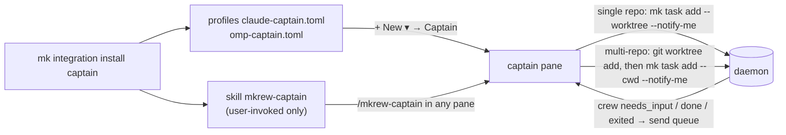
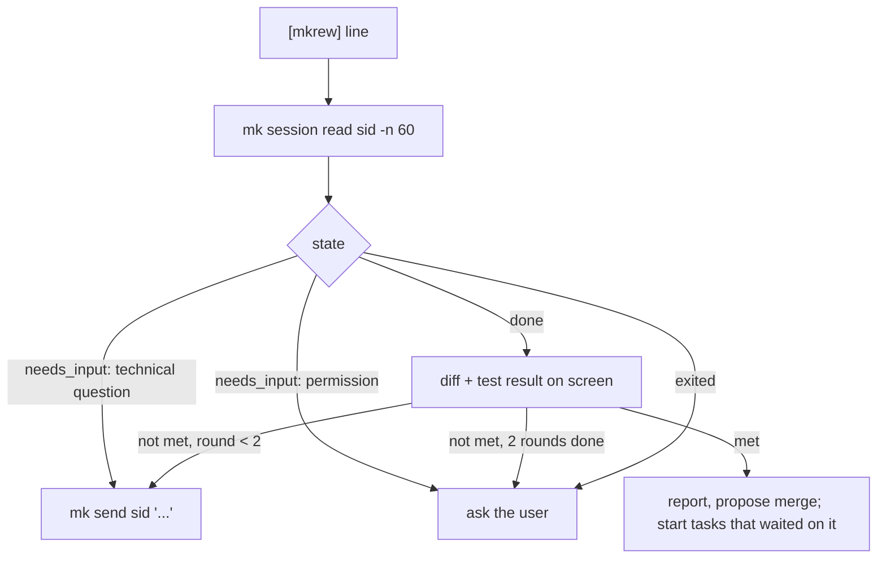

# Captain: one agent pane that runs a crew of task agents

- Date: 2026-10-28 (revised 2026-10-29: multi-repo workspaces, opt-in and project-rules principles)
- Status: proposed
- ADR: 0086 (partly reverses ADR 0013)
- Inspired by: [kunchenguid/firstmate](https://github.com/kunchenguid/firstmate)

## Problem

Running three tasks in parallel in one workspace means the user creates three tasks, writes three prompts, watches three panes, answers each agent and merges each worktree by hand.
Mkrew already has every building block a coordinating agent would need (task worktrees, merge, send queue, hooks, `session.read`), but an agent inside a pane cannot drive them: `mk` has no worktree flag, no merge or remove, no screen read, and nothing tells an agent that another session changed state.
ADR 0013 dropped the agent-driven CLI for this reason.

The user's workspaces come in two layouts, and the captain must serve both:

- **Single repo:** the workspace folder is one git repository (e.g. `free-my-tv`).
- **Multi-repo root:** the workspace folder is not a repository and holds several, e.g. `EA/` with `EA-BE/` and `EA-FE/`, each its own git repo.
  Mkrew's task worktrees (§20E.1) do not isolate child repositories (ADR 0029), so these workspaces need another way.
  The EA workspace already solves this in its Jira workflow (`/jira-batch`): worktrees under `EA/.worktrees/<run>/<repo>`, one branch per repo, one lane per repo.
  The captain follows that model.

## Goal

The user opens a **captain** pane in a workspace and says "fix A, add B, look into C".
The captain splits the request into tasks, runs each in its own isolated folder, answers what it may answer, and comes back to the user only for real decisions and for merges.

Success:

- The captain learns within 2 s (§1 goal) that a crew task needs input, finished or exited, without polling and without spending tokens while it waits.
- The link between tasks and their captain survives a daemon restart and an in-app update.
- Both layouts work: a crew never edits the user's own checkout in either.
- A user who never installs or starts a captain sees no change at all: no setting, no menu entry, no event, no behavior.

Not in scope: tasks in other workspaces, push or pull requests, a captain UI, captains for Codex or Copilot, Board/Git view support for multi-repo crew folders (see Limits).

## Principles

1. **Active only when invoked.**
   The captain runs only in a Captain pane or after the user types its skill command.
   It is independent of any other workflow the project has (for example EA's Jira commands): the captain never starts one on its own, and none of them starts the captain.
2. **Project rules win.**
   When the project's `AGENTS.md` / `CLAUDE.md`, or a command the user invoked (e.g. `/jira-batch`), defines how work is split, isolated, ordered, verified, asked about or shipped, the captain follows it.
   Everything below (layouts, lanes, authority level B) is the default for projects that say nothing.

## Decisions taken in brainstorming

| # | Question | Decision |
|---|---|---|
| 1 | How is captain mode triggered? | Opt-in only: a "Captain" agent profile (A) and a user-invoked `/mkrew-captain` skill in any Claude or omp pane (B). No UI menu. |
| 2 | Which projects can a captain give tasks to? | Only its own workspace. |
| 3 | How does the captain learn crew state? | The daemon sends a line into the captain's pane through the existing send queue. |
| 4 | Where is the task → captain link kept? | In the DB, moved to the new session id on resume. |
| 5 | What may the captain decide alone? | Level B (below). |
| 6 | Multi-repo roots? | Follow the EA Jira model: the captain makes per-repo worktrees under `<root>/.worktrees/`, mkrew runs the crew there (`--cwd`). |

### Captain authority (level B, default)

| Action | Captain |
|---|---|
| Answer a crew's technical question (approach, file names) | Answers alone, lists it in its report |
| Approve a permission prompt (run a command, edit a file) | Asks the user |
| Send a crew back to fix failing tests or an unmet goal | Alone, at most 2 rounds per task, then asks the user |
| Merge a crew branch | Asks the user |
| Remove a worktree or branch | Asks the user; offers it right after a merge |
| Push, open a PR | Never |

These rules live in the skill text.
The daemon does not enforce them; see Risks.

## Design



### 1. Install and trigger

`mk integration install|uninstall|status captain` manages Mkrew-owned files, like `omp` and `copilot` today (whole-file write, backup of a different existing file, idempotent, uninstall deletes):

| File | Content |
|---|---|
| `~/.claude/skills/mkrew-captain/SKILL.md` | The captain procedure. Frontmatter `disable-model-invocation: true`. omp discovers Claude skill roots and normalizes the same key to `disableModelInvocation`, so one file serves both agents. |
| `<config>/mkrew/agents/claude-captain.toml` | Copy of `agents/claude.toml` with `name = "Captain (Claude)"`, `args = ["/mkrew-captain"]`. |
| `<config>/mkrew/agents/omp-captain.toml` | Copy of `agents/omp.toml` with `name = "Captain (Oh My Pi)"`, `args = ["/skill:mkrew-captain"]`. |

The skill and profile texts are embedded in `mk` (`include_str!`), so install writes the version that ships with the running `mk`.
The profiles are not in the repo's `agents/` samples: those are copied for everyone on first run, and a Captain entry without the skill would start a pane with an unknown command.

Trigger A: `+ New ▾` lists the captain profiles once installed (only those whose program is on `PATH`, as today).
Trigger B: the user types `/mkrew-captain` (Claude) or `/skill:mkrew-captain` (omp) in a pane already running.
Neither agent can start the skill on its own.
Resume keeps the profile's `resume` command, so a resumed captain continues its conversation and its role.

### 2. Layouts and isolation (skill text)

At start the captain reads the project's `AGENTS.md` / `CLAUDE.md` (principle 2), then detects the layout of its workspace folder `<root>`:

- `git -C <root> rev-parse --show-toplevel` succeeds → **single repo**.
- Otherwise the direct child folders that are git repositories → **multi-repo root**.
  A request that changes a repository's files becomes one task per repository it touches.

**Single repo.**
`mk task add <p> "<t>" --prompt … --worktree --notify-me`, then `mk task run`.
Mkrew creates the worktree and branch `mkrew/<slug>-<ulid>` (§20E.1); merge, remove and diff go through `mk task merge|remove|diff`.

**Multi-repo root** (EA Jira model).
One run folder per user request: `<run>` = `YYYY-MM-DD-<slug>`.
For each task, in its repository `<repo>`:

1. `git -C <root>/<repo> worktree add -b mkrew/<slug> <root>/.worktrees/<run>/<repo> HEAD`.
   Every repository of one request uses the same branch name, so a feature spanning FE and BE has one name in both.
2. Copy each path listed in `<root>/<repo>/.worktreeinclude` (same format and rules as §20E.1) into the worktree.
   Heavier setup (dependency folders, databases, config copies) only when the project's rules describe it; otherwise the crew installs what it needs.
3. `mk task add <p> "<t>" --prompt … --cwd .worktrees/<run>/<repo> --notify-me`, then `mk task run`.

The repositories of one run sit side by side under `.worktrees/<run>/`, so a crew can read its sibling's work in progress (FE reading the new BE API).
Mkrew's project watcher already skips `.worktrees/` (§8).

Merge (after the user says so): the same checks as §20E.1 Merge back, run by the captain with git: crew worktree and the user's checkout of `<repo>` both clean, not on a detached HEAD, `git -C <root>/<repo> merge --no-ff --no-edit <branch>`, on conflict `git merge --abort` and report the files.
Remove (after the user says so): `git -C <root>/<repo> worktree remove <path>` (refused with uncommitted changes), then `git branch -d` (never `-D`).
Diff: `git -C <worktree> diff <base>...HEAD` plus uncommitted changes.

**Lanes** (both layouts).
Tasks in different repositories run in parallel.
Tasks in the same repository run in parallel only when they touch separate areas; otherwise one after another.
A task that depends on another (FE needs the new BE endpoint) starts after that one is done.
Project rules override all three (EA: one BE ticket at a time, because Alembic must keep one head).

### 3. Notifications to the captain

A task created with a captain carries `notify_session_id`.
New daemon module `captain.rs`, shaped like `notify.rs` and `awake.rs`: one loop on the event bus.

- It listens to `Event::SessionState` and `Event::SessionExited`.
- For a session that is the current session of a task with `notify_session_id`, it reacts on the transition **into** `needs_input`, `done` or `exited`; `working` and `idle` are ignored.
  The decision is a pure function (`captain::message(task, session, state) -> Option<String>`), unit-tested.
- It sends one line to the captain session through the existing `session.send` path:

```
[mkrew] task 01JX.. "Fix flaky login" needs_input - session 01JY.. - read: mk session read 01JY.. -n 60
```

- The send queue (§8) already holds a text while the captain is `working` and delivers it once the captain is `idle`, `done` or `needs_input`, as a bracketed paste with Enter.
  So a notification never lands in the middle of the captain's turn or of the user's typing in that pane.
- Queued notifications are delivered one per captain turn, in order.
  `ponytail:` one turn per line; merge waiting `[mkrew]` lines into one send if bursts prove costly.
- The captain session is not live (exited, not resumable): the line is dropped with a `debug` log.
  The crew still reaches the user through the Inbox, OS notification, tray and push, unchanged.

Captain loop (skill text):



### 4. Data and protocol

Migration `0024_task_captain.sql`:

```sql
ALTER TABLE task ADD COLUMN notify_session_id TEXT;  -- NULL: nobody is told
ALTER TABLE task ADD COLUMN cwd TEXT;                -- NULL: project folder (or its worktree)
```

`task.cwd` is relative to the project folder with `/` separators, like the run env file (ADR 0049).

Protocol 48 → 49:

| Type | Change |
|---|---|
| `TaskCreateParams` | `notify_session_id: Option<Ulid>`, `cwd: Option<String>`, both `#[serde(default)]` |
| `Task` | `notify_session_id: Option<Ulid>`, `cwd: Option<String>`, both `#[serde(default)]`; the UI ignores them |

No new request or event.

`task.create` returns `invalid_request` when:

- `notify_session_id` is not a live agent session (not a shell or run command) of the same project;
- `cwd` is absolute, contains `..`, is not an existing folder inside the project folder, or comes with `worktree: true`.

`server.rs` `run_dir(project, task)`: a task with `cwd` runs in `<project>/<cwd>`; a folder that disappeared since is `invalid_state` ("the task's folder is gone").
Resume uses the same rule (`server/resume.rs`), so a crew in a multi-repo worktree resumes there.

`server/resume.rs` `resume(last, task)`: once the new session id is known, every task whose `notify_session_id` is `last.id` points to the new id (one `UPDATE`, in the store).
This covers both the startup resume and an explicit `session.resume`.

### 5. CLI

| Command | Request | Behavior |
|---|---|---|
| `mk task add <p> "<t>" [--prompt] [--agent] [--worktree \| --cwd <dir>] [--notify <sid> \| --notify-me]` | `task.create` | `--cwd` takes a path relative to the project folder (an absolute one inside it is converted); `--notify-me` takes `MKREW_SESSION_ID` and fails clearly without it |
| `mk task merge <id> [--yes]` | `task.merge` | Mkrew worktree tasks only. Without `--yes`: prints branch, target and changed files, changes nothing. Conflicts: prints the paths, exit 1, checkout unchanged |
| `mk task remove <id> [--yes]` | `task.remove_worktree` | Mkrew worktree tasks only. Without `--yes`: prints what would be removed, changes nothing |
| `mk task diff <id>` | existing `git.*` requests with `worktree_task_id`, against the project base | Mkrew worktree tasks only; unified diff on stdout |
| `mk session read <sid> [-n 60]` | `session.read` | Plain screen lines of a live session, `-n` 1-200 |

### 6. Docs

- ADR 0086: why part of ADR 0013's agent-driven CLI comes back (`mk session read`, `--notify`), why it stays opt-in, and why multi-repo isolation lives in the skill (`--cwd`) instead of mkrew's worktrees.
- SPEC: §5 (`task.notify_session_id`, `task.cwd`), §7 (`TaskCreateParams`, `Task`), §8 (captain notifications, task `cwd`), §9 (new commands), §20D (note pointing to §20L), new **§20L Captain (outside the milestones, ADR 0086)**.
- HUMAN_CHECKS: manual checks below.

Outside this repo (the user's EA workspace, not part of this work): `jira-conventions` may offer a "mkrew crew" execution method at gate 5, only when `MKREW_SESSION_ID` is set, running each lane with `mk task add --cwd <wt> --notify-me`.

## Edge cases

| Case | Behavior |
|---|---|
| `--notify` to a dead session, a shell, or another project's session | `invalid_request`; no task is created |
| `--cwd` outside the project, missing, or with `--worktree` | `invalid_request`; no task is created |
| A `--cwd` folder removed before Run or resume | `invalid_state` "the task's folder is gone" |
| Captain closed while crew runs | Lines dropped (`debug` log); crew alerts reach the user as today |
| Daemon restart or in-app update | Crew and captain resume (crew in its `cwd` or worktree); links move to the captain's new session id |
| Captain cannot resume after a restart | Same as closed |
| Task deleted or project archived | No task, so no line |
| Crew flips done → working → done | One line per entry into `done` |
| Captain `mk send`s to a working crew | Existing send queue delivers it later |
| Merge hits conflicts | Single repo: `task.merge` aborts. Multi-repo: the captain runs `git merge --abort`. Both report the files; the user's checkout is unchanged |
| Root is itself a git repo that also holds child repos (ADR 0029) | Changes to the root repo use mkrew worktrees; changes to a child repo use the multi-repo path |
| Captain installed without Claude or omp on `PATH` | Files are written; `+ New` hides profiles whose program is missing |

## Limits

- Multi-repo crew folders are plain folders to mkrew: the Board card shows no `⎇` branch, the Git view's target chooser does not list them, and `mk task merge|remove|diff` refuse them.
  The user reviews them by opening the folder (Files, Zed) or asking the captain for the diff.
- Multi-repo merge and remove safety lives in the skill, not in `task.merge`.

## Risks

- **Authority lives in a prompt.**
  A model that ignores the skill could run `mk task merge --yes`, or a git merge in a multi-repo root, without asking.
  A hard block (refuse `--yes` from inside a pane) would also block the merge the user just asked the captain for.
  Accepted: merges are local and abort on conflicts, nothing is pushed, and the user can undo a merge with git.
- **Token cost per notification.** Each line starts a captain turn; see the `ponytail:` note above.

## Testing

No test calls a real agent or the network (§16).

| Test | Checks |
|---|---|
| Unit `captain::message` | Line for `needs_input`, `done`, `exited`; none for `working`, `idle`; none for a task without `notify_session_id`; exact line format |
| Daemon e2e | Captain and crew are `mkrew-fakeagent`; crew runs the `ask` scenario; captain's log receives the `[mkrew] … needs_input` line; a crew task without `--notify` sends nothing |
| Daemon e2e resume | Stop and start the daemon; the task's `notify_session_id` is the captain's new id and the next crew state reaches it; a `cwd` crew resumes in its folder |
| Daemon e2e `task.create` | `notify_session_id` of an exited session, a shell, another project → `invalid_request`; `cwd` absolute, with `..`, missing, or with `worktree` → `invalid_request` |
| Daemon e2e `cwd` run | A task with `cwd` runs with that folder as its working directory; folder removed → `invalid_state` |
| CLI | `mk task merge` without `--yes` leaves branch and HEAD unchanged; conflict → exit 1 |
| Integration | install → `status` says installed; second install changes nothing; uninstall removes the three files |

Manual (HUMAN_CHECKS "2026-10-28 Captain"):

1. `mk integration install captain`; `+ New ▾` shows "Captain (Claude)" and "Captain (Oh My Pi)".
2. A plain Claude pane never starts the captain procedure on its own, even when asked to "coordinate tasks".
3. Single repo: "add a README section X and fix typo Y" creates two worktree tasks on the Board and two crew panes.
4. Multi-repo root (EA): "add endpoint X in BE and show it in FE" creates `.worktrees/<run>/EA-BE` and `EA-FE` on one branch name, BE first, FE after BE is done.
5. A crew permission prompt: the captain asks the user instead of approving.
6. Done: the captain reports and proposes merges; "merge" merges (per repo in a multi-repo root), then it offers removal.
7. In EA, `/jira-batch` inside a Captain pane follows the Jira gates and never asks during phase 2 (project rules win).
8. Restart the daemon mid-task: the captain still receives the next crew line; a multi-repo crew resumes in its worktree.
9. `mk integration uninstall captain`: the Captain entries leave `+ New ▾`.
