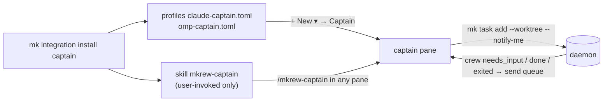
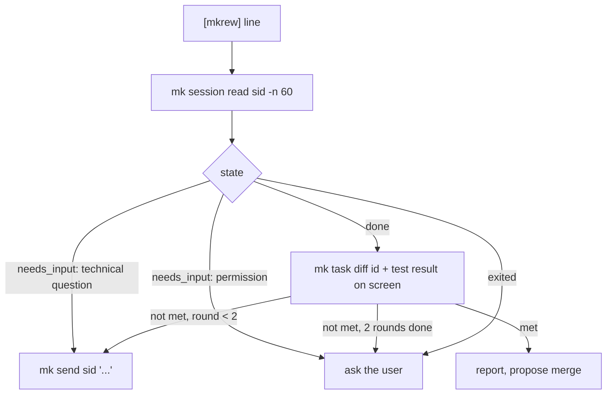

# Captain: one agent pane that runs a crew of task agents

- Date: 2026-10-28
- Status: proposed
- ADR: 0086 (partly reverses ADR 0013)
- Inspired by: [kunchenguid/firstmate](https://github.com/kunchenguid/firstmate)

## Problem

Running three tasks in parallel in one workspace means the user creates three tasks, writes three prompts, watches three panes, answers each agent and merges each worktree by hand.
Mkrew already has every building block a coordinating agent would need (task worktrees, merge, send queue, hooks, `session.read`), but an agent inside a pane cannot drive them: `mk` has no worktree flag, no merge or remove, no screen read, and nothing tells an agent that another session changed state.
ADR 0013 dropped the agent-driven CLI for this reason.

## Goal

The user opens a **captain** pane in a workspace and says "fix A, add B, look into C".
The captain splits the request into tasks, runs each in its own worktree, answers what it may answer, and comes back to the user only for real decisions and for merges.

Success:

- The captain learns within 2 s (§1 goal) that a crew task needs input, finished or exited, without polling and without spending tokens while it waits.
- The link between tasks and their captain survives a daemon restart and an in-app update.
- A user who never installs or starts a captain sees no change at all: no setting, no menu entry, no event, no behavior.

Not in scope: tasks in other workspaces, push or pull requests, a captain UI, captains for Codex or Copilot.

## Decisions taken in brainstorming

| # | Question | Decision |
|---|---|---|
| 1 | How is captain mode triggered? | Opt-in only: a "Captain" agent profile (A) and a user-invoked `/mkrew-captain` skill in any Claude or omp pane (B). No UI menu. |
| 2 | Which projects can a captain give tasks to? | Only its own workspace. |
| 3 | How does the captain learn crew state? | The daemon sends a line into the captain's pane through the existing send queue. |
| 4 | Where is the task → captain link kept? | In the DB, moved to the new session id on resume. |
| 5 | What may the captain decide alone? | Level B (below). |

### Captain authority (level B)

| Action | Captain |
|---|---|
| Answer a crew's technical question (approach, file names) | Answers alone, lists it in its report |
| Approve a permission prompt (run a command, edit a file) | Asks the user |
| Send a crew back to fix failing tests or an unmet goal | Alone, at most 2 rounds per task, then asks the user |
| Merge a worktree | Asks the user |
| Remove a worktree or branch | Asks the user; offers it right after a merge |
| Push, open a PR | Never |

These rules live in the skill text.
The daemon does not enforce them; see Risks.

## Design



### 1. Install and trigger

`mk integration install|uninstall|status captain` manages Mkrew-owned files, like `omp` and `copilot` today (whole-file write, backup of a different existing file, idempotent, uninstall deletes):

| File | Content |
|---|---|
| `~/.claude/skills/mkrew-captain/SKILL.md` | The captain procedure. Frontmatter `disable-model-invocation: true`. omp discovers Claude skill roots and normalizes the same key to `disableModelInvocation`, so one file serves both agents. |
| `<config>/mkrew/agents/claude-captain.toml` | Copy of `agents/claude.toml` with `name = "Captain (Claude)"`, `args = ["/mkrew-captain"]`. |
| `<config>/mkrew/agents/omp-captain.toml` | Copy of `agents/omp.toml` with `name = "Captain (Oh My Pi)"`, `args = ["/skill:mkrew-captain"]`. |

The skill and profile texts are embedded in `mk` (`include_str!`), so install writes the version that ships with the running `mk`.
The profiles are not in the repo's `agents/` samples: those are copied for everyone on first run, and a Captain entry without the skill would start a pane with an unknown command.

Trigger A: `+ New ▾` lists the captain profiles once installed (only those whose program is on `PATH`, as today).
Trigger B: the user types `/mkrew-captain` (Claude) or `/skill:mkrew-captain` (omp) in a pane already running.
Neither agent can start the skill on its own.
Resume keeps the profile's `resume` command, so a resumed captain continues its conversation and its role.

### 2. Notifications to the captain

A task created with a captain carries `notify_session_id`.
New daemon module `captain.rs`, shaped like `notify.rs` and `awake.rs`: one loop on the event bus.

- It listens to `Event::SessionState` and `Event::SessionExited`.
- For a session that is the current session of a task with `notify_session_id`, it reacts on the transition **into** `needs_input`, `done` or `exited`; `working` and `idle` are ignored.
  The decision is a pure function (`captain::message(task, session, state) -> Option<String>`), unit-tested.
- It sends one line to the captain session through the existing `session.send` path:

```
[mkrew] task 01JX.. "Fix flaky login" needs_input - session 01JY.. - read: mk session read 01JY.. -n 60
```

- The send queue (§8) already holds a text while the captain is `working` and delivers it once the captain is `idle`, `done` or `needs_input`, as a bracketed paste with Enter.
  So a notification never lands in the middle of the captain's turn or of the user's typing in that pane.
- Queued notifications are delivered one per captain turn, in order.
  `ponytail:` one turn per line; merge waiting `[mkrew]` lines into one send if bursts prove costly.
- The captain session is not live (exited, not resumable): the line is dropped with a `debug` log.
  The crew still reaches the user through the Inbox, OS notification, tray and push, unchanged.

Captain loop (skill text):



### 3. Data and protocol

Migration `0024_task_notify.sql`:

```sql
ALTER TABLE task ADD COLUMN notify_session_id TEXT;  -- NULL: nobody is told
```

Protocol 48 → 49:

| Type | Change |
|---|---|
| `TaskCreateParams` | `notify_session_id: Option<Ulid>`, `#[serde(default)]` |
| `Task` | `notify_session_id: Option<Ulid>`, `#[serde(default)]`; the UI ignores it |

No new request or event.

`task.create` with `notify_session_id` returns `invalid_request` unless that session is live, is an agent session (not a shell or run command) and belongs to the same project.

`server/resume.rs` `resume(last, task)`: once the new session id is known, every task whose `notify_session_id` is `last.id` points to the new id (one `UPDATE`, in the store).
This covers both the startup resume and an explicit `session.resume`.

### 4. CLI

| Command | Request | Behavior |
|---|---|---|
| `mk task add <p> "<t>" [--prompt] [--agent] [--worktree] [--notify <sid> \| --notify-me]` | `task.create` | `--notify-me` takes `MKREW_SESSION_ID` and fails clearly without it |
| `mk task merge <id> [--yes]` | `task.merge` | Without `--yes`: prints branch, target and changed files, changes nothing. Conflicts: prints the paths, exit 1, checkout unchanged |
| `mk task remove <id> [--yes]` | `task.remove_worktree` | Without `--yes`: prints what would be removed, changes nothing |
| `mk task diff <id>` | existing `git.*` requests with `worktree_task_id`, against the project base | Read only; unified diff on stdout |
| `mk session read <sid> [-n 60]` | `session.read` | Plain screen lines of a live session, `-n` 1-200 |

### 5. Docs

- ADR 0086: why part of ADR 0013's agent-driven CLI comes back (`mk session read`, `--notify`), and why it stays opt-in.
- SPEC: §5 (`task.notify_session_id`), §7 (`TaskCreateParams`, `Task`), §8 (captain notifications), §9 (new commands), §20D (note pointing to §20L), new **§20L Captain (outside the milestones, ADR 0086)**.
- HUMAN_CHECKS: manual checks below.

## Edge cases

| Case | Behavior |
|---|---|
| `--notify` to a dead session, a shell, or another project's session | `invalid_request`; no task is created |
| Captain closed while crew runs | Lines dropped (`debug` log); crew alerts reach the user as today |
| Daemon restart or in-app update | Crew and captain resume; links move to the captain's new session id |
| Captain cannot resume after a restart | Same as closed |
| Task deleted or project archived | No task, so no line |
| Crew flips done → working → done | One line per entry into `done` |
| Captain `mk send`s to a working crew | Existing send queue delivers it later |
| `mk task merge` hits conflicts | `task.merge` aborts and leaves the checkout unchanged; CLI exits 1 with the paths |
| Captain installed without Claude or omp on `PATH` | Files are written; `+ New` hides profiles whose program is missing |

## Risks

- **Authority lives in a prompt.**
  A model that ignores the skill could run `mk task merge --yes` without asking.
  A hard block (refuse `--yes` from inside a pane) would also block the merge the user just asked the captain for.
  Accepted: merges are local and abort on conflicts, nothing is pushed, and the user can undo a merge with git.
- **Token cost per notification.** Each line starts a captain turn; see the `ponytail:` note above.

## Testing

No test calls a real agent or the network (§16).

| Test | Checks |
|---|---|
| Unit `captain::message` | Line for `needs_input`, `done`, `exited`; none for `working`, `idle`; none for a task without `notify_session_id`; exact line format |
| Daemon e2e | Captain and crew are `mkrew-fakeagent`; crew runs the `ask` scenario; captain's log receives the `[mkrew] … needs_input` line; a crew task without `--notify` sends nothing |
| Daemon e2e resume | Stop and start the daemon; the task's `notify_session_id` is the captain's new id and the next crew state reaches it |
| Daemon e2e `task.create` | `notify_session_id` of an exited session, a shell, another project → `invalid_request` |
| CLI | `mk task merge` without `--yes` leaves branch and HEAD unchanged; conflict → exit 1 |
| Integration | install → `status` says installed; second install changes nothing; uninstall removes the three files |

Manual (HUMAN_CHECKS "2026-10-28 Captain"):

1. `mk integration install captain`; `+ New ▾` shows "Captain (Claude)" and "Captain (Oh My Pi)".
2. A plain Claude pane never starts the captain procedure on its own, even when asked to "coordinate tasks".
3. In a Captain pane: "add a README section X and fix typo Y" creates two worktree tasks on the Board and two crew panes.
4. A crew permission prompt: the captain asks the user instead of approving.
5. Both done: the captain reports and proposes merges; "merge" merges, then it offers removal.
6. Restart the daemon mid-task: the captain still receives the next crew line.
7. `mk integration uninstall captain`: the Captain entries leave `+ New ▾`.
