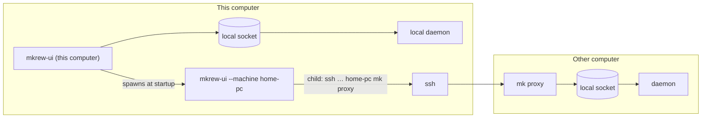

# Remote machine: one window per computer over SSH - Design

- Date: 2026-10-29
- Status: approved by the user in brainstorming (2026-10-29); this file is the written spec.
- Replaces: `docs/superpowers/plans/2026-10-10-remote-machine.md` (never executed; one window switching between machines).
- Inbox: `docs/INBOX.md` item 15.
- ADR: `docs/decisions/0089-remote-machine.md` (written by the first implementation task).

## 1. Goal

Mkrew runs on a computer at home (Windows, macOS or Ubuntu) with workspaces and agents on it.
From another computer the user opens Mkrew and keeps working on the home computer as if sitting in front of it.
When the other computer goes away (window closed, laptop shut, network lost), the home computer keeps working: the daemon and its agents never depend on a client.

## 2. What the user decided

| Topic | Decision |
| --- | --- |
| Client | The desktop UI (`mkrew-ui`), not `mk web`. |
| Machines in the UI | One window per computer. No switch button. |
| Network | Both "same Tailscale tailnet" and "plain SSH reachability" (port forward, company VPN, jump host). |
| Transport | SSH: the window runs `ssh <host> mk proxy`; the remote daemon keeps its owner-only local socket and gets no network listener. |
| Startup | Opening Mkrew opens this computer's window and one window per added machine, at once. |
| Unreachable at startup | The window opens anyway, says why, and retries with backoff. |
| Connection lost while working | The window keeps its layout and last screen, shows a banner, blocks input, reconnects with backoff and re-attaches. |
| Process model | Approach A: one UI process per machine (`mkrew-ui --machine <name>`), spawned by this computer's UI process. |
| Tray | One tray icon only (this computer's process); its menu lists the machines. |
| Adding machines | Settings → Machines page, plus palette commands. |
| Version mismatch | Clear message naming both versions; no automatic update of the other computer. |
| Daemon settings of the other computer | Not edited remotely; edit them on that computer. |

## 3. Non-goals

- A TCP listener in the daemon, or any network port opened by Mkrew.
- Several machines in one window, or one sidebar across machines.
- Updating Mkrew on the other computer over SSH.
- Zed remote editing (`zed ssh://…`), opening the other computer's files in this computer's Explorer or Finder.
- Port forwarding for `localhost` URLs that agents or run commands print on the other computer.
- Uploading files dropped from this computer to the other computer (images pasted from the clipboard already work through `attachment.save`).
- A folder browser for the other computer's disk; paths are typed.
- Editing the other computer's `settings.toml`, agent profiles or keymap from this computer.

## 4. Architecture



The §7 protocol does not change shape: the remote window speaks the same frames over the ssh child's stdin and stdout that it speaks over the local socket.
`hello` is sent by the window, never by `mk proxy`.

### 4.1 `mk proxy` (CLI, new)

- Connects to the daemon socket from `Paths::from_env()`; if nothing listens, starts the daemon the way `mk daemon start` does and waits until it answers (10 s, as today).
- Then copies bytes both ways: stdin → socket and socket → stdout, flushing stdout after every chunk.
- Writes nothing else to stdout.
  Errors go to stderr (the window shows them).
- Exits 0 when stdin closes (the window or ssh went away) or the daemon closes the socket; the daemon keeps running.
- Daemon start from inside an SSH session must outlive that session:
  - Windows: spawn with `CREATE_BREAKAWAY_FROM_JOB` in addition to today's detach flags, because Windows OpenSSH runs a session in a job object; if the job forbids breakaway (`PermissionDenied`), fall back to today's flags.
  - Unix: the daemon calls `setsid` (via `rustix`, already a dependency) instead of only `process_group(0)`, so a hangup of the SSH session never reaches it.
    This applies to every detached daemon start, not only `mk proxy`.
- `mk daemon start` keeps its printed lines; the start logic is shared through a quiet function that returns the pid and whether it started the daemon.

### 4.2 Machine list (`<config>/mkrew/machines.toml`)

```toml
[[machine]]
name = "Home PC"        # shown in the window title, the title bar and the tray menu; unique
host = "home-pc"        # ssh destination: MagicDNS name, user@host, or a ~/.ssh/config alias
# mk = "/home/me/.local/opt/mkrew/bin/mk"   # optional: the remote `mk`, when it is not on the
                                            # PATH of a non-interactive ssh shell
```

- Only the UI reads and writes it.
  The daemon never sees it.
- Validation (on Add and on load): `name` non-empty after trimming, at most 40 characters, unique (case-insensitive), not `This computer`; `host` non-empty, no whitespace, does not start with `-`; `mk` (when set) non-empty, does not start with `-`.
- A file that fails to parse or validate is never overwritten: the Machines page shows the error with the file and line, no machine window opens, and Add/Remove are disabled until the file is fixed.
- A missing file means no machines.

### 4.3 The ssh command

`ssh -T -o BatchMode=yes -o StrictHostKeyChecking=accept-new -o ServerAliveInterval=15 -o ServerAliveCountMax=3 -- <host> <mk> proxy`

- `ssh` is found on `PATH` (`ssh.exe` on Windows 10+ ships with the OS; `PATHEXT` lookup as for agents).
- `<mk>` defaults to `mk`.
- `BatchMode=yes`: never prompts for a password or passphrase; the user needs a key (or an agent, or Tailscale SSH).
- `StrictHostKeyChecking=accept-new`: the first host key is trusted; a changed key is refused with ssh's own message.
- `ServerAlive*`: a dead network is noticed within about 45 s and ends ssh, which ends the connection and starts the reconnect.
- On Windows the child gets `CREATE_NO_WINDOW`; its stderr is captured (last 20 lines kept) for error messages.
- The child is killed when the connection is dropped.

### 4.4 UI client transport

`client::Connection` gains a second endpoint kind besides the local socket: a program (the ssh command).
Both feed the same read and write loops, the same `Inbox` and the same backpressure budget.
Failure classes the window distinguishes:

| Failure | Detected by | Shown as |
| --- | --- | --- |
| ssh cannot start | spawn error | "Cannot run ssh: <error>. Install the OpenSSH client." |
| ssh or `mk proxy` exits before `hello` is answered | child exit, stream closed | "Cannot reach Home PC." + the last stderr lines + one hint (below) |
| `hello` refused with `version_mismatch` | error code | "Home PC speaks protocol N, this computer M. Update Mkrew on the older computer." No automatic retry. |
| Connection drops after `hello` | stream closed | reconnect banner (§6.3) |

Hints, chosen from stderr text (case-insensitive), first match wins:

- `Permission denied` → "Add this computer's SSH key to Home PC (ssh-copy-id, or its authorized_keys)."
- `Host key verification failed` or `REMOTE HOST IDENTIFICATION HAS CHANGED` → "Home PC's host key changed. If that is expected, remove the old key with `ssh-keygen -R <host>`."
- `not found`, `not recognized` or `No such file` together with `mk` → "Mkrew's `mk` is not on Home PC's PATH for SSH. Set the mk path for this machine in Settings → Machines."
- `Connection refused` → "Home PC answers but runs no SSH server. Start it there (OpenSSH Server, Remote Login, openssh-server)."
- `Could not resolve hostname`, `timed out`, `No route to host` → "Home PC is offline or not reachable from here (Tailscale up? Same network?)."
- Otherwise no hint.

### 4.5 Process model

- `mkrew-ui` with no arguments (or a `mkrew://` link) is **this computer's** window, as today.
- `mkrew-ui --machine <name>` is the window of one machine from `machines.toml`.
  It reads the machine list once at start; an unknown name shows "Home PC is no longer in the machine list." and nothing else.
- Single instance: the instance key of a machine window is computed from the exe path and `machine:<name>` (this computer keeps the socket), so a second start of the same machine raises the running window (Windows; other OSes have no single-instance today and keep that).
- This computer's process is the **launcher**:
  - At startup, after its own window opens, it spawns one child per machine (skipping a machine whose window already runs, which the raise check detects on Windows).
  - It keeps each child's handle and reads the child's stdout, where a machine window writes one line per connection state change: `connected`, `connecting`, `reconnecting`, `unreachable <reason>`, `version <message>`. The launcher shows these on the Machines page and in the tray menu.
  - "Open" (Machines page, tray menu, palette) raises the machine window if its child runs, else spawns it.
  - Quitting this computer's window (tray Quit, or update install) kills every child first.
  - A child that exits (the user closed that window) is shown as "Window closed"; it is not restarted until the next "Open" or the next start of Mkrew.
- A machine window started by hand (not by the launcher) has no launcher; its stdout lines go nowhere and it works the same.

## 5. Protocol changes (version 49 → 50)

All new requests work for every client; this computer's window uses them too, so there is one code path, not a local and a remote one.

| Request | Params | Result | Replaces in the UI |
| --- | --- | --- | --- |
| `session.log_tail` | `session_id`, `max_bytes` (≤ 4 MiB) | `data` (base64 bytes), `cut` (bool: older bytes were left out) | `history.rs` reading log files from the paths of `session.history` |
| `session.transcript` | `session_id`, `offset` (u64, where the reader stands) | `found` (bool), `format` (the profile's `[usage] format` name), `start` (where `data` starts), `len` (file length), `data` (base64, at most 4 MiB: from `offset` when the file still reaches it, else from 0; a read from 0 of a longer file returns its last 4 MiB) | `thread_panel.rs` and `thread_view.rs` finding and opening transcript files and reading agent profiles from this computer; the daemon locates the file with its own `transcript_path` and the profile the session ran |
| `fs.create` | `project_id`, `worktree_task_id?`, `dir` (relative, `""` = root), `name` (may hold `/`), `folder` (bool) | `path` (the new entry, relative) | `file_ops.rs` New file / New folder |
| `fs.ignore` | `project_id`, `worktree_task_id?`, `path` (relative), `is_dir` (bool) | `null` | `file_ops.rs` Add to `.gitignore` |

- `session.history` stays: `mk web` and the CLI read the files on the daemon's computer.
- `fs.create` refuses an existing path (`already_exists`) and a path outside the project or inside `.git` (`invalid_request`), like `fs.write`.
- `fs.ignore` appends the same line `file_ops.rs` appends today (leading `/`, escaped glob characters, `/` suffix for folders, keeps the file's line endings), creating `.gitignore` when missing.
- The 16 MiB frame cap holds: 4 MiB of base64 is about 5.4 MiB.

## 6. UI

### 6.1 Machine window identity

- OS window title: `Mkrew - <name>`.
- Title bar: right after the logo, a non-interactive chip with the Lucide `server` icon, the machine name and a status dot (connected / reconnecting / unreachable), with text in its tooltip (status is never color alone, §11).
- This computer's window is unchanged.
- Colors, sizes and spacing come from `theme.rs` tokens only.

### 6.2 Settings → Machines (new tab of the Settings dialog, next to Keyboard)

- One row per machine: name, host, state (Connected / Connecting… / Reconnecting… / Not reachable: <reason> / Version differs / Window closed), buttons **Open** and **Remove** (Remove asks for confirmation; it closes that machine's window and deletes its line).
- **Add machine…** opens fields *Name*, *Host*, *mk path (optional)*; validation as in §4.2 with the error under the field; Save writes `machines.toml` and opens the machine's window.
- A broken `machines.toml`: the error with file and line, no Add/Remove.
- A one-line help under the list: "The other computer needs Mkrew, an SSH server and this computer's SSH key."
- In a machine window this tab shows only: "Machines are managed in This computer's window."

Palette: `Machine: Add…`, and `Machine: Open <name>` per machine (this computer's window only).
Tray menu (Windows, this computer's process): one item per machine, opening or raising its window.

### 6.3 Connection states in any window

| State | Window shows |
| --- | --- |
| First connect | Today's "Connecting…" screen, naming the machine in a machine window. |
| Not reachable (before the first `hello`) | The machine name, the reason, the hint (§4.4), a countdown to the next try, and **Try now**. Backoff as today: 1, 2, 5, 10 s, then every 30 s. |
| Version differs | The message of §4.4, no retry, **Try now** to check again after updating. |
| Lost after working | The last screen stays: workspace, tabs, panes and their last frames. A banner over the top of the main area: "Connection to Home PC lost. Reconnecting in N s…" with **Try now**; all panes and the sidebar ignore keyboard and mouse input; dialogs that were open stay open but their send/save buttons show the error if pressed. On reconnect the window keeps the same workspace and re-attaches every visible pane (snapshot first, as on any attach). |

This keep-the-screen behavior also applies to this computer's window when its local daemon restarts.
Today's disconnect clears the state at once; the change moves that clearing to the moment the new connection is up, then rebuilds from the daemon, choosing the workspace that was shown.

### 6.4 Features that need this computer's disk or OS (machine window only)

| Feature | In a machine window |
| --- | --- |
| Add workspace / Clone into (folder picker) | A text field for the folder path on the other computer (the clone URL field stays as is). The daemon validates; its error shows under the field. |
| Link plan (file picker) | A text field for the plan file path on the other computer. |
| History (session log), Thread view (transcript) | Through `session.log_tail` and `session.transcript` (as in this computer's window). |
| Files: New file, New folder, Add to `.gitignore` | Through `fs.create` and `fs.ignore` (as in this computer's window). |
| Open in Zed, Follow in Zed, Open transcript, Open in Explorer/Finder, Reveal | The entries stay; choosing one shows the toast "Opens files on this computer only; <name> is another computer." |
| Terminal links | URLs open in this computer's browser as today; file paths are not underlined and not clickable. |
| Files dropped onto a pane, or file lists pasted from this computer | Toast "These files are on this computer; <name> cannot read them." Nothing is typed. |
| Pasted images | Unchanged: `attachment.save` stores them on the other computer and types that path. |
| Phone access, in-app update | Hidden (they belong to this computer's window). |
| Close to tray | Off: closing a machine window ends its process; the agents keep running on the other computer. |
| Settings dialog | Edits this computer's `settings.toml` and keymap, as today; a line at the top says "Daemon settings (notifications, retention, features) are Home PC's own; change them on Home PC." |

### 6.5 Notifications

- The other computer's daemon keeps showing its OS notifications on the other computer, unchanged.
- A machine window shows OS notifications on this computer itself: it feeds `session.state` events to the same `decide` policy the daemon uses (`mkrew_daemon::notify`), with this computer's `[notify]` settings, and shows them with the same notifier backends (`MKREW_NOTIFY` honored, so tests can capture them).
- The notification link carries the machine: `mkrew://session/<session>?project=<project>&machine=<name>`.
  `mkrew-ui` started with such a link raises (or starts) that machine's window and passes it the jump.
  A link without `machine` keeps today's meaning (this computer).
- The taskbar flash and badge work per window as today.

## 7. Security

- The daemon's endpoint stays owner-only and local (§15).
  Remote access is exactly as strong as the user's SSH setup.
- `host` and `mk` are validated (§4.2) and passed after `--`, so they can never become ssh options.
- Nothing is ever passed through a shell on this computer (`Command` with separate arguments).
  On the other computer ssh runs `<mk> proxy` through the user's login shell, which the user controls.
- `BatchMode=yes`: no password ever goes through Mkrew.

## 8. Error handling and edge cases

- Two computers attached to the same home daemon at once: allowed (the daemon already serves many clients); both see the same sessions; resizes follow today's rule.
- A daemon started by `mk proxy` inherits the SSH session's environment, which may lack the agents' `PATH`.
  The ADR and README say: keep the home daemon started by the home computer's own login (Mkrew window or Task Scheduler); `mk proxy` starting it is a fallback.
- Unsaved Files editor changes when the connection drops: the editor keeps the text; Save after reconnect uses `fs.write` with the old hash, so a file changed meanwhile is refused as today.
- The Linux `~/.bashrc` usually returns early for non-interactive shells, so `mk` may be missing from `PATH` over ssh; the `mk` field and the hint cover it.
- A machine whose window is closed by the user is not reopened until asked.
- The launcher dies (crash) while machine windows run: they keep working; the next start of Mkrew raises them instead of spawning duplicates (Windows) [ponytail: other OSes may get a duplicate window; add a lock file when that is reported].

## 9. Testing

No test runs `ssh` or reaches the network; tests use `mk proxy` (or a small test program) as the program endpoint.

| Test | Proves |
| --- | --- |
| CLI: `mk proxy` starts the daemon, carries frames both ways, writes nothing else to stdout, exits 0 on stdin EOF while the daemon keeps running | §4.1 |
| UI client: a program endpoint running `mk proxy` greets, answers requests, delivers events and output; killing it closes the inbox | §4.4 |
| UI client: a program that exits before `hello` yields "cannot reach" with its last stderr lines; the hint table maps sample ssh messages | §4.4 |
| Machines model: parse, validation (empty, whitespace, leading `-`, duplicates, reserved name), save/load round trip, broken file never overwritten | §4.2 |
| ssh argument builder: exact argument vector, `--` before host, custom `mk` | §4.3 |
| Launcher status line parse/format round trip | §4.5 |
| Links: `machine` parameter round trip; old links without it parse as before | §6.5 |
| Daemon: `session.log_tail` (cut flag, byte-identical tail across `.log.1` + `.log`, `max_bytes` cap), `session.transcript` (offset reads, shrink resets, not found), `fs.create` (file, folder, exists, outside), `fs.ignore` (new file, appends, line endings) | §5 |
| Protocol round trip of the four requests | §5 |
| HUMAN_CHECKS: Windows→Windows, Windows→Ubuntu, Windows→macOS (or reverse); startup with an offline machine; pulling the network while an agent runs and coming back; one tray icon with machine items; Settings → Machines; refused local-only actions; notification click opening the right window | §6 |

## 10. Documentation

- ADR 0089 (process model, SSH transport, no TCP listener, keep-screen reconnect, notifications in the machine window).
- SPEC: §3 (machine windows and `mk proxy`), §7 (four requests, version 50), §9 (`mk proxy`), §10 (machine chip, Machines settings tab, connection states), §14 (chip and banner tokens), §15 (security row mentions SSH), §19 (remove "remote workspaces over SSH" from the backlog).
- README: a "Work on another computer" section (install Mkrew there, SSH server, key, add the machine).
- HUMAN_CHECKS: one section for this feature.
- INBOX item 15 → `[x]`, pointing at the new plan; the old plan file is deleted (superseded).
