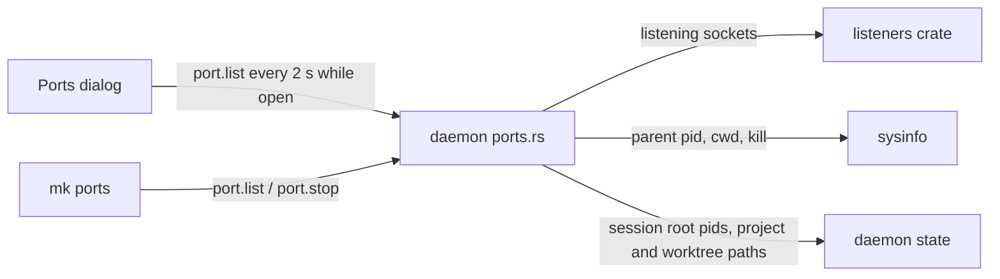

# Port manager: every listening port on the machine, its workspace and worktree, Stop - Design

- Date: 2026-11-01
- Status: approved by the user in brainstorming (2026-11-01); this file is the written spec.
- ADR: `docs/decisions/0091-port-manager.md` (written by the first implementation task).

## 1. Goal

The user works on many worktrees at once, and each may run a dev server on its own port.
They need one place that answers "which port runs in which workspace, which worktree, and what is it", and that can stop it.
Done means the user no longer hunts for the owner of `:3000`.

## 2. What the user decided

| Topic | Decision |
| --- | --- |
| Source of ports | The whole machine: the OS table of listening TCP sockets, not only Mkrew run sessions. |
| Mkrew ports | A port held by a process of a Mkrew session shows its workspace, task worktree (branch), pane and run command. |
| Ports outside Mkrew | Shown in their own group with process name and pid; a process whose folder is inside a workspace or worktree still gets that workspace. |
| Stop | Run command: the existing session Stop. Other Mkrew pane: kill the process holding the port and its children; the pane and its agent stay. Outside Mkrew: kill that process and its children, after a confirmation. |
| Where it shows | A global dialog "Ports", opened from the palette and from the Run menu, plus a CLI `mk ports`. |
| Where the scan runs | Approach A: the daemon scans on request (`port.list`), so a window connected to another machine (ADR 0089) sees that machine's ports. No background scan, no event. |

## 3. Non-goals

- An "Open in browser" action, filtering or search in the dialog.
- UDP ports.
- A title bar pill or any scan while the dialog is closed (SPEC §15 idle budget).
- Stopping the daemon or its own helpers (the `mk web` server) through the port manager.
- Pushing changes as events; clients ask again.

## 4. Architecture



### 4.1 Dependencies

- `listeners` 0.6 (MIT, cross-platform: Windows, Linux, macOS): listening sockets with pid and process name.
  Reason (SPEC §2 rule 6): one maintained implementation instead of three per-OS socket table readers.
- `sysinfo` 0.31, already in the tree through gpui: parent pid, cwd and kill.
  The daemon adds it with the `system` feature only, the same version the UI uses.

### 4.2 Daemon module `crates/mkrew-daemon/src/ports.rs`

The OS reads are split from the decision so the decision is tested without the OS.

Pure function `attribute(sockets, processes, sessions, folders, daemon_pid) -> Vec<PortRow>`:

1. Keep TCP sockets in LISTEN state only.
   Collapse rows with the same `(port, pid)` (a server often listens on both `0.0.0.0` and `::`); `addr` keeps the first address seen, in this order: `0.0.0.0`, `::`, then any other.
2. For each row, walk the parent chain from the pid (the pid itself included).
   The first live session root pid met decides `session_id`, `session_title`, `project_id`, `worktree_task_id`, `branch` and `run_command` (the session's run command name, when it is a run session).
   Meeting `daemon_pid` before any session root drops the row: it is the daemon or one of its own helpers, such as the `mk web` server.
   The walk stops after 64 steps, at a pid already visited, or at a parent that started after its child (a reused pid, not the real parent; Windows keeps a dead parent's pid in the table).
3. A row whose walk met neither: compare the process cwd with the folders of every workspace and every task worktree.
   The longest matching folder wins, so a worktree beats its project.
   A match sets `project_id` and, for a worktree, `worktree_task_id` and `branch`; `session_id` stays empty.
   No cwd (the OS refused it) or no match: `project_id` stays empty and the row is "outside Mkrew".
4. Sort: rows with a project first, by workspace order, then main folder before worktrees, worktrees by branch, then port; rows outside Mkrew last, by port.

`list()` reads the sockets (`listeners`), the process table (`sysinfo`: pid, parent, name, cwd), the live sessions' root pids (`child.process_id()`, already kept by the session actor) and the folders, then calls `attribute`.

`stop(port, pid)`:

1. Call `list()` again.
   No row with this `(port, pid)`: `not_found` ("port :3000 is no longer held by pid 1234"); nothing is killed.
2. The row has `run_command`: stop that session through the existing run Stop path.
3. Otherwise kill the pid and all its descendants (children first, read from the same process table), never its ancestors, so a shell pane or an agent keeps running.
4. A kill the OS refuses (system process, another user's process, access denied): `invalid_state` with the reason.
   The daemon and its helpers never reach this step: their rows are not listed, so step 1 answers `not_found`.

### 4.3 Protocol

`PROTOCOL_VERSION` goes up by one.
SPEC §9 gains two requests:

| Request | Params | Result |
| --- | --- | --- |
| `port.list` | none | `PortRow[]` |
| `port.stop` | `port`, `pid` | `null`; `not_found` when that pid no longer holds that port (or is the daemon's own); `invalid_state` for a refused kill |

`PortRow`: `port` (u16), `addr` (string), `pid` (u32), `process` (name), `project_id?`, `worktree_task_id?`, `branch?` (without `mkrew/`), `session_id?`, `session_title?`, `run_command?`.

### 4.4 UI: the Ports dialog

Files: `crates/mkrew-ui/src/ports.rs` (pure: grouping, row labels, which Stop needs a confirmation; tested headlessly like `workspace_menu.rs`) and `crates/mkrew-ui/src/shell/ports.rs` (the `impl Shell` part: open, poll, render, actions).

- Opened by the palette command `Ports: Show…` and by an `All ports…` row at the end of the Run menu, under `Run setup…`.
- Groups: one per workspace with a port, headed by the workspace name, in sidebar order; then `OUTSIDE MKREW`.
- Each row: `:3000`, where (`main`, or `⎇ <branch>` for a task worktree), source (run command name, else session title, else process name), `pid 1234` in muted text, and a red `■` Stop button.
- A click on a row with a session switches to that workspace and worktree, focuses the pane and closes the dialog.
  A row without a session does nothing on click.
- Stop:
  - a run command stops at once, like `■` in the Run menu;
  - any other row asks first: "Stop `<process>` (pid 1234) on :3000?", adding "The pane stays open." for a Mkrew pane.
  - The question, Cancel and a red Stop show in the dialog's footer, not in a separate prompt: the keyboard stays on the dialog, so Stop is never the first focus (SPEC §10 rule for destructive buttons) and runs only after Tab moved onto it.
    `Esc` cancels the question; a second `Esc` closes the dialog.
- Refresh: `port.list` when the dialog opens, every 2 seconds while it is open, and right after each Stop.
  Nothing runs while the dialog is closed.
- Empty state: "No ports are listening."
  Disconnected: the dialog closes, like every other dialog (Phone access, Turns).
  A `port.list` error shows as one error line above the rows, which stay.
- Keyboard: `↑` / `↓` select a row, `Enter` goes to its pane, `Delete` stops it (with the same confirmation), `Esc` closes.
- Every color, spacing, radius and font size comes from `theme.rs`; the new tokens are `PORTS_DIALOG_WIDTH`, `PORTS_LIST_HEIGHT` and `PORTS_TICK` (2 s).

### 4.5 CLI

```
mk ports                 # table: PORT  WORKSPACE  WHERE  SOURCE  PID
mk ports --json          # PortRow[] as returned by port.list
mk ports stop <port>     # finds the pid holding <port>, calls port.stop
mk ports stop <port> --pid <pid>
```

- `WORKSPACE` is the workspace name, or `-` outside Mkrew; `WHERE` is `main` or the branch.
- `mk ports stop` asks no confirmation: typing the command is the intent.
- Several pids on one port without `--pid`: exit code 1, listing the pids and asking for `--pid`.
- No pid on that port: exit code 1, "nothing listens on :<port>".

## 5. Errors

| Case | Daemon | UI / CLI |
| --- | --- | --- |
| The OS socket table cannot be read | `internal` with the OS reason | dialog error line, rows kept; CLI exit code 1 |
| The pid no longer holds the port | `not_found` | dialog lists again, the row goes away, no error shown; CLI prints the message, exit code 1 |
| System process, another user's process or refused kill | `invalid_state` with the reason | dialog error line "Can't stop pid 4: access denied"; CLI prints it, exit code 1 |
| Parent chain cycle or deeper than 64 | no error | the row falls back to the cwd match |
| A process cwd cannot be read | no error | the row is outside Mkrew unless a session ancestor was found |

## 6. Testing

No test calls the network or a real agent; tests listen on `127.0.0.1:0` like the existing `jira.rs` tests.

1. Unit tests of `attribute` with fake sockets, processes, sessions and folders:
   session ancestor found; worktree beats project by the longer folder; outside Mkrew; rows under the daemon pid dropped; `0.0.0.0` and `::` collapsed; parent cycle stops; sort order.
2. Daemon integration test `crates/mkrew-daemon/tests/daemon/ports.rs`: a run command and a shell pane each start a small test helper that listens on `127.0.0.1:0` and prints its port.
   - `port.list` attributes both to their session, workspace and run command.
   - `port.stop` on the shell pane's port closes the port and the pane stays live.
   - `port.stop` on the run command stops that session.
   - `port.stop` with a pid that no longer holds the port is `not_found`.
3. CLI tests: `mk ports --json`, `mk ports stop <port>`, and the several-pids error.
4. UI tests of `ports.rs`: grouping and order, row labels, which rows need a confirmation.
5. A HUMAN_CHECKS entry for the dialog's look, the Run menu row and the palette command.

## 7. Documentation

- ADR `docs/decisions/0091-port-manager.md`: the `listeners` dependency and the kill-the-subtree rule.
- SPEC §9: `port.list`, `port.stop`, `PortRow`, the protocol version.
- SPEC §10: the Ports dialog, the `All ports…` Run menu row, the palette command.
- SPEC CLI section: `mk ports`.
