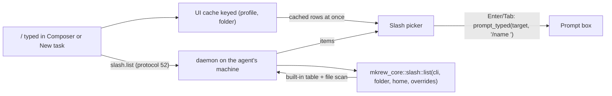

# Prompt inputs: `/` command picker per agent, image paste and drops in New task, prompt library manager - Design

- Date: 2026-11-04
- Status: approved by the user in brainstorming (2026-11-04); this file is the written spec.
- Branch: `feat/prompt-skills` in `.worktrees/prompt-skills`.
- ADRs: `docs/decisions/0094-slash-command-picker.md` (part A), `docs/decisions/0095-task-dialog-attachments.md` (part B), both written by the first task of their part.
- Numbers: part A takes protocol 52, part B takes protocol 53. No migration (0024 stays free).

## 1. Goal

The composer and the New task Prompt box share `composer::Prompt` and most of their behavior (SPEC §20B.1).
Three gaps remain:

- **A.** Typing `/` in either box must show what typing `/` in that agent's own terminal shows: the same names, descriptions and order.
  A pick types `/name ` so the agent receives exactly what the user would have typed in its TUI.
- **B.** The New task Prompt box cannot paste images or take dropped files.
- **C.** The prompt library (SPEC §20B.3) has no UI to add, edit, rename or delete prompts.

Done means: the user never opens a terminal or a file manager to find a command name, attach a screenshot to a task, or edit a prompt.

## 2. What the user decided

| Topic | Decision |
| --- | --- |
| Who reads the command list | The daemon, through a new request `slash.list`. A machine window (ADR 0089) then lists the commands of the machine that runs the agent. |
| How the list is built | Approach 1: scan files by each CLI's documented rules, plus a static built-in table per CLI shipped in the binary. The CLI itself is never started. |
| Profile to CLI | A new optional profile key `cli`; when missing, inferred from the program name of `command`. |
| User fixes | `[slash] hide` and `[[slash.add]]` in the agent profile TOML; no rebuild. |
| Codex skills | Not in `/`, as in Codex (they live in its `$` popup). `/` shows Codex built-ins only. |
| Image paste in New task | `attachment.save` takes an owner: a session or a project. Project images live until no open task mentions them (retention below). |
| Prompt manager | A Prompts page in Settings (Ctrl+,), reachable from the palette, from the prompt picker and from "From prompt". |
| Protocol numbers | A = 52, B = 53, so each part can merge alone. |
| Commits | One commit series per part: A, then B, then C. |

## 3. Non-goals

- MCP prompts in the `/` list.
  They exist only while the agent is connected to its servers; the picker footer says so and `/mcp__server__prompt` still works when typed.
- Usage-based ordering ("recently used first" in Claude Code and omp): Mkrew does not see which commands the agent ran.
- Argument completion after `/name ` (omp and Codex complete some arguments).
- Codex `$` skill mentions, and a picker for them.
- Built-ins that depend on the user's plan, login, provider or feature flags: they are listed; the user hides them with `[slash] hide`.
- omp settings that change discovery (`commands.enableClaudeUser`, `skills.enableSkillCommands`, `disabledExtensions` and similar in `~/.omp/agent/config.yml`): omp defaults are used; `[slash]` covers the rest.
- omp extension commands and user or project TypeScript commands (`.omp/commands/<dir>/index.ts`): their names and descriptions come from running code, so they are not listed (bundled `green`, `review`, `annotate` have fixed names and are in the built-in table).
  The user adds the ones they use with `[[slash.add]]`.
- A file watcher for commands or prompts: both lists are read when their picker opens.

## 4. Part A - `/` command picker

### 4.1 Architecture



### 4.2 Profile: `cli` and `[slash]`

New keys in the agent profile TOML (`RawProfile`, `crates/mkrew-core/src/profile.rs`):

```toml
cli = "claude"            # "claude" | "codex" | "omp" | "copilot"; optional

[slash]
hide = ["desktop", "upgrade"]   # names removed from the list

[[slash.add]]
name = "deploy"
description = "Deploy to staging"
argument_hint = "<env>"         # optional
```

- `AgentProfile` gets `cli: Option<Cli>` and `slash: SlashOverrides { hide: Vec<String>, add: Vec<SlashAdd> }`.
- When `cli` is missing it is inferred from the file stem of `command`, lowercased, with `.exe`, `.cmd`, `.bat`, `.ps1` removed: `claude`, `codex`, `omp`, `copilot`.
  Inference is needed because `seed_profiles` never overwrites a profile the user already has, so existing users would otherwise get no list.
  A wrapper command (`npx`, a script) infers nothing; the user sets `cli`.
- The shipped profiles in `agents/*.toml` state `cli` explicitly.
- Shell profiles (`kind = "shell"`) never infer a CLI.
- An unknown `cli` value is a profile error, shown like other profile errors.
- `[slash] hide` removes rows by name after every source is merged; `[[slash.add]]` rows are added with source `profile` and win over every other source of the same name.
- `AgentProfileInfo` (protocol) does not change: the daemon resolves the CLI itself.

### 4.3 Protocol 52: `slash.list`

```rust
// Request::SlashList, "slash.list"
pub struct SlashListParams {
    pub profile_id: String,
    pub project_id: Ulid,
    /// The task worktree to scan instead of the project folder.
    pub worktree_task_id: Option<Ulid>,
}
pub struct SlashListResult {
    /// None: the profile's CLI is unknown; `items` is empty.
    pub cli: Option<Cli>,
    pub items: Vec<SlashItem>,
    /// Files that could not be read or parsed, one line each; the picker shows a count.
    pub errors: Vec<String>,
}
pub struct SlashItem {
    pub name: String,            // without the leading '/'
    pub description: String,
    pub argument_hint: Option<String>,
    pub source: SlashSource,     // BuiltIn | Project | User | Managed | Plugin(String) | Profile
    /// omp only: the row stands for N skills and expands to `skill:` (section 5.3).
    pub group: Option<u32>,
}
```

- The daemon resolves the folder the same way `fs.*` requests do with `worktree_task_id`.
- `home` is the daemon user's home, so `~` means the agent's machine.
- The scan runs on the blocking pool; it reads only small files and stops at the repo root.
- `PROTOCOL_VERSION` 51 to 52; SPEC protocol section lists the request.

### 4.4 Which folder and which profile

| Box | Profile | Folder |
| --- | --- | --- |
| Composer | `session.agent_profile` | the session's project, with `worktree_task_id = session.task_id` when that task has a worktree |
| New task | `dialog.agent`, else the workspace default agent | the project folder (no worktree exists before Run) |
| Edit task | `dialog.agent`, else the default | the task's worktree when it has one, else the project folder |

Changing Agent in the dialog while the picker is open sends a new `slash.list` and replaces the rows; the filter text stays.

### 4.5 UI cache and refresh

- `Shell` keeps `slash_cache: HashMap<(String, Ulid, Option<Ulid>), Vec<SlashItem>>`.
- Opening the picker shows the cached rows at once (or "Loading commands…" the first time), sends `slash.list`, and swaps the rows when the answer arrives.
  Answers are matched by a request number; a stale answer is dropped, as `QuickOpen.sent` does.
- No request is sent while typing.
- The cache lives for the window's life; it is small (a few hundred rows per key).

### 4.6 Picker behavior

- Trigger: `/` typed at the start of a line or right after whitespace, in either box, via one helper shared with `@` (`trigger_at(text, cursor)` replacing `opens_file_picker`).
- The picker reuses the prompt picker's overlay frame and the palette matcher `palette::fuzzy`.
- Empty filter: rows in the CLI's own order (section 5).
  With a filter: fuzzy score, ties kept in the CLI's order.
- Row: `/name` in the mono font, `argument_hint` in `text_muted`, description (one line, ellipsis), and a source chip on the right: `built-in`, `project`, `user`, `managed`, `plugin: <name>`, `profile`.
- Keys: ↑ ↓ move, Enter or Tab types `/name ` through `prompt_typed(target, …)`, Esc closes and types `/`.
  A group row (omp `skill:`) types nothing; it sets the filter to `skill:` and lists the skills.
- Empty states (each one sentence plus one action):
  - CLI unknown: "Mkrew doesn't know which CLI this agent runs. Set `cli` in its profile." Action **Open profile** opens `<config>/agents/<id>.toml` in Zed.
  - No match: `No commands match "/x"`. Action: Esc types `/x` as typed.
  - Daemon error: the error line. Action **Try again**.
- Footer, fixed: "MCP prompts are not listed; type /mcp__server__prompt" (Claude only), plus "N files could not be read" when `errors` is not empty, with the list in a tooltip.
- Palette: no new command (the picker is a typing aid, like `@`); the composer toolbar tooltip for the prompt box mentions `/`.

### 4.7 Shared key handling

`composer_key_down` (`shell/composer.rs`) and `task_dialog_key_down` (`shell/task_dialog.rs`) become one `prompt_key_down(target, event, window, cx)`.
Box-specific keys (Enter to send in the composer, Ctrl+Enter to run in the dialog, Tab focus order) stay in thin callers.
`@` and `/` go through the shared path.

## 5. Command sources per CLI

Every rule below is from the CLI's official docs or source; the ADR lists the links (section 9).

Front matter: a file whose first line is `---` has YAML front matter up to the next `---`.
Mkrew reads only top-level keys `name`, `description`, `argument-hint` (`argumentHint` for omp), `user-invocable`, `when_to_use`, with plain, quoted, `|` and `>` scalars.
A file whose front matter does not parse is listed with no fields set, as Claude Code does.
Description fallback: the first non-empty body line (omp: cut to 60 characters plus `...`).

### 5.1 Claude Code (table pinned to 2.1.312)

| Source | Files | Name | Chip |
| --- | --- | --- | --- |
| Built-ins and bundled skills | `crates/mkrew-core/slash/claude.toml` | fixed | built-in |
| Managed skills | `<managed>/.claude/skills/*/SKILL.md`; managed = `C:\Program Files\ClaudeCode\`, `/Library/Application Support/ClaudeCode/`, `/etc/claude-code/` | `name`, else folder | managed |
| User skills, commands | `~/.claude/skills/*/SKILL.md`, `~/.claude/commands/**/*.md` | skill: `name` or folder; command: path below `commands/` with `/` joined by `:`, `.md` removed | user |
| Project skills, commands | `.claude/skills/*/SKILL.md` and `.claude/commands/**/*.md` in the folder and each parent up to the repo root (worktree root in a linked worktree; when the worktree has no `.claude/skills`, the main checkout) | as above | project |
| Plugins | `~/.claude/plugins/installed_plugins.json` entries whose `<name>@<marketplace>` is enabled; `<installPath>/skills/*/SKILL.md`, `<installPath>/commands/*.md`, plus `skills`/`commands` paths in `.claude-plugin/plugin.json` (`commands` replaces the default folder, `skills` adds to it) | `<manifest name>:<name>` | plugin: name |

Rules:
- Skills with `user-invocable: false` are left out.
- Enabled plugins and skill toggles come from the settings files, lowest to highest: `~/.claude/settings.json`, `.claude/settings.json`, `.claude/settings.local.json`, managed `managed-settings.json`.
  `enabledPlugins` entries merge by key; `skillOverrides` with `"off"` hides that skill; `disableBundledSkills: true` hides rows marked `bundled` in the table.
- Same name: managed beats user beats project; a skill beats a command file; a user or project skill replaces a built-in row of that name.
  Names compare case-insensitively.
- Built-in rows carry `os = [...]` when the docs restrict them (`/desktop`: windows, macos); other conditions are not evaluated.
  Rows hidden until fully typed (`/heapdump`, `/setup-bedrock`, `/setup-vertex`) are left out.
- Order with an empty filter: by name.
  The docs do not state an order beyond usage; HUMAN_CHECKS asks the user to compare with the TUI.
- Built-in descriptions: taken from `supportedCommands()` of Claude Code 2.1.312 once while building the table, when that runs without a model turn; otherwise from the docs "Purpose" column.
  The table records which.

### 5.2 Codex CLI

- Only built-ins, from `crates/mkrew-core/slash/codex.toml`, copied from `codex-rs/tui/src/slash_command.rs` with its exact descriptions and enum order (the source says the enum order is the popup order).
- Left out as Codex leaves them out: names starting with `debug`, `apps`, `rollout`, `test-approval`, and the aliases `quit` and `btw` in the unfiltered list.
- Feature-gated rows (`plan`, `voice`, `goal`, `worktree`, `usage`, `plugins`, `daybreak`, `setup-default-sandbox`) are listed except `daybreak` and `setup-default-sandbox`, whose gates are internal; `os` filters `app`.
- Service-tier commands (`/fast`) come from the model catalog at runtime and are not listed.
- The table records the Codex version or commit it was copied from.
  Codex is not installed on the build machine, so the commit hash of `slash_command.rs` is recorded instead of a CLI version.

### 5.3 Oh My Pi (omp, table pinned to 18.13.2)

Order with an empty filter, as the omp popup: built-ins (registry order, then bundled custom commands), the `skill:` group row, markdown commands, prompt templates.

| Source | Files | Name | Chip |
| --- | --- | --- | --- |
| Built-ins | `crates/mkrew-core/slash/omp.toml` (from `builtin-registry.ts`), plus bundled `green`, `review`, `annotate`, and `init` when no file command is named `init` | fixed | built-in |
| Skills | `.omp/skills/*/SKILL.md` (folder up to repo root), `~/.omp/agent/skills/*/SKILL.md`, project `.claude/skills/*/SKILL.md`, `~/.omp/plugins/node_modules/*/skills/*/SKILL.md` | `skill:<name>`, collapsed into one row `skill:` "N skills" | per source |
| Markdown commands | `.omp/commands/*.md`, `~/.omp/agent/commands/*.md`, project `.claude/commands/**/*.md` (`foo/bar.md` gives `bar` and `foo:bar`), `.agent(s)/commands/*.md` up to repo root and in home, `.codex/commands/*.md`, `.opencode/commands/*.md` | file stem | per source |
| Prompt templates | `~/.omp/agent/prompts/**/*.md`, `.omp/prompts/**/*.md` | file stem | user / project |

Rules:
- Markdown command clash: first wins by provider priority, omp 100 > plugins 90 > claude 80 > agents and codex 70 > opencode 55; inside omp project beats user, inside the others user beats project.
- Skill clash: native 100 > plugins 90 > claude 80 > others; the skill name comes from `name`, else the folder; names with `/` or `\` are dropped.
- A prompt template whose name is taken by any other row is hidden.
- The group row expands when the filter starts with `skill:`; a single skill also shows on its own when its bare name prefix-matches better than every other row.

### 5.4 GitHub Copilot CLI (table pinned to 1.0.99)

| Source | Files | Name | Chip |
| --- | --- | --- | --- |
| Built-ins | `crates/mkrew-core/slash/copilot.toml`, from the CLI command reference | fixed | built-in |
| Project skills | `.github/skills/*/SKILL.md`, `.agents/skills/*/SKILL.md`, `.claude/skills/*/SKILL.md` in the folder, then parent `.github/skills/` up to the repo root | `name` | project |
| User skills | `~/.copilot/skills/*/SKILL.md`, `~/.agents/skills/*/SKILL.md`, folders in `COPILOT_SKILLS_DIRS` (a comma-separated list, as in the Copilot CLI reference; from the profile `env`, else the daemon's environment) | `name` | user |
| Commands | `.claude/commands/*.md` | file stem | project |

Rules: the first found wins in the order of the table rows above; a skill beats a command of the same name; `user-invocable: false` is left out.
Plugin skills are not listed: the docs do not name the plugin folder.
Order with an empty filter: built-ins in the reference order, then skills, then commands.

### 5.5 Built-in tables

- One TOML file per CLI under `crates/mkrew-core/slash/`, embedded with `include_str!`.
- Header: `cli_version` (or `source_commit` for Codex) and `source` (URL).
- Rows: `name`, `description`, optional `argument_hint`, `os`, `bundled`.
- A unit test parses every table and checks unique names.
- Version drift: when a CLI adds or renames a command, the user adds it with `[[slash.add]]` or hides it with `[slash] hide` until the table is updated.

## 6. Part B - New task: image paste and drops

### 6.1 Protocol 53: `attachment.save` owner

```rust
pub struct AttachmentSaveParams {
    pub owner: AttachmentOwner,   // replaces `session_id`
    pub ext: String,
    pub data: String,             // unchanged, ≤ 10 MiB
}
pub enum AttachmentOwner { Session(Ulid), Project(Ulid) }
```

- `Session` keeps today's folder `<data>/attachments/<session_id>/<ulid>.<ext>`.
- `Project` writes `<data>/attachments/projects/<project_id>/<ulid>.<ext>`.
- The composer sends `Session`; the task dialog sends `Project(dialog.project_id())`.
- An unknown project is an error, as an unknown session is today.

### 6.2 Retention (ADR 0060)

The hourly check keeps today's session rule and adds:
a file under `attachments/projects/<id>/` is deleted when it is older than 7 days and no task of that project has a prompt containing the file name, unless that task has been done for more than 7 days.
A task in the backlog for weeks keeps its screenshot; a done task's screenshot goes 7 days after the task is done, like a session's.

### 6.3 Paste

- Ctrl+V in the dialog's Prompt box with an image on the clipboard saves it and types its path, through the same code the composer uses (moved into the shared `prompt_key_down`).
- The "text only" note in SPEC §20B.1 and the HUMAN_CHECKS entry "2026-11-02 Task dialog prompt works like the composer" change to match.

### 6.4 Drops

- The dialog's Prompt box takes OS file drops and file-tree row drags, and types each path the way a drop on a pane does (quoting and separator rules shared).
- While a drag is over the box it shows the accent focus ring, using the pane's `drop_hover` approach (the gpui drop workaround).
- `type_into_pane` keeps ignoring drops while a dialog is open; the dialog box handles its own.

## 7. Part C - Prompt library manager

### 7.1 Core API (`mkrew_core::prompt`)

```rust
pub fn validate_name(dir: &Path, name: &str, renaming: Option<&str>) -> Result<(), NameError>;
pub fn create(dir: &Path, name: &str, body: &str) -> Result<(), PromptError>;
pub fn save(dir: &Path, name: &str, body: &str) -> Result<(), PromptError>;
pub fn rename(dir: &Path, old: &str, new: &str) -> Result<(), PromptError>;
pub fn delete(dir: &Path, name: &str) -> Result<(), PromptError>;
```

- A name is invalid when empty after trimming, longer than 64 characters, starting with `.`, containing `/ \ : * ? " < > |` or a control character, ending in a space or `.`, or a Windows reserved name (`CON`, `PRN`, `AUX`, `NUL`, `COM1`-`COM9`, `LPT1`-`LPT9`).
- A name equal to another prompt's name, case-insensitively, is a duplicate; renaming a prompt to a new case of its own name is allowed.
- `save` writes a temp file in the same folder and renames it over the target, so a crash never leaves half a prompt.
- `rename` refuses when the target exists.
- Tests in a tempdir: create, save, rename, rename case-only, delete, duplicate, each invalid kind, missing folder.

### 7.2 Settings page "Prompts"

- A new `Tab::Prompts` in `settings_dialog.rs`, laid out like Machines: list on the left, editor on the right.
- List: title (the `# Title` line, else the name) and name in `text_muted`.
  Empty state: "No prompts yet." Action **New prompt** (Ctrl+N).
- Editor: Name field, a multi-line TextBox for the body (ADR 0075), a hint line naming `{file}`, `{selection}`, `{task}`, `{project}`, and buttons **Save** (Ctrl+S), **Delete** (asks first), **Open folder**.
- Unsaved edits: switching prompt or closing Settings asks Save / Discard / Cancel, as Files does.
- Errors (name invalid, duplicate, read or write failure) show under the field or at the top of the page and never close it.
- The folder is re-read when the page opens and after every write; a broken file shows its error in its row.

### 7.3 Entry points

- Palette: "Manage prompts" (opens Settings on the Prompts page).
- Prompt picker: a last row "Manage prompts", reachable by keyboard.
- New task: the "From prompt" menu gets the same row.
- The prompt picker already reloads the folder on every open, so a saved prompt shows at once.
- In a machine window, the page edits this computer's library, as the picker reads it.

## 8. Testing

No test starts a real agent or uses the network; every scan runs on a fake home and project in a tempdir.

| Area | Tests |
| --- | --- |
| Profile | `cli` parse, inference from `command` (`claude.cmd`, `C:\x\codex.exe`, `npx` gives none), shell profiles infer none, unknown `cli` error, `[slash]` parse |
| Front matter | plain, quoted, `|`, `>`, missing, broken YAML, first-line fallback, omp 60-character cut |
| Claude | command `a/b.md` to `a:b`; skill `name` vs folder; `user-invocable: false`; managed > user > project; skill beats command; user skill replaces built-in; parent folders up to repo root only; plugin enabled vs disabled via settings precedence; manifest `commands` replaces, `skills` adds; `disableBundledSkills`; `skillOverrides: off` |
| Codex | only built-ins; debug and alias rows left out; enum order kept |
| omp | provider priority on clashes; project vs user inside providers; skill group row and expansion; template hidden by a taken name; `init` only when no file command `init` |
| Copilot | first-found order; skill beats command; `COPILOT_SKILLS_DIRS` |
| Overrides | `hide` removes; `add` wins over every source |
| Tables | every embedded table parses; names unique |
| Daemon | `slash.list` with project and with `worktree_task_id`; unknown profile error; unknown CLI gives `cli: None` |
| UI picker | trigger at line start and after space only; filter; Enter and Tab type `/name `; Esc types `/`; group row expands; agent change in the dialog replaces rows; stale answer dropped |
| Attachments | `attachment.save` with `Project`; unknown project error; retention keeps a file named by an open task, deletes it once the task is done and 7 days passed |
| Dialog | paste image types a path; drop types paths |
| Prompt CRUD | section 7.1 list |

Visual checks (dark and light) for the slash picker, the dialog drag ring and the Prompts page go to HUMAN_CHECKS "To verify", with the check that the Claude order matches the TUI.

## 9. Sources (copied into ADR 0094)

- Claude Code commands: https://code.claude.com/docs/en/commands.md
- Claude Code skills and command files, precedence: https://code.claude.com/docs/en/skills.md
- Claude Code plugins on disk: https://code.claude.com/docs/en/plugins/loading.md, https://code.claude.com/docs/en/plugins-reference.md
- Claude Code MCP prompts: https://code.claude.com/docs/en/mcp.md#use-mcp-prompts-as-commands
- Claude Code managed settings: https://code.claude.com/docs/en/managed-settings.md
- Claude Code SDK `supportedCommands()`: https://code.claude.com/docs/en/agent-sdk/typescript.md
- Claude Code changelog: https://github.com/anthropics/claude-code/blob/main/CHANGELOG.md
- Codex built-ins and order: https://github.com/openai/codex/blob/main/codex-rs/tui/src/slash_command.rs
- Codex popup filtering: https://github.com/openai/codex/blob/main/codex-rs/tui/src/bottom_pane/command_popup.rs, https://github.com/openai/codex/blob/main/codex-rs/tui/src/bottom_pane/slash_commands.rs
- Codex custom prompts removed in 0.117.0: https://github.com/openai/codex/issues/15941
- Codex skills: https://learn.chatgpt.com/docs/build-skills.md
- omp built-in registry: https://github.com/can1357/oh-my-pi/blob/main/packages/coding-agent/src/slash-commands/builtin-registry.ts
- omp list assembly: https://github.com/can1357/oh-my-pi/blob/main/packages/coding-agent/src/modes/interactive-mode.ts
- omp file commands, priorities: https://github.com/can1357/oh-my-pi/blob/main/packages/coding-agent/src/extensibility/slash-commands.ts and `omp://slash-command-internals.md`, `omp://skills.md` (docs embedded in omp 18.13.2)
- omp prompt templates: https://github.com/can1357/oh-my-pi/blob/main/packages/coding-agent/src/config/prompt-templates.ts
- omp popup ranking and skill group: `@oh-my-pi/pi-tui/src/autocomplete.ts` (pi-tui package, installed with omp 18.13.2)
- Copilot CLI commands, skills, command files: https://docs.github.com/en/copilot/reference/copilot-cli-reference/cli-command-reference
- Copilot CLI changelog: https://github.com/github/copilot-cli/blob/main/changelog.md

## 10. Docs that change

- SPEC §20B.1 (image paste and drops in the task dialog), §20B.3 (manager page), §20B.5 (project attachments, retention), §13 (Ctrl+N and Ctrl+S on the Prompts page, `/` in prompt boxes), the agent profile section (`cli`, `[slash]`), the protocol section (52, 53).
- HUMAN_CHECKS: the 2026-11-02 entry; new "To verify" lines.
- README: `/` picker and the Prompts page in the feature list.
