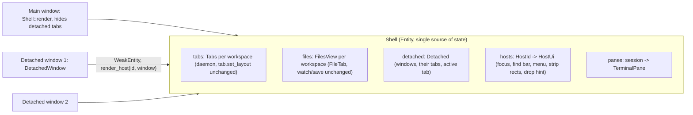

# Detached windows: drag a terminal tab or an Editor file out into its own window - Design

- Date: 2026-11-10
- Status: approved by the user in brainstorming (2026-11-10); amended the same day after reading the code (§2 Approach, §4.1-§4.5, §5.1, §6.1, §9), amendment approved by the user.
- ADR: `docs/decisions/0096-detached-windows.md` (written by the first implementation task).
- Inspiration: JetBrains IntelliJ "drag an editor tab out of the window" / "Open in New Window".

## 1. Goal

The user wants to place a terminal tab (an agent at work) or a file they edit on a second screen, next to the main Mkrew window.
Dragging a tab out of the main window opens it in its own OS window.
That window can hold several tabs, can send them back to the main window, or can close them.
Done means: a tab dragged out lands in a new window under the pointer, the terminal keeps running and takes keys, the file stays fully editable, "Move back" returns it, and a restart brings the windows back.

## 2. What the user decided

| Topic | Decision |
| --- | --- |
| Terminal unit | A whole terminal tab (its split tree), not a single pane. |
| Editor | A file tab of the Files view, fully editable in the detached window: type, save, find, Markdown preview, preview select and block edit. |
| Window content | Several tabs per detached window, like IntelliJ, with a tab strip; tabs can be dragged between any Mkrew windows. |
| Mixing | Free: one detached window may hold terminal tabs and file tabs of different workspaces; each chip shows its workspace. |
| Restart | Detached windows come back with their bounds, display, tabs and active tab; stored locally by the UI, no protocol change. |
| Close | Closing a detached window really closes its tabs (terminal `tab.close`, which removes the sessions, ADR 0041; unsaved files ask). "Move back" is a separate action. |
| Approach | A: `Shell` stays the single owner of all state; each detached window is a thin host view that asks `Shell` to render its part. The window an input or a render belongs to is read from its `window` handle, never from a stored "current window" field. |
| Delivery | Two plans: Plan 1 = the detached-window machinery and terminal tabs; Plan 2 = Editor file tabs (§9). |

## 3. Non-goals

- Detaching a single pane, the Board, Git, Docs, the sidebar or any dialog.
- A file tree or an inspector inside a detached window.
- Sharing detached windows through the daemon, `mk` or `mk web`.
- Keeping unsaved file edits across a crash (the main window does not either).
- Window z-order against other apps when choosing a drop target.

## 4. Architecture



### 4.1 Model

- `HostId`: `Main` or `Detached(WindowKey)`, where `WindowKey` is a small counter local to the UI process.
- `DockTab`: `Terminal { project: Ulid, tab_id: Ulid }` or `File { project: Ulid, worktree: Option<Ulid>, path: String }`.
  `path` is `FileTab.path` as it is today: relative to the folder the Files view shows (the project folder, or the task worktree `worktree`), `/` separators.
- A tab keeps living where it lives today: a terminal tab in `Shell.tabs[project]`, a file tab in `Shell.files[project].tabs`.
  The daemon, `tab.set_layout`, the router, file watch, save and reload do not change.
- `Detached` (pure module `crates/mkrew-ui/src/detached.rs`) lists the detached windows: for each, its key, its tabs (`Vec<DockTab>`, strip order) and its active index.
  It is the only record of which tab sits in which window.
  A tab in no detached window is in the main window.
- Invariant: a `DockTab` appears in at most one detached window.
  Every change goes through `Detached::move_tab(tab, to: HostId, index: Option<usize>)`, which removes it from its old window, inserts it at the index (or the end), makes it active, and drops a detached window left without tabs.
- The main window's terminal tab strip and Files tab strip skip tabs present in `Detached`.
  When every tab of the shown workspace is detached, the existing empty state shows.
- Invariant: the main window's choices never name a detached tab.
  `Tabs.active` (one per workspace, `tabs.rs:151`) and `FilesView.active` stay the main window's; a detach moves them to a tab that stays in the main window, or to none.
  The detached window's own active tab is the one in `Detached`.
- Opening something that is already detached activates its window and selects its tab instead of opening a second copy:
  a file opened from the Files tree, a session picked in the sidebar, a palette jump to a session.

### 4.2 Host view

- `DetachedWindow` is the root view of each detached window.
  Fields: `shell: WeakEntity<Shell>`, `key: WindowKey`, `focus_handle`.
- `render` calls `shell.update(cx, |shell, cx| shell.render_host(HostId::Detached(key), window, cx))`.
  `render_host` draws the title bar, the mixed tab strip and the active tab's content with the existing pane and editor render code.
- `DetachedWindow` observes `Shell` (`cx.observe(&shell, ...)`) so a `Shell` change redraws every detached window.
- The root sets the same key contexts as the main window: the terminal context, or `EDITOR_CONTEXT` when a file tab is active.
- The host of a render, a listener, an action or an async continuation is `Shell::host_of(window)`: a lookup of `window.window_handle()` in `Shell.windows: HashMap<AnyWindowHandle, WindowKey>`; a window not in the map is the main window.
  There is no stored "current host": every gpui callback that runs code for a window already receives that window.
- Code that runs for a detached window takes the tab explicitly: `(project, tab_id)` for a terminal tab, `(project, path)` for a file tab.
  Functions that read `self.workspace` or `Tabs::active` today and must also serve a detached window get that explicit parameter (for example `close_tabs(project_id, tab_ids, ...)`).
  Everything that only the main window shows (sidebar, Board, Git, Docs, dialogs) keeps reading `self.workspace`.
- Keyboard commands in a detached window go through its own `on_action`, which calls `Shell::run_detached(key, command, window, cx)`.
  It handles an explicit list of commands for the active tab (tab and pane commands of §13, palette, the commands of §5.2) and ignores the rest, so no command of a detached window can act on the main window's tabs.

### 4.3 Per-window UI state

- `Shell.hosts: HashMap<HostId, HostUi>` holds what each window shows on its own: the tab strip rect and chip rects recorded after paint, and the drop hint.
- Popovers stay single, as today (one context menu, one palette at a time, app-wide), and remember the window they opened in: `Shell.menu_host: HostId` and `Shell.palette_host: HostId`.
  Only that window renders them; opening one in another window dismisses the open one first, as a click elsewhere does today.
- Plan 2 adds the Editor state that exists once today and must exist per window when two editors are on screen: the find bar (`FilesView.find`), the editor, find, replace, block and preview focus handles, `file_code_scroll`, `file_tabs_scroll`, `file_page`, `file_text_left`, `md_split_bounds` and `md_split_sync`.
  These fields move out of `Shell` into `HostUi`, the main window included, so there is one convention, not two.
- IME state (`typing_target`, `ime_marked`) stays single: only one OS window holds the keyboard at a time.
  Mark it with a `ponytail:` comment naming that ceiling.

### 4.4 Terminal panes across windows

- `TerminalPane` stores its two window-bound subscriptions (`observe_window_appearance`, `on_blur`, `terminal/view.rs:187-197`) as `Subscription` fields instead of detaching them.
- `TerminalPane::rehost(window, cx)` replaces both for the new window.
  The emulator, scrollback, selection, copy mode and focus handle survive the move.
- `Shell::attach` keeps the `OpenLink` subscription (`subscribe_in(window)`) in `Shell.link_subscriptions: HashMap<Ulid, Subscription>` so a move re-subscribes it for the new window.
- A pane click in a detached window focuses the pane through a new `Tabs::focus_pane(tab_id, session)`, which, unlike `Tabs::focus`, leaves `Tabs.active` alone.
- Attaching a session shown in another window than the one `sync_panes` runs for: `Shell` cannot borrow that window while it is itself being updated, so it schedules the attach with `cx.defer` and runs it inside `WindowHandle::update` of the window that shows it.
- The new window's size reaches the session through the existing resize path (`session.resize`).
- `sync_panes` (`shell/focus.rs:187`) computes the visible sessions as the union of:
  the main window's visible tab (today's rule), and the active tab of every detached window that is not minimized.
  Background tabs of a detached window are detached like background tabs of the main window (SPEC §10).
  A session becoming visible attaches inside the window that shows it.

### 4.5 Editor in a detached window

Plan 2 (§9).

- Only the tab strip and the editor: no file tree, no inspector.
- Typing, save, find, Markdown mode, preview select and block edit work as in the main window.
  The render and input code takes the tab's path and the window's `HostUi` explicitly instead of `FilesView::tab()` and the single `Shell` fields.
- Markdown mode, scroll position and caret move with the `FileTab`.
- Switching a workspace's Files view to another folder (project or worktree) replaces its `FilesView` (`shell/files.rs:44`), so its detached file tabs are pruned like closed tabs, after the existing unsaved-changes questions.

### 4.6 Where overlays show

| Kind | Window |
| --- | --- |
| Find bar, context menu, confirm prompt (`window.prompt`), slash picker and composer of a pane | The window where the user acts |
| Palette | The window where the user acts; in a detached window it hides commands that only mean something in the main window (view switches, sidebar, Board) |
| App dialogs (Settings, Task, Phone access, Update, Ports...) | Always the main window, which is activated first |
| Toasts | The focused Mkrew window |

### 4.7 Theme

Each detached window observes its own appearance and calls `theme::refresh`, like the main window (`shell/connection.rs:55`).
Dark and light themes both apply; every color, spacing, radius and font size comes from `theme.rs`.

## 5. Interactions

### 5.1 Drag and drop

- A drag starts on a chip of the terminal tab strip, the Files tab strip, or a detached window's strip.
  Today's reorder (`DraggedItem`, `shell/reorder.rs`) and tab-on-pane split (`pane_drop.rs`) stay as they are.
- gpui-pre-windows captures the mouse on button down (`SetCapture`, `events.rs:492`) and releases it on button up (`events.rs:522`), so the source window receives the release even outside its bounds, while other windows see no hover and no drop.
  The source window therefore decides the target.
- On release, with the pointer in screen coordinates (window position plus `window.bounds().origin`):

| Release point | Result |
| --- | --- |
| Inside the source window | Today's behavior (reorder, split). |
| Over another Mkrew window of this process | The tab moves there: into its strip at the index under the pointer when over the strip, else at the end; it becomes active and that window takes focus. A drop on the main window also switches it to the tab's workspace and to Terminals or Files. |
| Outside every Mkrew window | A new detached window opens with its top left at the pointer, the size of the source's tab content area (at least the minimum window size), clamped onto the display under the pointer. |

- The target comes from `cx.windows()` and each window's `bounds()`; strip rects come from `HostUi`.
- During a drag `Shell` keeps a drop hint (target host and index), so the target window highlights the insertion point although it receives no mouse events.
- Overlapping Mkrew windows: the most recently activated one wins (`Shell` keeps the activation order; `App::window_stack` returns `None` on Windows in gpui-pre 0.3.7).
  Other apps' windows are ignored (`ponytail:` comment: no OS z-order query; add one if drops through other apps confuse users).
- The release point is the source window's logical position plus its `bounds().origin`.
  On two displays with different scale factors this can be off by the scale difference (`ponytail:` comment naming it; convert through physical pixels if users hit it).
- A detached window left without tabs closes.

### 5.2 Keyboard, palette and menus (ADR 0085)

| Command | Where | Key |
| --- | --- | --- |
| `Tab: Move to new window` | Palette; tab context menu; terminal and file tabs, in any window | `Shift+F4` like IntelliJ (free in `keymap.rs` on 2026-11-10) |
| `Tab: Move to main window` | Palette and tab context menu in a detached window | none |
| `Tab: Move to window ▸ <window>` | Tab context menu, when 2 or more windows exist | none |
| `Window: Move all tabs back` | Palette and title bar button in a detached window | none |

### 5.3 Detached window title bar

- The same custom title bar as the main window: drag area, minimize, maximize, close.
- Title: `<active tab title> - <workspace name>`.
- A "Move all back" icon button, with a tooltip and a keyboard path through the palette.

### 5.4 Close

- The ✕ button, `Alt+F4` and the palette close of a detached window use `on_window_should_close` and close every tab inside it:
  - terminal tabs through the existing `close_tabs` (one confirmation for all running agents, ADR 0041);
  - file tabs through the existing unsaved-changes prompt.
- Cancel at any prompt keeps the window and every tab not closed yet.
- Closing the app (main window ✕, quit) never runs this path: see §6.2.

## 6. Persistence and lifecycle

### 6.1 `windows.json`

- Path: `<data_dir>/windows.json` for this computer's window; a machine window (ADR 0089) uses `windows-<machine>.json`, named like `inbox::viewed_file`.
- Shape:

```json
{
  "version": 1,
  "windows": [
    {
      "bounds": { "x": 1920, "y": 80, "width": 1100, "height": 760 },
      "maximized": false,
      "tabs": [
        { "terminal": { "project": "01J...", "tab_id": "01J..." } },
        { "file": { "project": "01J...", "worktree": null, "path": "src/main.rs" } }
      ],
      "active": 0
    }
  ]
}
```

- Written atomically (temporary file, then rename) after a window move or resize, a tab move, a tab close, and on quit.
- Unknown `version`, unreadable or broken file: `tracing::warn`, start without detached windows, overwrite on the next write.
- A failed write shows an error toast, like `settings_write_failed`.
- A file tab is restored only when its workspace's Files view shows the same folder (`worktree`) at restore time; a Files view created by the restore starts on that folder.

### 6.2 Lifecycle

| Event | Behavior |
| --- | --- |
| Startup | After the first `tabs` snapshot from the daemon, reopen the saved windows. Drop tabs whose project, tab or file is gone; skip a window left empty. File tabs read their content from disk. Bounds that intersect no display in `cx.displays()` move to the center of the primary display. |
| Main window ✕ | The existing `window_should_close`: unsaved files ask, including those in detached windows (they live in `FilesView`). Then write `windows.json`, close the detached windows without closing their tabs, and quit. `on_window_closed` quits when the main window closes, not only when no window is left. |
| Close to tray (ADR 0064) | Hiding the main window hides every detached window; showing it from the tray shows them again. |
| Tab closed elsewhere (`mk`, another ✕), session removed, workspace archived | The tab leaves `Tabs` or `FilesView`; the next update prunes it from `Detached`; a window left empty closes. |
| Daemon lost and back | Detached windows show the same reconnecting state as the main window; after the new snapshot, missing tabs are pruned. |
| File renamed or deleted | Today's `FilesView` handling, since the tab still lives there. |
| `open_window` fails | The tab stays where it was; error toast. |

## 7. Testing

Pure logic lives in `crates/mkrew-ui/src/detached.rs` with tests in `crates/mkrew-ui/src/detached/tests.rs`, like `tabs/tests.rs` (the repo has no gpui test context).

- `move_tab`: one window per tab, insertion order in a strip, the active tab after a tab leaves, an emptied window is dropped, moving to `Main` removes the entry.
- `drop_target(point, windows, strips)` returns `Strip(host, index)`, `Window(host)` or `NewWindow(bounds)`: edges of a window, overlapping windows, outside all windows, clamp onto a display.
- Bounds restore: saved bounds on a missing display move onto the primary display.
- `windows.json`: round trip, unknown version, broken file, empty file, pruning of tabs that no longer exist.
- Visible sessions: union of the main window and the active tabs of detached windows, minimized windows excluded.
- Close plan: a detached window ✕ lists its tabs to close; app quit lists none.

Smoke on the real app (Windows, `mkrew-ui`): drag a terminal tab out, type in it, drag it into a second detached window and back to the main window, detach a file and save it, Move all back, Close with a running agent (confirmation), restart and check the restore, dark and light themes, screenshots.
The manual checks go to `docs/HUMAN_CHECKS.md` "2026-11-10 Detached windows".

## 8. Documents

- ADR `docs/decisions/0096-detached-windows.md`: approach A, local persistence instead of the daemon, close semantics, source-decided drop.
- SPEC §10: replace "One window." with the main window plus detached windows, and add a "Detached windows" subsection (model, drag rules, commands, close, persistence).
- SPEC §13: the `Shift+F4` default for `Tab: Move to new window`.
- `docs/PROGRESS.md` note and `docs/HUMAN_CHECKS.md` entry.
- No protocol change (`PROTOCOL_VERSION` stays 53), no migration.

## 9. Delivery

| Plan | Contents | Done when |
| --- | --- | --- |
| Plan 1 | `detached.rs` model and `windows.json`; `DetachedWindow` host view and title bar; host lookup; terminal tab strip and tab content in a detached window; pane rehost and cross-window attach; drag out, drag between windows, Move back, Move all back, Close; `run_detached`; palette and menu commands; restore; lifecycle (§6.2) for terminal tabs; ADR 0096; SPEC §10 and §13. | A terminal tab can live in a detached window end to end, and every §5 and §6 rule holds for terminal tabs. File tabs cannot be detached yet: the Files strip has no "Move to new window" and its drags stay inside the main window. |
| Plan 2 | Per-window Editor state in `HostUi`; file tabs in detached windows (strip, editor, find, save, preview, block edit); file tab commands and drags; file tab persistence and restore; unsaved-changes path of Close. | Every §2 Editor row holds. |

Plan 2 is written after Plan 1 is merged, from the code Plan 1 leaves.
