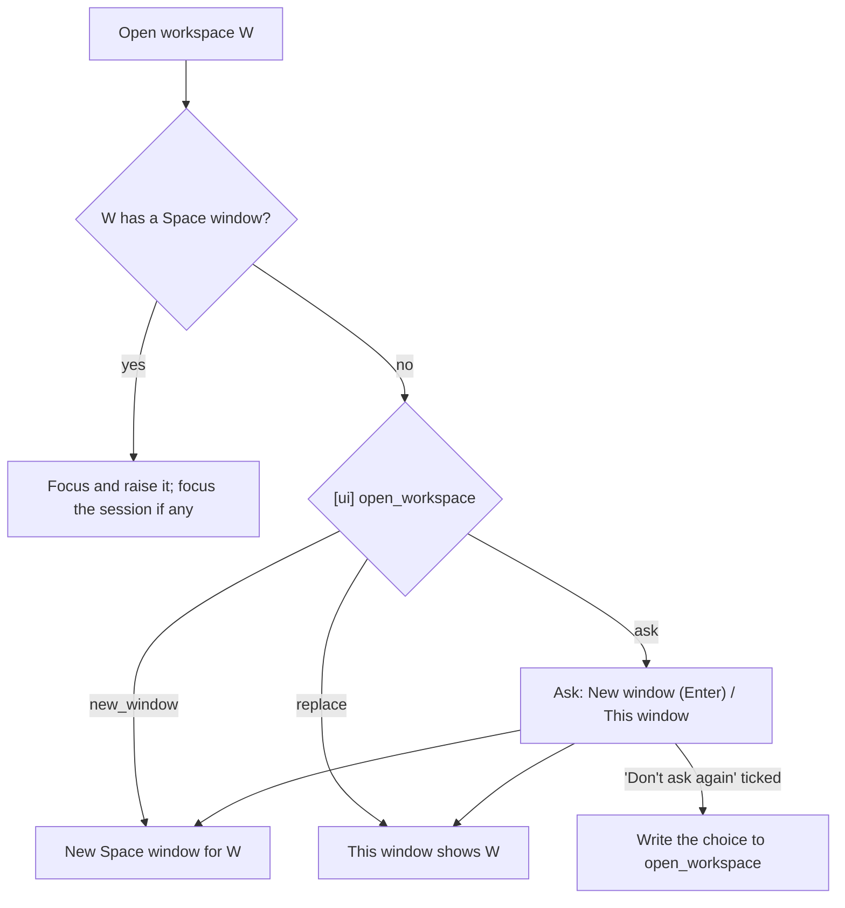

# Window modes - Design

- Date: 2026-11-25
- Status: design approved in chat by the user (2026-11-25), section by section; this file waits for the user's review.
- Branch and worktree: `feat/window-modes` in `.worktrees/window-modes`, from `master` at `164d885`.
- ADR: `docs/decisions/0115-window-modes.md`.
  `master` took 0113 (omp composer local editing) and 0114 (pane render performance) while this branch was open, so this one takes 0115.
  Re-check the number when this branch merges; take the next free one if it moved.
- Protocol: no change.
- Migration: none (UI and settings only).
- Amends ADR 0096 (detached windows: the main window is no longer special) and SPEC §10 (layout) and §20.0 (`[ui]` keys).

## 1. Goal

The user wants two ways to use Mkrew and to switch between them:

- **Single window** (mode 1): today's Mkrew, one window with the sidebar listing every workspace.
- **Window per workspace** (mode 2): every workspace the user opens has its own OS window.

The user wants mode 2 for three things at once:

- Putting one project on each screen and watching several at the same time.
- Focus: a window shows one project only, nothing from the others.
- Switching projects with Alt+Tab and the taskbar, like VS Code.

Success means:

- From mode 1 the user picks one or several workspaces; each picked one gets its own window (one confirmation when several are picked).
- In mode 2, opening another workspace asks "New window" or "This window", with "Don't ask again"; a workspace that already has a window is focused instead.
- From mode 2 back to mode 1, the window the user is in becomes the single window with the sidebar; nothing is lost.
- Mode 1 looks and behaves exactly as today.
- Mkrew comes back in the same mode with the same windows after a restart.
- Moving between modes and windows feels smooth: no flicker of empty windows, no lost focus, every step works with the keyboard.

## 2. What the user said, and what was assumed

Said by the user (request and brainstorm answers):

- Two modes; mode 1 is today's; mode 2 separates by workspace.
- When opening a new workspace the user chooses a new window or the current one: ask each time, with a remembered choice.
- From mode 1 to mode 2: ask the user to pick workspaces; with several, confirm that each opens in its own window.
- From mode 2 back to mode 1: keep it as today; combine into one window.
- Mode 2 has no sidebar; the Files / Session / Git panel can be shown on the left, with a setting for left or right.
- The UX must be smooth and easy.
- Build it in a worktree.
- Architecture: one `Shell` with the shown workspace kept per window (approach A of three).

Assumed (presented in chat, not objected to):

- The mode and the windows are restored on the next start.
- Mode 2 shows a "need you" chip in the title bar for the other workspaces, since there is no sidebar.
- Tear-off windows (ADR 0096) keep working in both modes.
- `[ui] panel_side` applies in both modes (one code path).
- A 3 px stripe of the workspace color tops each mode 2 window.

## 3. Windows and state

### 3.1 Two kinds of windows

| Kind | `HostId` | Holds | Mode 1 | Mode 2 |
|---|---|---|---|---|
| Space window (new name of the main window) | `HostId::Space(SpaceKey)` | title bar, sidebar (mode 1 only), panes, the Files / Session / Git panel, Board, Docs | exactly one | one per opened workspace, at most one per workspace |
| Detached window (ADR 0096) | `HostId::Detached(WindowKey)` | torn-off tabs | unchanged | unchanged |

`HostId::Main` is removed.
Every caller of `HostId::Main` and of the `shell::app_menu::MainWindow` global moves to the new model (about 134 places in `crates/mkrew-ui/src`).

### 3.2 No special main window

- `Shell` becomes an entity created once in `main()`, not the root view of a window.
- Every Space window's root view is a thin `SpaceWindow` view that calls `Shell::render_host(HostId::Space(key))` and forwards input to the `Shell`, like `DetachedWindow` does today (`shell/detached_view.rs`).
- `Shell::primary()` returns the Space window focused last.
  It replaces the `MainWindow` global: Settings, Turns… and the app menu (macOS) open in it.
- `main()` no longer quits when "the main window" closes.
  It quits when the last Space window closes (a hide to tray does not close windows, see 3.5).
  Detached windows alone never keep the app running.

### 3.3 State per window

New fields in `HostUi` (`shell/hosts.rs`), set only for Space windows:

- `workspace: Option<Ulid>`: replaces `Shell.workspace` (about 120 reads).
  Every reader takes the host it draws or acts for; code that has a `Window` gets it with `host_of(window)`.
- `right_panel: inspector::RightPanel`: shown or not, and its tab, per window.
- The scroll and list state of what a Space window draws: `files_scroll`, `git_files_scroll`, `doc_page`, `doc_source_scroll`, `comments_scroll` and `jira_scroll`, moved into a `HostView` struct held by `HostUi`.
  Two windows scrolling one handle would fight over its offset.
  Focus handles stay in `Shell`: gpui keeps the focused handle per window, and detached windows already track `git_focus` in their Diff panes while the main window tracks it in the Git panel.

Changed in `Shell`:

- `git_summary: Option<(Ulid, GitSummary)>` becomes `git_summaries: HashMap<Ulid, GitSummary>`, holding the summary of every workspace shown in a Space window; `git_summary_busy` and `git_summary_again` become per workspace.
  A workspace that leaves every Space window drops its summary.
- `watch_needs` is the union of what every Space window shows.

Unchanged (already per workspace): `tabs`, `views`, `files`, `git`, `git_repos`, `docs`, `documents`, `diff_views`, `browsers`.

Stays global, one at a time across all windows: the palette, dialogs and menus.
They open in the window that asked, through the existing `palette_host`, `menu_host` and `picker_host` fields.
A palette or menu whose window closes or changes workspace is closed first; an open dialog (or the split picker) moves to the Space window used last, keeping what was typed.

### 3.4 Rules

- `[ui] window_mode = "single" | "per_workspace"` (default `single`).
- In mode 2 a workspace is shown by at most one Space window.
- `activate_workspace(host, project)` replaces `activate_workspace(project)`.
  A real switch closes the menus of that host only and drops the old workspace's git summary only when no other Space window shows it.
- In mode 1 the sidebar, compact sidebar and their commands work as today.
  In mode 2 the sidebar is not drawn, `◧` is hidden and the sidebar commands (Toggle sidebar, Toggle compact sidebar, Collapse / Expand all workspaces, Focus sidebar filter) are not in the palette and do nothing.
- A detached window's "Move all back" (and the tab menu's "Move to main window", renamed "Move back") goes to the Space window showing that tab's workspace.
  In mode 2, when no Space window shows it, a new Space window opens for it (no question: the user asked for the tab to come back).
  In mode 1 it goes to the single Space window and switches it to that workspace, as today.

### 3.5 Closing and quitting

- Mode 2: the ✕ of a Space window closes that window only; agents keep running and its tear-off windows stay.
- Closing the last Space window: with `[ui] close_to_tray` it hides every window (detached ones too), as the main window does today; otherwise Mkrew saves and quits.
- A second launch or the tray "Open" shows and raises every window (`restore_window`, `set_detached_shown`).

### 3.6 Saved windows

`windows.json` (and a machine window's `windows-<key>.json`) goes to version 2 and adds the Space windows:

```json
{
  "version": 2,
  "spaces": [
    { "workspace": "01J…", "bounds": { "x": 0, "y": 0, "width": 1400, "height": 900 }, "maximized": false, "fullscreen": false }
  ],
  "windows": [ … detached windows, unchanged … ]
}
```

- `spaces` is ordered by focus, the one focused last at the end; at start the last one gets the keyboard.
- Mode 1 saves one entry; mode 2 one per Space window.
- `main-window.json` (`detached::main_file`) is read only when `spaces` is missing (version 1); its frame becomes the single Space window and the file is deleted after the first version 2 write.
- At start a saved Space window whose workspace is gone (removed, archived) is skipped; when none is left one Space window opens for `initial_workspace` (or the empty state).
- In mode 1 the single window takes the place of the last saved entry; mode 2's first window takes the place of the last entry that has a workspace, and shows that workspace.
- Bounds go through `window_place::restored`, so a window saved on an unplugged screen comes back on a connected one.
- Reading or parsing errors fall back to one centered Space window, as today.

## 4. Flows

### 4.1 Mode 1 to mode 2

Entry points: palette "Window: Open each workspace in its own window…", the `Window mode` row of Settings, and the same item in the Split ▾ menu of the title bar.

The **workspace picker** ("Open workspaces in windows") is a floating panel in the window that asked:

- A filter field on top, then every listed workspace (avatar, name, `● N working` / `? N` status as in the switcher), each with a checkbox; the shown workspace is ticked.
- Keys follow the Broadcast dialog (`broadcast.rs`): typing edits the filter; ↑/↓ move the highlight and hand the keyboard to the list, where Space ticks or unticks the highlighted row; any other key goes back to the filter (Space is a space again); Alt+A ticks every shown row (or unticks them when all are ticked); Tab moves between the dialog's controls (`dialog_nav`); Enter confirms; Esc cancels and stays in mode 1.
  A click on a row ticks or unticks it.
- The primary button says what happens: `Switch` with one ticked, `Open N windows` with N > 1; it is disabled with none ticked ("Pick a workspace").
- With two or more ticked, Enter (or the button) shows a confirmation step inside the same panel: "`api` stays in this window. `web` and `docs` each open in a new window." with [Open N windows] (default) and [Back].
- The kept workspace is the shown one when ticked, else the first ticked in list order.
- New windows open in list order, each offset 32 px right and down from the previous one on the same screen, at the asking window's size; the asking window keeps the keyboard.
- Workspaces left unticked get no window; the switcher and the palette open them later.
- With zero or one listed workspace there is no picker: the mode changes at once.
- `[ui] window_mode` is written as `per_workspace` when the switch is done.

### 4.2 Opening a workspace in mode 2

This rule covers every way in: the title bar switcher, `Alt+1…9` (`Command::Workspace(n)`), the palette, the end of Add workspace, and every jump to a session (Ctrl+Shift+I, an OS notification, the tray, the "need you" chip, the palette's Sessions scope).



- `[ui] open_workspace = "ask" | "new_window" | "replace"` (default `ask`).
- The question is a small floating panel anchored under what was clicked (the switcher row, the chip), or centered in the window for a key or the palette.
  It has "Open `web`" as its title, two buttons [New window] (default, Enter) and [This window], the "Don't ask again" checkbox, and Esc cancels.
- Ctrl: with a saved choice, Ctrl+click or Ctrl+Enter takes the other one; with `ask`, Ctrl+click or Ctrl+Enter opens a new window without asking.
- Replace: the old workspace loses its window, its agents keep running and it shows in the "need you" chip.
- The `Open workspace` row in Settings changes the saved choice back.
- A new Space window opens at the asking window's size, offset 32 px right and down, on the same screen.
- In mode 1 none of this applies: opening a workspace switches the single window, as today.

### 4.3 Mode 2 to mode 1

Entry points: palette "Window: Combine into one window", and the Settings row.

- The Space window the user is in becomes the single window: the sidebar shows, its workspace stays shown.
- Every other Space window closes without a question (nothing is lost: sessions and tabs live in the daemon).
- Detached windows stay as they are.
- A toast says "Combined N windows" (N counts every window combined, the kept one too; no toast when no other window was open).
- `[ui] window_mode` is written as `single`.

### 4.4 Changing the setting by hand

A `window_mode` change read on the status tick (`connection.rs`) runs the same flows without a picker:
to `per_workspace` the focused window becomes the Space window of its workspace; to `single` the windows combine as in 4.3.

### 4.5 Edge cases

- In mode 2, a workspace removed or archived closes its Space window; when it was the last one, that window stays and shows the default workspace (`initial_workspace`), or the empty state with Add workspace when none is left.
- A lost daemon connection shows the reconnect banner in every window.
  After reconnecting each Space window keeps its workspace when the workspace still exists, else takes `initial_workspace` (today's reset of `workspace` to `None` in `connection.rs` keeps the window blank until then).
- A failed `cx.open_window` shows a toast "Cannot open a window for `web`: <error>"; that workspace stays without a window and the other windows of the same action still open (no rollback).
- A failed settings write keeps the change for this run and shows `settings_write_failed`, like every setting.

## 5. Look

### 5.1 Title bar of a Space window in mode 2

| Element | Mode 1 (unchanged) | Mode 2 |
|---|---|---|
| Sidebar toggle `◧` | shown | hidden |
| Machine chip | shown | shown |
| Workspace switcher `A api ▾` | switches the window | lists every workspace; one with a Space window ends with `◳`; picking one runs 4.2 |
| Tabs, `+`, Run, Board / Docs, Split, panel toggle | shown | shown, for this window's workspace |
| Limits chip | shown | shown in every Space window |
| "Need you" chip | none (the sidebar does it) | see 5.2 |
| Workspace stripe | none | 3 px along the top edge in the workspace color (`theme.workspace_color`), none without a color |

The OS window title of a mode 2 Space window is `<workspace> - Mkrew`; mode 1 keeps today's title.
The taskbar badge and the tray icon count for the whole app, as today.
On Windows the badge shows on every Space window's taskbar button: `Desktop` keeps a list of window handles (`attach`, `detach`) instead of the single main window handle, and hiding to the tray hides all of them.

### 5.2 "Need you" chip

- Shown in mode 2 only, while sessions of **other** workspaces need the user (`inbox::needs_you`).
- Text `● N need you · <workspace>` with one workspace, `● N need you · M workspaces` with several; amber dot and text, chip look (`Look::Chip`).
- A click opens a menu: one row per session, `<avatar> <workspace> · <title> · <state>`, newest first; picking a row shows the session where it lives (its torn-off window, else 4.2 for its workspace, then the session is focused).
- Ctrl+Shift+I (Jump to next) keeps working across windows.
- The chip never hides while N is above 0: it does not shrink, and the tab area gives way first (a window is never narrower than `WINDOW_MIN_WIDTH`, so the full text always fits).

### 5.3 Panel side

- `[ui] panel_side = "right" | "left"` (default `right`), both modes.
- `left` puts the panel left of the panes (right of the sidebar in mode 1); its resize edge and the toggle icon (`◨` / `◧`) follow the side.
- `inspector_width` is shared by both sides.
- Palette: "Panel: Move to the other side" (one entry; a palette title has no state, so it does not name the side).

### 5.4 What the sidebar did, in mode 2

| Sidebar job | In mode 2 |
|---|---|
| Sessions of the workspace | The tabs; the palette's Sessions scope |
| RUN group | The Run pill (exists) |
| Footer: Inbox state | The "need you" chip; Ctrl+Shift+I |
| Footer: voice state | Already in the title bar while no sidebar is shown |
| Empty state without workspaces | Centered in the window with Add workspace |

### 5.5 Design rules

Every color, spacing, radius and size comes from `theme.rs` (SPEC §14); pickers and the question are `floating_panel`s; every clickable element is a widget or `.pressable(..)`; dark and light themes both get screenshots.

## 6. Commands and settings

New `keymap::Command`s (no default keys):

| Command | Palette label | Shows when |
|---|---|---|
| `SplitWindows` | Window: Open each workspace in its own window… | mode 1, two or more workspaces |
| `CombineWindows` | Window: Combine into one window | mode 2 |
| `TogglePanelSide` | Panel: Move to the other side | a workspace is shown |

New `[ui]` keys in `UiSettings` (`mkrew-core/src/settings.rs`), the template and the `SETTINGS` table (`settings_fields.rs`):

| Key | Values | Default | Settings page |
|---|---|---|---|
| `window_mode` | `single`, `per_workspace` | `single` | General / Windows |
| `open_workspace` | `ask`, `new_window`, `replace` | `ask` | General / Windows |
| `panel_side` | `right`, `left` | `right` | General / Layout |

Changing `window_mode` in the Settings dialog runs 4.1 (with the picker) or 4.3.

## 7. Code layout

- `crates/mkrew-ui/src/window_mode.rs` (pure, no gpui): `plan_split(listed, ticked, shown) -> Option<SplitPlan { keep, open: Vec<Ulid> }>`; `plan_combine(focused, spaces) -> Vec<SpaceKey>` (to close); `open_target(workspace, mode, pref, ctrl, spaces) -> OpenTarget::{Switch, Focus(SpaceKey), New, Replace, Ask}`; `WorkspacePicker` (ticks, filter, cursor, button label, confirmation text); `need_you(entries, shown) -> Option<NeedYou>` (count, label, rows) over `inbox::Entry`. The mode enums (`WindowMode`, `OpenWorkspace`, `PanelSide`) live in `mkrew_core::settings`.
- `crates/mkrew-ui/src/detached.rs`: `SpaceKey`, `HostId::Space`, saved file version 2 (`SavedSpace`, legacy `main-window.json` read).
- `crates/mkrew-ui/src/shell/hosts.rs`: `HostUi` fields of 3.3 (`workspace`, `right_panel`, `view: HostView`), `primary()`, `space_of(workspace)`.
- `crates/mkrew-ui/src/desktop.rs`, `desktop/win32.rs`, `desktop/none.rs`: `Desktop::new` no longer takes a window; `attach(window)` / `detach(window)` keep the Space windows' handles.
- `crates/mkrew-ui/src/shell/space_view.rs`: `SpaceWindow` root view.
- `crates/mkrew-ui/src/shell/window_mode.rs`: open / close Space windows, split, combine, the picker and the question panels, the "need you" chip and menu.
- `crates/mkrew-ui/src/main.rs`: `Shell` created once, the first Space window(s) opened from the saved file, the quit rule of 3.2.
- Existing callers of `Shell.workspace`, `HostId::Main`, `MainWindow`, `git_summary`, `right_panel` and the panel focus handles: moved to the host-aware forms.

## 8. Testing

Pure (`window_mode.rs`, `detached.rs` tests, headless):

- `plan_split`: kept workspace (shown and ticked, shown not ticked, nothing ticked), order of the new windows.
- `plan_combine`: the focused window stays, every other Space window closes, detached ones are not listed.
- `open_target`: every pair of mode, saved choice and Ctrl, and a workspace that already has a window.
- `WorkspacePicker`: tick, untick, Alt+A both ways, filter keeps ticks, button labels, confirmation text, empty selection.
- `need_you`: counts other workspaces only, labels for one and several workspaces, row order.
- Saved file: version 2 round trip, version 1 plus `main-window.json` read as one Space window, a missing workspace skipped, unknown fields ignored.
- Settings: the three keys parse, reject unknown values and appear in the template (the existing table test).

Mode 1 regression: the refactor of 3.2 and 3.3 lands first in its own commits with no new behavior, and the whole existing suite passes before any mode 2 code.

Smoke on Windows (`scripts/smoke.ps1`, fakeagent sessions, screenshots dark and light into `docs/screenshots/window-modes-<view>-<theme>.png`):

1. Mode 1 looks and works as before (sidebar, switcher, tear-off, Settings).
2. Split with three workspaces ticked: three windows, titles `<workspace> - Mkrew`, stripes, no sidebar.
3. Open a fourth workspace from the switcher: the question shows; "Don't ask again" skips it next time; Ctrl+click takes the other way.
4. Panel left and right in both modes.
5. A fakeagent waiting for input in another workspace shows the "need you" chip; picking its row focuses that window and session.
6. Combine, restart: mode 1 with the same workspace; split again, restart: the same windows come back.

HUMAN_CHECKS: dragging windows across screens, Alt+Tab and taskbar grouping, macOS app menu and full screen.

## 9. Docs

- ADR 0115 "Window modes" (amends ADR 0096).
- SPEC §10: a "Window modes" section after "Detached windows"; "main window" wording replaced by "Space window" where the rule changed.
- SPEC §20.0: the three `[ui]` keys.
- `docs/PROGRESS.md` notes and `docs/HUMAN_CHECKS.md` "2026-11-25 Window modes".

## 10. Non-goals

- One process per window, or one daemon connection per window.
- Several palettes, dialogs or menus open at once in different windows.
- Two Space windows showing the same workspace.
- Per-window `board_all`, sidebar width or theme.
- A mode 2 session list column (the user chose no sidebar).
- Default keyboard shortcuts for the new commands.
